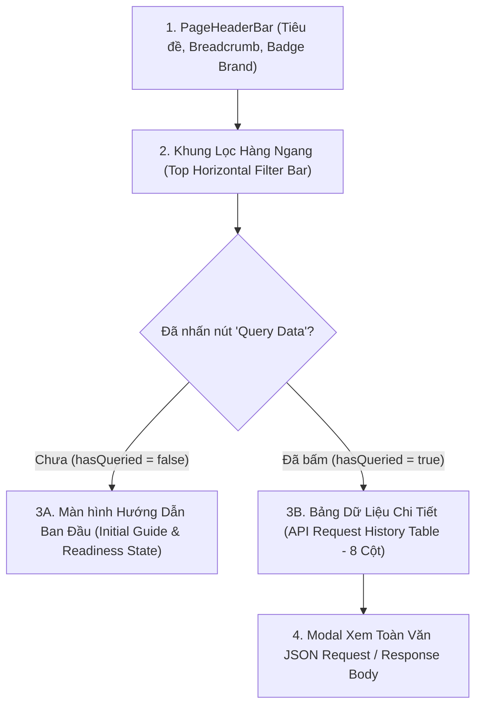

# KẾ HOẠCH TRIỂN KHAI GIAO DIỆN API REQUEST HISTORY (`/api/request-log`)

> **Tài liệu tham chiếu:** Plan thiết kế và kiến trúc giao diện cho màn hình Giám Sát & Nhật Ký Yêu Cầu API (API Request History / Log Dashboard).  
> **Áp dụng cho route:** `/api/request-log` (thuộc nhóm menu **QUẢN LÝ API (`api_request`) -> NHẬT KÝ YÊU CẦU API (`api_request_log`)**).  
> **Component đích:** `src/features/api_management/api_request_history/ApiRequestHistoryPage.jsx`.  
> **Đặc tả kiến trúc:** Thiết kế theo mô hình **Module Hóa Tối Đa (Component-Driven Architecture)** — Tách độc lập Khung lọc hàng ngang, Bảng dữ liệu có điều kiện, Modal xem JSON payload toàn văn, và Custom Hook quản lý trạng thái truy vấn.  
> **Ngày khởi tạo:** 06/11/2026.  
> **Vị trí tài liệu:** `src/md/API_REQUEST_HISTORY_PLAN.md` (đồng bộ tại `md/API_REQUEST_HISTORY_PLAN.md`).

---

## 1. TỔNG QUAN VÀ MỤC TIÊU DỰ ÁN

Giao diện **API Request History (`/api/request-log`)** là trung tâm kiểm soát và đối soát lưu lượng mạng (Network & API Traffic Audit Cockpit) cho các dịch vụ kết nối giữa tầng thiết bị (PLC, Camera AI, Đầu đọc RFID), hệ thống điều khiển chuyền (ALABEL Engine, SFC Switch / Adapter Gateway) và máy chủ CSDL trung tâm trong các nhà máy thông minh Foxconn & NVIDIA.

### Mục Tiêu Cốt Lõi:
1. **Giám sát lưu lượng API chính xác và trực quan**: Hỗ trợ kỹ sư phần mềm, kỹ sư tự động hóa và quản trị hệ thống theo dõi toàn bộ request/response HTTP/REST phát sinh trong dây chuyền.
2. **Khung lọc hàng ngang đa tiêu chí (Top Horizontal Filter Bar)**: Cung cấp bộ lọc dàn đều trên 1 hàng ngang với bộ chọn Ngày & Giờ linh hoạt, 5 dropdown menu chuyên sâu và nút bấm thực thi truy vấn.
3. **Hiển thị bảng dữ liệu có điều kiện (Conditional Table Display)**: Bảng dữ liệu chỉ xuất hiện khi người dùng chủ động nhấn nút **"Query Data"**. Trước khi bấm, giao diện hiển thị trạng thái hướng dẫn ban đầu (Initial Guide State) thân thiện, tinh gọn, tránh tải thừa dữ liệu.
4. **Đối soát nhanh dữ liệu Payload**: Cho phép xem nhanh và mở rộng toàn văn Request Body / Response Body dưới định dạng JSON có tô màu cú pháp (Syntax Highlighted) và nút sao chép 1-click.
5. **Tương thích hoàn hảo 2 thương hiệu Foxconn (Light) vs NVIDIA (Dark)**: Độ tương phản cao, phông chữ Mono công nghiệp cho dữ liệu kỹ thuật và không có tình trạng đen chìm màu chữ.

---

## 2. BỐ CỤC KHÔNG GIAN VÀ ĐẶC TẢ CHI TIẾT

Giao diện bao gồm 3 phân khu chính xếp theo chiều dọc:



---

### PHÂN ĐOẠN 1: KHUNG LỌC HÀNG NGANG (TOP HORIZONTAL FILTER BAR)

Toàn bộ các trường lọc được xếp theo **hàng ngang liền mạch (Single Horizontal Grid / Flex Row)**, tự động co giãn theo độ phân giải màn hình (`grid grid-cols-1 md:grid-cols-3 lg:grid-cols-7 gap-3`):

| STT | Tên Trường Lọc | Kiểu Điều Khiển | Đặc Tả & Dữ Liệu Tùy Chọn |
| :---: | :--- | :---: | :--- |
| **1** | **Date & Time** | **Lịch & Thời Gian** (DateTime-Local) | Hỗ trợ chọn chính xác ngày, giờ, phút (`<input type="datetime-local" />`). Mặc định khởi tạo từ đầu ca làm việc hiện tại (hoặc 24 giờ gần nhất). |
| **2** | **Area** | **Dropdown Menu** | Danh mục khu vực / xưởng sản xuất: `-- Tất Cả Khu Vực --`, `SMT Area (Xưởng Dán Bề Mặt)`, `Board Assembly (Lắp Ráp Bo Mạch)`, `ICT / FCT Testing (Khu Kiểm Thử)`, `Pressfit Area`, `Packaging & Warehouse`. |
| **3** | **Controller** | **Dropdown Menu** | Danh mục API Controller nghiệp vụ: `-- Tất Cả Controller --`, `SfcSwitchController`, `SfcAdapterController`, `AlabelProcessController`, `CarrierTrackingController`, `MachineConfigController`, `AuthenticationController`. |
| **4** | **Action** | **Dropdown Menu** | Danh mục phương thức / hành động gọi: `-- Tất Cả Action --`, `InsertSerialNumber`, `CheckSerialNumber`, `CheckKeyParts`, `InsertTestResult`, `TransferCarrier`, `UndoRouterStep`, `ClearUndoRework`, `GetAccessToken`. |
| **5** | **Client IP** | **Dropdown Menu** | Danh sách IP nguồn của trạm máy / Gateway: `-- Tất Cả IP --`, `192.168.10.45 (ALABEL-GW-01)`, `192.168.10.102 (SFC-DISPATCH-01)`, `192.168.10.103 (TEST-STATION-03)`, `10.12.88.21 (CLOUD-SYNC-NODE)`, `127.0.0.1 (Localhost)`. |
| **6** | **Select Top** | **Dropdown Menu** | Giới hạn số lượng bản ghi trả về: `Top 50 bản ghi`, `Top 100 bản ghi (Khuyến nghị)`, `Top 200 bản ghi`, `Top 500 bản ghi`, `Top 1000 bản ghi`. |
| **7** | **Query Data Button** | **Nút Hành Động** | Nút bấm chính **`[🔍 Query Data]`** (kèm hiệu ứng loading spinner khi đang fetch dữ liệu, nút phụ làm sạch bộ lọc `[🧹 Reset]`). |

---

### PHÂN ĐOẠN 2: TRẠNG THÁI TRƯỚC KHI TRUY VẤN (INITIAL GUIDE STATE)

- **Cơ chế:** Khi người dùng vừa tải trang hoặc vừa làm mới (`hasQueried === false`), bảng dữ liệu **sẽ ẩn hoàn toàn**.
- **Hiển thị thay thế:** Một khung card giới thiệu trực quan, sạch đẹp:
  - Biểu tượng radar quét mạng / API icon động.
  - Thông điệp hướng dẫn rõ ràng: *"Vui lòng thiết lập bộ lọc thời gian, khu vực, Controller tương ứng ở khung phía trên và nhấn nút **Query Data** để tải nhật ký yêu cầu API."*
  - Badge trạng thái kết nối CSDL và các thông số gợi ý nhanh (Ví dụ: Các Controller thường dùng nhất, số lượng bản ghi ước tính).

---

### PHÂN ĐOẠN 3: BẢNG DỮ LIỆU NHẬT KÝ API (CONDITIONAL REQUEST LOGS TABLE)

Bảng dữ liệu chỉ xuất hiện ngay sau khi người dùng nhấn **"Query Data"** (`hasQueried === true`). Bảng gồm đúng **8 trường thông tin (cột)** theo yêu cầu:

| Cột | Tiêu Đề Cột | Định Dạng Dữ Liệu | Đặc Tả Hiển Thị & Hành Vi Tương Tác |
| :---: | :--- | :---: | :--- |
| **1** | **Client IP** | Font Mono, Bold | Hiển thị địa chỉ IPv4 máy trạm gửi bản tin (kèm icon máy trạm 🖥️). |
| **2** | **Method** | Badge màu HTTP | Badge phương thức HTTP chuẩn quốc tế: <br>• **`GET`**: Xanh dương (`blue-500`) <br>• **`POST`**: Xanh lá cây (`emerald-500` / `#76B900`) <br>• **`PUT`**: Vàng hổ phách (`amber-500`) <br>• **`DELETE`**: Đỏ hồng (`rose-500`) <br>• **`PATCH`**: Tím (`purple-500`). |
| **3** | **Url** | Font Mono, Path | Đường dẫn endpoint API (ví dụ `/api/v1/sfc/switch/insert-sn`), tự động cắt gọn có tooltip và copy URL nhanh. |
| **4** | **Status Code** | Badge HTTP Status | Badge mã phản hồi HTTP: <br>• **200, 201**: Xanh lá (`200 OK`) <br>• **400, 401, 403**: Vàng cam (`400 Bad Request`) <br>• **500, 502, 503**: Đỏ sẫm (`500 Server Error`). |
| **5** | **Request Time** | Datetime (YYYY-MM-DD HH:mm:ss.SSS) | Thời điểm chính xác microsecond khi máy chủ tiếp nhận request. |
| **6** | **Processing Time** | Font Mono + Đơn vị `ms` | Thời gian xử lý: <br>• `< 50ms`: Xanh lá (Rất nhanh) <br>• `50ms - 200ms`: Vàng cam (Bình thường) <br>• `> 200ms`: Đỏ (Cần tối ưu). |
| **7** | **Request Body** | Full JSON Prettified | Hiển thị toàn văn đầy đủ cấu trúc JSON có định dạng thụt lề chuẩn RFC 8259, cuộn mượt dọc/ngang, nút sao chép `[📋 Chép]` trực tiếp và nút `[⛶ Phóng to]` mở modal. |
| **8** | **Response Body** | Full JSON Prettified | Hiển thị toàn văn đầy đủ phản hồi máy chủ với viền và màu sắc trạng thái (Xanh ngọc cho 2xx, Đỏ/Hổ phách cho 4xx/5xx), nút sao chép `[📋 Chép]` trực tiếp và nút `[⛶ Phóng to]`. |

---

### PHÂN ĐOẠN 4: HỘP THOẠI XEM TOÀN VĂN JSON PAYLOAD (JSON VIEWER MODAL)

Khi người dùng nhấn vào cột **Request Body** hoặc **Response Body**:
- Mở Modal xem toàn văn dữ liệu JSON được định dạng thụt lề chuẩn (Pretty Printed JSON).
- Nút bấm **`Sao Chép JSON`** vào clipboard với hiệu ứng phản hồi tích tắc (`✓ Đã sao chép`).
- Ô tìm kiếm / lọc từ khóa trong nội dung JSON.
- Đổi chế độ xem: Dạng cây thuộc tính (Tree View) hoặc mã nguồn thô (Raw JSON).

---

## 3. THIẾT KẾ ĐA THƯƠNG HIỆU: FOXCONN VS NVIDIA

Mọi thành phần tuân thủ nghiêm ngặt chuẩn thiết kế hai thương hiệu:

| Yếu Tố Giao Diện | Chế Độ Foxconn (Light Brand) | Chế Độ NVIDIA (Dark Brand) |
| :--- | :--- | :--- |
| **Nền Trang & Container** | `bg-slate-50`, card `bg-white`, viền `border-slate-200/90` | `bg-zinc-950`, card `bg-zinc-900/90`, viền `border-zinc-800` |
| **Màu Chữ Tiêu Đề** | `text-slate-800`, font đậm, độ tương phản cao | `text-zinc-100` / `text-white` (trắng tinh không mờ) |
| **Màu Chữ Nhãn Label** | `text-slate-700 font-bold` | `text-zinc-200 font-bold` |
| **Màu Chữ Phụ & Timestamp**| `text-slate-500 font-semibold` | `text-zinc-400 font-semibold` |
| **Nút "Query Data"** | `bg-blue-600 hover:bg-blue-700 text-white shadow-blue-600/20` | `bg-[#76B900] hover:bg-[#86d400] text-black font-extrabold shadow-[#76B900]/20` |
| **Trường Input / Select** | `bg-slate-50 border-slate-300 text-slate-800 focus:bg-white focus:border-blue-500` | `bg-zinc-950/80 border-zinc-700 text-zinc-100 focus:border-[#76B900]` |
| **Dòng Trống / Hướng Dẫn** | `text-slate-500 bg-blue-50/40 border-blue-200/60` | `text-zinc-400 bg-zinc-900/60 border-zinc-800` |
| **Khung Code JSON** | `bg-slate-950 text-slate-100 border-slate-800` | `bg-zinc-950 text-zinc-200 border-zinc-800` |

---

## 4. KIẾN TRÚC MODULE HÓA THƯ MỤC DỰ ÁN

Để đảm bảo khả năng bảo trì, mở rộng và tuân thủ các nguyên tắc Single Responsibility, cấu trúc mã nguồn sẽ được đặt tại:
`src/features/api_management/api_request_history/`

```
src/features/api_management/api_request_history/
├── ApiRequestHistoryPage.jsx           # Component trang gốc, gắn kết header, filter và table
├── components/
│   ├── ApiRequestFilterBar.jsx         # Khung 7 trường lọc xếp theo hàng ngang
│   ├── ApiRequestLogsTable.jsx         # Bảng 8 cột dữ liệu nhật ký API
│   ├── ApiRequestInitialGuideState.jsx # Giao diện hướng dẫn ban đầu khi chưa Query
│   ├── ApiRequestJsonModal.jsx         # Modal xem & copy toàn văn JSON Request/Response
│   ├── ApiRequestStatsSummary.jsx      # Thẻ thống kê nhanh (Tổng request, Thành công, Lỗi, Latency TB)
│   └── index.js                        # Barrel export các components
├── hooks/
│   └── useApiRequestHistoryData.js     # Custom hook quản lý logic filter, query, phân trang & modal
└── constants/
    └── apiRequestHistoryConstants.js   # Danh mục Area, Controller, Action, IP, Top Limit & Mock Data
```

---

## 5. ĐẶC TẢ SCHEMA DỮ LIỆU (DATA MODEL CONTRACT)

Mỗi bản ghi nhật ký yêu cầu API trong CSDL có cấu trúc mẫu như sau:

```typescript
interface ApiRequestLogItem {
  id: string;               // Mã định danh bản ghi: 'REQ-20261106-0091'
  clientIp: string;         // Địa chỉ IP nguồn: '192.168.10.45'
  method: 'GET' | 'POST' | 'PUT' | 'DELETE' | 'PATCH'; // Phương thức HTTP
  url: string;              // Đường dẫn API: '/api/v1/sfc/switch/insert-sn'
  statusCode: number;       // HTTP Status Code: 200, 201, 400, 500
  statusText: string;       // Mô tả mã: 'OK', 'Bad Request', 'Internal Error'
  requestTime: string;      // Thời gian gửi: '2026-11-06 09:45:12.318'
  processingTimeMs: number; // Thời gian xử lý: 28 (đơn vị ms)
  area: string;             // Khu vực: 'SMT Area', 'Assembly Area'
  controller: string;       // Tên Controller: 'SfcSwitchController'
  action: string;           // Tên Action: 'InsertSerialNumber'
  requestHeaders?: Record<string, string>;
  requestBody: Record<string, any> | string;   // Dữ liệu payload gửi lên
  responseBody: Record<string, any> | string;  // Dữ liệu payload phản hồi
}
```

---

## 6. LỘ TRÌNH THỰC THI (STEP-BY-STEP IMPLEMENTATION ROADMAP)

- [ ] **Bước 1: Khởi tạo Hằng Số & Mock Data (`apiRequestHistoryConstants.js`)**
  - Khởi tạo danh sách các tùy chọn cho 5 Dropdown menu: `AREAS`, `CONTROLLERS`, `ACTIONS`, `CLIENT_IPS`, `TOP_LIMIT_OPTIONS`.
  - Khởi tạo 20+ bản ghi mẫu phong phú với đa dạng method HTTP (GET, POST, PUT, DELETE), đa dạng Controller (SFC Switch, Adapter, ALABEL, Carrier), các mã lỗi 200, 400, 500 và độ trễ khác nhau.

- [ ] **Bước 2: Xây dựng Custom Hook (`useApiRequestHistoryData.js`)**
  - Quản lý state bộ lọc: `filters = { dateTime, area, controller, action, clientIp, topLimit }`.
  - Quản lý state truy vấn: `hasQueried` (boolean, mặc định `false`), `isQuerying` (boolean xoay loading).
  - Quản lý dữ liệu trả về: `logs`, `statsSummary` (Tổng, Tỷ lệ thành công, Latency trung bình).
  - Quản lý Modal JSON Viewer: `selectedJsonData`, `modalType` ('request' | 'response'), `isModalOpen`.
  - Hàm `handleExecuteQuery()`: Giả lập gọi API với thời gian trễ 400ms và cập nhật `hasQueried = true`.
  - Hàm `handleResetFilters()`: Khôi phục toàn bộ lọc về mặc định.

- [ ] **Bước 3: Xây dựng Khung Lọc Hàng Ngang (`ApiRequestFilterBar.jsx`)**
  - Thiết kế bố cục hàng ngang với tiêu đề lọc và nút làm sạch.
  - Trường 1: Input lịch & giờ (`type="datetime-local"`).
  - Trường 2 đến 6: Dropdown select `Area`, `Controller`, `Action`, `Client IP`, `Select Top`.
  - Trường 7: Nút `Query Data` nổi bật, tích hợp spinner và hiệu ứng phản hồi xúc giác.

- [ ] **Bước 4: Xây dựng Giao Diện Hướng Dẫn Ban Đầu (`ApiRequestInitialGuideState.jsx`)**
  - Xuất hiện khi `hasQueried === false`.
  - Thiết kế card hướng dẫn trực quan, thẩm mỹ cao cho cả Foxconn và NVIDIA mode.

- [ ] **Bước 5: Xây dựng Bảng Dữ Liệu 8 Cột (`ApiRequestLogsTable.jsx`)**
  - Xuất hiện khi `hasQueried === true`.
  - Render 8 cột: `Client IP`, `Method`, `Url`, `Status Code`, `Request Time`, `Processing Time`, `Request Body`, `Response Body`.
  - Badge màu sắc chuẩn hóa cho Method và Status Code.
  - Nút xem nhanh Payload mở Modal.
  - Phân trang hoặc hiển thị đủ Top Limit đã chọn.

- [ ] **Bước 6: Xây dựng Hộp Thoại Xem JSON Payload (`ApiRequestJsonModal.jsx`)**
  - Xem định dạng Pretty JSON với nút sao chép `Sao Chép JSON` 1-click.

- [ ] **Bước 7: Tích hợp Routing & Menu (`routesConfig.jsx` & `Menu.jsx`)**
  - Đăng ký route `/api/request-log` trong `src/routes/routesConfig.jsx`.
  - Kết nối với mục menu đã có sẵn trong `src/utils/Menu.jsx` (`api_request -> api_request_log`).

- [ ] **Bước 8: Kiểm Thử Toàn Diện & Build Verification**
  - Kiểm tra chuyển đổi thương hiệu Foxconn vs NVIDIA.
  - Chạy `npm run build` để đảm bảo 100% không có lỗi cú pháp hoặc đường dẫn import.
