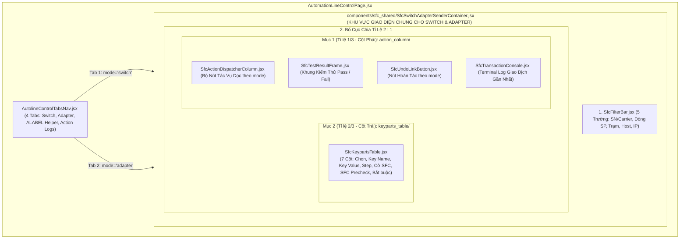
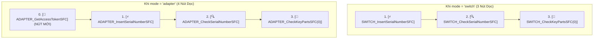

# KẾ HOẠCH TRIỂN KHAI GIAO DIỆN ĐIỀU KHIỂN CHUYỀN TỰ ĐỘNG (`/config/automation-line` - AUTOLINE CONTROL)

> **Tài liệu tham chiếu:** Thiết kế chi tiết kiến trúc giao diện, luồng dữ liệu và tích hợp giao thức SFC (Shop Floor Control) cho phân hệ **Điều Khiển Chuyền Tự Động** (Automation Line Control).  
> **Áp dụng cho route:** `/config/automation-line` (thuộc nhóm menu **CONFIG**).  
> **Component điều phối chính:** `src/features/config/automation_line_control/AutomationLineControlPage.jsx`.  
> **Mô hình kiến trúc cốt lõi:** **Tái Sử Dụng Giao Diện Đa Năng (Universal Reusable SFC Sender Architecture)** — Thiết kế một component khung dùng chung (`SfcSwitchAdapterSenderContainer.jsx` đặt tại `components/sfc_shared/`) cho cả 2 tab: **SFC Switch Helpers** và **SFC Adapter Helpers**, tham số hóa linh hoạt qua thuộc tính `mode = 'switch' | 'adapter'`. Tích hợp phân hệ **ALABEL_Helper** (thay thế AIOT Helpers) chuyên trách tra cứu tiến trình sản xuất và điều khiển tác vụ dây chuyền.  
> **Hỗ trợ giao diện kép:** Chuẩn công nghiệp Foxconn (Industrial Clean Blue) và Nhà máy AI NVIDIA (High Contrast Pure White / Emerald `#76B900`).  
> **Ngày cập nhật:** 04/11/2026 (Chuẩn hóa tên component thực thi chung `SfcSwitchAdapterSenderContainer.jsx` trong `components/sfc_shared/`; Triển khai hoàn chỉnh phân hệ ALABEL_Helper 7 sub-tabs).  
> **Vị trí tài liệu:** `md/AUTOLINE_CONTROL_PLAN.md` (đồng bộ tại `src/md/AUTOLINE_CONTROL_PLAN.md`).

---

## 1. TỔNG QUAN VÀ MỤC TIÊU KIẾN TRÚC TÁI SỬ DỤNG

Phân hệ **Điều Khiển Chuyền Tự Động (`/config/automation-line`)** đóng vai trò là trạm điều hành kỹ thuật trung tâm (Engineering Dispatch & SFC Control Console) cho dây chuyền sản xuất tự động hóa cao cấp trong nhà máy thông minh Foxconn / NVIDIA.

### 1.1. Mục Tiêu Tái Sử Dụng Giữa Tab Switch Helpers & Tab Adapter Helpers:

Trong quy trình vận hành nhà máy, hai giao thức **SFC Switch** (giao tiếp trực tiếp switch layer) và **SFC Adapter** (giao tiếp qua adapter middleware gateway) có cấu trúc dữ liệu, tiêu chí lọc, danh sách linh kiện và quy trình kiểm thử **hoàn toàn tương đồng 100%**, chỉ khác biệt ở:

1. **Tiền tố của các nút tác vụ điều phối:** `SWITCH_...` đối với Tab Switch Helpers, và `ADAPTER_...` đối với Tab Adapter Helpers.
2. **Nút bổ sung đặc thù của Adapter:** Tab Adapter có thêm nút **`ADAPTER_GetAccessTokenSFC`** ở đầu danh sách tác vụ để lấy mã xác thực (Bearer/Token) từ Adapter Gateway trước khi thực hiện các giao dịch kế tiếp.
3. **Endpoint & Mã lệnh tương ứng:** Các hành động gửi test result và hoàn tác liên kết được ánh xạ thành `Adapter_InsertTestResultSFC` và `ADAPTER_UndoLinkSFC`.

Nhờ kiến trúc **Universal Reusable Container**, toàn bộ giao diện bộ lọc 5 trường, bảng SFC Keyparts 7 cột, khung kiểm thử Pass/Fail, modal xác nhận Undo, và Terminal console giám sát giao dịch đều được **dùng lại 100% (Zero Code Duplication)** giữa 2 tab.

### 1.2. Chuẩn Hóa Cấu Trúc Thư Mục Giao Diện Chung: Tách Riêng `components/sfc_shared/`

- **Vấn đề của cấu trúc cũ (`components/sfc_switch/`):**
  Trước đây, toàn bộ giao diện chung được đặt trong thư mục mang tên `sfc_switch`. Tên gọi này gây hiểu nhầm nghiêm trọng: khi nhìn vào cấu trúc thư mục, lập trình viên dễ lầm tưởng các component này chỉ phục vụ cho riêng Tab 1 (SFC Switch), dẫn đến việc khó tìm kiếm các thành phần của SFC Adapter hoặc có thể code trùng lặp một giao diện Adapter riêng.
- **Giải pháp cấu trúc mới:**
  1. **Tạo phân khu dùng chung rõ ràng `components/sfc_shared/`:** Đổi tên và chuyển toàn bộ component tái sử dụng vào `src/features/config/automation_line_control/components/sfc_shared/`.
  2. **Trách nhiệm rõ ràng:** Thư mục này là nơi duy nhất tạo và đóng gói giao diện tương tác SFC (Thanh lọc, Bảng Keyparts, Cột điều phối tác vụ dọc, Terminal Console và Modal Undo) cho cả 2 tab Switch & Adapter thông qua component thực thi chung mang tên **`SfcSwitchAdapterSenderContainer.jsx`**.
  3. **Phân cấp kiến trúc trực quan:**
     - `components/tabs/`: Nơi điều phối các Tab cấp cao (`AutolineControlTabsNav.jsx`, `AlabelHelperTab.jsx`, `ActionLogsRestoreTab.jsx`).
     - `components/sfc_shared/`: Nơi tạo giao diện chung cho cả Tab Switch và Tab Adapter thông qua `<SfcSwitchAdapterSenderContainer mode="switch" | "adapter" />`.
     - `components/tabs/alabel/`: Nơi chứa các component chuyên biệt của Tab ALABEL Helper.



---

## 2. BẢNG SO SÁNH GIAO DIỆN GIỮA TAB SWITCH VÀ TAB ADAPTER

Dưới đây là bảng đối chiếu chi tiết các thành phần giữa 2 tab khi tái sử dụng giao diện chung:

| Thành phần / Tiêu chí             | Tab 1: SFC Switch Helpers (`mode='switch'`)                                        | Tab 2: SFC Adapter Helpers (`mode='adapter'`)                                      | Ghi chú kiến trúc                          |
| :-------------------------------- | :--------------------------------------------------------------------------------- | :--------------------------------------------------------------------------------- | :----------------------------------------- |
| **Tiêu đề Khung chính**           | `SFC SWITCH KEYPART & ACTION SENDER`                                               | `SFC ADAPTER KEYPART & ACTION SENDER`                                              | Đổi nhãn động theo prop `mode`             |
| **Thanh lọc 5 trường ngang**      | Giống nhau 100% _(SN/Carrier, Dòng SP, Trạm, Host, Station IP)_                    | Giống nhau 100% _(SN/Carrier, Dòng SP, Trạm, Host, Station IP)_                    | Dùng chung `SfcFilterBar.jsx`              |
| **Bảng SFC Keyparts (Tỉ lệ 2/3)** | Giống nhau 100% _(7 cột: Chọn, Key Name, Key Value, Step, Cờ, Precheck, Bắt buộc)_ | Giống nhau 100% _(7 cột: Chọn, Key Name, Key Value, Step, Cờ, Precheck, Bắt buộc)_ | Dùng chung `SfcKeypartsTable.jsx`          |
| **Số lượng nút tác vụ dọc**       | **3 nút xếp dọc**                                                                  | **4 nút xếp dọc (Bổ sung nút Token)**                                              | Tự động render theo cấu hình mode          |
| **Nút 1 (Đặc thù)**               | _Không có_                                                                         | **`[🔑 ADAPTER_GetAccessTokenSFC]`**                                               | **Nút mới:** Lấy token xác thực từ Adapter |
| **Nút 2**                         | `[⚡ SWITCH_InsertSerialNumberSFC]`                                                | `[⚡ ADAPTER_InsertSerialNumberSFC]`                                               | Đăng ký SN vào trạm qua Adapter            |
| **Nút 3**                         | `[🔍 SWITCH_CheckSerialNumberSFC]`                                                 | `[🔍 ADAPTER_CheckSerialNumberSFC]`                                                | Kiểm tra Router SN qua Adapter             |
| **Nút 4**                         | `[🧩 SWITCH_CheckKeyPartsSFC(0)]`                                                  | `[🧩 ADAPTER_CheckKeyPartsSFC(0)]`                                                 | Kiểm tra Keyparts BOM qua Adapter          |
| **Khung kiểm thử - Hàng 1**       | Bộ đôi nút: `[Pass]` và `[Fail]`                                                   | Bộ đôi nút: `[Pass]` và `[Fail]`                                                   | Dùng chung `SfcTestResultFrame.jsx`        |
| **Khung kiểm thử - Hàng 2**       | `[Switch_InsertTestResultSFC(PASS/FAIL)]`                                          | `[Adapter_InsertTestResultSFC(PASS/FAIL)]`                                         | Đổi tiền tố `Switch_` thành `Adapter_`     |
| **Nút Hoàn tác liên kết**         | `[↩️ SWITCH_UndoLinkSFC]`                                                          | `[↩️ ADAPTER_UndoLinkSFC]`                                                         | Đổi tiền tố `SWITCH_` thành `ADAPTER_`     |
| **Modal xác nhận Undo**           | Xác nhận hoàn tác SFC Switch Link                                                  | Xác nhận hoàn tác SFC Adapter Link                                                 | Dùng chung `UndoLinkConfirmModal.jsx`      |
| **Khung Log giao dịch**           | Terminal log phản hồi từ SFC Switch                                                | Terminal log phản hồi từ SFC Adapter Gateway                                       | Dùng chung `SfcTransactionConsole.jsx`     |

---

## 3. SƠ ĐỒ BỐ CỤC KHÔNG GIAN GIAO DIỆN (UI WIREFRAME & MOCKUP)

### 3.1. Giao Diện Chung Khi Chọn Tab 1: `SFC Switch Helpers` (`mode='switch'`)

```text
┌────────────────────────────────────────────────────────────────────────────────────────────────────────────────────────┐
│ CONFIG > AUTOMATION LINE CONTROL                              [Dừng Khẩn Cấp E-STOP]  [Khởi Động Dây Chuyền]  [Full]  │
│ Bảng điều khiển tập trung: SFC Helpers, Bắn lệnh SFC Switch/Adapter, Kiểm thử linh kiện và Giám sát giao dịch         │
├────────────────────────────────────────────────────────────────────────────────────────────────────────────────────────┤
│  [★ SFC Switch Helpers]   [  SFC Adapter Helpers  ]   [  ALABEL Helper  ]   [  Action Logs & Restore  ]                 │
├────────────────────────────────────────────────────────────────────────────────────────────────────────────────────────┤
│ ┌─ KHUNG: SFC SWITCH KEYPART & ACTION SENDER ────────────────────────────────────────────────────────────────────────┐ │
│ │                                                                                                                     │ │
│ │ ── THANH LỌC THÔNG TIN (5 TRƯỜNG NGANG) ────────────────────────────────────────────────────────────────────────── │ │
│ │ ┌───────────────────┐ ┌────────────────────┐ ┌───────────────────┐ ┌───────────────────┐ ┌────────────────────┐   │ │
│ │ │ 🔍 Tìm SN/Carrier │ │ Dòng SP (Model) ▼  │ │ Trạm (Group) ▼    │ │ Host              │ │ Station IP         │   │ │
│ │ │ [SN8839210492...] │ │ [HGX B200 NVL  ]   │ │ [ST03-SMT-A   ]   │ │ [sfc-host-01.fii] │ │ [192.168.10.45 ]   │   │ │
│ │ └───────────────────┘ └────────────────────┘ └───────────────────┘ └───────────────────┘ └────────────────────┘   │ │
│ │                                                                                                                     │ │
│ │ ── BỐ CỤC 2 : 1 ─────────────────────────────────────────────────────────────────────────────────────────────────── │ │
│ │ ┌───────────────────────────────────────────────────────┬─────────────────────────────────────────────────────────┐ │ │
│ │ │ MỤC 2 (TỈ LỆ 2/3): BẢNG SFC KEYPARTS CỦA SN           │ MỤC 1 (TỈ LỆ 1/3): TÁC VỤ GỬI SFC SWITCH                │ │ │
│ │ ├───────────────────────────────────────────────────────┼─────────────────────────────────────────────────────────┤ │ │
│ │ │ [x] Chọn | Key Name   | Key Value | Step | Cờ | Pre | BB  │  ┌───────────────────────────────────────────────────┐  │ │ │
│ │ ├───┼───────────┼───────────┼──────┼────┼─────┼─────┤  │  [⚡ SWITCH_InsertSerialNumberSFC                  ]  │  │ │ │
│ │ │ ☑ │ MOTHERBRD │ MB-994821 │ 010  │ Y  │ PASS│ YES │  ├───────────────────────────────────────────────────┤  │ │ │
│ │ │ ☑ │ GPU_01    │ GPU-NV-01 │ 020  │ Y  │ PASS│ YES │  │  [🔍 SWITCH_CheckSerialNumberSFC                   ]  │  │ │ │
│ │ │ ☑ │ GPU_02    │ GPU-NV-02 │ 020  │ Y  │ PASS│ YES │  ├───────────────────────────────────────────────────┤  │ │ │
│ │ │ ☑ │ HEATSINK  │ HS-BLK-88 │ 030  │ Y  │ PASS│ NO  │  │  [🧩 SWITCH_CheckKeyPartsSFC(0)                    ]  │  │ │ │
│ │ │ ☐ │ MAC_ADDR  │ 00:1B:44..│ 040  │ N  │ PEND│ YES │  └───────────────────────────────────────────────────┘  │ │ │
│ │ │   │           │           │      │    │     │     │                                                         │ │ │
│ │ │   │           │           │      │    │     │     │  ┌─ KHUNG KẾT QUẢ KIỂM THỬ ──────────────────────────┐  │ │ │
│ │ │   │           │           │      │    │     │     │  │  [✅ Pass]                   [❌ Fail]             │  │ │ │
│ │ │   │           │           │      │    │     │     │  │  [🚀 Switch_InsertTestResultSFC(PASS)            ] │  │ │ │
│ │ │   │           │           │      │    │     │     │  └───────────────────────────────────────────────────┘  │ │ │
│ │ │   │           │           │      │    │     │     │                                                         │ │ │
│ │ │   │           │           │      │    │     │     │  [↩️  SWITCH_UndoLinkSFC                              ]  │ │ │
│ │ │   │           │           │      │    │     │     │                                                         │ │ │
│ │ │   │           │           │      │    │     │     │  ┌─ KẾT QUẢ GIAO DỊCH GẦN NHẤT (SFC SWITCH) ─────────┐  │ │ │
│ │ │   │           │           │      │    │     │     │  │  [Status: 200 OK]  ⚡ 38ms  Time: 09:45:12           │  │ │ │
│ │ │   │           │           │      │    │     │     │  │  Action: [SWITCH_CheckKeyPartsSFC(0)]              │  │ │ │
│ │ │   │           │           │      │    │     │     │  └───────────────────────────────────────────────────┘  │ │ │
│ │ └───┴───────────┴───────────┴──────┴────┴─────┴─────┴─────────────────────────────────────────────────────────┘ │ │
│ └─────────────────────────────────────────────────────────────────────────────────────────────────────────────────────┘ │
└────────────────────────────────────────────────────────────────────────────────────────────────────────────────────────┘
```

---

### 3.2. Giao Diện Chung Khi Chọn Tab 2: `SFC Adapter Helpers` (`mode='adapter'`)

```text
┌────────────────────────────────────────────────────────────────────────────────────────────────────────────────────────┐
│ CONFIG > AUTOMATION LINE CONTROL                              [Dừng Khẩn Cấp E-STOP]  [Khởi Động Dây Chuyền]  [Full]  │
│ Bảng điều khiển tập trung: SFC Helpers, Bắn lệnh SFC Switch/Adapter, Kiểm thử linh kiện và Giám sát giao dịch         │
├────────────────────────────────────────────────────────────────────────────────────────────────────────────────────────┤
│  [  SFC Switch Helpers  ]   [★ SFC Adapter Helpers]   [  ALABEL Helper  ]   [  Action Logs & Restore  ]              │
├────────────────────────────────────────────────────────────────────────────────────────────────────────────────────────┤
│ ┌─ KHUNG: SFC ADAPTER KEYPART & ACTION SENDER ───────────────────────────────────────────────────────────────────────┐ │
│ │                                                                                                                     │ │
│ │ ── THANH LỌC THÔNG TIN (5 TRƯỜNG NGANG - DÙNG CHUNG 100%) ───────────────────────────────────────────────────────── │ │
│ │ ┌───────────────────┐ ┌────────────────────┐ ┌───────────────────┐ ┌───────────────────┐ ┌────────────────────┐   │ │
│ │ │ 🔍 Tìm SN/Carrier │ │ Dòng SP (Model) ▼  │ │ Trạm (Group) ▼    │ │ Host              │ │ Station IP         │   │ │
│ │ │ [SN8839210492...] │ │ [HGX B200 NVL  ]   │ │ [ST03-SMT-A   ]   │ │ [adapter-gw.fii ] │ │ [192.168.10.45 ]   │   │ │
│ │ └───────────────────┘ └────────────────────┘ └───────────────────┘ └───────────────────┘ └────────────────────┘   │ │
│ │                                                                                                                     │ │
│ │ ── BỐ CỤC 2 : 1 ─────────────────────────────────────────────────────────────────────────────────────────────────── │ │
│ │ ┌───────────────────────────────────────────────────────┬─────────────────────────────────────────────────────────┐ │ │
│ │ │ MỤC 2 (TỈ LỆ 2/3): BẢNG SFC KEYPARTS (DÙNG CHUNG 100%)│ MỤC 1 (TỈ LỆ 1/3): TÁC VỤ GỬI SFC ADAPTER               │ │ │
│ │ ├───────────────────────────────────────────────────────┼─────────────────────────────────────────────────────────┤ │ │
│ │ │ [x] Chọn | Key Name   | Key Value | Step | Cờ | Pre | BB  │  ┌───────────────────────────────────────────────────┐  │ │ │
│ │ ├───┼───────────┼───────────┼──────┼────┼─────┼─────┤  │  [🔑 ADAPTER_GetAccessTokenSFC (Nút mới)          ]  │  │ │ │
│ │ │ ☑ │ MOTHERBRD │ MB-994821 │ 010  │ Y  │ PASS│ YES │  ├───────────────────────────────────────────────────┤  │ │ │
│ │ │ ☑ │ GPU_01    │ GPU-NV-01 │ 020  │ Y  │ PASS│ YES │  │  [⚡ ADAPTER_InsertSerialNumberSFC                 ]  │  │ │ │
│ │ │ ☑ │ GPU_02    │ GPU-NV-02 │ 020  │ Y  │ PASS│ YES │  ├───────────────────────────────────────────────────┤  │ │ │
│ │ │ ☑ │ HEATSINK  │ HS-BLK-88 │ 030  │ Y  │ PASS│ NO  │  │  [🔍 ADAPTER_CheckSerialNumberSFC                  ]  │  │ │ │
│ │ │ ☐ │ MAC_ADDR  │ 00:1B:44..│ 040  │ N  │ PEND│ YES │  ├───────────────────────────────────────────────────┤  │ │ │
│ │ │   │           │           │      │    │     │     │  │  [🧩 ADAPTER_CheckKeyPartsSFC(0)                   ]  │  │ │ │
│ │ │   │           │           │      │    │     │     │  └───────────────────────────────────────────────────┘  │ │ │
│ │ │   │           │           │      │    │     │     │                                                         │ │ │
│ │ │   │           │           │      │    │     │     │  ┌─ KHUNG KẾT QUẢ KIỂM THỬ (ADAPTER) ─────────────────┐  │ │ │
│ │ │   │           │           │      │    │     │     │  │  [✅ Pass]                   [❌ Fail]             │  │ │ │
│ │ │   │           │           │      │    │     │     │  │  [🚀 Adapter_InsertTestResultSFC(PASS)           ] │  │ │ │
│ │ │   │           │           │      │    │     │     │  └───────────────────────────────────────────────────┘  │ │ │
│ │ │   │           │           │      │    │     │     │                                                         │ │ │
│ │ │   │           │           │      │    │     │     │  [↩️  ADAPTER_UndoLinkSFC                             ]  │ │ │
│ │ │   │           │           │      │    │     │     │                                                         │ │ │
│ │ │   │           │           │      │    │     │     │  ┌─ KẾT QUẢ GIAO DỊCH GẦN NHẤT (SFC ADAPTER) ────────┐  │ │ │
│ │ │   │           │           │      │    │     │     │  │  [Status: 200 OK]  ⚡ 22ms  Time: 09:48:02           │  │ │ │
│ │ │   │           │           │      │    │     │     │  │  Action: [ADAPTER_GetAccessTokenSFC]               │  │ │ │
│ │ │   │           │           │      │    │     │     │  │  Token: Bearer eyJhbGciOiJIUzI1NiIsInR5cCI6IkpX... │  │ │ │
│ │ │   │           │           │      │    │     │     │  └───────────────────────────────────────────────────┘  │ │ │
│ │ └───┴───────────┴───────────┴──────┴────┴─────┴─────┴─────────────────────────────────────────────────────────┘ │ │
│ └─────────────────────────────────────────────────────────────────────────────────────────────────────────────────────┘ │
└────────────────────────────────────────────────────────────────────────────────────────────────────────────────────────┘
```

---

### 3.3. Giao Diện Khi Chọn Tab 3: `ALABEL Helper` (Bố Cục Tỉ Lệ 1 : 1 & Khối Log Thực Thi Phía Dưới)

Phân hệ **ALABEL_Helper** được thiết kế để thay thế hoàn toàn cho **AIOT Helpers**, tập trung vào chức năng tra cứu tiến trình đa tiêu chí và thực thi 7 nghiệp vụ điều khiển cốt lõi của hệ thống ALABEL:

```text
┌────────────────────────────────────────────────────────────────────────────────────────────────────────────────────────┐
│ CONFIG > AUTOMATION LINE CONTROL                              [Dừng Khẩn Cấp E-STOP]  [Khởi Động Dây Chuyền]  [Full]  │
│ Bảng điều khiển tập trung: SFC Helpers, Bắn lệnh SFC Switch/Adapter, ALABEL Helper và Giám sát giao dịch               │
├────────────────────────────────────────────────────────────────────────────────────────────────────────────────────────┤
│  [  SFC Switch Helpers  ]   [  SFC Adapter Helpers  ]   [★ ALABEL Helper  ]   [  Action Logs & Restore  ]              │
├────────────────────────────────────────────────────────────────────────────────────────────────────────────────────────┤
│ ┌─ KHUNG CHÍNH: PHÂN HỆ ALABEL HELPER (ĐIỀU HÀNH & TRA CỨU TIẾN TRÌNH DÂY CHUYỀN) ────────────────────────────────────┐ │
│ │                                                                                                                     │ │
│ │ ── PHẦN 1: BỐ CỤC CHIA HAI PHÍA (TỈ LỆ 1 : 1) ───────────────────────────────────────────────────────────────────── │ │
│ │ ┌───────────────────────────────────────────────────────┬─────────────────────────────────────────────────────────┐ │ │
│ │ │ MỤC 1 (PHÍA TRÁI - TỈ LỆ 1/2): TRA CỨU TIẾN TRÌNH     │ MỤC 2 (PHÍA PHẢI - TỈ LỆ 1/2): THAO TÁC ĐIỀU KHIỂN ALABEL│ │ │
│ │ ├───────────────────────────────────────────────────────┼─────────────────────────────────────────────────────────┤ │ │
│ │ │ 🔍 TIÊU CHÍ TRA CỨU (Chọn 1 trong 3):                 │ ⚙️ BẢNG ĐIỀU KHIỂN TÁC VỤ ALABEL                         │ │ │
│ │ │ (•) Serial Number (SN)   ( ) Carrier   ( ) Keypart    │ ┌─────────────────────────────────────────────────────┐ │ │ │
│ │ │ ┌───────────────────────────────────────────────────┐ │ │ [★ Undo/Reset] [Transfer] [Clear Undo] [Bù sn_detail]│ │ │ │
│ │ │ │ Nhập SN / Mã Pallet Carrier / Barcode Keypart... │ │ │ [Đổi Keypart] [SNDetails] [Error Logs]               │ │ │ │
│ │ │ └───────────────────────────────────────────────────┘ │ └─────────────────────────────────────────────────────┘ │ │ │
│ │ │                                                       │                                                         │ │ │
│ │ │ 🏷️ DÒNG SẢN PHẨM (MODEL):                             │ ── KHU VỰC THAO TÁC THEO TAB (ĐANG CHỌN: UNDO / RESET) ── │ │ │
│ │ │ ┌───────────────────────────────────────────────────┐ │ ┌─────────────────────────────────────────────────────┐ │ │ │
│ │ │ │ [Tự động nhận diện từ hệ thống...               ] │ │ │ Dòng 1: Mã Đối Tượng: [★ SN] [ Carrier ] (Tab chuyển)│ │ │ │
│ │ │ └───────────────────────────────────────────────────┘ │ │ ┌─────────────────────────────────────────────────┐ │ │ │ │
│ │ │ ℹ️ Chú thích: Tự động nhận diện nếu để trống          │ │ │ Nhập Serial Number (SN) / Carrier RFID...       │ │ │ │ │
│ │ │ [▶ Mở rộng Dropdown chọn Model từ CSDL (Ẩn mặc định)] │ │ └─────────────────────────────────────────────────┘ │ │ │ │
│ │ │   └─ [HGX B200 NVL ▼] (Được nạp động từ CSDL)         │ │ Dòng 2:                                             │ │ │ │
│ │ │                                                       │ │ • Dòng SP (Model):       • Mã NV (Tự truy xuất):    │ │ │ │
│ │ │ ── KẾT QUẢ TIẾN TRÌNH HIỆN TẠI CỦA ĐỐI TƯỢNG ───────── │ │   [HGX B200 NVL        ▼]  [NV-2026-08819 🔒      ]│ │ │ │
│ │ │ • Đối tượng: SN8839210492 | Loại: SERIAL NUMBER       │ │ ─────────────────────────────────────────────────── │ │ │ │
│ │ │ • Dòng SP: HGX B200 NVL (Tự nhận diện từ DB: OK)      │ │ Chế độ: [★ Hoàn tác]   [ Reset Chu Kỳ ]             │ │ │ │
│ │ │ • Trạm hiện tại: ST03-SMT-A (Step: 030 - PRE-CHECK)   │ │ ┌─────────────────────────────────────────────────┐ │ │ │ │
│ │ │ • Mã Pallet / Carrier: CARRIER-RFID-8819              │ │ │ [Khi chọn Hoàn tác]:                            │ │ │ │ │
│ │ │ • Trạng thái Router: WIP (Đang thực hiện) | Pass: 2/3 │ │ │ • Hoàn tác về step: [Step 020 - SMT_SURFACE   ▼]│ │ │ │ │
│ │ │                                                       │ │ │ • [↩️ Thực thi hoàn tác về Step 020             ]│ │ │ │ │
│ │ │                                                       │ │ │ [Khi chọn Reset chu kỳ]:                        │ │ │ │ │
│ │ │                                                       │ │ │ • [⚡ Thực thi reset chu kỳ về Step 0            ]│ │ │ │ │
│ │ │                                                       │ │ └─────────────────────────────────────────────────┘ │ │ │ │
│ │ │                                                       │ └─────────────────────────────────────────────────────┘ │ │ │
│ │ └───────────────────────────────────────────────────────┴─────────────────────────────────────────────────────────┘ │ │
│ │                                                                                                                     │ │
│ │ ── PHẦN 2: MỤC LOG THỰC THI THAO TÁC ALABEL (FULL WIDTH - PHÍA DƯỚI 2 MỤC TRÊN) ─────────────────────────────────── │ │
│ │ ┌─────────────────────────────────────────────────────────────────────────────────────────────────────────────────┐ │ │
│ │ │ 📋 ALABEL OPERATION EXECUTION LOGS               [Bộ lọc: ALL ▼] [🔍 Tìm log...] [🧹 Xóa Terminal] [📥 Xuất Log]│ │ │
│ │ ├─────────────────────────────────────────────────────────────────────────────────────────────────────────────────┤ │ │
│ │ │ [09:50:12.140] [SUCCESS] [UNDO_RESET] SN: SN8839210492 | Trạm: ST03-SMT-A | Response: Reset Router OK (24ms)   │ │ │
│ │ │ [09:48:45.892] [SUCCESS] [COMPENSATE_DETAIL] SN: SN8839210492 | Bù trường: mac_eth0, vendor_pn | Updated 2 rows│ │ │
│ │ │ [09:47:10.024] [WARNING] [CHANGE_KEYPART] Đổi KP-GPU-01 -> KP-GPU-01-REV2 | Chờ SFC xác nhận đối chiếu (45ms)  │ │ │
│ │ │ [09:45:22.711] [ERROR]   [TRANSFER] SN: SN8839210488 -> ST04-TEST | ErrCode 409: Route sequence mismatch (18ms)│ │ │
│ │ │ [09:42:01.050] [INFO]    [CLEAR_UNDO] Carrier: CARRIER-RFID-8819 | Đã xóa trạng thái khóa Undo của trạm ST02   │ │ │
│ │ └─────────────────────────────────────────────────────────────────────────────────────────────────────────────────┘ │ │
│ └─────────────────────────────────────────────────────────────────────────────────────────────────────────────────────┘ │
└────────────────────────────────────────────────────────────────────────────────────────────────────────────────────────┘
```

---

## 4. ĐẶC TẢ CHI TIẾT CÁC THÀNH PHẦN GIAO DIỆN CHUNG

### 4.1. Thanh Lọc Thông Tin Ngang (5 Trường Lọc Dùng Chung)

Sử dụng chung component `SfcFilterBar.jsx`:

- **Trường 1 (Tìm SN/Carrier):** Text input đa năng hỗ trợ tìm theo cả mã sản phẩm hoặc mã khay chứa Pallet/Carrier RFID.
- **Trường 2 (Dòng sản phẩm):** Dropdown menu lựa chọn model (`HGX B200`, `GB200 NVL72`, `HGX H100`...).
- **Trường 3 (Trạm / Group):** Dropdown menu lựa chọn công đoạn (`SMT_ASSY`, `ICT_TEST`, `PRESSFIT_AUTO`...).
- **Trường 4 (Host):** Trường text cấu hình hostname SFC Server / Gateway.
- **Trường 5 (Station IP):** Trường text địa chỉ IP máy trạm.

### 4.2. Bảng Danh Sách SFC Keyparts Của SN (Tỉ Lệ 2/3 - Cột Trái Dùng Chung)

Sử dụng chung component `SfcKeypartsTable.jsx` hiển thị đầy đủ 7 cột:

1. `Chọn` (Checkbox từng dòng + Select All ở Header).
2. `Key Name` (Tên linh kiện kèm tag phân loại Board, Processor, Mechanical, Network, Memory...).
3. `Key Value` (Giá trị mã vạch định dạng font monospace + nút sao chép nhanh có phản hồi xanh lá).
4. `Step` (Bước quy trình: `010`, `020`, `030`...).
5. `Cờ SFC` (Huy hiệu cờ `Y` / `N`).
6. `SFC Precheck` (Badge trạng thái kiểm tra tiền điều kiện: `PASSED`, `WARNING`, `PENDING`).
7. `Bắt buộc` (Badge nổi bật màu đỏ `BẮT BUỘC` hoặc `TÙY CHỌN`).

---

### 4.3. Cột Tác Vụ Điều Phối (Tỉ Lệ 1/3 - Cột Phải Được Tham Số Hóa)

Sử dụng component `SfcActionDispatcherColumn.jsx` với prop `mode`:

#### 4.3.1. Danh sách các nút thao tác xếp theo hàng dọc:



1. **Nút mới đặc thù của Adapter: `ADAPTER_GetAccessTokenSFC`**
   - **Chỉ xuất hiện khi:** `mode === 'adapter'`.
   - **Vị trí:** Đặt ở vị trí đầu tiên trên cùng của cụm nút tác vụ.
   - **Chức năng:** Gửi yêu cầu xin cấp Bearer Access Token từ Adapter API Gateway với chứng thực Client ID và Machine Station IP.
   - **Styling:** Nền tím than hoàng gia / Amber Gold (Foxconn: `bg-violet-700 hover:bg-violet-800 text-white`, NVIDIA: `bg-zinc-800 hover:bg-zinc-700 text-white border border-amber-500/40 hover:border-amber-400`), Icon `KeyIcon` / Chìa khóa vàng.
   - **Phản hồi:** Lưu token vào state phiên làm việc và hiển thị token tóm tắt trên màn hình Terminal log.

2. **Nút Insert SN:**
   - Khi `mode === 'switch'`: `SWITCH_InsertSerialNumberSFC`
   - Khi `mode === 'adapter'`: `ADAPTER_InsertSerialNumberSFC`

3. **Nút Check SN:**
   - Khi `mode === 'switch'`: `SWITCH_CheckSerialNumberSFC`
   - Khi `mode === 'adapter'`: `ADAPTER_CheckSerialNumberSFC`

4. **Nút Check Keyparts:**
   - Khi `mode === 'switch'`: `SWITCH_CheckKeyPartsSFC(0)`
   - Khi `mode === 'adapter'`: `ADAPTER_CheckKeyPartsSFC(0)`

#### 4.3.2. Khung Kết Quả Kiểm Thử (Dùng Chung Cấu Trúc):

- Dòng 1: Bộ đôi nút chuyển đổi trạng thái xếp ngang: `Pass` (Xanh lục) và `Fail` (Đỏ rực).
- Dòng 2: Nút thực thi động theo mode:
  - Nếu `mode === 'switch'`: `Switch_InsertTestResultSFC(PASS)` hoặc `Switch_InsertTestResultSFC(FAIL)`
  - Nếu `mode === 'adapter'`: `Adapter_InsertTestResultSFC(PASS)` hoặc `Adapter_InsertTestResultSFC(FAIL)`

#### 4.3.3. Nút Hoàn Tác (Undo Link):

- Nếu `mode === 'switch'`: `SWITCH_UndoLinkSFC`
- Nếu `mode === 'adapter'`: `ADAPTER_UndoLinkSFC`
- Cả 2 đều mở hộp thoại xác nhận `UndoLinkConfirmModal.jsx` với nội dung tương ứng trước khi thực thi.

#### 4.3.4. Khung Hiển Thị Kết Quả Giao Dịch Gần Nhất (Terminal Console):

- Dùng chung `SfcTransactionConsole.jsx`.
- Hiển thị đầy đủ Status Code, Latency, Timestamp, Action Name, Message và Raw JSON.

---

## 5. ĐẶC TẢ CHI TIẾT PHÂN HỆ ALABEL_HELPER (TAB 3 - THAY THẾ AIOT HELPERS)

Phân hệ **ALABEL_Helper** được thiết kế lại toàn diện để thay thế cho tab _AIOT Helpers_ trước đây. Phân hệ đóng vai trò là trạm điều hành dán nhãn, quản lý thẻ RFID/Carrier và can thiệp quy trình router sản xuất trên dây chuyền tự động hóa.

### 5.1. Bố Cục Không Gian Hai Tầng (Split 1:1 Grid & Full-Width Execution Console)

```mermaid
flowchart TD
    subgraph TabAlabel["Tab 3: ALABEL_Helper Console"]
        subgraph TopSection["TẦNG 1: BỐ CỤC CHIA ĐÔI HAI PHÍA (TỈ LỆ 1 : 1)"]
            subgraph LeftCol["Cột Trái (50%): Tra Cứu Tiến Trình (Process Tracking)"]
                SearchType["1. Tìm kiếm theo 3 tiêu chí:\n[SN] | [Carrier] | [Keypart]"]
                ModelDetect["2. Dòng sản phẩm (Model):\n• Tự động nhận diện nếu để trống\n• Dropdown từ CSDL (Ẩn mặc định)"]
                ProcessSummary["3. Thẻ kết quả tiến trình:\n• Trạm hiện tại & Bước Router\n• Trạng thái WIP & Danh mục linh kiện"]
                SearchType --> ModelDetect --> ProcessSummary
            end

            subgraph RightCol["Cột Phải (50%): Thao Tác Điều Khiển ALABEL"]
                NavTabs["Thanh Điều Hướng 7 Sub-Tabs Tác Vụ"]
                subgraph SubTabsGroup["7 Nghiệp Vụ Chuyên Biệt"]
                    ST1["1. Undo / Reset"]
                    ST2["2. Transfer"]
                    ST3["3. Clear Undo"]
                    ST4["4. Bù sn_detail"]
                    ST5["5. Đổi Keypart"]
                    ST6["6. SNDetails"]
                    ST7["7. Error Logs"]
                end
                ActionDispatch["Form Nhập Liệu & Nút Thực Thi Tác Vụ"]
                NavTabs --> SubTabsGroup --> ActionDispatch
            end
        end

        subgraph BottomSection["TẦNG 2: MỤC LOG THỰC THI THAO TÁC ALABEL (FULL WIDTH)"]
            ExecutionLogs["ALABEL Execution Logs Console (Terminal Giám Sát Thời Gian Thực)\n• Thời gian (ms) | Level (Success/Error/Warn) | Tên Action | Target | Response Payload\n• Toolbar: Lọc trạng thái, Tìm kiếm log, Xóa terminal, Xuất báo cáo"]
        end

        TopSection --> BottomSection
    end
```



---

### 5.2. Khối Phía Trái (Tỉ Lệ 1/2): Tra Cứu Tiến Trình (Process Tracking)

Khối này cung cấp công cụ nhận diện và kiểm tra vòng đời sản phẩm, vị trí hiện tại trên dây chuyền và lịch sử qua trạm:

#### 5.2.1. Bộ tìm kiếm linh hoạt 3 chế độ (Multi-mode Identifier Search):

- **3 Tiêu chí tra cứu:**
  1. `Serial Number (SN)`: Tra cứu theo số serial định danh chính của sản phẩm (ví dụ: `SN8839210492`).
  2. `Carrier`: Tra cứu theo mã thẻ RFID hoặc mã định danh khay/Pallet đồ gá mang sản phẩm di chuyển trên băng tải (ví dụ: `CARRIER-RFID-8819`).
  3. `Keypart`: Tra cứu ngược từ mã vạch của bất kỳ linh kiện con nào đã được liên kết vào sản phẩm (ví dụ: mã bo mạch chủ `MB-994821`, mã GPU `GPU-NV-01`).
- **Tương tác:** Cho phép chuyển đổi nhanh bằng bộ Radio Button hoặc Switch Pill `[ (•) SN | ( ) Carrier | ( ) Keypart ]`. Hỗ trợ nhấn phím `Enter` hoặc máy quét barcode gắn cổng USB để tự động kích hoạt tra cứu.

#### 5.2.2. Mục Dòng Sản Phẩm (Model / Product Line):

- **Nguyên tắc nhận diện thông minh:**
  - Trường nhập liệu hiển thị chú thích rõ ràng:
    > ℹ️ **Chú thích:** _Tự động nhận diện nếu để trống (Auto-detected from database if left blank)._
  - Khi người dùng nhập SN, Carrier hoặc Keypart và bấm tra cứu, hệ thống ALABEL sẽ tự động truy vấn CSDL để đối chiếu và tự động điền Model tương ứng (ví dụ: `HGX B200 NVL`, `GB200 NVL72`).
- **Dropdown menu từ CSDL (Trạng thái ẩn đi):**
  - Bên dưới mục Dòng sản phẩm có một **Dropdown menu lấy danh mục Model trực tiếp từ CSDL**.
  - **Cơ chế ẩn/hiện:** Ở trạng thái mặc định, dropdown này được **thu gọn/ẩn đi** (collapsed / hidden) để giao diện tối giản và ưu tiên tính năng tự động nhận diện.
  - **Nút mở rộng:** Cung cấp nút chuyển đổi `[▶ Mở rộng chọn Model từ CSDL]` (hoặc biểu tượng Chevron). Khi kỹ thuật viên bấm vào, dropdown sẽ mở ra cho phép chọn thủ công dòng sản phẩm trong trường hợp cần override cưỡng bức dữ liệu hoặc sản phẩm chưa có trong danh mục nhận diện tự động.

#### 5.2.3. Khung hiển thị thông tin tiến trình đối tượng:

- Hiển thị tóm tắt tình trạng sản xuất dưới dạng các thẻ chỉ số (Badges & Metric Cards):
  - **Đối tượng & Định danh:** SN, Model, Mã khay Carrier RFID đang gán.
  - **Trạm hiện tại (Current Station):** Mã trạm (Group), Tên công đoạn, Mã bước router (ví dụ: `ST03-SMT-A` - `Step 030`).
  - **Trạng thái WIP (Work In Progress):** `IN_PROCESS`, `PASSED`, `REWORK_HOLD`, `FAILED`.
  - **Keyparts liên kết:** Tỉ lệ linh kiện đã quét đủ (ví dụ: `4/5 Keyparts Bound`).

---

### 5.3. Khối Phía Phải (Tỉ Lệ 1/2): Thao Tác Điều Khiển ALABEL & Hệ Thống 7 Sub-Tabs

Nằm ở phía trên bên phải là bảng điều khiển tác vụ ALABEL. Ngay dưới tiêu đề là hệ thống **7 Sub-Tabs** tương ứng với 7 nghiệp vụ điều phối chuyên sâu:

|  STT  | Sub-Tab        | Tên Nghiệp Vụ               | Mục Đích & Phạm Vi Xử Lý                                                                                                                                        | Form Nhập Liệu & Nút Tác Vụ                                                                                                                                                                                                                                                                                                                                                                                              |
| :---: | :------------- | :-------------------------- | :-------------------------------------------------------------------------------------------------------------------------------------------------------------- | :----------------------------------------------------------------------------------------------------------------------------------------------------------------------------------------------------------------------------------------------------------------------------------------------------------------------------------------------------------------------------------------------------------------------- |
| **1** | `undo/reset`   | **Hoàn tác & Reset chu kỳ** | Hỗ trợ 2 chế độ can thiệp: Rollback bước router về step mục tiêu chỉ định hoặc reset toàn bộ chu kỳ sản xuất của sản phẩm về Step 0.                            | • **Dòng 1:** Mã đối tượng (Tab chuyển đổi `[SN]` / `[Carrier]`).<br>• **Dòng 2:** Dropdown Dòng sản phẩm (Model) & Mã nhân viên (Tự truy xuất khi đăng nhập, `Read-only / Disabled`).<br>• **Chế độ nghiệp vụ (2 Tab con):**<br> - _Nếu chọn [Hoàn tác]:_ Dropdown chọn step mục tiêu + Nút `[↩️ Thực thi hoàn tác về Step {targetStep}]`.<br> - _Nếu chọn [Reset chu kỳ]:_ Nút `[⚡ Thực thi reset chu kỳ về Step 0]`. |
| **2** | `transfer`     | **Điều chuyển khay Carrier**| Luân chuyển sản phẩm (SN) từ khay Pallet cũ sang khay mới hoặc điều chuyển công đoạn sang step router chỉ định.                                                  | • **Các trường text:** Mã Serial Number, Mã khay cũ, Mã khay mới.<br>• **Dòng sản phẩm (Model):** Dropdown menu (tự động giải mã).<br>• **Mã nhân viên:** Tự truy xuất sau khi đăng nhập (`Read-only / Disabled 🔒`).<br>• **Step chuyển sang:** Dạng Dropdown menu.<br>• **Nút thực thi:** `[🔀 Thực thi chuyển khay]`. |
| **3** | `clear undo`   | **Giải undo / rework**      | Giải phóng cờ khóa undo hoặc trạng thái rework router của SN/Carrier trên server ALABEL, cho phép sản phẩm tiếp tục đi tiếp trong luồng router dây chuyền.       | • **Mã đối tượng:** Text input kèm tab chuyển đổi `[SN]` / `[Carrier]`.<br>• **Dòng sản phẩm (Model):** Dropdown menu.<br>• **Mã nhân viên:** Tự truy xuất sau khi đăng nhập (`Read-only / Disabled 🔒`).<br>• **Giải undo/rework đến step:** Dropdown menu (tùy chọn).<br>• **Nút thực thi:** `[🧹 Thực thi giải undo/rework]` (`shared_clearundorework`). |
| **4** | `bù sn_detail` | **Nạp bù seri thủ công**    | Nạp bù dữ liệu chi tiết bản ghi SNDetails từ Step 1 đến TargetStep cho sản phẩm bị thiếu dữ liệu trên hệ thống qua Stored Procedure `[AutoLine].[Shared_ManualInsertSn]`. | • **Trường text:** Serial Number và Carrier Code nạp bù.<br>• **Dòng sản phẩm (Model):** Dropdown menu.<br>• **Dây chuyền:** Ô text nhập dây chuyền.<br>• **Target Step:** Ô text nhập router step mục tiêu.<br>• **Mã nhân viên:** Tự truy xuất sau khi đăng nhập (`Read-only / Disabled 🔒`).<br>• **Lưu ý:** Nạp bù SNDetails từ Step 1 đến TargetStep qua SP `[AutoLine].[Shared_ManualInsertSn]`.<br>• **Nút thực thi:** `[📥 Thực thi nạp bù seri thủ công]` (`Shared_ManualInsertSN`). |
| **5** | `đổi keypart`  | **Hoán đổi mã linh kiện**   | Hủy gán linh kiện cũ bị lỗi và liên kết mã barcode linh kiện mới thay thế vào cấu trúc sản phẩm của SN (Keypart Replacement).                                   | • Input: Mã SN cha, Loại linh kiện (Key Name dropdown), Mã Barcode cũ, Mã Barcode mới.<br>• Nút: `[🔄 Thực Thi Đổi Keypart]`.                                                                                                                                                                                                                                                                                            |
| **6** | `sndetails`    | **Hồ sơ chi tiết SN**       | Truy vấn toàn diện và hiển thị dữ liệu bảng `sn_detail`, lịch sử quét, thuộc tính cấu hình và thông số kiểm tra của SN.                                         | • Input: Mã SN (tự động thừa hưởng từ kết quả tra cứu bên trái).<br>• Hiển thị: Bảng dữ liệu đa cột, bộ lọc thuộc tính, nút copy nhanh và export CSV/JSON.                                                                                                                                                                                                                                                               |
| **7** | `error logs`   | **Nhật ký lỗi trạm**        | Xem danh sách bản ghi lỗi phát sinh tại các trạm dán nhãn ALABEL, phân loại theo mã lỗi, thời gian và mức độ nghiêm trọng.                                      | • Input: Bộ lọc theo Trạm, Mã lỗi (Error Code), Thời gian.<br>• Hiển thị: Danh sách lỗi kèm stack trace, nút tra cứu giải pháp xử lý SOP tương ứng.                                                                                                                                                                                                                                                                      |

#### 5.3.1. Đặc Tả Chi Tiết Sub-Tab 1: `undo/reset` (Hoàn Tác Router & Reset Chu Kỳ Dây Chuyền)

Nghiệp vụ **Undo / Reset** là công cụ can thiệp vận hành trọng yếu, phục vụ kỹ sư khắc phục nhanh các sự cố quét nhầm tem, sai lệch thứ tự bước router hoặc phế phẩm cần chạy lại từ đầu dây chuyền:

1. **Dòng đầu tiên: Nhập mã đối tượng (Target Identifier Input with Switch Tabs):**
   - **Thanh tab chuyển đổi đối tượng:** Đặt ngay trên ô nhập liệu với 2 nút chuyển đổi nhanh:
     - `[★ Serial Number (SN)]`: Dành cho sản phẩm đã được bắn số SN cố định.
     - `[ Carrier RFID ]`: Dành cho khay chứa Pallet hoặc thẻ RFID mang bảng mạch di chuyển trên chuyền tự động.
   - **Ô nhập liệu (Text Input):**
     - Placeholder và tiêu đề thay đổi tương ứng theo tab được chọn (ví dụ: `Nhập Serial Number (SN)...` hoặc `Nhập mã khay Carrier RFID...`).
     - Kế thừa tự động: Tự động điền dữ liệu nếu đối tượng đã được tra cứu thành công ở khung _Tra cứu tiến trình_ bên trái.
     - Hỗ trợ phím tắt và quét tự động từ đầu đọc mã vạch / đầu đọc RFID cổng trạm.

2. **Dòng tiếp theo: Dòng Sản Phẩm & Mã Nhân Viên (Model & Operator ID Row - Lưới 2 Cột):**
   - **Cột 1: Dòng sản phẩm (Model / Product Line):**
     - Hiển thị dưới dạng **Dropdown menu** chọn lựa danh mục dòng sản phẩm (được đồng bộ từ CSDL backend, ví dụ: `HGX B200 NVL`, `GB200 NVL72`, `HGX H100 SXM5`...).
     - Tự động nhận diện và chọn sẵn nếu mã SN/Carrier đã tồn tại trong CSDL, hoặc cho phép kỹ thuật viên chọn thủ công để điều phối đúng router model.
   - **Cột 2: Mã nhân viên (Operator ID / User Code):**
     - **Cơ chế tự truy xuất:** Hệ thống tự động trích xuất mã định danh nhân viên (`Employee ID`, ví dụ `NV-2026-08819`) từ tài khoản đăng nhập hiện tại (`Auth Context / Session`).
     - **Quy tắc bảo mật:** Trường này ở trạng thái **Chỉ đọc (Read-only / Disabled)**, có biểu tượng ổ khóa bảo mật (`🔒`), kỹ thuật viên **hoàn toàn không thể tự ý sửa đổi**.
     - **Ý nghĩa kiểm toán (Audit Trail):** Đảm bảo ghi nhận trung thực và truy vết 100% trách nhiệm của người phát lệnh can thiệp router trên hệ thống điều khiển tự động hóa Foxconn / NVIDIA.

3. **Phân nhánh 2 Chế Độ Nghiệp Vụ (Sub-Mode Navigation Tabs):**
   Phía dưới thông tin đối tượng là bộ đôi tab chuyển đổi chế độ thao tác:
   - **Chế độ 1: Tab `[Hoàn tác (Undo Router)]`**
     - **Dropdown chọn Step mục tiêu (`Hoàn tác về step mục tiêu nào`):**
       - Hiển thị danh mục các bước router hợp lệ trước trạm hiện tại của sản phẩm (ví dụ: `Step 010 - SMT_FEEDER`, `Step 020 - SMT_SURFACE`, `Step 030 - SMT_AOI_INSPECT`...).
       - Kỹ sư chọn bước cần rollback tới để khắc phục công đoạn lỗi.
     - **Nút hành động thực thi:**
       - Nhãn nút: **`[↩️ Thực thi hoàn tác về Step {targetStep}]`** (tự động cập nhật số step theo lựa chọn ở dropdown, ví dụ `Thực thi hoàn tác về Step 020`).
       - Hành vi: Gửi lệnh rollback router về đúng step đã chọn, cập nhật lại trạng thái WIP của sản phẩm và ghi nhận log thực thi.
   - **Chế độ 2: Tab `[Reset chu kỳ (Cycle Reset)]`**
     - Dành riêng cho các trường hợp phế phẩm nặng, board mạch cần tháo dỡ linh kiện hoặc làm sạch để chạy lại từ đầu chu trình sản xuất.
     - **Không yêu cầu chọn Step:** Vì hệ thống mặc định đưa toàn bộ tiến trình về điểm xuất phát.
     - **Nút hành động thực thi:**
       - Nhãn nút: **`[⚡ Thực thi reset chu kỳ về Step 0]`**.
       - Hành vi: Đặt lại toàn bộ lịch sử router của SN/Carrier về `Step 000` (Initial State / Trạm cấp phôi ban đầu), giải phóng các cờ khóa router và cho phép bắt đầu chu kỳ dán nhãn mới.

4. **Tích hợp Console Log thời gian thực:**
   - Mọi thao tác khi nhấn nút thực thi (Hoàn tác hoặc Reset chu kỳ) đều kích hoạt ghi nhận bản ghi tức thì xuống khối `ALABEL Execution Logs Console` ở tầng dưới cùng:
     - Action: `UNDO_TO_TARGET_STEP` hoặc `CYCLE_RESET_STEP_0`.
     - Target: Mã SN hoặc Carrier tương ứng.
     - Operator: Mã nhân viên đã tự động truy xuất từ phiên đăng nhập.
     - Target Step: Mã step hoàn tác hoặc `Step 000`.
     - Response: Trạng thái phản hồi từ ALABEL Engine và độ trễ mili-giây (Latency ms).

#### 5.3.2. Đặc Tả Chi Tiết Sub-Tab 2: `transfer` (Điều Chuyển Khay Carrier & Router Step)

Nghiệp vụ **Transfer (Điều chuyển khay Carrier)** phục vụ kỹ sư khi cần hoán đổi khay chứa sản phẩm (Pallet đồ gá / Carrier RFID) trong dây chuyền tự động—ví dụ khay cũ bị lỗi ăng-ten RFID, bị dơ bẩn hoặc cần chuyển sang khay chuyên dụng của công đoạn kế tiếp—đồng thời điều phối sản phẩm đến bước router công đoạn (Step) chỉ định:

1. **Các trường Text định danh đối tượng & khay chứa:**
   - **Mã Serial Number (SN):**
     + Trường text input nhập mã serial định danh của sản phẩm (ví dụ: `SN8839210492-NV`).
     + Kế thừa tự động: Tự động điền dữ liệu nếu đã tra cứu thành công ở khung *Tra cứu tiến trình* bên trái.
   - **Mã khay cũ (Old Carrier RFID):**
     + Trường text input hiển thị mã khay/Pallet đồ gá hiện tại đang mang sản phẩm (ví dụ: `CARRIER-RFID-8819`).
     + Tự động nhận diện từ kết quả tra cứu tiến trình của SN, hoặc cho phép kỹ thuật viên quét mã vạch / thẻ RFID trực tiếp từ đầu đọc.
   - **Mã khay mới (New Carrier RFID):**
     + Trường text input nhập mã khay Pallet mới cần chuyển sản phẩm sang (ví dụ: `CARRIER-RFID-9920`).
     + Hỗ trợ quét barcode / RFID khay mới tại trạm chuyển khay tự động. Bắt buộc nhập và phải khác với mã khay cũ.

2. **Dòng sản phẩm & Mã nhân viên (Lưới 2 Cột):**
   - **Dòng sản phẩm (Model / Product Line):**
     + Hiển thị dưới dạng **Dropdown menu** liệt kê danh mục dòng sản phẩm (`HGX B200 NVL`, `GB200 NVL72`, `HGX H100 SXM5`...).
     + **Cơ chế tự động giải mã:** Khi người dùng nhập mã Serial Number hoặc mã khay cũ, hệ thống tự động phân tích tiền tố hoặc đối chiếu CSDL để giải mã và chọn sẵn đúng Model. Kỹ thuật viên vẫn có thể mở dropdown để chọn lại thủ công nếu cần.
   - **Mã nhân viên (Operator ID):**
     + **Cơ chế tự truy xuất sau khi đăng nhập:** Hệ thống tự động trích xuất mã thẻ nhân viên (`cardId` hoặc `username`, ví dụ `NV-2026-08819`) từ phiên đăng nhập tài khoản hiện tại (`state.auth`).
     + **Quy tắc bảo mật:** Trường này ở trạng thái **Chỉ đọc (Read-only / Disabled)** kèm biểu tượng ổ khóa (`🔒`), kỹ thuật viên **hoàn toàn không thể tự ý sửa đổi** nhằm đảm bảo tính toàn vẹn kiểm toán (Audit Trail) của nhà máy Foxconn & NVIDIA.

3. **Step chuyển sang & Nút hành động thực thi:**
   - **Step chuyển sang (Destination Station Step):**
     + Hiển thị dưới dạng **Dropdown menu** liệt kê danh mục các bước router công đoạn trên dây chuyền (ví dụ: `Step 010 - ST01-FEEDER`, `Step 020 - ST02-SMT-SURFACE`, `Step 030 - ST03-SMT-A`, `Step 040 - ST04-ICT-TEST`, `Step 050 - ST05-PRESSFIT`...).
     + Giúp xác định chính xác công đoạn tiếp theo mà khay mới sẽ được băng tải tự động điều hướng đến.
   - **Nút hành động thực thi:**
     + Nhãn nút: **`[🔀 Thực thi chuyển khay]`**.
     + Hiệu ứng: Hiển thị loading spinner (`Đang chuyển khay...`) trong suốt quá trình gửi lệnh tới ALABEL Engine.
     + Điều kiện kích hoạt (Validation): Yêu cầu có đầy đủ Serial Number, Mã khay cũ và Mã khay mới hợp lệ (mã khay mới không được trùng mã khay cũ).

4. **Tích hợp Console Log thời gian thực:**
   - Khi bấm nút `[🔀 Thực thi chuyển khay]`, hệ thống đóng gói đầy đủ payload gửi lên server và ghi nhận ngay bản tin vào `ALABEL Execution Logs Console` ở tầng dưới cùng:
     + Action: `TRANSFER_CARRIER`.
     + Target: `{sn} ➔ {newCarrier}`.
     + Operator: Mã nhân viên tự truy xuất từ tài khoản đăng nhập.
     + Message: `[TRANSFER_OK] Đã chuyển thành công SN {sn} từ khay cũ {oldCarrier} sang khay mới {newCarrier} tại Step {targetStep}. Model: {model}. Nhân viên: {operatorId}.`
     + Latency ms và phản hồi từ ALABEL Engine.

#### 5.3.3. Đặc Tả Chi Tiết Sub-Tab 3: `clear undo` (Giải Phóng Cờ Khóa Undo & Rework Router)

Nghiệp vụ **Clear Undo / Rework (`shared_clearundorework`)** là công cụ can thiệp vận hành trọng yếu, phục vụ kỹ sư khi cần giải phóng cờ trạng thái khóa undo hoặc cờ rework hold của đối tượng trên server ALABEL/SFC—giúp board mạch / sản phẩm sau khi đã xử lý lỗi hoặc xác minh xong có thể tiếp tục di chuyển qua các trạm kế tiếp theo luồng router sản xuất:

1. **Trường Text Nhập Mã Đối Tượng & Tab Chuyển Đổi (SN / Carrier):**
   - **Thanh tab chuyển đổi đối tượng:** Đặt ngay trên ô nhập liệu với 2 nút chuyển đổi tiện lợi:
     - `[★ Serial Number (SN)]`: Dành cho đối tượng quản lý theo số Serial cố định của sản phẩm.
     - `[ Carrier RFID / Pallet ]`: Dành cho khay chứa Pallet đồ gá hoặc thẻ RFID di chuyển trên băng tải.
   - **Ô nhập liệu (Text Input):**
     - Placeholder và nhãn thay đổi linh hoạt theo tab được chọn (ví dụ: `Nhập Serial Number (SN)...` hoặc `Nhập mã khay Carrier RFID...`).
     - Kế thừa tự động: Tự động trích xuất và điền mã đối tượng nếu kỹ thuật viên đã tra cứu thành công ở khung *Tra cứu tiến trình* bên trái.
     - Hỗ trợ quét nhanh từ máy đọc mã vạch (Barcode Scanner) hoặc đầu đọc thẻ RFID cố định tại trạm.

2. **Dòng Sản Phẩm & Mã Nhân Viên (Lưới 2 Cột Đồng Bộ):**
   - **Dòng sản phẩm (Model / Product Line):**
     - Hiển thị dưới dạng **Dropdown menu** liệt kê danh mục dòng sản phẩm kích hoạt trong CSDL backend (`HGX B200 NVL`, `GB200 NVL72`, `HGX H100 SXM5`...).
     - Tự động nhận diện và chọn sẵn nếu mã SN/Carrier đã có trong hệ thống, hoặc cho phép kỹ thuật viên chọn thủ công để điều phối đúng router model tương ứng.
   - **Mã nhân viên (Operator ID):**
     - **Cơ chế tự truy xuất sau khi đăng nhập thành công:** Hệ thống tự động trích xuất mã thẻ nhân viên (`cardId` hoặc `username`, ví dụ: `NV-2026-08819`) từ phiên đăng nhập tài khoản hiện tại (`state.auth`).
     - **Quy tắc bảo mật nghiêm ngặt:** Trường này ở trạng thái **Chỉ đọc (Read-only / Disabled)** kèm biểu tượng ổ khóa bảo mật (`🔒`), kỹ thuật viên **hoàn toàn không thể tự ý chỉnh sửa**.
     - **Ý nghĩa kiểm toán (Audit Trail):** Ghi nhận chính xác 100% trách nhiệm của kỹ thuật viên phát lệnh gỡ khóa undo/rework trên hệ thống dây chuyền tự động hóa Foxconn & NVIDIA.

3. **Dropdown Menu Giải Undo/Rework Đến Step (Tùy Chọn - Optional):**
   - Hiển thị danh mục các bước router công đoạn trên dây chuyền (ví dụ: `Step 010 - ST01-FEEDER`, `Step 020 - ST02-SMT-SURFACE`, `Step 030 - ST03-SMT-A`, `Step 040 - ST04-ICT-TEST`, `Step 050 - ST05-PRESSFIT`...).
   - **Tính chất Tùy chọn (Optional):**
     - Giá trị mặc định: `Toàn bộ chu kỳ / Giữ nguyên step hiện tại (Mặc định)`.
     - Cho phép kỹ thuật viên lựa chọn một step router cụ thể nếu muốn sau khi gỡ cờ khóa, sản phẩm sẽ được chuyển hướng tiếp tục từ đúng công đoạn đó.

4. **Nút Hành Động Thực Thi:**
   - **Nhãn nút:** **`[🧹 Thực thi giải undo/rework]`**.
   - **Backend Handler / Action Code:** `shared_clearundorework`.
   - **Hiệu ứng & Kiểm tra hợp lệ:**
     - Hiển thị loading spinner (`Đang giải undo/rework...`) trong suốt quá trình gửi lệnh tới ALABEL Service.
     - Validation: Bắt buộc người dùng phải nhập mã đối tượng (SN hoặc Carrier) và xác nhận Model trước khi phát lệnh.

5. **Tích Hợp Console Log Thời Gian Thực:**
   - Khi bấm nút `[🧹 Thực thi giải undo/rework]`, hệ thống đóng gói payload gửi lên server và lập tức ghi nhận bản tin vào `ALABEL Execution Logs Console` ở tầng dưới cùng:
     - Action: `CLEAR_UNDO_REWORK` (`shared_clearundorework`).
     - Target: `{targetType.toUpperCase()}: {targetCode}`.
     - Operator: Mã nhân viên đã tự động truy xuất từ tài khoản đăng nhập.
     - Target Step: Mã step được chọn (hoặc `Mặc định`).
     - Message: `[CLEAR_UNDO_OK] Đã giải phóng thành công cờ khóa undo/rework cho {targetType} '{targetCode}' (Model: {model}) tại Step: {clearStep || 'CURRENT'}. Nhân viên: {operatorId}.`
     - Response status và Latency ms từ ALABEL Engine.

#### 5.3.4. Đặc Tả Chi Tiết Sub-Tab 4: `bù sn_detail` (Nạp Bù Seri Thủ Công & Dữ Liệu SNDetails Qua Stored Procedure)

Nghiệp vụ **Nạp Bù Seri Thủ Công (Manual Insert SN Details)** phục vụ kỹ sư khắc phục sự cố gián đoạn dữ liệu trên dây chuyền tự động hóa—ví dụ khi đường truyền mạng giữa PLC trạm và máy chủ SFC bị đứt, lỗi timeout hoặc bo mạch đi qua các trạm trước nhưng bảng `sn_detail` chưa được chèn đủ thuộc tính. Nghiệp vụ này kích hoạt Stored Procedure hệ thống `[AutoLine].[Shared_ManualInsertSn]` để khởi tạo và nạp bù dữ liệu chi tiết từ Step 1 đến TargetStep chỉ định:

1. **Hai trường Text nhập mã Serial Number và Carrier Code nạp bù (Lưới 2 Cột):**
   - **Mã Serial Number (SN):**
     * Trường text input nhập mã serial định danh của sản phẩm cần nạp bù (ví dụ: `SN8839210492-NV`).
     * Cơ chế kế thừa: Tự động trích xuất và điền sẵn nếu kỹ thuật viên đã tra cứu thành công ở khung *Tra cứu tiến trình* bên trái.
     * Hỗ trợ quét nhanh từ đầu đọc barcode của trạm. Bắt buộc nhập (`*`).
   - **Mã Carrier Code (Mã khay RFID / Pallet):**
     * Trường text input nhập mã khay Pallet mang sản phẩm cần nạp bù (ví dụ: `CARRIER-RFID-8819`).
     * Tự động đồng bộ từ kết quả tra cứu tiến trình của SN, hoặc cho phép quét mã RFID đồ gá trực tiếp. Bắt buộc nhập (`*`).

2. **Dòng sản phẩm & Dây chuyền sản xuất (Lưới 2 Cột):**
   - **Dòng sản phẩm (Model / Product Line):**
     * Hiển thị dưới dạng **Dropdown menu** liệt kê danh mục dòng sản phẩm kích hoạt trong CSDL backend (`DB_ACTIVE_MODELS`, ví dụ: `HGX B200 NVL`, `GB200 NVL72`, `HGX H100 SXM5`...).
     * Tự động nhận diện và chọn sẵn theo tiền tố của Serial Number/Carrier, hoặc cho phép kỹ thuật viên chọn thủ công từ dropdown.
   - **Dây chuyền (Production Line):**
     * Trường text input cho phép nhập tên/mã dây chuyền sản xuất đang vận hành (ví dụ: `LINE-01-SMT`, `LINE-02-NVL`, `LINE-B200-AUTO`).
     * Xác định phạm vi dây chuyền để Stored Procedure nạp bù cấu hình trạm tương ứng.

3. **Target Step & Mã nhân viên thực thi (Lưới 2 Cột):**
   - **Target Step (Bước Router mục tiêu nạp bù tới):**
     * Trường text input cho phép nhập mã bước router mục tiêu cần nạp bù dữ liệu tới (ví dụ: `030`, `040`, `ST03-SMT-A`).
     * Xác định giới hạn đích của quá trình nạp bù: Stored Procedure sẽ chạy tuần tự từ công đoạn đầu tiên (Step 1) đến đúng TargetStep này.
   - **Mã nhân viên thực thi (Operator ID):**
     * **Cơ chế tự truy xuất sau khi đăng nhập thành công:** Tự động trích xuất mã thẻ nhân viên (`cardId` hoặc `username`, ví dụ: `NV-2026-08819`) từ phiên đăng nhập tài khoản hiện tại (`state.auth`).
     * **Quy tắc bảo mật nghiêm ngặt:** Trường này ở trạng thái **Chỉ đọc (Read-only / Disabled)** kèm biểu tượng ổ khóa (`🔒`), kỹ thuật viên **hoàn toàn không thể tự ý sửa đổi**.
     * **Ý nghĩa kiểm toán (Audit Trail):** Ghi nhận chính xác danh tính người phát lệnh can thiệp nạp bù dữ liệu CSDL của nhà máy Foxconn & NVIDIA.

4. **Khung thông báo lưu ý kỹ thuật (Technical Callout Notice):**
   - Đặt ngay bên dưới các trường nhập liệu với thiết kế khung viền cảnh báo trực quan:
     > ⚠️ **Lưu ý:** Nạp bù dữ liệu SNDetails từ Step 1 đến TargetStep qua Stored Procedure `[AutoLine].[Shared_ManualInsertSn]`.
   - Giúp kỹ sư nhận biết cơ chế hoạt động ngầm của hệ thống: Thủ tục lưu trữ (Stored Procedure) sẽ thẩm tra tính toàn vẹn của Serial Number, kiểm tra đồ gá Carrier và tự động nạp liên hoàn toàn bộ bản ghi dữ liệu công đoạn từ Step 1 cho đến TargetStep trên máy chủ SFC.

5. **Cụm nút hành động thực thi & Làm sạch form:**
   - **Nút hành động chính:** **`[📥 Thực thi nạp bù seri thủ công]`**.
   - **Mã lệnh / Stored Procedure thực thi:** `Shared_ManualInsertSN` (`[AutoLine].[Shared_ManualInsertSn]`).
   - **Nút phụ:** `[Làm Sạch Form]` (Xóa trắng các ô nhập liệu về trạng thái ban đầu).
   - **Hiệu ứng & Kiểm tra hợp lệ (Validation):**
     * Yêu cầu nhập đầy đủ: Serial Number, Carrier Code, Model, Dây chuyền và Target Step.
     * Hiển thị trạng thái xoay loading spinner (`Đang nạp bù dữ liệu qua Stored Procedure...`) khi đang phát lệnh.

6. **Tích hợp Console Log thời gian thực:**
   - Khi bấm nút `[📥 Thực thi nạp bù seri thủ công]`, hệ thống ghi nhận ngay bản tin vào `ALABEL Execution Logs Console` ở tầng dưới cùng:
     * Action: `MANUAL_INSERT_SN` (`Shared_ManualInsertSN`).
     * Target: `{sn} | Carrier: {carrierCode}`.
     * Line: `{line}` | TargetStep: `{targetStep}`.
     * Operator: Mã nhân viên tự động truy xuất từ tài khoản đăng nhập.
     * Message: `[MANUAL_INSERT_OK] Đã nạp bù dữ liệu SNDetails thành công từ Step 1 đến Step {targetStep} qua SP [AutoLine].[Shared_ManualInsertSn] cho SN {sn} (Khay: {carrierCode}, Chuyền: {line}, Model: {model}). Nhân viên: {operatorId}.`
     * Response status, số lượng bản ghi đã chèn (rowsInserted) và độ trễ latency ms.

---

### 5.4. Khối Phía Dưới: Mục Log Thực Thi Thao Tác ALABEL (ALABEL Execution Logs)

Nằm ở phía dưới toàn bộ 2 khối trên (trải dài **Full Width 100%**), đóng vai trò là **Terminal Giám Sát Thời Gian Thực (Audit & Execution Console)**:

1. **Hiển thị thông tin nhật ký chi tiết:**
   - `Timestamp`: Tem thời gian chính xác tới millisecond (ví dụ `[09:50:12.140]`).
   - `Level Badge`: Trạng thái thực thi trực quan:
     - `SUCCESS` (Xanh lục / Emerald `#76B900`): Lệnh thực thi thành công trên ALABEL Service.
     - `ERROR` (Đỏ rực / Crimson `#EF4444`): Lỗi xử lý, sai Router hoặc vi phạm nghiệp vụ.
     - `WARNING` (Vàng hổ phách / Amber `#F59E0B`): Cảnh báo xung đột hoặc cần xác nhận lại.
     - `INFO` (Xanh dương / Sky Blue): Bản tin thông báo trạng thái tra cứu.
   - `Action Type`: Tên thao tác vừa thực hiện (`UNDO_RESET`, `TRANSFER`, `CLEAR_UNDO`, `COMPENSATE_DETAIL`, `CHANGE_KEYPART`, `SNDETAILS_FETCH`, `ERROR_LOGS_QUERY`).
   - `Target Identifier`: Định danh đối tượng (SN / Carrier RFID / Keypart).
   - `Message & Response Code`: Thông điệp phản hồi từ server, mã kết quả HTTP / SFC Status, độ trễ xử lý (Latency tính theo ms).
   - `Raw JSON Details`: Cho phép nhấp vào dòng log để mở rộng xem trọn vẹn Request Payload & Response Body phục vụ gỡ lỗi chuyên sâu.

2. **Thanh công cụ điều khiển Console (Console Toolbar):**
   - **Bộ lọc trạng thái:** Dropdown / segmented chips chuyển đổi lọc theo `TẤT CẢ (ALL)`, `SUCCESS`, `ERROR`, `WARN`, `INFO` (hỗ trợ cuộn ngang mượt mà trên thiết bị di động).
   - **Ô tìm kiếm tức thì:** Tìm kiếm log theo từ khóa SN, mã trạm, mã lỗi hoặc tên action, tích hợp nút xóa nhanh (`✕`).
   - **Nút Xóa Terminal `[🧹 Xóa]`:** Làm sạch màn hình hiển thị log hiện tại (tự động rút gọn nhãn trên màn hình nhỏ).
   - **Nút Xuất File `[📥 Xuất Log]`:** Xuất danh sách nhật ký thực thi thành định dạng `.json`.
   - **Tùy chọn Tự Động Cuộn `[Auto-scroll]`:** Bật/tắt chế độ tự động cuộn xuống dòng mới nhất khi có bản tin mới kèm chỉ báo xung nhịp (pulse dot).

3. **Thiết Kế Tối Ưu Hóa Responsive Đa Độ Phân Giải (Mobile, Tablet, Desktop):**
   - **Chế độ Màn Hình Lớn (`>= md` Desktop & Tablet Ngang):**
     - Hiển thị dạng hàng đơn monospaced tinh gọn chuẩn terminal kỹ thuật.
     - Phân bổ cột tỷ lệ cố định: `Timestamp` (w-24) | `Level Badge` (w-18) | `Action Tag` | `Target Pill` (nền hổ phách) | `Message` (co giãn, truncate) | `Latency ms` | `Nút [▼ JSON]`.
     - Viền trái `border-l-4` đổi màu trực quan theo mức độ (Xanh lục: SUCCESS, Đỏ: ERROR, Vàng: WARN, Xanh lam: INFO).
   - **Chế độ Màn Hình Nhỏ (`< md` Mobile & Tablet Dọc):**
     - Chuyển đổi thông minh sang thẻ Card phân tầng 3 lớp, triệt tiêu hiện tượng ngắt dòng lộn xộn:
       - **Tầng 1 (Meta Header):** Level badge, Action tag, Latency ms (`⚡ 24ms`), Time và nút bấm toggle `▼ JSON`.
       - **Tầng 2 (Target Identifier):** Thẻ định danh nổi bật `Target: {log.target}`.
       - **Tầng 3 (Message Body):** Hiển thị trọn vẹn thông điệp và mô tả lỗi (break-words, không cắt cụt) giúp kỹ sư đọc rõ nguyên nhân sự cố ngay trên điện thoại/máy tính bảng.
   - **Khung Soi Dữ Liệu JSON (JSON Inspector):**
     - Tự động chia lưới 2 cột (`grid-cols-2`) trên màn hình lớn và xếp chồng 1 cột trên điện thoại.
     - Tích hợp nút `Sao chép` một chạm cho từng khối Request Payload và Response Body với phản hồi `✓ Đã chép`.
   - **Thanh Tóm Tắt Chân Trang (Footer Summary):**
     - Hiển thị bộ đếm thời gian thực: `Success: X`, `Errors: Y`, `Warnings: Z`, `Info: W`, trạng thái `Auto-scroll` và `Filter`.

---

## 6. THIẾT KẾ CẤU TRÚC PROPS CỦA COMPONENT DÙNG CHUNG & ALABEL HELPER

### 6.1. Component `SfcSwitchAdapterSenderContainer.jsx` (Dùng Chung Switch & Adapter - Đặt tại `components/sfc_shared/`)

```javascript
/**
 * @typedef {'switch' | 'adapter'} SfcMode
 *
 * Props của SfcSwitchAdapterSenderContainer:
 * @param {SfcMode} mode - Chế độ giao diện ('switch' hoặc 'adapter')
 * @param {Object} filters - State bộ lọc 5 trường
 * @param {Function} onFilterChange - Hàm cập nhật trường lọc
 * @param {Function} onResetFilters - Hàm đặt lại bộ lọc
 * @param {Array} keyparts - Danh sách SFC Keyparts
 * @param {Function} onToggleKeypartSelect - Chọn/bỏ chọn 1 keypart
 * @param {Function} onSelectAllKeyparts - Chọn/bỏ chọn tất cả keyparts
 * @param {string} testResultStatus - 'PASS' | 'FAIL'
 * @param {Function} onSelectResultStatus - Hàm chọn kết quả test
 * @param {Object} latestTransaction - Dữ liệu giao dịch gần nhất
 * @param {Function} onClearConsole - Xóa terminal
 * @param {string|null} isExecutingAction - Tên action đang loading
 * @param {Function} executeGetAccessToken - Hàm lấy token (chỉ cho adapter)
 * @param {Function} executeInsertSerialNumber - Hàm chèn SN
 * @param {Function} executeCheckSerialNumber - Hàm kiểm tra SN
 * @param {Function} executeCheckKeyParts - Hàm kiểm tra Keyparts
 * @param {Function} executeInsertTestResult - Hàm gửi kết quả test
 * @param {Function} executeUndoLink - Hàm hoàn tác liên kết
 * @param {boolean} isUndoModalOpen - Trạng thái modal confirm
 * @param {Function} setIsUndoModalOpen - Đóng/mở modal confirm
 */
```

### 6.2. Component `SfcActionDispatcherColumn.jsx`

```javascript
/**
 * Props của SfcActionDispatcherColumn:
 * @param {SfcMode} mode - 'switch' | 'adapter'
 * @param {string} accessToken - Token xác thực hiện tại (dành cho adapter)
 * @param {Function} onExecuteGetAccessToken - Handler nút ADAPTER_GetAccessTokenSFC
 * @param {Function} onExecuteInsertSN - Handler nút Insert SN
 * @param {Function} onExecuteCheckSN - Handler nút Check SN
 * @param {Function} onExecuteCheckKeyparts - Handler nút Check Keyparts
 * @param {string} testResultStatus - 'PASS' | 'FAIL'
 * @param {Function} onSelectResultStatus - Chọn PASS / FAIL
 * @param {Function} onExecuteInsertTestResult - Gửi kết quả test
 * @param {Function} onOpenUndoModal - Mở modal Undo
 * @param {Object} latestTransaction - Giao dịch gần nhất
 * @param {Function} onClearConsole - Xóa log
 * @param {string|null} isExecutingAction - Action đang thực thi
 */
```

### 6.3. Component `AlabelHelperTab.jsx` (Điều Phối Tab ALABEL)

```javascript
/**
 * Props của AlabelHelperTab:
 * @param {Object} filters - State bộ lọc chung (model, stationGroup, host...)
 * @param {Object} alabelState - Toàn bộ state phân hệ ALABEL từ useAlabelHelperData
 * @param {Function} onLookupProcess - Hàm thực hiện tra cứu tiến trình (SN/Carrier/Keypart)
 * @param {Function} onExecuteSubTabAction - Hàm kích hoạt tác vụ của 7 sub-tabs
 * @param {Function} onClearExecutionLogs - Hàm làm sạch console log
 * @param {Function} onExportExecutionLogs - Hàm xuất báo cáo log
 */
```

### 6.4. Component `AlabelProcessLookup.jsx` (Cột Trái 50% - Tra Cứu Tiến Trình)

```javascript
/**
 * Props của AlabelProcessLookup:
 * @param {'sn' | 'carrier' | 'keypart'} searchType - Tiêu chí tìm kiếm đang chọn
 * @param {Function} setSearchType - Thay đổi tiêu chí tìm kiếm
 * @param {string} searchValue - Giá trị tìm kiếm nhập vào
 * @param {Function} setSearchValue - Cập nhật giá trị tìm kiếm
 * @param {string} detectedModel - Model tự động nhận diện từ DB
 * @param {string} manualModel - Model chọn thủ công từ dropdown CSDL
 * @param {Function} setManualModel - Cập nhật model thủ công
 * @param {boolean} isModelDropdownExpanded - Trạng thái ẩn/hiện dropdown CSDL
 * @param {Function} toggleModelDropdown - Hàm đóng/mở dropdown CSDL
 * @param {Array<string>} dbModelList - Danh mục Model lấy từ CSDL
 * @param {Object|null} processResult - Dữ liệu tiến trình sau khi tra cứu thành công
 * @param {boolean} isSearching - Trạng thái đang tải kết quả tra cứu
 * @param {Function} onExecuteSearch - Kích hoạt hành động tra cứu
 */
```

### 6.5. Component `AlabelActionControl.jsx` (Cột Phải 50% - 7 Sub-Tabs Điều Khiển)

```javascript
/**
 * @typedef {'undo_reset' | 'transfer' | 'clear_undo' | 'compensate_detail' | 'change_keypart' | 'sndetails' | 'error_logs'} AlabelSubTabId
 *
 * Props của AlabelActionControl:
 * @param {AlabelSubTabId} activeSubTab - Sub-tab đang kích hoạt
 * @param {Function} setActiveSubTab - Thay đổi sub-tab
 * @param {Object} targetItem - Dữ liệu SN/Carrier kế thừa từ cột tra cứu
 * @param {boolean} isExecuting - Trạng thái đang gửi lệnh
 * @param {Function} onExecuteAction - Dispatcher gửi payload theo từng sub-tab
 */
```

#### 6.5.1. Component `UndoResetSubTab.jsx` (Sub-Tab 1 - Hoàn Tác & Reset Chu Kỳ)

```javascript
/**
 * @typedef {'sn' | 'carrier'} TargetType
 * @typedef {'undo' | 'cycle_reset'} UndoSubMode
 *
 * Props & Form State của UndoResetSubTab:
 * @param {Object} form - State dữ liệu form
 * @param {TargetType} form.targetType - Loại đối tượng ('sn' hoặc 'carrier')
 * @param {string} form.targetCode - Mã đối tượng nhập vào (SN hoặc Carrier RFID)
 * @param {string} form.model - Dòng sản phẩm (chọn từ dropdown hoặc tự nhận diện)
 * @param {string} form.operatorId - Mã nhân viên (Read-only, tự trích xuất từ tài khoản đăng nhập)
 * @param {UndoSubMode} form.subMode - Chế độ nghiệp vụ ('undo' hoặc 'cycle_reset')
 * @param {string} form.targetStep - Step mục tiêu hoàn tác (khi subMode = 'undo')
 * @param {Function} setForm - Hàm cập nhật state form
 * @param {boolean} isExecuting - Trạng thái loading khi đang gửi lệnh
 * @param {Function} onExecute - Handler gửi lệnh thực thi ('undo_reset')
 */
```

#### 6.5.2. Component `TransferSubTab.jsx` (Sub-Tab 2 - Điều Chuyển Khay Carrier)

```javascript
/**
 * Props & Form State của TransferSubTab:
 * @param {Object} form - State form dữ liệu transfer
 * @param {string} form.sn - Mã Serial Number sản phẩm
 * @param {string} form.oldCarrier - Mã khay cũ (Pallet / Carrier RFID hiện tại)
 * @param {string} form.newCarrier - Mã khay mới (Pallet / Carrier RFID đích)
 * @param {string} form.model - Dòng sản phẩm (Dropdown menu tự động giải mã từ CSDL/SN)
 * @param {string} form.operatorId - Mã nhân viên (Read-only, tự truy xuất khi đăng nhập)
 * @param {string} form.targetStep - Step chuyển sang (Dropdown menu router step)
 * @param {Function} setForm - Hàm cập nhật state form
 * @param {boolean} isExecuting - Trạng thái loading khi đang gửi lệnh
 * @param {Function} onExecute - Handler gửi lệnh thực thi chuyển khay ('transfer')
 */
```

#### 6.5.3. Component `ClearUndoSubTab.jsx` (Sub-Tab 3 - Giải Undo / Rework)

```javascript
/**
 * Props & Form State của ClearUndoSubTab:
 * @param {Object} form - State form dữ liệu clear undo / rework
 * @param {string} form.targetType - Loại đối tượng ('sn' | 'carrier')
 * @param {string} form.targetCode - Mã SN hoặc Carrier RFID
 * @param {string} form.model - Dòng sản phẩm (Dropdown menu chọn model từ CSDL)
 * @param {string} form.operatorId - Mã nhân viên (Read-only 🔒, tự truy xuất khi đăng nhập)
 * @param {string} [form.clearStep] - Bước router cần giải undo/rework tới (Dropdown menu tùy chọn)
 * @param {Function} setForm - Hàm cập nhật state form
 * @param {boolean} isExecuting - Trạng thái loading khi đang gửi lệnh
 * @param {Function} onExecute - Handler gửi lệnh thực thi giải undo/rework ('shared_clearundorework')
 */
```

#### 6.5.4. Component `CompensateSnDetailSubTab.jsx` (Sub-Tab 4 - Nạp Bù Seri Thủ Công & SNDetails)

```javascript
/**
 * Props & Form State của CompensateSnDetailSubTab:
 * @param {Object} form - State form dữ liệu nạp bù seri thủ công
 * @param {string} form.sn - Mã Serial Number sản phẩm nạp bù
 * @param {string} form.carrierCode - Mã Carrier Code (khay RFID/Pallet đồ gá)
 * @param {string} form.model - Dòng sản phẩm (Dropdown menu chọn model từ CSDL)
 * @param {string} form.line - Dây chuyền sản xuất (Text input)
 * @param {string} form.targetStep - Bước router mục tiêu nạp bù tới (Text input)
 * @param {string} form.operatorId - Mã nhân viên (Read-only 🔒, tự truy xuất khi đăng nhập)
 * @param {Function} setForm - Hàm cập nhật state form
 * @param {boolean} isExecuting - Trạng thái loading khi đang gửi lệnh
 * @param {Function} onExecute - Handler gửi lệnh thực thi nạp bù ('compensate_detail' / Shared_ManualInsertSN)
 */
```

### 6.6. Component `AlabelExecutionLogs.jsx` (Khối Phía Dưới - Full Width)

```javascript
/**
 * Props của AlabelExecutionLogs:
 * @param {Array<Object>} logs - Danh sách nhật ký thực thi ALABEL
 * @param {string} filterLevel - Bộ lọc cấp độ ('ALL' | 'SUCCESS' | 'ERROR' | 'WARNING')
 * @param {Function} setFilterLevel - Cập nhật bộ lọc
 * @param {string} keyword - Từ khóa tìm kiếm trong log
 * @param {Function} setKeyword - Cập nhật từ khóa
 * @param {Function} onClearLogs - Hàm xóa console
 * @param {Function} onExportLogs - Hàm xuất log file
 * @param {boolean} autoScroll - Tùy chọn tự động cuộn
 * @param {Function} setAutoScroll - Đổi trạng thái tự động cuộn
 */
```

---

## 7. ĐẶC TẢ GIAO THỨC & API SPECIFICATION

### 7.1. Bảng Đối Chiếu API Endpoints Giữa SFC Switch & SFC Adapter:

| Thao Tác                  | Method | SFC Switch Protocol (`mode='switch'`)                       | SFC Adapter Protocol (`mode='adapter'`)                                                    | Mục Đích Nghiệp Vụ                                          |
| :------------------------ | :----: | :---------------------------------------------------------- | :----------------------------------------------------------------------------------------- | :---------------------------------------------------------- |
| **0. Get Access Token**   | `POST` | _Không áp dụng (Internal Switch Auth)_                      | **`ADAPTER_GetAccessTokenSFC(clientId, stationIp)`**<br>`POST /api/v1/adapter/oauth/token` | Lấy Token xác thực Bearer trước khi gửi các bản tin kế tiếp |
| **1. Insert SN**          | `POST` | `SWITCH_InsertSerialNumberSFC(SN, Model, Group, StationIP)` | `ADAPTER_InsertSerialNumberSFC(SN, Model, Group, StationIP)`                               | Đăng ký Serial Number vào công đoạn trạm                    |
| **2. Check SN**           | `POST` | `SWITCH_CheckSerialNumberSFC(SN, Group)`                    | `ADAPTER_CheckSerialNumberSFC(SN, Group)`                                                  | Thẩm tra tính hợp lệ và luồng Router của SN                 |
| **3. Check Keyparts**     | `POST` | `SWITCH_CheckKeyPartsSFC(mode=0, KeypartList)`              | `ADAPTER_CheckKeyPartsSFC(mode=0, KeypartList)`                                            | Thẩm định khớp linh kiện với bảng BOM chuẩn                 |
| **4. Insert Test Result** | `POST` | `Switch_InsertTestResultSFC(result, ErrorCode)`             | `Adapter_InsertTestResultSFC(result, ErrorCode)`                                           | Ghi nhận kết quả kiểm thử PASS hoặc FAIL lên SFC            |
| **5. Undo Link**          | `POST` | `SWITCH_UndoLinkSFC(SN, Group, Reason)`                     | `ADAPTER_UndoLinkSFC(SN, Group, Reason)`                                                   | Hủy gán toàn bộ liên kết Keyparts của SN                    |

### 7.2. Danh Mục Endpoints & Giao Thức ALABEL Helper (7 Nghiệp Vụ Điều Khiển):

| Nghiệp Vụ ALABEL        | Method | Endpoint                                     | Request Payload Tối Thiểu                                                                                                                  | Kết Quả Phản Hồi Kỳ Vọng                                                             |
| :---------------------- | :----: | :------------------------------------------- | :----------------------------------------------------------------------------------------------------------------------------------------- | :----------------------------------------------------------------------------------- |
| **Tra Cứu Tiến Trình**  | `POST` | `/api/v1/alabel/process/lookup`              | `{ type: "sn"\|"carrier"\|"keypart", query: string, model?: string }`                                                                      | Thông tin trạm hiện tại, WIP status, Carrier link, Model tự nhận diện từ DB          |
| **Danh Mục Model CSDL** | `GET`  | `/api/v1/alabel/models/active`               | _None_                                                                                                                                     | Danh sách các dòng sản phẩm đang kích hoạt trên dây chuyền                           |
| **1. Undo / Reset**     | `POST` | `/api/v1/alabel/action/undo-reset`           | `{ targetType: "sn"\|"carrier", targetCode: string, model: string, operatorId: string, mode: "undo"\|"cycle_reset", targetStep?: string }` | `{ status: "SUCCESS", newStep: string, rollbackStation: string, latencyMs: number }` |
| **2. Transfer**         | `POST` | `/api/v1/alabel/action/transfer-carrier`     | `{ sn: string, oldCarrier: string, newCarrier: string, model: string, operatorId: string, targetStep: string }`                            | `{ status: "SUCCESS", sn: string, newCarrier: string, targetStep: string, latencyMs: number }` |
| **3. Clear Undo**       | `POST` | `/api/v1/alabel/action/clear-undo-rework`    | `{ targetType: "sn"\|"carrier", targetCode: string, model: string, operatorId: string, clearStep?: string, action: "shared_clearundorework" }` | `{ status: "SUCCESS", unlocked: true, targetCode: string, action: "shared_clearundorework", latencyMs: number }` |
| **4. Bù sn_detail**     | `POST` | `/api/v1/alabel/action/manual-insert-sn`     | `{ sn: string, carrierCode: string, model: string, line: string, targetStep: string, operatorId: string, spName: "[AutoLine].[Shared_ManualInsertSn]" }` | `{ status: "SUCCESS", sn: string, targetStep: string, sp: "Shared_ManualInsertSN", rowsInserted: number, latencyMs: number }` |
| **5. Đổi Keypart**      | `POST` | `/api/v1/alabel/action/change-keypart`       | `{ sn: string, keyName: string, oldKeypart: string, newKeypart: string }`                                                                  | `{ status: "SUCCESS", unlinkedOld: true, linkedNew: true }`                          |
| **6. SNDetails**        | `GET`  | `/api/v1/alabel/query/sn-details`            | Query param: `?sn={sn}&limit=100`                                                                                                          | Danh sách bản ghi thuộc tính chi tiết từ bảng `sn_detail`                            |
| **7. Error Logs**       | `GET`  | `/api/v1/alabel/query/error-logs`            | Query param: `?station={station}&limit=50&level=ERROR`                                                                                     | Danh sách các lỗi trạm ALABEL ghi nhận trong ca                                      |

---

## 8. CẤU TRÚC THƯ MỤC SOURCE CODE DỰ KIẾN SAU KHI TÍCH HỢP ALABEL & CHUẨN HÓA SFC SHARED

```text
src/features/config/automation_line_control/
├── AutomationLineControlPage.jsx                     # Điều phối 4 Tab (Tab 1 Switch, Tab 2 Adapter, Tab 3 ALABEL, Tab 4 Logs)
├── components/
│   ├── tabs/
│   │   ├── AutolineControlTabsNav.jsx                # Thanh chuyển đổi 4 Tab trên cùng
│   │   ├── AlabelHelperTab.jsx                       # Tab 3: Phân hệ ALABEL Helper (THAY THẾ AIOT HELPERS)
│   │   │   └── alabel/
│   │   │       ├── AlabelProcessLookup.jsx           # Phía Trái (50%): Tra cứu tiến trình (SN/Carrier/Keypart, Model ẩn/tự nhận)
│   │   │       ├── AlabelActionControl.jsx           # Phía Phải (50%): Thao tác điều khiển ALABEL (Quản lý 7 Sub-tabs)
│   │   │       ├── AlabelExecutionLogs.jsx           # Phía Dưới: Console log thực thi thao tác ALABEL (Full width)
│   │   │       └── subtabs/                          # Hệ thống 7 Sub-Tabs chuyên biệt
│   │   │           ├── undo_reset/                   # Sub-tab 1: Undo / Reset Router
│   │   │           │   └── UndoResetFunction.jsx
│   │   │           ├── transfer/                     # Sub-tab 2: Điều chuyển trạm & khay Carrier
│   │   │           │   └── TransferSubTab.jsx
│   │   │           ├── clear_undo/                   # Sub-tab 3: Giải undo/rework (shared_clearundorework)
│   │   │           │   └── ClearUndoSubTab.jsx
│   │   │           ├── sn_compensation/              # Sub-tab 4: Nạp bù seri thủ công & SNDetails
│   │   │           │   └── CompensateSnDetailSubTab.jsx
│   │   │           ├── ChangeKeypartSubTab.jsx       # Sub-tab 5: Đổi / hoán đổi Keypart
│   │   │           ├── SnDetailsSubTab.jsx           # Sub-tab 6: Xem hồ sơ dữ liệu SN
│   │   │           └── ErrorLogsSubTab.jsx           # Sub-tab 7: Nhật ký lỗi trạm ALABEL
│   │   │
│   │   └── ActionLogsRestoreTab.jsx                  # Tab 4: Nhật ký hành động chung & Backup
│   │
│   ├── sfc_shared/                                   # KHU VỰC GIAO DIỆN CHUNG CHO SWITCH & ADAPTER (ĐỔI TỪ sfc_switch)
│   │   │                                             # Phân khu tập trung duy nhất đóng gói UI tương tác SFC
│   │   ├── SfcSwitchAdapterSenderContainer.jsx       # Container chính thực thi cả Switch & Adapter (nhận prop mode="switch" | "adapter")
│   │   ├── SfcFilterBar.jsx                          # Thanh lọc 5 trường ngang dùng chung
│   │   │
│   │   ├── keyparts_table/                           # Phân khu Bảng SFC Keyparts 7 cột
│   │   │   ├── SfcKeypartsTable.jsx                  # Bảng 7 cột SFC Keyparts của SN
│   │   │   ├── SfcKeypartsTableHeader.jsx            # Header bảng kèm Select All
│   │   │   └── SfcKeypartRow.jsx                     # Từng dòng linh kiện
│   │   │
│   │   ├── action_column/                            # Phân khu Cột tác vụ điều phối
│   │   │   ├── SfcActionDispatcherColumn.jsx         # Cột tác vụ (render nút theo mode, bao gồm GetAccessToken)
│   │   │   ├── SfcTestResultFrame.jsx                # Khung kết quả Pass/Fail + InsertTestResult
│   │   │   ├── SfcUndoLinkButton.jsx                 # Nút Undo Link kèm modal
│   │   │   └── SfcTransactionConsole.jsx             # Terminal hiển thị giao dịch gần nhất
│   │   │
│   │   └── modals/                                   # Hộp thoại xác nhận an toàn SFC
│   │       ├── UndoLinkConfirmModal.jsx              # Hộp thoại cảnh báo Undo Link động theo mode
│   │       └── AlabelConfirmActionModal.jsx          # Hộp thoại xác nhận an toàn cho tác vụ ALABEL (Undo/Clear)
│
├── hooks/
│   ├── useAutolineControlData.js                     # Hook quản lý state lọc, Keyparts và các action Switch/Adapter
│   └── useAlabelHelperData.js                        # Hook chuyên trách tra cứu tiến trình, quản lý 7 sub-tabs và log ALABEL
│
├── constants/
│   ├── sfcControlConstants.js                        # Danh mục Model, Trạm, Mock Keyparts & Transaction responses
│   └── alabelConstants.js                            # Mock dữ liệu Router, 7 sub-tabs config, lý do Undo & mã lỗi ALABEL
│
└── utils/
    ├── sfcPayloadBuilder.js                          # Tiện ích đóng gói Payload theo chuẩn Switch / Adapter
    └── alabelPayloadBuilder.js                       # Tiện ích đóng gói Payload cho 7 tác vụ điều khiển ALABEL
```

---

## 9. KẾ HOẠCH TRIỂN KHAI VÀ THỰC THI (ACTION ITEMS & VERIFICATION)

- [x] **Bước 1**: Cập nhật tài liệu đặc tả `src/md/AUTOLINE_CONTROL_PLAN.md` và `md/AUTOLINE_CONTROL_PLAN.md`:
  - Định nghĩa kiến trúc giao diện dùng chung giữa Tab Switch & Tab Adapter.
  - Chuẩn hóa cấu trúc thư mục giao diện chung thành `components/sfc_shared/` (thay vì `sfc_switch`), giải quyết triệt để việc nhầm lẫn và khó tìm kiếm.
  - Thiết kế hoàn chỉnh phân hệ **ALABEL_Helper** (thay thế AIOT Helpers): Bố cục chia đôi 1:1 (Tra cứu tiến trình vs Thao tác điều khiển ALABEL), hệ thống 7 sub-tabs, cơ chế Model tự nhận diện/Dropdown ẩn từ CSDL, và khung nhật ký thực thi phía dưới.
- [x] **Bước 2**: Tái cấu trúc thư mục giao diện chung SFC:
  - Đổi tên thư mục `src/features/config/automation_line_control/components/sfc_switch/` thành `src/features/config/automation_line_control/components/sfc_shared/`.
  - Cập nhật đường dẫn import trong `AutomationLineControlPage.jsx` (`import SfcSenderContainer from './components/sfc_shared/SfcSenderContainer';`).
- [ ] **Bước 3**: Nâng cấp Custom Hook `useAutolineControlData.js`:
  - Thêm state `accessToken` cho Adapter.
  - Bổ sung hàm `executeGetAccessToken()`.
  - Hỗ trợ các action tương ứng khi gọi từ tab Switch hoặc tab Adapter.
- [ ] **Bước 4**: Cập nhật `SfcActionDispatcherColumn.jsx` và `SfcSenderContainer.jsx` (trong `sfc_shared/`):
  - Tiếp nhận prop `mode` (`'switch'` hoặc `'adapter'`).
  - Khi `mode === 'adapter'`: hiển thị thêm nút `ADAPTER_GetAccessTokenSFC` trên cùng, các nút đổi tiền tố sang `ADAPTER_...` và `Adapter_InsertTestResultSFC`.
  - Khi `mode === 'switch'`: giữ nguyên 3 nút chuẩn `SWITCH_...` và `Switch_InsertTestResultSFC`.
- [x] **Bước 5**: Triển khai phân hệ **ALABEL_Helper** (Tab 3):
  - Xây dựng component `AlabelHelperTab.jsx` và custom hook `useAlabelHelperData.js`.
  - Xây dựng component Cột trái `AlabelProcessLookup.jsx` (hỗ trợ tìm kiếm SN/Carrier/Keypart, trường Model tự nhận diện kèm Dropdown ẩn danh mục từ CSDL).
  - Xây dựng component Cột phải `AlabelActionControl.jsx` cùng 7 component Sub-tabs: `UndoResetSubTab.jsx`, `TransferSubTab.jsx`, `ClearUndoSubTab.jsx`, `CompensateSnDetailSubTab.jsx`, `ChangeKeypartSubTab.jsx`, `SnDetailsSubTab.jsx`, `ErrorLogsSubTab.jsx`.
  - Xây dựng component Cột dưới `AlabelExecutionLogs.jsx` với các tính năng lọc trạng thái, tìm kiếm log, xóa console và xuất log.
- [x] **Bước 6**: Cập nhật `AutomationLineControlPage.jsx` và `AutolineControlTabsNav.jsx`:
  - Kết nối `activeTab === 'a_label_helpers'` render component `AlabelHelperTab`.
  - Đồng bộ nhãn hiển thị và icon chuẩn cho ALABEL Helper.
- [x] **Bước 7**: Kiểm thử đóng gói `npm run build` và kiểm tra tính nhất quán 2 Theme Foxconn & NVIDIA trên toàn bộ các tab.
