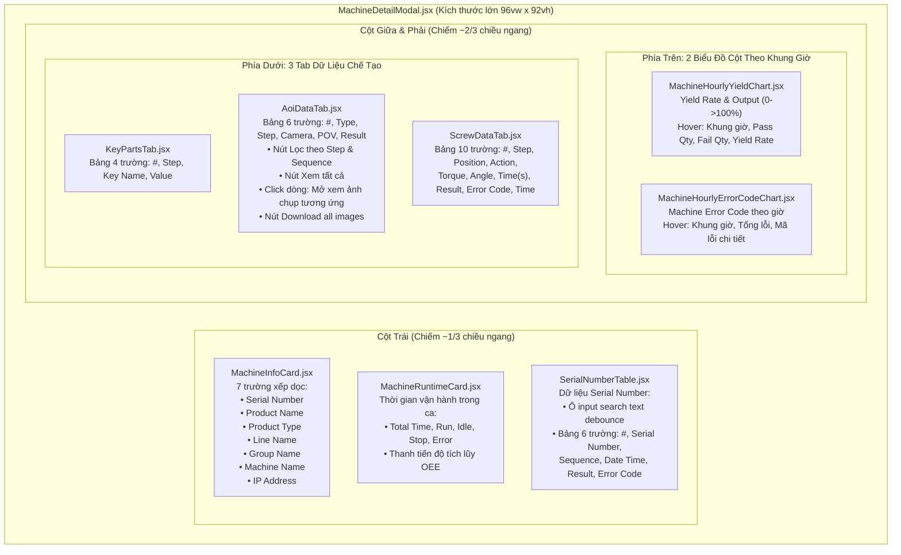

# KẾ HOẠCH TRIỂN KHAI GIAO DIỆN QUẢN LÝ CHUYỀN TỰ ĐỘNG (`/autoline-management`)

> **Tài liệu tham chiếu:** Plan thiết kế và kiến trúc giao diện cho màn hình điều hành dây chuyền sản xuất tự động thông minh (Smart Factory Automation Line Management).  
> **Áp dụng cho route:** `/autoline-management` (thuộc nhóm menu **QUẢN LÝ TỰ ĐỘNG HÓA**).  
> **Component đích:** `src/features/management/automation_line_management/AutomationLineManagement.jsx`.  
> **Đặc tả kiến trúc:** Thiết kế theo mô hình **Module Hóa Tối Đa (Component-Driven Architecture)** — Tách từng máy thành file JSX độc lập (`MachineCard.jsx`), module hóa thẻ KPI, từng widget đồ thị, drawer bộ lọc và custom hook dữ liệu riêng biệt.  
> **Ngày cập nhật:** 26/10/2026.  
> **Vị trí tài liệu:** `md/AUTOLINE_MANAGEMENT_PLAN.md` (đồng bộ tại `src/md/AUTOLINE_MANAGEMENT_PLAN.md`).

---

## 1. TỔNG QUAN VÀ MỤC TIÊU DỰ ÁN

Giao diện **Quản lý Chuyền Tự Động (`/autoline-management`)** là trung tâm giám sát & điều hành (Operation Central Cockpit) cho các dây chuyền sản xuất tự động hóa cao cấp trong nhà máy Foxconn / NVIDIA. Màn hình được thiết kế hướng tới khả năng **mở rộng cao, tái sử dụng, tối ưu hóa không gian hiển thị tối đa, tự động cuộn chữ thông minh và trải nghiệm thị giác vượt trội**:

### Bố cục không gian 4 phân đoạn chính:
1. **Nút Dài Hẹp Mép Trái & Drawer Bộ Lọc Đa Tiêu Chí (`LeftFilterTabHandle.jsx` & `AutolineFilterDrawer.jsx`):**
   - Một **nút dài hẹp bo góc tinh tế gắn sát ở mép bên trái màn hình** (Left Edge Handle) với chữ xoay dọc `BỘ LỌC` và badge đếm số lượng bộ lọc đang chọn.
   - Khi nhấp vào, trượt ra **Drawer Bộ Lọc Thông Minh (Filter Drawer)** cho phép lọc toàn bộ dữ liệu trên trang theo 4 tiêu chí cốt lõi:
     - **Ngày & Giờ (Date & Time):** Tích chọn checkbox linh hoạt để kích hoạt lọc ngày giờ (`Từ ngày/giờ -> Đến ngày/giờ`), đã **lược bỏ phần chọn nhanh theo ca** để tập trung lọc chuẩn xác theo khoảng thời gian tùy chọn của người dùng (`DateTimeFilterGroup.jsx`).
     - **Tên sản phẩm (Product Name):** **Nhập trực tiếp dạng text** (`<input type="text" ... />`) hỗ trợ tìm kiếm mọi model, kèm danh sách thẻ gợi ý nhanh (NVIDIA HGX H100, HGX B200, GB200 NVL72, NVLink Switch...).
     - **Loại sản phẩm (Product Type):** Lựa chọn loại sản phẩm (*AI Server Motherboard, GPU Accelerator Module, High-Power Shelf, NVLink Switch...*).
     - **Tên chuyền (Line Name):** Lựa chọn dây chuyền (*Line 01 - High-Speed SMT, Line 02 - GPU Board Assembly, Line 03 - Server Rack System...*).
   - Sau khi áp dụng bộ lọc, **tất cả các thông số và đồ thị ở Phần Top, Phần Giữa và Phần Bottom sẽ được cập nhật đồng bộ**.

2. **Phần Top (Hàng ngang 1 - Top KPI Metrics Bar - Siêu gọn & Cách đều nhau):** Bố trí dàn trải hàng ngang 6 chỉ số vận hành cốt lõi qua component dùng chung `KpiMetricCard.jsx`:
   - **Input** (Sản lượng đầu vào)
   - **Output** (Sản lượng đạt chuẩn đầu ra)
   - **Yield Rate** (Tỷ lệ đạt chuẩn / First Pass Yield %)
   - **UPH** (Units Per Hour - Tốc độ sản xuất trên giờ)
   - **Cycle Time** (Thời gian chu kỳ nhịp chuyền thực tế)
   - **Performance** (Hiệu suất vận hành dây chuyền %)
   - **Tối ưu hóa tinh gọn:** **Không cần hiện target (mục tiêu) và hiệu suất vận hành (progress bar & subtext)**. Các ô KPI được tinh gọn chiều cao (`p-3`), cách nhau đều đặn (`gap-3.5`), làm nổi bật con số giá trị chính và đơn vị.

3. **Phần Giữa (Hàng ngang 2 - Chuỗi Trạm Máy Nối Tiếp - Tự Động Cuộn & Căn Giữa Linh Hoạt):** Bố trí các máy móc trong dây chuyền sắp xếp tuần tự theo hàng ngang mô phỏng luồng sản xuất liên tục từ đầu chuyền đến cuối chuyền (Conveyor Process Flow).  
   - **Mỗi máy được tách riêng thành 1 file JSX độc lập (`MachineCard.jsx`)** để dễ dàng cấu hình, thêm/bớt máy động từ API/Mock Data.
   - **Bỏ cuộn chữ, tự động xuống dòng khi text dài:** Đã loại bỏ hoàn toàn hiệu ứng cuộn chữ marquee để tránh gây rối mắt và giúp người vận hành quan sát số liệu tĩnh ổn định. Khi tên máy, model hoặc cảnh báo dài quá khung thẻ, chữ sẽ tự động ngắt và xuống dòng tự nhiên (`break-words whitespace-normal line-clamp-2`), kết hợp thuộc tính `title` hiển thị tooltip đầy đủ khi hover.
   - **Căn giữa linh hoạt khi số lượng máy ít:**
     - Tự động căn giữa (`justify-center`) khi số lượng trạm máy ít (`<= 4` máy), giúp giao diện cân đối, không bị lệch hẳn về bên trái.
     - Tích hợp nút **"Căn Giữa"** trên thanh công cụ để người dùng có thể chủ động bật/tắt căn giữa bất kỳ lúc nào.
   - **Tự động cuộn khi chuỗi máy dài (Auto-Scroll Conveyor):**
     - Tích hợp nút **"Auto Cuộn"** trên header trạm máy, giúp chuỗi máy tự động trượt mượt mà sang phải (không cuộn ngược lại khi hết chuyền).
     - Tự động tạm dừng cuộn khi người dùng rê chuột vào bất kỳ máy nào để thao tác hoặc xem chi tiết.
   - **Bố cục thông số máy xếp dọc (`MachineMetricsBlock.jsx`):**
     - **Phần Input vs Output xếp theo hàng dọc** (Input hàng trên, Output hàng dưới).
     - **Phần NG vs Yield cũng xếp theo hàng dọc** (NG hàng trên, Yield hàng dưới).
     - **Đã bỏ phần Takt time và nút Chi tiết** trên thẻ máy để tiết kiệm tối đa không gian chiều cao và chiều rộng thẻ máy.
     - **Điều chỉnh kích thước thẻ máy to hơn:** Nâng kích thước thẻ từ **`w-44` (176px)** lên **`w-56` (khoảng 224px)**, tăng padding lên **`p-3.5`**, bo góc mềm mại **`rounded-2xl`**. Kích thước mới giúp thẻ máy rộng rãi, cân đối, thoải mái cho chữ xuống dòng 2 hàng mà không bị chen chúc, các khối chỉ số Input/Output và NG/Yield hiển thị thông thoáng, dễ quan sát từ xa.
     - Click vào thẻ máy sẽ mở modal xem thông số cảm biến chi tiết (`MachineDetailModal.jsx`).

4. **Phần Bottom (Hàng ngang 3 - Bottom Analytics & Diagnostics Row):** Bố trí dàn theo hàng ngang 3 khối đồ thị & phân tích chuyên sâu (mỗi khối là 1 file JSX widget độc lập):
   - **Top Error Code (`TopErrorCodeWidget.jsx`):** Bảng / Bar chart tổng hợp các mã lỗi phát sinh nhiều nhất trong ca, số lần và máy bị lỗi.
   - **Yield Rate & Output (`YieldOutputTrendWidget.jsx`):** Biểu đồ kết hợp Recharts (Combo Bar + Line Chart) phản ánh sản lượng ra và tỷ lệ đạt theo từng khung giờ trong ca.
   - **Machine Runtime Breakdown (`MachineRuntimeWidget.jsx`):** Biểu đồ phân bổ thời gian vận hành tổng hợp theo 4 trạng thái (`RUN`, `IDLE`, `STOP`, `ERROR`) của tất cả các máy trong chuyền.

5. **Tối ưu hiển thị giao diện NVIDIA (High Contrast Pure White Text):**
   - Khi chuyển sang giao diện NVIDIA (`brand === 'nvidia'`), **toàn bộ văn bản (tiêu đề trang, tên máy, nhãn thông số, giá trị KPI, trục đồ thị Recharts, bảng danh sách lỗi) được chuyển sang màu trắng tinh (`text-white`)**.
   - Tạo độ tương phản tối đa với nền tối công nghiệp `bg-zinc-950`, giúp kỹ sư và quản lý dây chuyền đọc số liệu rõ ràng, dễ quan sát từ xa trong môi trường phòng điều hành (Command Center).
   - `ThemeProvider.jsx` tự động đồng bộ gán class `dark` trên thẻ `<html>` khi chọn brand NVIDIA.

---

## 2. NGUYÊN TẮC MODULE HÓA (MODULARIZATION ARCHITECTURE)

Hệ thống tuân thủ nghiêm ngặt nguyên tắc **Single Responsibility Principle (SRP)** và **Atomic Design**:

```mermaid
graph TD
    subgraph Container chính
        MainPage["AutomationLineManagement.jsx (Orchestrator)"]
    end

    subgraph Tầng Quản Lý State & Logic (Hooks)
        Hook["useAutolineData.js (Custom Hook)"]
        Mock["autolineMockData.js (Dữ liệu mô phỏng)"]
        Const["autolineConstants.js (Enum & Config)"]
    end

    subgraph Module Bộ Lọc Mép Trái (filter/)
        Tab["LeftFilterTabHandle.jsx (Nút dẹt hẹp mép trái)"]
        Drawer["AutolineFilterDrawer.jsx (Drawer trượt, tên SP nhập text)"]
        DateTime["DateTimeFilterGroup.jsx (Lọc ngày & giờ có checkbox, bỏ chọn theo ca)"]
        Chips["ActiveFilterChipsBar.jsx (Dải thẻ lọc đang chọn)"]
    end

    subgraph Module Top KPI (top_kpi/)
        TopRow["TopKpiRow.jsx (Container hàng ngang cách đều nhau)"]
        KpiCard["KpiMetricCard.jsx (Thẻ KPI siêu gọn, bỏ Target & Progress, chữ trắng)"]
    end

    subgraph Module Trạm Máy Giữa (machine_flow/)
        FlowRow["MachineFlowRow.jsx (Dãy máy căn giữa linh hoạt, auto-cuộn khi dài)"]
        MachineCard["MachineCard.jsx (Thẻ máy to hơn w-56, bỏ cuộn chữ - xuống dòng tự nhiên)"]
        Badge["MachineStatusBadge.jsx (Đèn LED & Huy hiệu trạng thái)"]
        Metrics["MachineMetricsBlock.jsx (Khối In/Out xếp dọc, NG/Yield xếp dọc)"]
    end

    subgraph Module Cửa Sổ Nổi Chi Tiết Máy (machine_modal/)
        Modal["MachineDetailModal.jsx (Cửa sổ nổi Full-Screen 96vw)"]
        subgraph ColLeft["Cột Trái 1/3 (left_column/)"]
            InfoCard["MachineInfoCard.jsx (7 trường xếp dọc)"]
            RuntimeCard["MachineRuntimeCard.jsx (Thời gian vận hành)"]
            SNTable["SerialNumberTable.jsx (Search text, Bảng 6 trường)"]
        end
        subgraph ColRight["Cột Phải 2/3 (right_content/)"]
            subgraph TopCharts["Top: 2 Biểu Đồ Cột Theo Giờ (right_analytics/)"]
                YieldChart["MachineHourlyYieldChart.jsx (Yield 0->100% & Output)"]
                ErrChart["MachineHourlyErrorCodeChart.jsx (Mã lỗi theo giờ)"]
            end
            subgraph BottomTabs["Bottom: 3 Tab Dữ Liệu Chế Tạo (right_tabs/)"]
                TabsContainer["MachineDetailTabsContainer.jsx"]
                KeyPartsTab["KeyPartsTab.jsx (Bảng 4 trường)"]
                AoiDataTab["AoiDataTab.jsx (Bảng 6 trường, lọc, xem ảnh, tải ảnh)"]
                ScrewDataTab["ScrewDataTab.jsx (Bảng 10 trường)"]
            end
        end
    end

    subgraph Module Đồ Thị Bottom (bottom_analytics/)
        BotRow["BottomAnalyticsRow.jsx (Container 3 widget ngang)"]
        ErrWidget["TopErrorCodeWidget.jsx (Khối Top mã lỗi)"]
        TrendWidget["YieldOutputTrendWidget.jsx (Biểu đồ Recharts Yield & Output trục trắng)"]
        RuntimeWidget["MachineRuntimeWidget.jsx (Biểu đồ phân bổ thời gian máy)"]
    end

    MainPage --> Hook
    Hook --> Mock
    Hook --> Const

    MainPage --> Tab
    MainPage --> Drawer
    Drawer --> DateTime
    MainPage --> Chips

    MainPage --> TopRow
    TopRow --> KpiCard

    MainPage --> FlowRow
    FlowRow --> MachineCard
    MachineCard --> Badge
    MachineCard --> Metrics
    MachineCard -.->|Click trạm| Modal

    Modal --> InfoCard
    Modal --> RuntimeCard
    Modal --> SNTable
    Modal --> YieldChart
    Modal --> ErrChart
    Modal --> TabsContainer
    TabsContainer --> KeyPartsTab
    TabsContainer --> AoiDataTab
    TabsContainer --> ScrewDataTab

    MainPage --> BotRow
    BotRow --> ErrWidget
    BotRow --> TrendWidget
    BotRow --> RuntimeWidget
```

---

## 3. THIẾT KẾ CHI TIẾT TỪNG PHÂN ĐOẠN GIAO DIỆN

### 3.1. Nút Dài Hẹp Mép Trái & Drawer Bộ Lọc Đa Tiêu Chí (Module `filter/`)

#### 3.1.1. Component `LeftFilterTabHandle.jsx` (Nút dài hẹp mép trái):
- **Vị trí hiển thị:** Cố định sát mép bên trái khu vực nội dung trang (`fixed left-0 top-1/2 -translate-y-1/2 z-30`).
- **Hình dáng & Kích thước:**
  - Thiết kế dạng tab dọc dài thanh mảnh (chiều rộng hẹp khoảng `32px`, chiều dài khoảng `120px`).
  - Bo tròn viền góc ngoài bên phải (`rounded-r-2xl`), phẳng ở mép trái áp sát màn hình.
  - Chữ hiển thị xoay dọc: `BỘ LỌC` kèm biểu tượng phễu lọc phát sáng.
  - Huy hiệu số lượng bộ lọc đang kích hoạt (Active filter badge count: ví dụ `[3]`).
- **Hiệu ứng trực quan:** Hover trượt nhẹ ra ngoài 4px, phát sáng màu chủ đạo (**Foxconn Blue `#002766`** hoặc **NVIDIA Neon Green `#76B900`**).

#### 3.1.2. Component `AutolineFilterDrawer.jsx` (Drawer lọc trượt):
- Chiều rộng: `384px (w-96)`, trượt mượt mà từ mép trái với hiệu ứng slide-over kèm backdrop mờ.
- Chứa 4 nhóm điều kiện lọc:
  1. **Ngày & Giờ (`DateTimeFilterGroup.jsx`):** Checkbox tích chọn kích hoạt lọc ngày giờ, 2 ô `datetime-local` (`Từ ngày/giờ` -> `Đến ngày/giờ`). **Đã bỏ toàn bộ các nút ca làm việc** để giao diện tập trung lọc mốc thời gian tùy biến chính xác.
  2. **Tên Sản Phẩm (Product Name):** **Ô nhập văn bản dạng text (`<input type="text" ... />`)**, người dùng có thể gõ bất kỳ chuỗi tên/mã sản phẩm. Có sẵn danh sách thẻ gợi ý nhanh (NVIDIA HGX H100, B200, GB200, NVLink Switch, Titanium Power Shelf).
  3. **Tên Chuyền (Line Name):** Danh sách chọn: *Line 01 - High-Speed SMT, Line 02 - GPU Board, Line 03 - Server Rack...*
  4. **Loại Sản Phẩm (Product Type):** *AI Server Motherboard, GPU Accelerator Module, Power Shelf, NVLink Switch...*

#### 3.1.3. Component `ActiveFilterChipsBar.jsx` (Thanh thẻ lọc đang áp dụng):
- Hiển thị ngay dưới Header các chip tag nhỏ gọn (ví dụ: `[Chuyền: Line 01 ✕] [SP: H100 ✕] [24/10 08:00 - 16:00 ✕]`).
- Hỗ trợ click `✕` để xóa từng điều kiện hoặc nút `Xóa tất cả lọc`.

---

### 3.2. Phần Top: 6 Thẻ Chỉ Số Vận Hành Hàng Ngang (Module `top_kpi/`)

#### 3.2.1. Component `TopKpiRow.jsx`:
- Container bố trí Grid 6 cột cân đối trên Desktop (hoặc 3 cột trên Tablet, 2 cột trên Mobile) với khoảng cách phân tách rõ ràng (`gap-3 lg:gap-3.5`).
- Bỏ hoàn toàn việc tính toán và truyền props `target`, `progress`, `subText` ("hiệu suất vận hành").

#### 3.2.2. Component `KpiMetricCard.jsx` (Thẻ KPI siêu gọn):
- **Cấu trúc tinh giản tối đa:**
  - Viền màu trạng thái nhẹ nhàng kèm đường accent màu phía trên.
  - Hàng trên: Tên chỉ số (Input, Output, Yield Rate, UPH, Cycle Time, Performance) + Biểu tượng SVG chuyên biệt.
  - Hàng dưới: Con số giá trị kích thước lớn đậm nét (`text-xl xl:text-2xl font-black font-mono`) kèm đơn vị (`unit`) và nhãn delta tăng/giảm (`diff`).
  - **Đã lược bỏ:** Toàn bộ thanh tiến độ (Progress bar) và chân thẻ hiển thị Target/Hiệu suất vận hành để thẻ đạt độ cao tối thiểu, gọn gàng và tinh tế.
- Hỗ trợ 2 phong cách giao diện:
  - **Foxconn:** Nền thẻ trắng sáng, viền xanh nhạt, chữ đen/xanh navy chuẩn doanh nghiệp.
  - **NVIDIA:** Nền thẻ tối công nghiệp `bg-zinc-900/90`, viền `zinc-800`, **chữ màu trắng tinh (`text-white`)**, điểm nhấn xanh neon `#76B900`.

---

### 3.3. Phần Giữa: Chuỗi Máy Xếp Hàng Ngang (Module `machine_flow/`)

#### 3.3.1. Quy Tắc Hiển Thị Văn Bản Không Cuộn (Tự Động Xuống Dòng Đa Dòng):
- **Bỏ cuộn chữ marquee:** Không sử dụng hiệu ứng trượt chữ chuyển động liên tục nhằm mang lại sự tĩnh tại, tập trung cho người quản lý dây chuyền.
- **Tự động xuống dòng khi text dài:** Thiết lập các thuộc tính CSS `break-words whitespace-normal line-clamp-2` cho Tên máy (`Machine Name`) và Model máy (`Machine Model`).
- **Giới hạn số dòng tối ưu:** Tên máy hiển thị tối đa 2 dòng, Model hiển thị tối đa 2 dòng giúp chiều cao của các thẻ luôn đồng đều và thẳng hàng.
- **Tooltip toàn văn:** Khi văn bản dài vượt quá 2 dòng, thuộc tính `title` của trình duyệt sẽ hiển thị toàn bộ nội dung đầy đủ khi người dùng rê chuột vào.

#### 3.3.2. Component `MachineCard.jsx` (Thẻ Máy Kích Thước Rộng Rãi `w-56`):
- **Trách nhiệm duy nhất:** Nhận dữ liệu của 1 trạm máy cụ thể (`machine` object) và render giao diện máy.
- **Điều chỉnh kích thước to hơn:**
  - Mở rộng chiều rộng thẻ từ **`w-44` (176px)** lên **`w-56` (224px)**, tăng padding lên **`p-3.5`**, bo góc mềm mại **`rounded-2xl`**.
  - Không gian mới giúp tên máy 2 dòng và model hiển thị thoáng đạt, không bị co ép.
  - **Đã loại bỏ phần Takt time và nút Chi tiết** ở footer thẻ máy để giảm chiều cao thừa thãi.
  - Click vào thẻ máy sẽ trực tiếp mở modal xem chi tiết cảm biến trạm (`MachineDetailModal.jsx`).
  - Ở giao diện NVIDIA, **toàn bộ chữ tên máy, model, mã trạm đều hiển thị màu trắng (`text-white`)**.
- **Cấu trúc bên trong `MachineCard.jsx`:**
  - Header: Huy hiệu trạng thái với đèn LED nhấp nháy (`MachineStatusBadge.jsx`) + Mã trạm (`#01 OP-10`).
  - Title: Tên máy và Model hiển thị dạng văn bản tự động xuống dòng (`break-words whitespace-normal line-clamp-2`).
  - Body: Khối thông số vận hành xếp theo hàng dọc (`MachineMetricsBlock.jsx`).

#### 3.3.3. Sub-component `MachineStatusBadge.jsx`:
- Render nhãn trạng thái và đèn LED xung ánh sáng theo 4 mã màu chuẩn:
  - `RUN`: Đèn LED xanh ngọc nhấp nháy (`animate-ping`), chữ `RUNNING`.
  - `IDLE`: Đèn LED vàng hổ phách, chữ `IDLE / WAITING`.
  - `STOP`: Đèn xám kim loại, chữ `STOPPED`.
  - `ERROR`: Đèn đỏ ruby phát sáng mạnh, viền rung nhẹ, chữ `ERROR / ALARM`.

#### 3.3.4. Sub-component `MachineMetricsBlock.jsx` (Xếp theo hàng dọc):
- **Phần Input vs Output xếp theo hàng dọc:**
  - Hàng 1: `INPUT` + Số lượng đầu vào (ví dụ: `1,420`).
  - Hàng 2: `OUTPUT` + Số lượng đạt chuẩn đầu ra (ví dụ: `1,390`).
- **Phần NG vs Yield cũng xếp theo hàng dọc:**
  - Hàng 3: `NG:` + Số phế phẩm (ví dụ: `30 pcs`).
  - Hàng 4: `Yield:` + Tỷ lệ đạt chuẩn (ví dụ: `97.9%`).
- Toàn bộ chữ nhãn và giá trị hiển thị màu trắng (`text-white`) trên giao diện NVIDIA.

#### 3.3.5. Component `MachineFlowRow.jsx` (Căn Giữa & Auto-Scroll 1 Chiều):
- **Căn giữa linh hoạt:** Tự động căn giữa (`justify-center`) khi số lượng trạm máy ít (`<= 4` máy). Có nút bật/tắt căn giữa trên toolbar.
- **Auto Cuộn Băng Chuyền 1 Chiều:** Nút "Auto Cuộn" tự động trượt mượt mà sang phải (`left: 1.5`), khi hết chuyền sẽ quay về đầu ngay mà không cuộn ngược lại từ phải sang trái, tự động tạm dừng khi rê chuột vào.
- Hỗ trợ nút cuộn trái/phải thủ công (`←` / `→`) và thanh cuộn ngang mượt mà (`overflow-x-auto`).
- Khoảng cách các máy rộng rãi `gap-5`.

#### 3.3.6. Cửa Sổ Nổi Chi Tiết Máy Toàn Diện (`MachineDetailModal.jsx`):
- Đã được nâng cấp toàn diện thành **Trung tâm phân tích chuyên sâu toàn màn hình (Full-Screen Machine Cockpit)** chiếm gần trọn kích thước web (`w-[96vw] h-[92vh]`).
- Tách thành 2 phân vùng trực quan:
  - **Cột trái (~1/3 chiều ngang):** 7 thông số máy xếp dọc, Machine Runtime trong ca, Bảng Serial Number kèm ô tìm kiếm text.
  - **Cột phải (~2/3 chiều ngang):** Phía trên gồm 2 Biểu đồ cột phân tích Yield Rate & Error Code theo khung giờ (hover tooltip); Phía dưới gồm 3 Tab dữ liệu chế tạo vi mô: Key Parts, AOI Data (kèm xem ảnh popup & download) và Screw Data (10 trường thông số siết vít).
- *Xem đặc tả chi tiết và sơ đồ luồng tại [Mục 3.5: Đặc tả chi tiết Cửa Sổ Nổi Chi Tiết Máy](#35-đặc-tả-chi-tiết-cửa-sổ-nổi-chi-tiết-máy-toàn-diện-full-screen-advanced-machine-detail-modal).*

---

### 3.4. Phần Bottom: 3 Khối Thông Tin Dàn Theo Hàng Ngang (Module `bottom_analytics/`)

#### 3.4.1. Component `BottomAnalyticsRow.jsx`:
- Container bố trí dàn đều 3 khối phân tích theo hàng ngang (Grid 3 cột tỉ lệ `1fr : 1.3fr : 1fr` trên màn hình lớn).

#### 3.4.2. Component `TopErrorCodeWidget.jsx` (Khối 1):
- Quản lý danh sách Top 5 mã lỗi trong ca.
- Tiêu đề, tên lỗi, tên máy phát sinh lỗi và số liệu thống kê được hiển thị bằng chữ màu trắng (`text-white`) trên theme NVIDIA.

#### 3.4.3. Component `YieldOutputTrendWidget.jsx` (Khối 2):
- Tích hợp biểu đồ Recharts kết hợp (Dual-Axis Combo Chart) tự động thích ứng chữ rõ nét theo brand:
  - Cột Bar: Sản lượng Output hoàn thành theo từng giờ (`#002766` Foxconn Navy hoặc `#0284c7` Cyber Sky Blue).
  - Đường Line: Tỷ lệ Yield Rate (%) theo giờ với các điểm dot tròn nổi bật (`#059669` Foxconn Green hoặc `#76B900` NVIDIA Neon Green).
  - Trục X: Khung giờ hiển thị chữ đậm sắc nét (`#0f172a` Foxconn hoặc `#ffffff` NVIDIA).
  - Trục Y trái: Output ticks hiển thị đậm nét (`#002766` Foxconn hoặc `#ffffff` NVIDIA) với `width={38}` chống cắt chữ.
  - Trục Y phải: Yield % ticks hiển thị đậm nét (`#047857` Foxconn hoặc `#76B900` NVIDIA) với `width={44}` rõ ràng cả ký tự `%`.
  - Cơ chế `key={`trend-chart-${brand}`}` kích hoạt re-render SVG tức thì khi chuyển đổi giao diện giữa Foxconn và NVIDIA.
  - Tooltip tùy biến độ tương phản cao: Nền kính mờ `backdrop-blur-md`, tiêu đề khung giờ, Output và Yield Rate rõ ràng, phân biệt theo từng theme.
  - Đường Reference Line ngang thể hiện Target Yield `98.5%` với nhãn chữ tương phản cao (`#991b1b` Foxconn hoặc `#ff85a0` NVIDIA).

#### 3.4.4. Component `MachineRuntimeWidget.jsx` (Khối 3):
- Quản lý phân tích thời gian vận hành tổng hợp:
  - Thanh Stacked Progress Bar tổng quát: Tỷ lệ % của toàn chuyền theo `RUN`, `IDLE`, `STOP`, `ERROR`.
  - Bảng danh sách thanh tích lũy thời gian của từng máy trong dây chuyền:
    - **Thanh tiến độ kéo dài toàn diện (`flex-1 mx-3 h-2 rounded-full`):** Tận dụng tối đa không gian ngang của widget (khi widget mở rộng `xl:col-span-4`), không còn khoảng trống thừa giữa tên máy và tỷ lệ %.
    - **Hiển thị % chi tiết khi trỏ chuột vào:**
      - Trỏ vào từng phân đoạn màu (`RUN`, `IDLE`, `STOP`, `ERROR`): Hiển thị tooltip tỷ lệ % chính xác và số giờ tương ứng (ví dụ: `RUN: 92.5% (7.4h)`).
      - Trỏ vào toàn thanh: Hiển thị tóm tắt tổng hợp toàn bộ 4 trạng thái của máy đó.
      - Hiệu ứng hover phát sáng nhẹ (`hover:brightness-110`).
    - Số liệu Availability % hiển thị đậm nét, rõ ràng trên cả 2 giao diện Foxconn và NVIDIA.

---

### 3.5. ĐẶC TẢ CHI TIẾT CỬA SỔ NỔI CHI TIẾT MÁY TOÀN DIỆN (FULL-SCREEN ADVANCED MACHINE DETAIL MODAL)

Khi người dùng nhấp vào bất kỳ một máy nào trên băng chuyền (`MachineCard.jsx`), hệ thống sẽ mở ra một cửa sổ nổi chuyên sâu (**Machine Detail Cockpit Modal**) với kích thước gần như toàn bộ màn hình web. Đây là trung tâm phân tích, giám sát và truy vết chất lượng sản xuất chuyên sâu cho từng trạm máy.



#### 3.5.1. Quy cách kích thước & Hành vi tương tác (Modal Layout & Interactions):
- **Kích thước cực đại:** Chiếm gần bằng toàn bộ trang web (`w-[96vw] max-w-[1800px] h-[92vh] max-h-[960px]`), căn giữa màn hình (`fixed inset-0 m-auto z-50`).
- **Lớp nền mờ (Backdrop):** Lớp phủ tối mờ sang trọng `backdrop-blur-md bg-black/80`, chống cuộn trang bên dưới (`overflow-hidden` trên `<body>` khi mở modal).
- **Đóng modal linh hoạt:** Hỗ trợ nút đóng `✕` to bản nổi bật góc trên bên phải, click ra ngoài vùng backdrop, hoặc nhấn phím `ESC` để thoát nhanh.
- **Header Modal:**
  - Hiển thị: Logo trạm, Tên máy (`Machine Name`), Mã định danh (`Machine ID`), Đèn LED xung nhịp (`MachineStatusBadge`) và nút chuyển đổi Fullscreen / Đóng.
- **Phân chia 2 phân vùng chính:**
  - **Cột Trái (Left Group):** Chiếm khoảng **1/3 chiều ngang** (`w-full lg:w-1/3 xl:w-[32%]`), bao gồm 3 khối xếp dọc liên hoàn.
  - **Cột Giữa & Bên Phải (Right Content Group):** Chiếm khoảng **2/3 chiều ngang** (`w-full lg:w-2/3 xl:w-[68%]`), chia thành tầng trên (2 biểu đồ cột) và tầng dưới (3 tab dữ liệu vi mô).

---

#### 3.5.2. Cột Bên Trái (~1/3 Chiều Ngang): 3 Khối Xếp Theo Hàng Dọc

Toàn bộ khối cột trái được thiết kế để kỹ sư vận hành nắm bắt ngay định danh máy, hiệu suất thời gian và lịch sử các phôi/bo mạch đang đi qua:

##### 1. Khối Thông Tin Trạm Máy Xếp Dọc (`MachineInfoCard.jsx`):
- **Vị trí:** Đặt tại góc trên bên trái của cửa sổ nổi.
- **Bố cục:** Xếp lần lượt **theo một hàng dọc (Vertical Stack)**, gồm đúng **7 trường thông tin định danh**:
  1. `Serial Number`: Số serial định danh máy móc thiết bị (ví dụ: `SN-OP10-SMT-2026-0982`).
  2. `Product Name`: Tên model sản phẩm đang sản xuất (ví dụ: `NVIDIA HGX B200 NVL72`).
  3. `Product Type`: Phân loại sản phẩm (ví dụ: `GPU Accelerator Board`).
  4. `Line Name`: Tên dây chuyền (ví dụ: `Line 01 - High-Speed SMT`).
  5. `Group Name`: Cụm nhóm công đoạn (ví dụ: `SMT Surface Mount Group A`).
  6. `Machine Name`: Tên định danh của máy (ví dụ: `High-Precision Pick & Place Station 01`).
  7. `IP Address`: Địa chỉ IP nội bộ của trạm (ví dụ: `192.168.10.115`).
- **Styling chuẩn Enterprise:** Mỗi dòng gồm nhãn phụ bên trái (`text-xs text-slate-400 dark:text-zinc-500 font-semibold`) và giá trị in đậm sắc nét bên phải (`text-xs font-mono font-bold text-slate-800 dark:text-white`), hỗ trợ nút click để copy nhanh IP/Serial Number.

##### 2. Khối Thời Gian Vận Hành Máy (`MachineRuntimeCard.jsx`):
- **Vị trí:** Nằm ngay phía dưới Khối thông tin trạm máy.
- **Bố cục & Nội dung:**
  - Hiển thị các chỉ số thời gian vận hành trong ca sản xuất:
    - **Total Time (Tổng thời gian ca):** `8h 00m`
    - **Run Time (Thời gian máy chạy):** `7h 15m` (Chiếm `90.6%`, màu xanh neon/emerald)
    - **Idle Time (Thời gian máy chờ):** `25m` (Chiếm `5.2%`, màu vàng hổ phách)
    - **Stop Time (Thời gian dừng máy):** `12m` (Chiếm `2.5%`, màu xám bạc)
    - **Error Time (Thời gian sự cố/lỗi):** `8m` (Chiếm `1.7%`, màu đỏ rực)
  - **Thanh Stacked Runtime Bar:** Một thanh tiến độ tích lũy phân bổ 4 dải màu trực quan, hiển thị % Availability OEE của trạm máy đạt `90.6%`.

##### 3. Khối Dữ Liệu Serial Number Đi Qua Máy (`SerialNumberTable.jsx`):
- **Vị trí:** Nằm tiếp tục ở phía dưới Khối Machine Runtime, mở rộng tự động lấp đầy phần chiều cao còn lại của cột trái.
- **Ô tìm kiếm text (Search Field):**
  - Trường nhập văn bản: `<input type="text" placeholder="Tìm kiếm serial number..." />`
  - Tích hợp debounce tìm kiếm tức thì, cho phép kỹ sư gõ bất kỳ chuỗi ký tự nào trong mã Serial để lọc danh sách.
- **Bảng danh sách Serial Number (Scrollable Table):**
  - Chiều cao bảng có thanh cuộn mượt mà (`overflow-y-auto max-h-[260px] xl:max-h-[320px]`).
  - Gồm đúng **6 trường thông tin tiêu chuẩn**:
    1. `#`: Số thứ tự bản ghi (`1, 2, 3...`).
    2. `Serial Number`: Mã serial của sản phẩm/bo mạch (ví dụ: `NV-B200-20261028-00142`).
    3. `Sequence`: Bước/chuỗi gia công (ví dụ: `SEQ-014`).
    4. `Date Time`: Mốc thời gian hoàn tất trạm (ví dụ: `2026-10-28 11:24:05`).
    5. `Result`: Kết quả kiểm tra trạm (`PASS` nền xanh chữ đậm, `FAIL` nền đỏ chữ đậm).
    6. `Error Code`: Mã lỗi tương ứng nếu Fail (ví dụ: `ERR-SDR-04`, `ERR-TRQ-01` hoặc `-` nếu Pass).
- **Tương tác Drilldown:** Nhấp chuột vào 1 dòng Serial Number bất kỳ sẽ tự động chọn bo mạch đó và đồng bộ nạp dữ liệu chi tiết tương ứng sang 3 tab bên phải (Key Parts, AOI, Screw Data).

---

#### 3.5.3. Cột Giữa & Bên Phải (~2/3 Chiều Ngang): Phân Tích Khung Giờ & 3 Tab Chế Tạo

Bố cục phân tầng thành 2 phần: Nửa trên dành cho Đồ thị phân tích theo khung giờ, nửa dưới dành cho 3 Tab dữ liệu chế tạo vi mô.

##### PHẦN TRÊN: 2 Biểu Đồ Cột Phân Tích Theo Khung Giờ (Grid 2 Cột Độc Lập)

###### 1. Bảng/Đồ Thị `Machine Yield Rate & Output` (`MachineHourlyYieldChart.jsx`):
- **Dạng thức biểu đồ:** Sơ đồ dạng cột (Bar Chart) chia theo từng khung giờ trong ca làm việc (`08:00 - 09:00`, `09:00 - 10:00`, `10:00 - 11:00`... đến `16:00 - 17:00`).
- **Trục tỷ lệ:** Thang đo từ **`0 -> 100%`** (Trục Y thể hiện tỷ lệ Yield Rate % từ 0 đến 100).
- **Hiệu ứng khi trỏ chuột vào 1 cột (Hover Tooltip):**
  - Khi hover vào một cột bất kỳ thuộc một khung giờ, popup tooltip nổi bật trên nền kính mờ (`backdrop-blur-md`) hiển thị đầy đủ 4 thông số:
    - **Khoảng thời gian (Time Range):** ví dụ `09:00 - 10:00`
    - **Pass Qty (Sản lượng đạt):** ví dụ `185 pcs`
    - **Fail Qty (Sản lượng lỗi):** ví dụ `3 pcs`
    - **Yield Rate (Tỷ lệ đạt):** ví dụ `98.4%`

###### 2. Bảng/Đồ Thị `Machine Error Code` (`MachineHourlyErrorCodeChart.jsx`):
- **Dạng thức biểu đồ:** Sơ đồ dạng cột phân bổ số lượng lỗi theo từng khung giờ trong ca sản xuất, có cấu trúc tương tự bảng Yield Rate.
- **Trục hiển thị:** Thể hiện số lượng lỗi phát sinh theo từng khung giờ.
- **Hiệu ứng khi trỏ chuột vào 1 cột (Hover Tooltip):**
  - Khi hover vào một cột khung giờ, tooltip hiển thị chi tiết:
    - **Khoảng thời gian (Time Range):** ví dụ `09:00 - 10:00`
    - **Tổng số lỗi:** ví dụ `3 lỗi`
    - **Danh sách mã lỗi chi tiết & tần suất:** ví dụ `ERR-SDR-04 (Lệch thiếc hàn): 2`, `ERR-TRQ-01 (Quá lực siết): 1`

---

##### PHẦN DƯỚI: 3 Tab Dữ Liệu Chế Tạo Vi Mô (`MachineDetailTabsContainer.jsx`)

Khu vực chuyển đổi linh hoạt qua 3 Tab chuyên sâu cho sản phẩm/trạm máy:

###### 1. Tab `Key Parts` (`KeyPartsTab.jsx`):
- **Ý nghĩa:** Danh mục các linh kiện trọng yếu (Critical BOM Parts) được lắp ráp/gắn vào bo mạch tại trạm này.
- **Bảng dữ liệu gồm đúng 4 trường thông tin:**
  1. `#`: Số thứ tự (`1, 2, 3...`).
  2. `Step`: Bước thao tác gắn linh kiện (ví dụ: `Step 01 - GPU Base Placement`, `Step 02 - VRM Choke Mounting`).
  3. `Key Name`: Tên linh kiện chính (ví dụ: `GPU Die B200`, `Thermal Interface Pad 2.5mm`, `Power Inductor 470nH`, `Decoupling Cap Array`).
  4. `Value`: Giá trị tham số, mã vạch hoặc mã lô của linh kiện (ví dụ: `LOT-B200-A02-88412`, `THP-900W-2.5MM`, `470nH-40A-OK`).

###### 2. Tab `AOI Data` (`AoiDataTab.jsx`):
- **Ý nghĩa:** Dữ liệu kiểm tra quang học tự động từ hệ thống Camera AI Vision của trạm máy.
- **Bố cục 2 phần Trái - Phải trực quan (Split Layout - Không dùng cửa sổ nổi):**
  - **Phần bên trái (~60% chiều ngang):** Bảng danh sách chi tiết các điểm quang học tự động kiểm tra gồm 6 trường chuẩn (#, Type, Step, Camera, POV, Result), tích hợp bộ lọc theo Step & Sequence và nút Xem tất cả. Dòng đang chọn được highlight viền phát quang nổi bật (`border-l-4`).
  - **Phần bên phải (~40% chiều ngang):** Khung hiển thị trực tiếp ảnh chụp quang học độ nét cao (Embedded AI Vision Inspection Canvas). Khi người dùng nhấp vào bất kỳ dòng nào bên trái, hình ảnh mạch PCB vi tính, vùng quét Bounding Box (xanh lá PASS / đỏ tươi FAIL), thông số zoom và chẩn đoán lỗi AI sẽ xuất hiện ngay lập tức ở khung bên phải mà không cần phải mở cửa sổ nổi (popup modal).
- **Bảng dữ liệu gồm đúng 6 trường thông tin:**
  1. `#`: Số thứ tự (`1, 2, 3...`).
  2. `Type`: Loại kiểm tra quang học (ví dụ: `Solder Joint`, `Component Presence`, `Polarity Check`, `Offset/Coplanarity`, `Foreign Object`).
  3. `Step`: Bước chụp kiểm tra (ví dụ: `Step 02 - Pre-Reflow AOI`, `Step 04 - Post-Reflow AOI`).
  4. `Camera`: ID camera chụp (ví dụ: `CAM-01 (Top-Down)`, `CAM-02 (45° Oblique)`, `CAM-03 (Side-Profile)`).
  5. `POV`: Point of View / Góc nhìn kiểm tra (ví dụ: `Top View 0°`, `Side View 45° NW`, `Macro Pin Grid 10x`).
  6. `Result`: Kết quả kiểm định (`PASS` huy hiệu xanh lá, `NG` huy hiệu đỏ tươi).
- **Hệ thống điều khiển & tương tác tức thời (Instant Visual Inspection):**
  - Nút **"Lọc theo Step & Sequence"**: Cho phép chọn bước kiểm tra cụ thể để thu hẹp dữ liệu.
  - Nút **"Xem tất cả"**: Hiển thị toàn bộ các điểm chụp trong chu trình chế tạo.
  - **Click chọn dòng:** Ngay lập tức đổi ảnh và chi tiết kiểm định ở panel bên phải theo thời gian thực (real-time instant preview), dòng được chọn tự động gắn nhãn icon camera `📷`.
  - **Nút "Tải ảnh này" & "Tải tất cả ({count} ảnh)":** Tải xuống ảnh đang xem hoặc trọn gói toàn bộ ảnh quang học. Loại bỏ hoàn toàn cửa sổ nổi (`AoiImagePreviewModal.jsx`), tối ưu hóa thao tác tra cứu nhanh của kỹ sư.

###### 3. Tab `Screw Data` (`ScrewDataTab.jsx`):
- **Ý nghĩa:** Dữ liệu siết ốc tự động (Torque & Angle Telemetry) từ các tuốc-nơ-vít điện tử servo trên máy.
- **Bảng dữ liệu gồm đầy đủ đúng 10 trường thông tin chi tiết:**
  1. `#`: Số thứ tự (`1, 2, 3...`).
  2. `Step`: Bước siết vít (ví dụ: `Step 01 - Corner Screws`, `Step 02 - Central Clamp`).
  3. `Position`: Vị trí/tọa độ của ốc vít (ví dụ: `SCR-01 (X: 120.4, Y: 85.2)`, `SCR-02 (Corner NW)`, `Slot M3-A`).
  4. `Action`: Hành động siết (ví dụ: `Fast Pre-torque`, `Final Angle Tighten`, `Verification Re-tighten`).
  5. `Torque`: Lực siết thực tế (ví dụ: `1.85 N.m`, `2.10 N.m` kèm ngưỡng dung sai `[1.80 - 2.20 N.m]`).
  6. `Angle`: Góc xoay thực tế tính bằng độ (ví dụ: `720°`, `1080°`, `945°`).
  7. `Time(s)`: Thời gian siết hoàn thành tính bằng giây (ví dụ: `1.24s`, `0.85s`).
  8. `Result`: Kết quả siết (`PASS` nền xanh, `NG - Over Torque` nền đỏ, `NG - Strip` nền cam).
  9. `Error Code`: Mã lỗi nếu có (ví dụ: `ERR-TRQ-HIGH`, `ERR-ANG-OVER` hoặc `-` nếu Pass).
  10. `Time`: Mốc thời gian chính xác ghi nhận giá trị siết (ví dụ: `11:24:08.412`).

---

## 4. BẢNG MÃ MÀU VÀ ĐỒNG BỘ THIẾT KẾ THEO BRAND (FOXCONN & NVIDIA)

Màn hình được thiết kế chuẩn Enterprise, tự động thích ứng với Brand được chọn trong `useTheme()`:

| Phần tử UI | Foxconn Brand (`foxconn`) | NVIDIA Brand (`nvidia`) |
| :--- | :--- | :--- |
| **Màu nền trang** | `bg-slate-50` / `bg-white` | `bg-zinc-950` / `bg-black` |
| **Nút dài hẹp mép trái** | `bg-[#002766] text-white shadow-blue-900/30` | `bg-zinc-900 border-[#76B900] text-[#76B900] shadow-[#76B900]/20` |
| **Drawer Bộ lọc** | `bg-white border-slate-200 shadow-2xl` | `bg-zinc-900/95 border-zinc-800 backdrop-blur-xl shadow-2xl text-white` |
| **Thẻ Máy (`MachineCard`)** | `w-56 bg-white border-slate-200 shadow-2xs hover:border-blue-400 rounded-2xl` | `w-56 bg-zinc-900/90 border-zinc-800 text-white hover:border-[#76B900]/60 rounded-2xl` |
| **Xử lý khi text dài** | Bỏ cuộn marquee, tự động xuống dòng (`line-clamp-2`) | Bỏ cuộn marquee, tự động xuống dòng (`line-clamp-2`, chữ trắng) |
| **Căn giữa chuỗi máy ít** | Căn giữa `justify-center` linh hoạt | Căn giữa `justify-center` linh hoạt |
| **Auto cuộn băng chuyền** | Cuộn 1 chiều sang phải, không cuộn ngược lại | Cuộn 1 chiều sang phải, không cuộn ngược lại |
| **Bố cục Input/Output** | Xếp theo hàng dọc (dọc) | Xếp theo hàng dọc (dọc, chữ trắng) |
| **Bố cục NG/Yield** | Xếp theo hàng dọc (dọc) | Xếp theo hàng dọc (dọc, chữ trắng) |
| **Thẻ Top KPI** | Siêu gọn, không hiện target & hiệu suất | Siêu gọn, không hiện target & hiệu suất (chữ trắng) |
| **Khoảng cách giữa các máy** | `gap-5` (Rộng rãi, thoáng đẹp) | `gap-5` (Rộng rãi, thoáng đẹp) |
| **Khoảng cách giữa các thẻ KPI** | `gap-3 lg:gap-3.5` (Cách nhau đều đặn) | `gap-3 lg:gap-3.5` (Cách nhau đều đặn) |
| **Màu chữ chính (Tiêu đề, Tên máy, KPI)** | `text-slate-900` / `text-slate-800` | **`text-white` (Trắng sáng rõ nét 100%)** |
| **Màu chữ phụ (Nhãn, Mô tả, Đơn vị)** | `text-slate-500` / `text-slate-600` | **`text-white` / `text-zinc-200` (Dễ đọc trên nền tối)** |
| **Chữ đồ thị Yield/Output Trend** | Trục X `#0f172a`, Y trái `#002766`, Y phải `#047857` | **Trục X `#ffffff`, Y trái `#ffffff`, Y phải `#76B900` (Rõ nét 100%)** |
| **Màu điểm nhấn (Accent)** | Xanh dương Foxconn (`#002766`, `#003893`) | Xanh neon NVIDIA (`#76B900`, `#86D400`) |
| **Trạng thái RUN** | `bg-emerald-50 border-emerald-300 text-emerald-700` | `bg-emerald-950/40 border-emerald-500/50 text-emerald-400` |
| **Trạng thái IDLE** | `bg-amber-50 border-amber-300 text-amber-700` | `bg-amber-950/40 border-amber-500/50 text-amber-400` |
| **Trạng thái STOP** | `bg-slate-100 border-slate-300 text-slate-700` | `bg-zinc-800 border-zinc-700 text-white` |
| **Trạng thái ERROR** | `bg-rose-50 border-rose-300 text-rose-700` | `bg-rose-950/40 border-rose-500/50 text-rose-400 animate-pulse` |

---

## 4.1. QUY CHUẨN ĐỒNG BỘ PHÔNG CHỮ & TYPOGRAPHY HỆ THỐNG (UNIFIED TYPOGRAPHY SPECIFICATION)

> **Lưu ý kiến trúc chung (Common Component):** Toàn bộ cấu trúc phần Header (Breadcrumb, H1 Title, Live Badge, Subtext, Nhóm điều khiển thời gian thực và Nút Toàn màn hình) đã được trích xuất thành component dùng chung **`src/components/common/PageHeaderBar.jsx`**, được áp dụng đồng bộ trên tất cả các trang quản lý và cấu hình của hệ thống (`/autoline-management`, `/machine-status`, `/config/machine`, `/config/carrier`, `/config/rack`,...).

Để đảm bảo tính nhất quán tuyệt đối giữa 2 tính năng **Quản Lý Chuyền Tự Động (`/autoline-management`)** và **Giám Sát Trạng Thái Máy (`/machine-status-management`)**, hệ thống thiết lập bảng quy chuẩn Typography chuẩn mực công nghiệp cho từng chi tiết giao diện:

### 1. Phông chữ nền tảng (Base Font Families):
- **Phông chữ Sans-serif chuẩn (Toàn bộ giao diện):** `'Inter', -apple-system, BlinkMacSystemFont, 'Segoe UI', Roboto, Helvetica, Arial, sans-serif`.
  - Được cấu hình toàn cục trong `src/index.css` qua biến `@theme { --font-sans: 'Inter', ... }` và áp dụng cho `html, body, input, button, select`.
- **Phông chữ Đơn cách (Monospace - `font-mono`):** Dành riêng cho dữ liệu kỹ thuật, mã thiết bị, địa chỉ mạng, file chương trình, và các con số đo lường:
  - Mã trạm: `#{code}` / `#{index + 1}` (ví dụ: `#01`, `#M01`, `ST-02`).
  - Giá trị KPI lớn: `text-2xl font-black font-mono tracking-tight`.
  - Tỷ lệ phần trăm và sản lượng: Input, Output, NG, Yield %, UPH, Cycle Time.
  - Địa chỉ IP mạng: `font-mono font-bold text-xs`.
  - Tên file chương trình / Recipe: `font-mono font-semibold text-[11px]`.
  - Huy hiệu LED trạng thái: `font-mono font-black text-[10px]`.
  - Thời gian cập nhật: `font-mono font-bold text-xs`.

### 2. Bảng Phân Cấp Typography Đồng Bộ Từng Chi Tiết Giao Diện:

| Vị trí / Phần tử Giao diện | Cỡ chữ (Size) | Độ đậm (Weight) | Kiểu dòng & Giãn cách | Monospace | Màu Foxconn (Light) | Màu NVIDIA (Dark) |
| :--- | :--- | :--- | :--- | :--- | :--- | :--- |
| **Header: Đường dẫn Breadcrumb** | `text-xs` (12px) | `font-semibold` | `tracking-wider uppercase mb-1` | Không | `text-slate-400` / `#002766` | `text-zinc-400` / `#76B900` |
| **Header: Tiêu đề trang chính** | `text-2xl` (24px) | `font-black` | `tracking-tight leading-none` | Không | `text-slate-900` | `text-white` (trắng tinh) |
| **Header: Huy hiệu Live (Live Pulse)** | `text-[11px]` (11px) | `font-bold` | `px-2.5 py-1 rounded-full uppercase` | Không | `text-emerald-600 bg-emerald-500/10` | `text-emerald-400 bg-emerald-500/10` |
| **Header: Đoạn mô tả phụ** | `text-xs` (12px) | `font-normal` | `mt-1 leading-normal` | Không | `text-slate-500` | `text-zinc-400` |
| **Header: Nhóm nút công cụ & Nút lọc** | `text-xs` (12px) | `font-bold` | `px-3 py-1.5 rounded-xl` | Không | `text-slate-700` / `text-white` | `text-white` / `text-black` |
| **Header: Thời gian Cập nhật** | `text-xs` (12px) | `font-bold` | `font-mono` | Có | `text-slate-800` | `text-white` |
| **Top KPI: Tiêu đề thẻ chỉ số** | `text-[11px]` (11px) | `font-black` | `uppercase tracking-wider mb-1` | Không | `text-slate-500` | `text-white` |
| **Top KPI: Giá trị số lớn** | `text-2xl` (24px) | `font-black` | `tracking-tight font-mono` | Có | `text-slate-900` | `text-white` |
| **Top KPI: Đơn vị (Unit)** | `text-xs` (12px) | `font-bold` | `tracking-normal` | Không | `text-slate-500` | `text-white/80` |
| **Top KPI: Subtext / Details** | `text-[10px]` (10px) | `font-bold` | `tracking-tight` | Không | `text-slate-500` | `text-white/80` |
| **Thẻ máy: Mã trạm / Tag số** | `text-[10px]` (10px) | `font-black` | `font-mono px-2 py-0.5 rounded` | Có | `#002766` trên nền `bg-slate-100` | `#76B900` trên nền `bg-zinc-800` |
| **Thẻ máy: Huy hiệu trạng thái** | `text-[10px]` (10px) | `font-black` | `font-mono px-2.5 py-0.5 rounded-full` | Có | Sẫm màu theo trạng thái | Neon phát quang trên nền tối |
| **Thẻ máy: Tên thiết bị (Machine Name)** | `text-sm` (14px) | `font-black` | `tracking-tight leading-snug wrap-break-word` | Không | `text-slate-900` | `text-white` |
| **Thẻ máy: Model thiết bị** | `text-[10px]` (10px) | `font-medium` | `leading-tight wrap-break-word opacity-70` | Không | `text-slate-500` | `text-zinc-400` |
| **Thẻ máy: Địa chỉ IP** | `text-xs` (12px) | `font-bold` | `font-mono break-all leading-tight` | Có | `text-slate-800` | `text-white` |
| **Thẻ máy: Chương trình (Program/Recipe)** | `text-[11px]` (11px) | `font-semibold` | `font-mono break-all leading-snug` | Có | `text-slate-800` | `text-zinc-100` |
| **Thẻ máy: Khu vực & Vị trí** | `text-[11px]` (11px) | `font-medium` | `wrap-break-word leading-snug` | Không | `text-slate-700` / `text-slate-600` | `text-zinc-200` / `text-zinc-300` |
| **Thẻ máy: Khối In/Out & NG/Yield** | Nhãn: `text-[9px] font-black uppercase`; Số: `text-xs font-black font-mono` | Nhãn đậm, số mono | Có | `text-slate-900` | `text-white` |
| **Drawer Lọc: Tiêu đề Drawer** | `text-sm` (14px) | `font-black` | `uppercase tracking-wider` | Không | `text-slate-900` | `text-white` |
| **Drawer Lọc: Tiêu đề nhóm tiêu chí** | `text-xs` (12px) | `font-bold` | `uppercase tracking-wider` | Không | `text-slate-700` | `text-white` |
| **Drawer Lọc: Input / Select / Option** | `text-xs` (12px) | `font-semibold` | `leading-normal` | Không | `text-slate-800` | `text-white` |
| **Modal Chi Tiết: Tiêu đề máy** | `text-lg` (18px) | `font-black` | `tracking-tight wrap-break-word` | Không | `text-slate-900` | `text-white` |
| **Modal Chi Tiết: Model & Vị trí phụ** | `text-xs` (12px) | `font-medium` | `mt-0.5 wrap-break-word` | Không | `text-slate-500` | `text-zinc-400` |
| **Modal Chi Tiết: Nhãn thông số** | `text-[10px]` (10px) | `font-medium` | `uppercase tracking-wider` | Không | `text-slate-500` | `text-zinc-400` |
| **Modal Chi Tiết: Giá trị thông số** | `text-xs / text-sm` | `font-bold` | `wrap-break-word / break-all` | Tùy trường | `text-slate-800` | `text-white` |
| **Nút Mép Trái: Chữ BỘ LỌC dọc** | `text-[10px]` (10px) | `font-black` | `uppercase tracking-widest vertical` | Không | `text-white` | `#76B900` |
| **Nút Mép Trái: Badge đếm bộ lọc** | `text-[9px]` (9px) | `font-black` | `font-mono w-4 h-4 rounded-full` | Có | `text-slate-900 bg-amber-400` | `text-black bg-[#76B900]` |

### 3. Quy tắc Ngắt dòng & Xuống dòng tự động (Word Wrapping Policy):
- **Đối với văn bản chứa khoảng trắng (Tên máy, Model, Khu vực, Vị trí, Tên sản phẩm, Tên nhà máy):**
  - Sử dụng class `.wrap-break-word` kết hợp `leading-snug` (được định nghĩa chuẩn trong `src/index.css` với `overflow-wrap: break-word; word-break: break-word;`).
  - Khi nội dung dài quá khung, chữ tự động xuống dòng thứ 2 hoặc 3 một cách tự nhiên mà không bị cắt dấu ba chấm (`truncate`) làm mất dữ liệu.
- **Đối với chuỗi liền ký tự kỹ thuật không có dấu cách (Địa chỉ IP, Tên file Recipe `.HEX`, Mã UUID):**
  - Bắt buộc dùng `break-all` kết hợp `font-mono leading-tight` để trình duyệt tự ngắt dòng an toàn, ngăn chặn hoàn toàn hiện tượng tràn khung (horizontal overflow).

---

## 5. CẤU TRÚC THƯ MỤC SOURCE CODE MODULE HÓA CHI TIẾT

Toàn bộ các file JSX và logic phụ trợ được phân rã thành các module chuyên biệt:

```text
src/features/management/automation_line_management/
├── AutomationLineManagement.jsx              # [Orchestrator] Trang chính kết nối state, hook và các module con
├── hooks/
│   └── useAutolineData.js                    # [Logic Hook] Quản lý state bộ lọc, fetch data, auto-refresh interval
├── constants/
│   └── autolineConstants.js                  # [Hằng số] Định nghĩa Enum trạng thái máy, màu sắc theme, ngưỡng KPI
├── data/
│   ├── autolineMockData.js                   # [Dữ liệu mẫu] Mock chuyền, sản phẩm, máy móc, mã lỗi, biểu đồ theo bộ lọc
│   └── machineModalMockData.js               # [MỚI] Mock chi tiết máy: 7 thông số, runtime, serial numbers, 2 biểu đồ giờ, 3 tabs
└── components/
    ├── header/
    │   └── AutolineHeaderBar.jsx             # Thanh tiêu đề, chỉ báo LIVE LINE, thời gian cập nhật, nút Fullscreen, Refresh
    ├── filter/
    │   ├── LeftFilterTabHandle.jsx           # [JSX] Nút dẹt dài hẹp gắn cố định mép trái màn hình (chữ dọc BỘ LỌC)
    │   ├── AutolineFilterDrawer.jsx          # [JSX] Drawer trượt mép trái chứa 4 tiêu chí lọc (Tên SP nhập text)
    │   ├── DateTimeFilterGroup.jsx           # [JSX] Khối lọc Ngày & Giờ (checkbox kích hoạt, datetime inputs, bỏ ca)
    │   └── ActiveFilterChipsBar.jsx          # [JSX] Dải thẻ hiển thị các điều kiện lọc đang kích hoạt kèm nút xóa
    ├── top_kpi/
    │   ├── TopKpiRow.jsx                     # [JSX] Container bố trí 6 thẻ KPI dàn hàng ngang cách nhau đều đặn
    │   └── KpiMetricCard.jsx                 # [JSX] Thẻ KPI đơn lẻ siêu gọn (Input, Output, Yield, UPH, CT, Perf - Bỏ Target/Progress)
    ├── machine_flow/
    │   ├── MachineFlowRow.jsx                # [JSX] Container dãy máy căn giữa linh hoạt khi ít, auto-cuộn khi dài, gap-5
    │   ├── MachineCard.jsx                   # [JSX] THẺ MÁY ĐỘC LẬP siêu gọn w-56 (Bỏ Takt & Chi tiết - Chữ trắng)
    │   ├── AutoScrollText.jsx                # [JSX] Component tự động cuộn chữ mượt mà khi text dài quá khung
    │   ├── MachineStatusBadge.jsx            # [JSX] Đèn LED xung ánh sáng và nhãn trạng thái (Run/Idle/Stop/Error)
    │   ├── MachineMetricsBlock.jsx           # [JSX] Khối thông số: In/Out xếp theo hàng dọc, NG/Yield xếp theo hàng dọc
    │   └── ConveyorConnector.jsx             # [JSX] Mũi tên kết nối luồng giữa các trạm máy
    ├── machine_modal/                        # [MỚI] Cụm Module Cửa Sổ Nổi Chi Tiết Máy Toàn Màn Hình
    │   ├── MachineDetailModal.jsx            # [Container] Modal lớn 96vw x 92vh, backdrop mờ, chia 1/3 trái - 2/3 phải
    │   ├── left_column/
    │   │   ├── MachineInfoCard.jsx           # [JSX] 7 thông số xếp dọc: Serial, Product Name, Type, Line, Group, Machine, IP
    │   │   ├── MachineRuntimeCard.jsx        # [JSX] Khối thời gian vận hành trong ca: Run, Idle, Stop, Error, availability
    │   │   └── SerialNumberTable.jsx         # [JSX] Ô search text & Bảng 6 trường: #, SN, Seq, Time, Result, Error Code
    │   ├── right_analytics/
    │   │   ├── MachineHourlyYieldChart.jsx   # [JSX] Biểu đồ cột Yield Rate & Output theo khung giờ (0->100%), hover tooltip
    │   │   └── MachineHourlyErrorCodeChart.jsx# [JSX] Biểu đồ cột mã lỗi theo giờ, hover hiện chi tiết lỗi & số lượng
    │   └── right_tabs/
    │       ├── MachineDetailTabsContainer.jsx# [JSX] Container điều hướng 3 tab dữ liệu chế tạo vi mô
    │       ├── KeyPartsTab.jsx               # [JSX] Tab Key Parts - Bảng 4 trường: #, Step, Key Name, Value
    │       ├── AoiDataTab.jsx                # [JSX] Tab AOI Data - Bảng 6 trường, 2 nút lọc, nút Download all images
    │       ├── AoiImagePreviewModal.jsx      # [JSX] Popup xem ảnh quang học phóng to có bounding box khi click dòng
    │       └── ScrewDataTab.jsx              # [JSX] Tab Screw Data - Bảng 10 trường dữ liệu siết ốc
    └── bottom_analytics/
        ├── BottomAnalyticsRow.jsx            # [JSX] Container dàn đều 3 khối phân tích hàng ngang
        ├── TopErrorCodeWidget.jsx            # [JSX] Widget hiển thị Top mã lỗi phổ biến trong ca (Chữ trắng)
        ├── YieldOutputTrendWidget.jsx        # [JSX] Widget biểu đồ kết hợp Recharts (Output Bar + Yield Line - Trục & Text trắng)
        └── MachineRuntimeWidget.jsx          # [JSX] Widget phân bổ thời gian vận hành (Run, Idle, Stop, Error - Chữ trắng)
```

---

## 6. KẾ HOẠCH TRIỂN KHAI VÀ THỰC THI (IMPLEMENTATION PHASES)

### Giai đoạn 1: Chuẩn bị Dữ liệu, Constants & Logic Hook
- [x] Xây dựng file [autolineConstants.js](file:///d:/EnterpriseProjectFrontend/enterprise-project-frontend/src/features/management/automation_line_management/constants/autolineConstants.js) định nghĩa các trạng thái (`MACHINE_STATUS.RUN`, `IDLE`, `STOP`, `ERROR`) và màu sắc tương ứng.
- [x] Xây dựng file [autolineMockData.js](file:///d:/EnterpriseProjectFrontend/enterprise-project-frontend/src/features/management/automation_line_management/data/autolineMockData.js) chứa dữ liệu mô phỏng hỗ trợ lọc theo Chuyền, Sản phẩm, Loại sản phẩm, Ngày/Giờ.
- [x] Xây dựng custom hook [useAutolineData.js](file:///d:/EnterpriseProjectFrontend/enterprise-project-frontend/src/features/management/automation_line_management/hooks/useAutolineData.js) quản lý state bộ lọc (hỗ trợ text search sản phẩm), timer tự động cập nhật và tính toán chỉ số.

### Giai đoạn 2: Xây dựng Module Bộ Lọc Mép Trái (`components/filter/`)
- [x] Xây dựng [LeftFilterTabHandle.jsx](file:///d:/EnterpriseProjectFrontend/enterprise-project-frontend/src/features/management/automation_line_management/components/filter/LeftFilterTabHandle.jsx): Nút dẹt hẹp mép trái với chữ xoay dọc `BỘ LỌC`, badge đếm và hiệu ứng hover.
- [x] Xây dựng [DateTimeFilterGroup.jsx](file:///d:/EnterpriseProjectFrontend/enterprise-project-frontend/src/features/management/automation_line_management/components/filter/DateTimeFilterGroup.jsx): Checkbox bật/tắt lọc thời gian, input `datetime-local`, đã loại bỏ hoàn toàn các nút chọn nhanh theo ca làm việc.
- [x] Xây dựng [AutolineFilterDrawer.jsx](file:///d:/EnterpriseProjectFrontend/enterprise-project-frontend/src/features/management/automation_line_management/components/filter/AutolineFilterDrawer.jsx): Drawer trượt chứa 4 tiêu chí lọc với ô nhập văn bản dạng text cho Tên Sản Phẩm và gợi ý nhanh.
- [x] Xây dựng [ActiveFilterChipsBar.jsx](file:///d:/EnterpriseProjectFrontend/enterprise-project-frontend/src/features/management/automation_line_management/components/filter/ActiveFilterChipsBar.jsx): Dải thẻ tag hiển thị điều kiện đang lọc và nút xóa.

### Giai đoạn 3: Xây dựng Module Header & Top KPI (`components/top_kpi/`)
- [x] Xây dựng [AutolineHeaderBar.jsx](file:///d:/EnterpriseProjectFrontend/enterprise-project-frontend/src/features/management/automation_line_management/components/header/AutolineHeaderBar.jsx): Thanh điều khiển trung tâm với chữ trắng độ nét cao trên theme NVIDIA.
- [x] Cập nhật **[KpiMetricCard.jsx](file:///d:/EnterpriseProjectFrontend/enterprise-project-frontend/src/features/management/automation_line_management/components/top_kpi/KpiMetricCard.jsx)**: Bỏ hoàn toàn việc hiển thị target và hiệu suất vận hành (progress bar & subtext), kích thước siêu gọn gàng.
- [x] Cập nhật **[TopKpiRow.jsx](file:///d:/EnterpriseProjectFrontend/enterprise-project-frontend/src/features/management/automation_line_management/components/top_kpi/TopKpiRow.jsx)**: Dàn đều 6 thẻ hàng ngang cách nhau đều đặn (`gap-3.5`).

### Giai đoạn 4: Xây dựng Module Chuỗi Máy Giữa (`components/machine_flow/`)
- [x] Tối ưu hóa văn bản thẻ máy: **Bỏ hiệu ứng cuộn chữ marquee**, thiết lập tự động ngắt và xuống dòng (`break-words whitespace-normal line-clamp-2`) kèm tooltip khi hover.
- [x] Xây dựng [MachineStatusBadge.jsx](file:///d:/EnterpriseProjectFrontend/enterprise-project-frontend/src/features/management/automation_line_management/components/machine_flow/MachineStatusBadge.jsx): Đèn LED và nhãn trạng thái máy.
- [x] Cập nhật **[MachineMetricsBlock.jsx](file:///d:/EnterpriseProjectFrontend/enterprise-project-frontend/src/features/management/automation_line_management/components/machine_flow/MachineMetricsBlock.jsx)**: **Input vs Output xếp theo hàng dọc**, **NG vs Yield cũng xếp theo hàng dọc**.
- [x] Cập nhật **[MachineCard.jsx](file:///d:/EnterpriseProjectFrontend/enterprise-project-frontend/src/features/management/automation_line_management/components/machine_flow/MachineCard.jsx)**: **Bỏ hoàn toàn phần Takt time và nút Chi tiết**, tăng kích thước thẻ máy lên **`w-56` (224px)**, padding `p-3.5`, bo góc `rounded-2xl`, chữ màu trắng khi chọn NVIDIA, text dài tự động xuống dòng.
- [x] Cập nhật **[MachineFlowRow.jsx](file:///d:/EnterpriseProjectFrontend/enterprise-project-frontend/src/features/management/automation_line_management/components/machine_flow/MachineFlowRow.jsx)**:
  - Tự động căn giữa (`justify-center`) khi số lượng máy ít (`<= 4`).
  - Nút chuyển đổi căn giữa chủ động trên toolbar.
  - Chế độ Auto Cuộn mượt mà khi chuỗi máy dài, tạm dừng khi rê chuột.
  - Khoảng cách máy `gap-5`.

### Giai đoạn 5: Xây dựng Module Đồ Thị Bottom (`components/bottom_analytics/`)
- [x] Xây dựng [TopErrorCodeWidget.jsx](file:///d:/EnterpriseProjectFrontend/enterprise-project-frontend/src/features/management/automation_line_management/components/bottom_analytics/TopErrorCodeWidget.jsx): Widget danh sách Top mã lỗi trong ca với chữ màu trắng.
- [x] Xây dựng [YieldOutputTrendWidget.jsx](file:///d:/EnterpriseProjectFrontend/enterprise-project-frontend/src/features/management/automation_line_management/components/bottom_analytics/YieldOutputTrendWidget.jsx): Biểu đồ Recharts kết hợp sản lượng Output và tỷ lệ Yield Rate theo giờ với các trục tọa độ màu trắng tinh (`#ffffff`).
- [x] Xây dựng [MachineRuntimeWidget.jsx](file:///d:/EnterpriseProjectFrontend/enterprise-project-frontend/src/features/management/automation_line_management/components/bottom_analytics/MachineRuntimeWidget.jsx): Biểu đồ phân bổ thời gian vận hành của tất cả các máy với chữ trắng dễ đọc.
- [x] Xây dựng [BottomAnalyticsRow.jsx](file:///d:/EnterpriseProjectFrontend/enterprise-project-frontend/src/features/management/automation_line_management/components/bottom_analytics/BottomAnalyticsRow.jsx): Ghép 3 widget dàn hàng ngang.

### Giai đoạn 6: Tối Ưu Theme NVIDIA & Kiểm Thử Toàn Diện
- [x] Tích hợp toàn bộ các module vào [AutomationLineManagement.jsx](file:///d:/EnterpriseProjectFrontend/enterprise-project-frontend/src/features/management/automation_line_management/AutomationLineManagement.jsx).
- [x] Cập nhật [ThemeProvider.jsx](file:///d:/EnterpriseProjectFrontend/enterprise-project-frontend/src/context/ThemeProvider.jsx) để tự động thêm/bỏ class `dark` trên thẻ `<html>` khi chuyển sang `brand === 'nvidia'`.
- [x] Kiểm thử chuyển đổi mượt mà giữa Foxconn và NVIDIA, xác nhận 100% chữ đổi sang màu trắng dễ đọc.
- [x] Kiểm tra cấu trúc module hóa độc lập, không có lỗi runtime.

### Giai đoạn 7: Xây Dựng Cửa Sổ Nổi Chi Tiết Máy Toàn Diện (Full-Screen Machine Detail Modal)
- [x] 7.1. Xây dựng module dữ liệu mẫu [machineModalMockData.js](file:///d:/EnterpriseProjectFrontend/enterprise-project-frontend/src/features/management/automation_line_management/data/machineModalMockData.js):
  - Khai báo 7 thông số định danh máy theo hàng dọc (Serial, Product Name, Type, Line, Group, Machine Name, IP).
  - Mock phân bổ thời gian Machine Runtime (Total, Run, Idle, Stop, Error, availability %).
  - Mock danh sách 25+ bo mạch Serial Number đa dạng kết quả Pass/Fail, sequence, mốc thời gian, mã lỗi.
  - Mock dữ liệu 8 khung giờ cho 2 biểu đồ cột: Yield Rate (0-100%, Pass/Fail Qty) và Error Code phân bổ theo giờ.
  - Mock dữ liệu chi tiết cho 3 tab: Key Parts (BOM linh kiện), AOI Data (kèm link ảnh quang học và bounding box kiểm tra), Screw Data (10 thông số siết ốc, lực torque, góc angle, thời gian).
- [x] 7.2. Xây dựng Cột Trái (~1/3 Chiều Ngang):
  - [x] Xây dựng [MachineInfoCard.jsx](file:///d:/EnterpriseProjectFrontend/enterprise-project-frontend/src/features/management/automation_line_management/components/machine_modal/left_column/MachineInfoCard.jsx): Hiển thị 7 trường thông tin xếp dọc, nhãn xám, giá trị đậm, hỗ trợ click copy nhanh.
  - [x] Xây dựng [MachineRuntimeCard.jsx](file:///d:/EnterpriseProjectFrontend/enterprise-project-frontend/src/features/management/automation_line_management/components/machine_modal/left_column/MachineRuntimeCard.jsx): Hiển thị chi tiết thời gian ca, 4 mốc trạng thái kèm thanh Stacked Bar trực quan.
  - [x] Xây dựng [SerialNumberTable.jsx](file:///d:/EnterpriseProjectFrontend/enterprise-project-frontend/src/features/management/automation_line_management/components/machine_modal/left_column/SerialNumberTable.jsx): Ô text input search debounce + Bảng 6 trường thông tin, cuộn nội bộ mượt mà, click chọn dòng để drilldown dữ liệu.
- [x] 7.3. Xây dựng Cột Phải - Phần Đồ Thị Phân Tích Khung Giờ (~2/3 Chiều Ngang):
  - [x] Xây dựng [MachineHourlyYieldChart.jsx](file:///d:/EnterpriseProjectFrontend/enterprise-project-frontend/src/features/management/automation_line_management/components/machine_modal/right_analytics/MachineHourlyYieldChart.jsx): Biểu đồ cột Recharts theo từng khung giờ với trục Y từ 0 -> 100%, hover tooltip hiện khoảng thời gian, pass qty, fail qty, yield rate.
  - [x] Xây dựng [MachineHourlyErrorCodeChart.jsx](file:///d:/EnterpriseProjectFrontend/enterprise-project-frontend/src/features/management/automation_line_management/components/machine_modal/right_analytics/MachineHourlyErrorCodeChart.jsx): Biểu đồ cột phân bổ lỗi theo khung giờ, hover tooltip hiện khoảng thời gian, tổng lỗi và danh sách mã lỗi chi tiết.
- [x] 7.4. Xây dựng Cột Phải - 3 Tab Dữ Liệu Chế Tạo Vi Mô:
  - [x] Xây dựng [MachineDetailTabsContainer.jsx](file:///d:/EnterpriseProjectFrontend/enterprise-project-frontend/src/features/management/automation_line_management/components/machine_modal/right_tabs/MachineDetailTabsContainer.jsx): Thanh điều hướng chuyển đổi tab có badge số lượng.
  - [x] Xây dựng [KeyPartsTab.jsx](file:///d:/EnterpriseProjectFrontend/enterprise-project-frontend/src/features/management/automation_line_management/components/machine_modal/right_tabs/KeyPartsTab.jsx): Bảng hiển thị 4 trường (#, step, key name, value).
  - [x] Xây dựng [AoiDataTab.jsx](file:///d:/EnterpriseProjectFrontend/enterprise-project-frontend/src/features/management/automation_line_management/components/machine_modal/right_tabs/AoiDataTab.jsx): Bảng hiển thị 6 trường (#, type, step, camera, pov, result), 2 nút lọc "Lọc theo Step & Sequence" và "Xem tất cả", nút "Download all images" ở góc dưới.
  - [x] Xây dựng [AoiImagePreviewModal.jsx](file:///d:/EnterpriseProjectFrontend/enterprise-project-frontend/src/features/management/automation_line_management/components/machine_modal/right_tabs/AoiImagePreviewModal.jsx): Hộp thoại popup xem ảnh chụp quang học phóng to khi click vào một dòng AOI.
  - [x] Xây dựng [ScrewDataTab.jsx](file:///d:/EnterpriseProjectFrontend/enterprise-project-frontend/src/features/management/automation_line_management/components/machine_modal/right_tabs/ScrewDataTab.jsx): Bảng hiển thị đầy đủ 10 trường (#, step, position, action, torque, angle, time(s), result, error code, time).
- [x] 7.5. Ghép nối và hoàn thiện Container [MachineDetailModal.jsx](file:///d:/EnterpriseProjectFrontend/enterprise-project-frontend/src/features/management/automation_line_management/components/machine_modal/MachineDetailModal.jsx):
  - Kích thước `w-[96vw] h-[92vh]`, layout 1/3 - 2/3 responsive.
  - Kết nối sự kiện click từ thẻ máy [MachineCard.jsx](file:///d:/EnterpriseProjectFrontend/enterprise-project-frontend/src/features/management/automation_line_management/components/machine_flow/MachineCard.jsx).
  - Kiểm thử đồng bộ 2 giao diện Foxconn (sáng) và NVIDIA (tối, chữ trắng tinh 100%).

---

## 7. TIÊU CHUẨN HOÀN THÀNH (ACCEPTANCE CRITERIA)

1. **Chuỗi trạm máy nối tiếp thông minh & linh hoạt:**
   - **Bỏ cuộn chữ, tự động xuống dòng:** Text dài (tên máy, model) tự động ngắt và xuống dòng tự nhiên (`line-clamp-2`), không dùng animation marquee gây rối mắt.
   - **Kích thước thẻ máy rộng rãi:** Tăng kích thước lên **`w-56` (224px)**, padding `p-3.5`, bo góc `rounded-2xl` tạo không gian thoáng đãng cho text và các thông số.
   - **Căn giữa khi số lượng máy ít:** Tự động căn giữa khi có ít hơn hoặc bằng 4 máy, kèm nút chỉnh "Căn Giữa" chủ động.
   - **Auto Cuộn khi chuỗi dài:** Chế độ tự động cuộn băng chuyền thông minh, tự động tạm dừng khi rê chuột vào trạm máy.
   - **Bố cục nén khoa học:** Input vs Output xếp theo hàng dọc, NG vs Yield xếp theo hàng dọc, bỏ phần Takt và nút Chi tiết, khoảng cách các máy `gap-5`.
2. **Thẻ Top KPI tinh gọn & cách đều nhau:**
   - 6 chỉ số: `Input`, `Output`, `Yield Rate`, `UPH`, `Cycle Time`, `Performance` dàn hàng ngang.
   - **Không hiển thị target (mục tiêu) và hiệu suất vận hành (progress bar & subtext)**.
   - Các ô KPI có chiều cao siêu gọn, cách đều nhau bằng khoảng cách chuẩn `gap-3.5`.
3. **Module hóa triệt để:**
   - Thẻ máy được tạo bằng file JSX riêng biệt ([MachineCard.jsx](file:///d:/EnterpriseProjectFrontend/enterprise-project-frontend/src/features/management/automation_line_management/components/machine_flow/MachineCard.jsx)), kèm các sub-components độc lập ([MachineStatusBadge.jsx](file:///d:/EnterpriseProjectFrontend/enterprise-project-frontend/src/features/management/automation_line_management/components/machine_flow/MachineStatusBadge.jsx), [MachineMetricsBlock.jsx](file:///d:/EnterpriseProjectFrontend/enterprise-project-frontend/src/features/management/automation_line_management/components/machine_flow/MachineMetricsBlock.jsx)).
   - Các thẻ KPI, từng widget phân tích đồ thị, bộ lọc đều là các file JSX tách rời, mã nguồn gọn gàng, tái sử dụng cao.
4. **Bộ lọc thông minh mép trái hoàn hảo:**
   - Nút dài hẹp mép trái mở Drawer trượt êm ái.
   - Lọc ngày giờ có checkbox tích chọn, nhập datetime tùy biến, không có nút chọn theo ca.
   - Tên sản phẩm hỗ trợ nhập text trực tiếp kèm gợi ý nhanh.
   - Cập nhật đồng bộ toàn bộ 3 phân đoạn trên trang khi bấm "Áp Dụng Bộ Lọc".
5. **Độ tương phản và tính dễ đọc cao trên giao diện NVIDIA:**
   - Khi chuyển sang giao diện NVIDIA, **toàn bộ văn bản chuyển sang màu trắng (`text-white`)**, dễ đọc, sắc nét và nổi bật trên nền đen/zinc tối.
   - Đồng bộ class `dark` trên `<html>` từ `ThemeProvider.jsx`.
6. **Thẩm mỹ xuất sắc:** Thiết kế giao diện hiện đại chuẩn Enterprise Smart Factory Control Center.
7. **Cửa sổ nổi chi tiết máy toàn diện (Full-Screen Machine Detail Modal):**
   - Kích thước lớn gần bằng toàn bộ trang web (`w-[96vw] h-[92vh]`), căn giữa màn hình, viền bo góc, backdrop mờ và nút đóng nổi bật / phím ESC.
   - **Cột trái (~1/3 chiều ngang):**
     - Góc trên bên trái: 7 trường thông tin định danh máy xếp dọc (Serial Number, Product Name, Product Type, Line Name, Group Name, Machine Name, IP Address).
     - Phía dưới: Khối Machine Runtime chi tiết trong ca kèm thanh tiến độ phân bổ thời gian.
     - Dưới tiếp: Khối Serial Number Data có ô tìm kiếm text debounce và bảng chuẩn 6 trường (#, Serial Number, Sequence, Date Time, Result, Error Code).
   - **Cột giữa & phải (~2/3 chiều ngang):**
     - Phía trên: 2 biểu đồ cột phân tích theo khung giờ:
       - Biểu đồ Machine Yield Rate & Output (Trục 0 -> 100%, hover tooltip: khoảng thời gian, pass qty, fail qty, yield rate).
       - Biểu đồ Machine Error Code (Hover tooltip: khoảng thời gian, tổng lỗi, danh sách mã lỗi chi tiết).
     - Phía dưới: 3 Tab chuyển đổi mượt mà:
       - Tab Key Parts: Bảng 4 trường (#, Step, Key Name, Value).
       - Tab AOI Data: Bảng 6 trường (#, Type, Step, Camera, POV, Result), 2 nút lọc "Lọc theo Step & Sequence" và "Xem tất cả", click dòng hiển thị ảnh chụp tương ứng, nút "Download all images" ở góc dưới.
       - Tab Screw Data: Bảng đầy đủ 10 trường (#, Step, Position, Action, Torque, Angle, Time(s), Result, Error Code, Time).
   - Tối ưu giao diện NVIDIA: toàn bộ chữ và số liệu hiển thị màu trắng tinh (`text-white`) tương phản cao trên nền đen công nghiệp.
