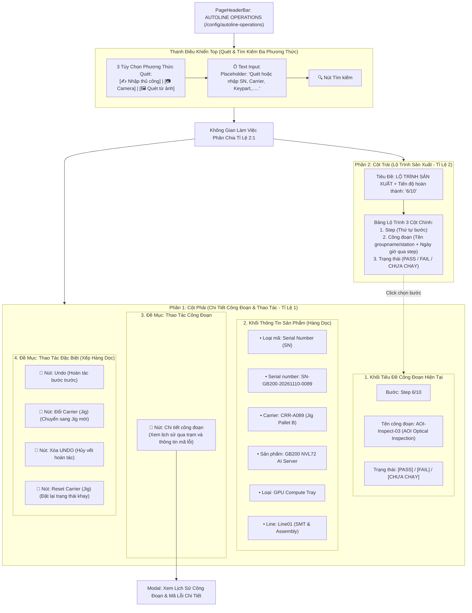

# KẾ HOẠCH TRIỂN KHAI GIAO DIỆN VẬN HÀNH DÂY CHUYỀN TỰ ĐỘNG (AUTOLINE OPERATIONS - `/config/autoline-operations`)

> **Tài liệu tham chiếu:** Plan đặc tả kiến trúc, thiết kế giao diện và luồng nghiệp vụ cho module Vận Hành Dây Chuyền & Truy Vết Lộ Trình Sản Xuất (Autoline Operations & Production Routing Execution Studio).  
> **Áp dụng cho route:** `/config/autoline-operations` (và `/autoline-operations`) (thuộc nhóm menu **CONFIG / CẤU HÌNH HỆ THỐNG -> AUTOLINE OPERATIONS**).  
> **Component đích:** `src/features/config/autoline_operations/AutolineOperationsPage.jsx`.  
> **Thư mục chức năng:** `src/features/config/autoline_operations/`.  
> **Bố cục giao diện:**
>
> - **Khung Top Bar:** Thanh công cụ quét & tìm kiếm đa phương thức (3 tùy chọn: _Nhập thủ công_, _Camera_, _Quét từ ảnh_ + Ô input tìm kiếm + Nút _Tìm kiếm_).
> - **Không gian làm việc chính chia tỉ lệ 2:1:**
>   - **Bên 2 (Tỉ lệ 2 - Cột Trái rộng ~66.7%):** Bảng Lộ Trình Sản Xuất (Routing Flow), hiển thị tiến độ số bước hoàn thành trên tiêu đề (ví dụ: `6/10`), các trường thông tin: `Step`, `Công đoạn (groupname/station + ngày giờ qua step)`, `Trạng thái (Pass / Fail / Chưa chạy)`.
>   - **Bên 1 (Tỉ lệ 1 - Cột Phải ~33.3%):** Khung chi tiết công đoạn & thao tác đặc biệt:  
>      - Khối thông tin bước, tên công đoạn, trạng thái hiện tại.  
>      - Khối thông tin sản phẩm theo hàng dọc: _Loại mã_, _Serial Number_, _Carrier_, _Sản phẩm_, _Loại_, _Line_.  
>      - Đề mục _Thao tác công đoạn_ + Nút _Chi tiết công đoạn_ (xem lịch sử qua trạm và thông tin lỗi).  
>      - Đề mục _Thao tác đặc biệt_ + Loạt nút xếp hàng dọc: _Undo_, _Đổi Carrier (Jig)_, _Xóa UNDO_, _Reset Carrier (Jig)_.  
>     **Ngày khởi tạo:** 10/11/2026.  
>     **Vị trí tài liệu:** `src/md/AUTOLINE_OPERATIONS_PLAN.md` (đồng bộ tại `md/AUTOLINE_OPERATIONS_PLAN.md`).

---

## 1. TỔNG QUAN VÀ MỤC TIÊU DỰ ÁN

Trong các nhà máy thông minh tự động hóa cao cấp (Foxconn & NVIDIA AI Server Manufacturing - ví dụ dây chuyền sản xuất máy chủ GPU Blackwell GB200 NVL72, HGX H100/H200), việc truy vết đường đi của từng phôi sản phẩm (Work-In-Progress - WIP), khay mang hàng (Carrier / Jig) và linh kiện khóa chính (Keypart) là cốt lõi để đảm bảo tiêu chuẩn chất lượng Zero-Defect.

Màn hình **Autoline Operations (`/config/autoline-operations`)** đóng vai trò là bảng điều khiển tác nghiệp thời gian thực (Real-time Shopfloor Execution & Tracking Console) dành cho kỹ sư chuyền, trưởng ca sản xuất và chuyên viên kiểm định chất lượng:

1. **Truy vấn đa phương thức (Multi-Modal Search & Scanner)**: Hỗ trợ tìm kiếm tức thì theo Serial Number (SN), Carrier ID hoặc Keypart thông qua 3 chế độ: Gõ thủ công (kèm súng quét barcode USB), Quét qua Webcam/Camera công nghiệp, hoặc Tải ảnh chụp nhãn mã vạch (OCR/Barcode image recognition).
2. **Giám sát trực quan lộ trình sản xuất (Tỉ lệ 2 - Bên Trái)**: Hiển thị toàn bộ chuỗi công đoạn tuần tự từ SMT, Auto-Screw, Pressfit, AOI, đến Functional Testing; theo dõi chính xác ngày giờ vượt qua từng bước và phân định rõ 3 trạng thái: `PASS` (Đạt), `FAIL` (Lỗi) và `CHƯA CHẠY` (Chờ xử lý). Đồng thời hiển thị tiến độ tổng thể (ví dụ: `6/10` bước).
3. **Thẻ hồ sơ sản phẩm & Công đoạn hiện tại (Tỉ lệ 1 - Bên Phải)**: Hiển thị nhanh các thuộc tính cốt lõi theo chiều dọc giúp kỹ thuật viên nắm bắt đầy đủ lý lịch sản phẩm đang kiểm tra.
4. **Nghiệm thu lỗi & Tra cứu lịch sử**: Nút bấm "Chi tiết công đoạn" mở bảng tra cứu thông tin lỗi cơ khí/quang học và nhật ký thao tác tại trạm tương ứng.
5. **Thao tác can thiệp kỹ thuật đặc biệt (Special Engineering Actions)**: Cung cấp 4 thao tác can thiệp nhanh xếp theo hàng dọc có cơ chế xác nhận an toàn:
   - **Undo**: Hoàn tác sản phẩm về công đoạn trước đó để kiểm tra lại khi phát hiện bất thường.
   - **Đổi Carrier (Jig)**: Chuyển đổi phôi sản phẩm sang Jig/Carrier thay thế khi khay hiện tại bị kẹt hoặc quá hạn kiểm định.
   - **Xóa UNDO**: Hủy vết hoàn tác hoặc đưa sản phẩm quay trở lại công đoạn kế tiếp.
   - **Reset Carrier (Jig)**: Đặt lại trạng thái khay chứa về ban đầu để tái sử dụng.
6. **Tương thích toàn diện nhận diện thương hiệu kép (Dual-Theme)**: Foxconn (Giao diện sáng Navy / Slate) và NVIDIA Cyberpunk (Giao diện tối Zinc Dark / Neon Green `#76B900`).

---

## 2. BỐ CỤC KHÔNG GIAN VÀ SƠ ĐỒ GIAO DIỆN (WIREFRAME)

### 2.1. Sơ đồ Luồng Hoạt Động (Architecture Flowchart):



---

### 2.2. Wireframe Chi Tiết Giao Diện (ASCII Wireframe):

```text
┌────────────────────────────────────────────────────────────────────────────────────────────────────────────────────────┐
│ CONFIG / AUTOLINE OPERATIONS                                                                          [⛶ Fullscreen]   │
│ AUTOLINE OPERATIONS                                                                     [Badge: SHOPFLOOR CONTROL]     │
│ Vận hành dây chuyền tự động, tra cứu lộ trình sản xuất (Routing) và thực hiện các thao tác can thiệp đặc biệt          │
├────────────────────────────────────────────────────────────────────────────────────────────────────────────────────────┤
│ [KHUNG TOP: TÙY CHỌN QUÉT & TÌM KIẾM ĐA PHƯƠNG THỨC]                                                                   │
│ ┌────────────────────────────────────────────────────────────────────────────────────────────────────────────────────┐ │
│ │  (●) Nhập thủ công    ( ) Camera    ( ) Quét từ ảnh                                                                │ │
│ │  ┌────────────────────────────────────────────────────────────────────────────────────────┐ ┌────────────────────┐  │ │
│ │  │ 🔍 Quét hoặc nhập SN, Carrier, Keypart,..…                                             │ │  [ 🔍 Tìm kiếm ]   │  │ │
│ │  └────────────────────────────────────────────────────────────────────────────────────────┘ └────────────────────┘  │ │
│ └────────────────────────────────────────────────────────────────────────────────────────────────────────────────────┘ │
│                                                                                                                        │
│ [KHÔNG GIAN LÀM VIỆC CHIA TỈ LỆ 2:1]                                                                                   │
│ ┌──────────────────────────────────────────────────────────────┐ ┌──────────────────────────────────────────────────┐ │
│ │ [BÊN 2: LỘ TRÌNH SẢN XUẤT (TỈ LỆ 2 - ~66.7%)]                │ │ [BÊN 1: CHI TIẾT CÔNG ĐOẠN & THAO TÁC (TỈ LỆ 1)] │ │
│ │                                                              │ │                                                  │ │
│ │ 📋 LỘ TRÌNH SẢN XUẤT                 [TIẾN ĐỘ: 6/10 HOÀN THÀNH]│ │ 📍 CÔNG ĐOẠN                                    │ │
│ │ ┌─────┬─────────────────────────────────────┬──────────────┐ │ │ ┌──────────────────────────────────────────────┐ │ │
│ │ │STEP │ CÔNG ĐOẠN (GROUP/STATION & NGÀY GIỜ)│ TRẠNG THÁI   │ │ │ │ Bước: Step 06/10                             │ │ │
│ │ ├─────┼─────────────────────────────────────┼──────────────┤ │ │ │ Tên công đoạn: AOI-Inspect-03                │ │ │
│ │ │ 01  │ SMT-Mount-01                        │ [ PASS ]     │ │ │ │                (AOI Optical Inspection)      │ │ │
│ │ │     │ 🕒 2026-11-10 08:05:12              │              │ │ │ │ Trạng thái: [ ✅ PASS ]                       │ │ │
│ │ ├─────┼─────────────────────────────────────┼──────────────┤ │ │ └──────────────────────────────────────────────┘ │ │
│ │ │ 02  │ Reflow-Oven-01                      │ [ PASS ]     │ │ │                                                  │ │
│ │ │     │ 🕒 2026-11-10 08:14:30              │              │ │ │ 📦 THÔNG TIN SẢN PHẨM                            │ │
│ │ ├─────┼─────────────────────────────────────┼──────────────┤ │ │ ┌──────────────────────────────────────────────┐ │ │
│ │ │ 03  │ Cooling-Zone-01                     │ [ PASS ]     │ │ │ │ • Loại mã:       Serial Number (SN)          │ │ │
│ │ │     │ 🕒 2026-11-10 08:20:05              │              │ │ │ │ • Serial number: SN-GB200-20261110-0089      │ │ │
│ │ ├─────┼─────────────────────────────────────┼──────────────┤ │ │ │ • Carrier:       CRR-A089 (Jig Pallet B)     │ │ │
│ │ │ 04  │ Screw-Auto-02                       │ [ PASS ]     │ │ │ │ • Sản phẩm:      GB200 NVL72 AI Server       │ │ │
│ │ │     │ 🕒 2026-11-10 08:35:44              │              │ │ │ │ • Loại:          GPU Compute Tray            │ │ │
│ │ ├─────┼─────────────────────────────────────┼──────────────┤ │ │ │ • Line:          Line01 (SMT & Assembly)     │ │ │
│ │ │ 05  │ Pressfit-01                         │ [ PASS ]     │ │ │ └──────────────────────────────────────────────┘ │ │
│ │ │     │ 🕒 2026-11-10 08:48:19              │              │ │                                                  │ │
│ │ ├─────┼─────────────────────────────────────┼──────────────┤ │ │ ⚙️ THAO TÁC CÔNG ĐOẠN                            │ │
│ │ │ 06★ │ AOI-Inspect-03 (Đang chọn)          │ [ PASS ]     │ │ │ ┌──────────────────────────────────────────────┐ │ │
│ │ │     │ 🕒 2026-11-10 09:02:50              │              │ │ │ │ [📋] Chi tiết công đoạn                      │ │ │
│ │ ├─────┼─────────────────────────────────────┼──────────────┤ │ │ └──────────────────────────────────────────────┘ │ │
│ │ │ 07  │ Functional-Test-01                  │ [ FAIL ]     │ │ │                                                  │ │
│ │ │     │ 🕒 2026-11-10 09:18:22              │              │ │ │ 🛠️ THAO TÁC ĐẶC BIỆT                             │ │
│ │ ├─────┼─────────────────────────────────────┼──────────────┤ │ │ ┌──────────────────────────────────────────────┐ │ │
│ │ │ 08  │ Burn-In-Chamber-02                  │ [ CHƯA CHẠY] │ │ │ │ [↩️] Undo                                     │ │ │
│ │ ├─────┼─────────────────────────────────────┼──────────────┤ │ │ ├──────────────────────────────────────────────┤ │ │
│ │ │ 09  │ Final-QC-01                         │ [ CHƯA CHẠY] │ │ │ │ [🔄] Đổi Carrier (Jig)                       │ │ │
│ │ ├─────┼─────────────────────────────────────┼──────────────┤ │ │ ├──────────────────────────────────────────────┤ │ │
│ │ │ 10  │ Auto-Pack-01                        │ [ CHƯA CHẠY] │ │ │ │ [🗑️] Xóa UNDO                                │ │ │
│ │ └─────┴─────────────────────────────────────┴──────────────┘ │ │ ├──────────────────────────────────────────────┤ │ │
│ │                                                              │ │ │ [🔁] Reset Carrier (Jig)                       │ │ │
│ │                                                              │ │ └──────────────────────────────────────────────┘ │ │
│ └──────────────────────────────────────────────────────────────┘ └──────────────────────────────────────────────────┘ │
└────────────────────────────────────────────────────────────────────────────────────────────────────────────────────────┘
```

---

## 3. ĐẶC TẢ CHI TIẾT CÁC THÀNH PHẦN GIAO DIỆN

### 3.1. Khung Điều Khiển Phía Trên (Top Bar - Scanner & Search Toolbar):

Khung đặt trên đỉnh trang, chịu trách nhiệm tiếp nhận dữ liệu đầu vào bằng 3 phương thức:

|  STT  | Thành phần                    | Loại điều khiển                    | Chi tiết hiển thị & Hành vi                                                                                                                                                                                                                                                           |
| :---: | :---------------------------- | :--------------------------------- | :------------------------------------------------------------------------------------------------------------------------------------------------------------------------------------------------------------------------------------------------------------------------------------ |
| **1** | **Tùy chọn phương thức quét** | Radio Group / Segmented Control    | 3 tùy chọn: <br>1. **Nhập thủ công** (`manual`): Nhập tay qua bàn phím hoặc súng quét mã vạch.<br>2. **Camera** (`camera`): Bật Webcam thiết bị để quét mã trực tiếp.<br>3. **Quét từ ảnh** (`image`): Cho phép kéo thả hoặc chọn tệp ảnh chụp nhãn mã vạch để phân tích OCR/Barcode. |
| **2** | **Ô nhập văn bản tìm kiếm**   | Text input (`<input type="text">`) | - Placeholder chính xác: `Quét hoặc nhập SN, Carrier, Keypart,..…`<br>- Hỗ trợ phím `Enter` để kích hoạt tìm kiếm ngay.<br>- Tự động xóa khoảng trắng và chuẩn hóa chữ in hoa.                                                                                                        |
| **3** | **Nút Tìm kiếm**              | Action Button (`<button>`)         | - Label: `Tìm kiếm` (kèm icon kính lúp `🔍`).<br>- Màu sắc: Foxconn Navy `#002766` hoặc NVIDIA Neon `#76B900`.<br>- Kích hoạt tìm nạp toàn bộ lộ trình và thông tin sản phẩm tương ứng.                                                                                               |

---

### 3.2. Bên Tỉ Lệ 2 (Cột Trái - Rộng ~66.7%): Bảng Lộ Trình Sản Xuất (`ProductionRoutingTable`)

- **Tiêu đề bảng & Huy hiệu tiến độ**:
  - Tiêu đề: **LỘ TRÌNH SẢN XUẤT** (Production Routing).
  - Huy hiệu tiến độ hoàn thành ngay cạnh tiêu đề: **`6/10 HOÀN THÀNH`** (hoặc dạng thanh tiến trình nhỏ trực quan `60%`).
- **Bảng dữ liệu lộ trình 3 cột thông tin**:

| Tên cột        | Chiều rộng | Định dạng dữ liệu            | Chi tiết hiển thị                                                                                                                                                                                                                                              |
| :------------- | :--------: | :--------------------------- | :------------------------------------------------------------------------------------------------------------------------------------------------------------------------------------------------------------------------------------------------------------- |
| **Step**       |   `80px`   | `Step 01`, `Step 02`, ...    | Số thứ tự bước theo quy trình công nghệ (Routing Sequence).                                                                                                                                                                                                    |
| **Công đoạn**  |   `Flex`   | Tên Group/Station + Ngày giờ | - Dòng 1: **Tên của groupname / station** (ví dụ: `SMT-Mount-01`, `Screw-Auto-02`, `AOI-Inspect-03`...).<br>- Dòng 2: **Ngày giờ qua step** với định dạng chuẩn `YYYY-MM-DD HH:mm:ss` (ví dụ: `2026-11-10 08:05:12`). Nếu bước chưa chạy thì hiển thị `- - -`. |
| **Trạng thái** |  `140px`   | Badge trạng thái             | 3 trạng thái phân biệt rõ màu sắc:<br>1. **`PASS` (Đạt)**: Huy hiệu màu xanh lá (`#10B981` / `#76B900`).<br>2. **`FAIL` (Lỗi)**: Huy hiệu màu đỏ (`#EF4444`).<br>3. **`CHƯA CHẠY` (Chờ xử lý / Pending)**: Huy hiệu màu xám/slate (`#64748B`).                 |

- **Tương tác dòng (Row Selection)**:
  - Cho phép người dùng nhấp chuột vào bất kỳ dòng nào trong bảng để chọn công đoạn đó.
  - Cột bên phải (Tỉ lệ 1) sẽ tự động cập nhật hiển thị thông tin chi tiết của công đoạn được chọn.

---

### 3.3. Bên Tỉ Lệ 1 (Cột Phải - Rộng ~33.3%): Chi Tiết Công Đoạn & Thao Tác

Cột bên phải gồm 4 khối nội dung được sắp xếp mạch lạc từ trên xuống dưới:

#### Khối 1: Khung Tiêu Đề Công Đoạn Hiện Tại (`StageHeaderCard`)

- Tiêu đề mục: **CÔNG ĐOẠN** (Current Stage).
- Các thông tin hiển thị:
  - **Bước**: Ví dụ `Step 06/10`.
  - **Tên của công đoạn**: Hiển thị tên trạm/nhóm (ví dụ: `AOI-Inspect-03 (AOI Optical Inspection)`).
  - **Trạng thái**: Badge hiển thị `PASS`, `FAIL` hoặc `CHƯA CHẠY`.

#### Khối 2: Thông Tin Sản Phẩm Trình Bày Theo Hàng Dọc (`ProductInfoVerticalList`)

Trình bày danh sách khóa-giá trị (Key-Value) theo hàng dọc, phân cách rõ ràng:

1. **Loại mã**: `Serial Number (SN)` / `Carrier` / `Keypart`.
2. **Serial number**: Mã định danh sản phẩm (ví dụ: `SN-GB200-20261110-0089`).
3. **Carrier**: Mã khay chứa/Jig đang mang sản phẩm (ví dụ: `CRR-A089 (Jig Pallet B)`).
4. **Sản phẩm**: Tên dòng máy chủ / sản phẩm (ví dụ: `GB200 NVL72 AI Server`).
5. **Loại**: Phân loại linh kiện / module (ví dụ: `GPU Compute Tray`).
6. **Line**: Tên chuyền sản xuất (ví dụ: `Line01 (SMT & Assembly)`).

#### Khối 3: Đề Mục "Thao Tác Công Đoạn" (`StageActionsGroup`)

- Đề mục: **Thao tác công đoạn** (Stage Actions).
- Nút bấm: **`Chi tiết công đoạn`**:
  - Khi nhấp chuột: Mở modal popup [`StageDetailHistoryModal`](#) hiển thị:
    - Lịch sử chi tiết sản phẩm đi qua công đoạn này (thời gian vào trạm, thời gian ra trạm, cycle time, mã máy thao tác, mã nhân viên vận hành).
    - Thông tin lỗi chi tiết (nếu trạng thái là `FAIL`): Mã lỗi (Error Code), mô tả lỗi, linh kiện sai hỏng (Defect Location), hình ảnh lỗi quang học trạm chụp.

#### Khối 4: Đề Mục "Thao Tác Đặc Biệt" (`SpecialActionsGroup`)

- Đề mục: **Thao tác đặc biệt** (Special Operations).
- Hệ thống 4 nút bấm xếp theo hàng dọc (Vertical Button Stack), có icon trực quan và cảnh báo an toàn:
  1. 🔘 **Undo**: Hoàn tác bước kiểm tra gần nhất, đưa sản phẩm về trạng thái của bước trước đó để kỹ sư kiểm tra lại.
  2. 🔘 **Đổi Carrier (Jig)**: Mở hộp thoại cho phép nhập mã Carrier/Jig mới để gán lại phôi sang Jig khác khi khay cũ gặp sự cố cơ học.
  3. 🔘 **Xóa UNDO**: Hủy vết hoàn tác hoặc phục hồi lại bước vừa hoàn tác (Clear Undo / Redo).
  4. 🔘 **Reset Carrier (Jig)**: Đặt lại trạng thái của Jig/Carrier về trạng thái sẵn sàng hoặc reset bộ đếm chu kỳ sử dụng.

---

## 4. THIẾT KẾ DỮ LIỆU & QUẢN LÝ TRẠNG THÁI (DATA SCHEMA & STATE)

### 4.1. Data Schema cho Bước Trong Lộ Trình (Routing Step):

```typescript
interface RoutingStep {
  stepNumber: number; // Thứ tự bước: 1, 2, ... 10
  stepCode: string; // Mã bước: 'STEP-01'
  stationName: string; // Tên trạm / công đoạn: 'SMT-Mount-01'
  groupName: string; // Tên nhóm trạm: 'SMT'
  stationDescription: string; // Mô tả công đoạn: 'Surface Mount Technology 01'
  passTimestamp: string | null; // Ngày giờ qua step: '2026-11-10 08:05:12' hoặc null
  status: "PASS" | "FAIL" | "PENDING"; // PASS, FAIL, PENDING (Chưa chạy)
  inspectorId?: string; // Nhân viên thực hiện
  errorCode?: string | null; // Mã lỗi nếu FAIL
  errorDescription?: string | null; // Mô tả chi tiết lỗi
  cycleTimeSeconds?: number; // Thời gian gia công (giây)
}
```

### 4.2. Data Schema cho Sản Phẩm (Product Details):

```typescript
interface ProductOperationDetails {
  codeType: "SN" | "CARRIER" | "KEYPART";
  serialNumber: string;
  carrierCode: string;
  productName: string;
  productCategory: string;
  lineName: string;
  totalSteps: number;
  completedSteps: number;
  currentStepIndex: number;
  routingSteps: RoutingStep[];
}
```

---

## 5. DANH MỤC COMPONENT VÀ CẤU TRÚC THƯ MỤC

Mã nguồn được tổ chức theo chuẩn module hóa tối đa tại `src/features/config/autoline_operations/`:

```text
src/features/config/autoline_operations/
├── components/
│   ├── AutolineTopScannerBar.jsx          # [Top Bar] 3 chế độ quét + Input tìm kiếm + Nút Tìm kiếm
│   ├── ProductionRoutingTable.jsx         # [Bên 2] Bảng Lộ trình sản xuất + Tiến độ 6/10
│   ├── StageDetailsSidebar.jsx            # [Bên 1] Khung công đoạn, thông tin sản phẩm dọc, 2 đề mục thao tác
│   ├── modals/
│   │   ├── StageDetailHistoryModal.jsx    # [Modal] Xem lịch sử công đoạn và thông tin lỗi chi tiết
│   │   ├── ChangeCarrierModal.jsx         # [Modal] Hộp thoại đổi Carrier (Jig)
│   │   ├── CameraScannerModal.jsx         # [Modal] Khung ngắm quét mã bằng camera
│   │   └── ImageUploadScannerModal.jsx    # [Modal] Tải ảnh quét mã vạch
├── hooks/
│   └── useAutolineOperations.js           # [Custom Hook] State tìm kiếm, routing steps, undo/change jig, toast
├── mock/
│   └── autolineOperationsMockData.js      # [Mock Data] Danh sách lộ trình mẫu, thông tin sản phẩm, mã lỗi
└── AutolineOperationsPage.jsx             # [Trang Chính] Bố cục 2:1 hoàn chỉnh
```

---

## 6. QUY CHUẨN THIẾT KẾ ĐA THƯƠNG HIỆU (DUAL-THEME SPECIFICATION)

| Thành phần giao diện           | Giao diện Foxconn (Light / Navy Slate)                            | Giao diện NVIDIA (Dark / Cyberpunk Neon)                                   |
| :----------------------------- | :---------------------------------------------------------------- | :------------------------------------------------------------------------- |
| **Nền trang chính**            | `bg-slate-50 text-slate-800`                                      | `bg-zinc-950 text-zinc-100`                                                |
| **Khung Top & Khối 2:1**       | `bg-white border-slate-200/90 shadow-xs`                          | `bg-zinc-900/60 border-zinc-800/80 shadow-xl backdrop-blur-md`             |
| **Huy hiệu hoàn thành (6/10)** | `bg-blue-100 text-[#002766] border border-blue-200 font-black`    | `bg-[#76B900]/20 text-[#76B900] border border-[#76B900]/40 font-black`     |
| **Badge PASS**                 | `bg-emerald-100 text-emerald-800 border-emerald-300 font-bold`    | `bg-emerald-950/80 text-emerald-300 border-emerald-700/80 font-bold`       |
| **Badge FAIL**                 | `bg-red-100 text-red-800 border-red-300 font-bold`                | `bg-red-950/80 text-red-300 border-red-700/80 font-bold`                   |
| **Badge CHƯA CHẠY**            | `bg-slate-100 text-slate-600 border-slate-200 font-bold`          | `bg-zinc-800 text-zinc-400 border-zinc-700 font-bold`                      |
| **Nút Tìm kiếm**               | `bg-[#002766] hover:bg-[#003893] text-white`                      | `bg-[#76B900] hover:bg-[#86d400] text-black font-extrabold`                |
| **Nút Chi tiết công đoạn**     | `bg-blue-50 text-[#002766] border-blue-200 hover:bg-blue-100`     | `bg-[#76B900]/15 text-[#76B900] border-[#76B900]/30 hover:bg-[#76B900]/25` |
| **Hàng nút Thao tác đặc biệt** | `bg-slate-100 hover:bg-slate-200 text-slate-700 border-slate-200` | `bg-zinc-800/80 hover:bg-zinc-700 text-zinc-200 border-zinc-700`           |

---

## 7. CẤU HÌNH MENU VÀ ROUTING

1. **Cập nhật Menu trong `src/utils/Menu.jsx`**:
   - Thêm mục `AUTOLINE OPERATIONS` vào danh mục `CONFIG`:
   ```javascript
   {
     name: { vi: 'AUTOLINE OPERATIONS', en: 'AUTOLINE OPERATIONS', zh: '自动化线操作' },
     path: '/config/autoline-operations',
     icon: (/* svg icon */),
   }
   ```
2. **Cập nhật Router trong `src/routes/routesConfig.jsx`**:
   - Khai báo lazy load `AutolineOperationsPage`.
   - Đăng ký 2 routes:
     - `/config/autoline-operations` -> `<AutolineOperationsPage />`
     - `/autoline-operations` -> Redirect hoặc render `<AutolineOperationsPage />`

---

## 8. KẾ HOẠCH TRIỂN KHAI THEO CÁC BƯỚC (NEXT STEPS)

1. **Bước 1**: Khởi tạo file mock data `src/features/config/autoline_operations/mock/autolineOperationsMockData.js`.
2. **Bước 2**: Khởi tạo custom hook `src/features/config/autoline_operations/hooks/useAutolineOperations.js`.
3. **Bước 3**: Xây dựng các components con:
   - `AutolineTopScannerBar.jsx` (Khung trên top: 3 tùy chọn + input + tìm kiếm).
   - `ProductionRoutingTable.jsx` (Cột 2: Bảng lộ trình sản xuất + tiến độ 6/10).
   - `StageDetailsSidebar.jsx` (Cột 1: Chi tiết công đoạn, thông tin sản phẩm dọc, nút chi tiết, 4 nút đặc biệt).
   - `StageDetailHistoryModal.jsx` (Modal xem lịch sử & thông tin lỗi).
   - `ChangeCarrierModal.jsx` (Modal đổi Jig/Carrier).
4. **Bước 4**: Hoàn thiện trang chính `AutolineOperationsPage.jsx`.
5. **Bước 5**: Cập nhật `Menu.jsx` và `routesConfig.jsx`.
6. **Bước 6**: Chạy `npm run build` để xác thực toàn bộ hệ thống.
