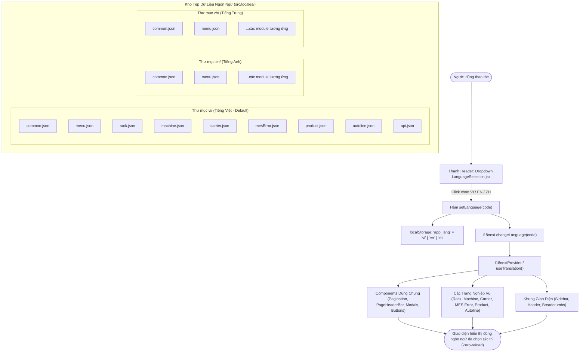

# KẾ HOẠCH TRIỂN KHAI ĐA NGÔN NGỮ (I18N INTEGRATION PLAN)

> **Tài liệu tham chiếu:** Kế hoạch tổng thể đặc tả kiến trúc, giải pháp công nghệ, cấu trúc thư mục từ điển, quy chuẩn đặt tên khóa (Key Naming Conventions) và lộ trình áp dụng đa ngôn ngữ toàn diện (**Internationalization - i18n**) cho toàn bộ hệ thống Enterprise Project Frontend.  
> **Ngôn ngữ hỗ trợ:**
>
> - 🇻🇳 **Tiếng Việt (`vi`)** (Ngôn ngữ mặc định hệ thống - Default Locale)
> - 🇬🇧 **Tiếng Anh (`en`)** (Chuẩn quốc tế đối tác công nghệ NVIDIA)
> - 🇨🇳 **Tiếng Trung Giản thể (`zh`)** (Chuẩn vận hành tập đoàn Foxconn Industrial Internet - FII)  
>   **Công nghệ đề xuất:** `i18next` + `react-i18next` kết hợp React 19, Tailwind CSS v4 và kiến trúc Namespaces theo từng phân hệ.  
>   **Ngày khởi tạo:** 16/11/2026.  
>   **Vị trí tài liệu:** `src/md/I18N_INTEGRATION_PLAN.md` (đồng bộ tại `md/I18N_INTEGRATION_PLAN.md`).

---

## 1. TỔNG QUAN VÀ BỐI CẢNH DỰ ÁN

### 1.1. Bối Cảnh Thực Tế Nhà Máy Thông Minh FII & NVIDIA

Dự án **Enterprise Project Frontend** là nền tảng điều hành và giám sát sản xuất máy chủ trí tuệ nhân tạo (AI Servers) tại các nhà máy thông minh của Foxconn (FII) hợp tác với đối tác chiến lược NVIDIA. Môi trường sản xuất thực tế có lực lượng người dùng đa quốc gia:

- **Kỹ sư và công nhân vận hành Việt Nam**: Cần giao diện Tiếng Việt chính xác, thân thiện, dễ hiểu, nắm bắt nhanh các cảnh báo lỗi máy, quy trình khắc phục sự cố (SOP).
- **Chuyên gia, kỹ sư trưởng kỹ thuật từ Đài Loan / Trung Quốc**: Cần giao diện Tiếng Trung chuẩn hóa thuật ngữ chuyên ngành sản xuất điện tử SMT, AOI, MES, SFC, Keyparts.
- **Khách hàng, chuyên gia kiểm toán kỹ thuật từ NVIDIA (Mỹ / Quốc tế)**: Cần giao diện Tiếng Anh chuẩn mực toàn cầu để đối soát tiêu chuẩn chất lượng (QA/QC), quản lý vòng đời sản phẩm, API logs và thông số kỹ thuật máy chủ AI.

### 1.2. Hiện Trạng Hệ Thống Hiện Tại

1. **Đã có sẵn nền móng ban đầu**:
   - `src/utils/Languages.jsx`: Định nghĩa 3 ngôn ngữ (`vi`, `zh`, `en`) kèm mã cờ SVG và nhãn đại diện.
   - `src/components/common/LanguageSelection.jsx`: Dropdown chọn ngôn ngữ trên Header.
   - `src/context/ThemeProvider.jsx`: State `language` lưu trữ trong `localStorage.getItem('app_lang')`.
   - `src/utils/Menu.jsx`: Menu có sẵn cấu trúc 3 ngôn ngữ cục bộ `{ vi, en, zh }` và `Sidebar.jsx` hiển thị `item.name[language]`.
2. **Hạn chế tồn tại**:
   - Hầu như 95% toàn bộ văn bản trong các trang (nút bấm, tiêu đề bảng, thông báo lỗi, placeholder, modal, tooltip, pagination, thống kê KPI, biểu đồ...) hiện đang bị **hardcode Tiếng Việt** hoặc Tiếng Anh rải rác.
   - Chưa có thư viện chuẩn hóa (chưa cài đặt `i18next` hay `react-i18next`), thiếu cơ chế nội suy biến (Interpolation: ví dụ: _"Hiển thị {{start}} - {{end}} trong tổng số {{total}}"_), thiếu cơ chế fallback khi thiếu bản dịch và thiếu kiến trúc tách file theo phân hệ (Namespaces).

### 1.3. Mục Tiêu Sau Khi Triển Khai

- **Chuyển đổi ngôn ngữ tức thời (Zero-Reload / Hot Switch)**: Khi người dùng bấm chuyển cờ VI / EN / ZH trên Header, 100% nội dung giao diện đổi ngôn ngữ ngay lập tức mà không cần reload lại trang.
- **Tương thích hoàn hảo React 19 & Tailwind CSS v4**: Không gây giật lag (re-render tối ưu), bundle size nhỏ gọn nhờ tách file theo namespace.
- **Duy trì nhận diện thương hiệu kép (Dual-Theme)**: Không làm ảnh hưởng đến cơ chế chuyển đổi giữa giao diện **Foxconn Navy/Slate** và **NVIDIA Cyber Neon Green**.
- **Không phá vỡ logic nghiệp vụ hiện có**: Cung cấp cơ chế tương thích ngược (Backward Compatibility), đảm bảo an toàn dữ liệu và các route hiện tại.

---

## 2. LỰA CHỌN CÔNG NGHỆ VÀ SO SÁNH GIẢI PHÁP

| Tiêu chí đánh giá                     | Tự viết Context cục bộ                   | FormatJS (`react-intl`) | `react-i18next` + `i18next` (Lựa chọn tối ưu)            |
| ------------------------------------- | ---------------------------------------- | ----------------------- | -------------------------------------------------------- |
| **Độ hoàn thiện & Hệ sinh thái**      | Thấp, phải tự code plural, interpolation | Cao, chuẩn quốc tế      | ⭐ **Rất cao**, là chuẩn thực tế số 1 cho React          |
| **Hỗ trợ Namespaces (Phân hệ)**       | Khó bảo trì khi ứng dụng phình to        | Phức tạp                | ⭐ **Xuất sắc**, tải file dịch theo từng trang/tính năng |
| **Tương thích React 19**              | Phải tự xử lý memo                       | Có thể gặp warning      | ⭐ **Tương thích hoàn hảo**, hỗ trợ Hooks chuẩn          |
| **Nội suy chuỗi (Interpolation)**     | Tự `replace()` thủ công, dễ lỗi          | Cú pháp ICU dài         | ⭐ **Cực kỳ trực quan**: `t('key', { val })`             |
| **Xử lý thiếu khóa dịch (Fallback)**  | Dễ bị crash màn hình trắng               | Fallback ra ID          | ⭐ **Tự động fallback** về ngôn ngữ mặc định (`vi`)      |
| **Dung lượng thư viện (Bundle size)** | 0 KB (nhưng tốn code maintain)           | ~14 KB gzipped          | ⭐ **~12 KB gzipped**, hỗ trợ tree-shaking               |

> **Quyết định kiến trúc:** Sử dụng bộ đôi **`i18next`** và **`react-i18next`**. Đây là giải pháp tiêu chuẩn công nghiệp, dễ bảo trì, đội ngũ kỹ sư có thể dễ dàng tham gia đóng góp và bổ sung bản dịch mà không cần can thiệp sâu vào logic JSX.

---

## 3. KIẾN TRÚC HỆ THỐNG VÀ SƠ ĐỒ LUỒNG DỮ LIỆU

### 3.1. Sơ Đồ Luồng Hoạt Động Của Hệ Thống i18n



---

## 4. THIẾT KẾ CẤU TRÚC THƯ MỤC VÀ PHÂN CHIA NAMESPACES

Để tránh việc gộp toàn bộ bản dịch của hàng chục tính năng vào một file JSON khổng lồ (gây chậm ứng dụng, khó tìm kiếm và dễ xung đột mã nguồn khi nhiều người cùng làm), kiến trúc chia thành các **Namespaces chuyên biệt**:

```text
src/
├── locales/
│   ├── i18n.js                              # Cấu hình khởi tạo i18next chính
│   │
│   ├── vi/                                  # Tệp từ điển TIẾNG VIỆT (Gốc)
│   │   ├── common.json                      # Từ dùng chung: nút bấm, trạng thái, modal, phân trang, lọc
│   │   ├── menu.json                        # Tên danh mục Sidebar, nhóm menu, Breadcrumbs
│   │   ├── auth.json                        # Đăng nhập, thông tin tài khoản, phân quyền RBAC
│   │   ├── autoline.json                    # Autoline Management & Operations, SFC Switch/Adapter
│   │   ├── machine.json                     # Machine Status, Machine Config, chỉ số OEE/UPH
│   │   ├── rack.json                        # Cấu hình Rack, Rack Overview, tủ điện, khe cắm
│   │   ├── carrier.json                     # Giám sát Carrier Realtime, Mở khóa khay (Unlock)
│   │   ├── mesError.json                    # Danh mục mã lỗi MES, SOP hướng dẫn khắc phục
│   │   ├── product.json                     # Cấu hình Model sản phẩm NVIDIA, Import file Excel
│   │   └── api.json                         # Nhật ký truy vấn API Request Logs
│   │
│   ├── en/                                  # Tệp từ điển TIẾNG ANH (Tương ứng 1-1)
│   │   ├── common.json
│   │   ├── menu.json
│   │   ├── auth.json
│   │   ├── autoline.json
│   │   ├── machine.json
│   │   ├── rack.json
│   │   ├── carrier.json
│   │   ├── mesError.json
│   │   ├── product.json
│   │   └── api.json
│   │
│   └── zh/                                  # Tệp từ điển TIẾNG TRUNG (Tương ứng 1-1)
│       ├── common.json
│       ├── menu.json
│       ├── auth.json
│       ├── autoline.json
│       ├── machine.json
│       ├── rack.json
│       ├── carrier.json
│       ├── mesError.json
│       ├── product.json
│       └── api.json
```

---

## 5. QUY CHUẨN ĐẶT TÊN KHÓA DỊCH (KEY NAMING CONVENTIONS)

Tuân thủ nguyên tắc **BEM-like Hierarchical Dot Notation (Cấu trúc phân cấp dấu chấm)**:
`<namespace>:<nhóm_chức_năng>.<loại_phần_tử>.<tên_cụ_thể>`

### 5.1. Ví Dụ Cụ Thể Trong `common.json` (Dùng Chung)

```json
{
  "actions": {
    "add": "Thêm mới",
    "edit": "Chỉnh sửa",
    "delete": "Xóa",
    "save": "Lưu lại",
    "cancel": "Hủy bỏ",
    "confirm": "Xác nhận",
    "search": "Tìm kiếm",
    "reset": "Đặt lại",
    "export": "Xuất báo cáo",
    "import": "Nhập tệp dữ liệu",
    "close": "Đóng",
    "refresh": "Làm mới",
    "fullscreen": "Toàn màn hình",
    "exitFullscreen": "Thoát toàn màn hình"
  },
  "pagination": {
    "showing": "Hiển thị",
    "to": "-",
    "of": "trong tổng số",
    "records": "bản ghi",
    "pageSize": "Số dòng:",
    "rowsPerPage": "dòng / trang",
    "first": "Đầu",
    "previous": "Trước",
    "next": "Sau",
    "last": "Cuối"
  },
  "status": {
    "all": "Tất cả trạng thái",
    "active": "Đang hoạt động",
    "inactive": "Không hoạt động",
    "running": "Đang chạy",
    "stopped": "Đã dừng",
    "error": "Lỗi",
    "warning": "Cảnh báo",
    "pass": "Đạt (PASS)",
    "fail": "Hỏng (FAIL)"
  },
  "table": {
    "no": "#",
    "actions": "Thao tác",
    "empty": "Không có dữ liệu phù hợp",
    "loading": "Đang tải dữ liệu...",
    "filter": "Lọc cột",
    "selectAll": "Chọn tất cả"
  },
  "roles": {
    "admin": "Quản trị viên (Admin)",
    "manager": "Trưởng bộ phận (Manager)",
    "operator": "Công nhân vận hành (Operator)",
    "permissionDenied": "Bạn không có quyền thực hiện chức năng này"
  }
}
```

### 5.2. Ví Dụ Cụ Thể Trong `mesError.json` (Phân Hệ Mã Lỗi)

```json
{
  "header": {
    "title": "MES ERROR CODE LIST",
    "badge": "TỪ ĐIỂN MÃ LỖI MES",
    "description": "Quản lý từ điển mã lỗi MES, phân loại bộ phận kỹ thuật phụ trách, thông báo song ngữ quốc tế và quy trình khắc phục sự cố tiêu chuẩn (SOP)."
  },
  "search": {
    "placeholder": "Tìm kiếm theo mã lỗi (ERR_...), nội dung tiếng Anh hoặc tiếng Việt...",
    "btnSearch": "Tìm kiếm",
    "btnAdd": "Thêm mã lỗi"
  },
  "table": {
    "colIndex": "#",
    "colErrorCode": "MÃ LỖI (ERROR CODE)",
    "colOwner": "BỘ PHẬN (OWNER)",
    "colMessageEn": "THÔNG BÁO TIẾNG ANH (MESSAGE EN)",
    "hint": "💡 Mẹo: Click vào Mã lỗi để xem chi tiết • Chuột phải vào dòng để Sửa / Xóa"
  },
  "detail": {
    "title": "CHI TIẾT MÃ LỖI MES",
    "subtitle": "Chi tiết mã lỗi MES & Hướng dẫn khắc phục sự cố (Troubleshooting SOP)",
    "ownerLabel": "Bộ phận phụ trách (Owner)",
    "stationsLabel": "Trạm áp dụng (Applicable Stations)",
    "msgEnLabel": "Thông báo tiếng Anh (Message EN)",
    "msgViLabel": "Thông báo tiếng Việt (Message VI)",
    "sopLabel": "Hướng dẫn xử lý & Khắc phục chuẩn (Troubleshooting SOP)",
    "lastUpdated": "Cập nhật lần cuối",
    "updatedBy": "Người cập nhật",
    "btnEdit": "Chỉnh sửa mã lỗi này",
    "btnClose": "Đóng"
  },
  "contextMenu": {
    "edit": "Sửa mã lỗi",
    "delete": "Xóa mã lỗi",
    "permissionWarning": "⚠️ Chỉ Admin / Manager mới thao tác được"
  }
}
```

---

## 6. MA TRẬN DỊCH THUẬT NGỮ CHUYÊN NGÀNH (TERMINOLOGY GLOSSARY MATRIX)

Để đảm bảo tính nhất quán trên toàn bộ các trang của nhà máy, bảng chuẩn hóa thuật ngữ 3 thứ tiếng như sau:

| Thuật ngữ gốc / Khái niệm    | 🇻🇳 Tiếng Việt               | 🇬🇧 English                      | 🇨🇳 中文 (Tiếng Trung)       |
| ---------------------------- | --------------------------- | ------------------------------- | --------------------------- |
| **Carrier / Jig**            | Khay chứa / Đồ gá           | Carrier / Jig Fixture           | 载具 / 治具                 |
| **Unlock Carrier**           | Mở khóa khay chứa           | Unlock Carrier                  | 解锁载具                    |
| **Routing / Work Order**     | Lộ trình sản xuất / Lệnh    | Production Routing / Work Order | 生产工艺路线 / 工单         |
| **Keyparts**                 | Linh kiện trọng yếu         | Critical Keyparts               | 关键物料 / 关键零件         |
| **Machine Config**           | Cấu hình máy                | Machine Configuration           | 机台配置                    |
| **Station Layout**           | Bố trí layout công đoạn     | Station Layout Control          | 工位布局控制                |
| **Interlock / Station Stop** | Chặn trạm / Dừng chuyền     | Station Interlock / Line Stop   | 工位防错拦截 / 停线         |
| **SFC (Shop Floor Control)** | Kiểm soát xưởng sản xuất    | Shop Floor Control (SFC)        | 现场生产控制系统            |
| **Troubleshooting Guide**    | Hướng dẫn khắc phục sự cố   | Troubleshooting Guide / SOP     | 故障排除指引 / 标准作业流程 |
| **Undo Link**                | Hủy liên kết phôi           | Undo Linkage                    | 撤销绑定关联                |
| **OEE**                      | Hiệu suất thiết bị tổng thể | Overall Equipment Effectiveness | 全面设备效率 (OEE)          |
| **UPH**                      | Sản lượng trên giờ          | Units Per Hour (UPH)            | 每小时产出 (UPH)            |
| **Yield Rate**               | Tỷ lệ đạt chất lượng        | Yield Rate (%)                  | 良品率 (%)                  |
| **Shift Start**              | Đầu ca sản xuất             | Shift Start Inspection          | 班次开始 / 换班首件         |
| **Periodic Inspection**      | Kiểm định định kỳ           | Periodic Inspection             | 定期检验 / 周期维保         |

---

## 7. ĐẶC TẢ TÍCH HỢP VÀO SOURCE CODE (INTEGRATION SPECIFICATIONS)

### 7.1. Cấu Hình Khởi Tạo `src/locales/i18n.js`

```javascript
import i18n from "i18next";
import { initReactI18next } from "react-i18next";

// Import các namespace Tiếng Việt
import viCommon from "./vi/common.json";
import viMenu from "./vi/menu.json";
import viMesError from "./vi/mesError.json";
// ...các namespace khác

// Import các namespace Tiếng Anh
import enCommon from "./en/common.json";
import enMenu from "./en/menu.json";
import enMesError from "./en/mesError.json";

// Import các namespace Tiếng Trung
import zhCommon from "./zh/common.json";
import zhMenu from "./zh/menu.json";
import zhMesError from "./zh/mesError.json";

const savedLang = localStorage.getItem("app_lang") || "vi";

i18n.use(initReactI18next).init({
  resources: {
    vi: {
      common: viCommon,
      menu: viMenu,
      mesError: viMesError,
    },
    en: {
      common: enCommon,
      menu: enMenu,
      mesError: enMesError,
    },
    zh: {
      common: zhCommon,
      menu: zhMenu,
      mesError: zhMesError,
    },
  },
  lng: savedLang,
  fallbackLng: "vi",
  defaultNS: "common",
  interpolation: {
    escapeValue: false, // React đã tự chống XSS an toàn
  },
});

export default i18n;
```

### 7.2. Đồng Bộ Hóa Giữa `LanguageSelection.jsx`, `ThemeProvider.jsx` và `i18n`

Trong `LanguageSelection.jsx` và `ThemeProvider.jsx`:

- Khi người dùng nhấp chọn ngôn ngữ mới:
  ```javascript
  const handleSelectLanguage = (code) => {
    setLanguage(code);
    i18n.changeLanguage(code);
    localStorage.setItem("app_lang", code);
  };
  ```
- Nhờ cơ chế `react-i18next`, tất cả các component dùng hook `useTranslation()` sẽ tự động kích hoạt re-render với nội dung ngôn ngữ mới ngay lập tức mà không cần F5/reload trang.

### 7.3. Áp Dụng Chuẩn Vào Component Phân Trang Dùng Chung (`Pagination.jsx`)

Hiện tại `Pagination.jsx` hiển thị:
`Hiển thị 1 - 10 trong tổng số 45 bản ghi` | `Số dòng:` | `⏮ Đầu`, `◀ Trước`, `Sau ▶`, `Cuối ⏭`

Sau khi tích hợp i18n:

```jsx
import { useTranslation } from "react-i18next";

export default function Pagination({
  currentPage,
  totalPages,
  pageSize,
  totalRecords,
  // ...
}) {
  const { t } = useTranslation("common");

  return (
    <div>
      <div>
        {t("pagination.showing")}{" "}
        <strong>
          {displayStart} - {displayEnd}
        </strong>{" "}
        {t("pagination.of")} <strong>{total}</strong> {t("pagination.records")}
      </div>

      {/* Nút phân trang */}
      <button>{t("pagination.first")}</button>
      <button>{t("pagination.previous")}</button>
      <button>{t("pagination.next")}</button>
      <button>{t("pagination.last")}</button>
    </div>
  );
}
```

---

## 8. LỘ TRÌNH THỰC HIỆN TỪNG BƯỚC (STEP-BY-STEP IMPLEMENTATION ROADMAP)

Quá trình tích hợp được chia thành **5 giai đoạn chiến lược** để đảm bảo kiểm soát chất lượng, không gián đoạn tính năng hiện tại:

### 🎯 Giai đoạn 1: Cài Đặt Thư Viện & Thiết Lập Cốt Lõi (Core Setup)

- [x] Cài đặt các gói npm: `npm install i18next react-i18next`.
- [x] Khởi tạo thư mục `src/locales/` và file cấu hình `src/locales/i18n.js`.
- [x] Tích hợp `import './locales/i18n';` vào entry point `src/main.jsx`.
- [x] Đồng bộ hàm `setLanguage` trong `ThemeProvider.jsx` và `LanguageSelection.jsx` với `i18n.changeLanguage()`.

### 🎯 Giai đoạn 2: Chuẩn Hóa Khung Bố Cục & Component Dùng Chung (Layout & Common)

- [x] Tạo file từ điển `common.json` cho cả 3 ngôn ngữ (`vi`, `en`, `zh`): nút bấm, phân trang, lọc, trạng thái.
- [x] Tạo file từ điển `menu.json` cho cả 3 ngôn ngữ: tên nhóm menu, tên từng chức năng.
- [x] Cập nhật `src/components/layout/Header.jsx` và `src/components/layout/Sidebar.jsx`.
- [x] Cập nhật component phân trang dùng chung `src/components/common/Pagination.jsx`.
- [x] Cập nhật `src/components/common/PageHeaderBar.jsx` (breadcrumbs, tiêu đề trang).

### 🎯 Giai đoạn 3: Chuyển Đổi Phân Hệ Cấu Hình Trọng Tâm (Config Modules)

- [x] **MES Error Code List**: Chuyển đổi `MesErrorCodeListPage.jsx`, bảng dữ liệu, top bar, modal xem chi tiết, menu chuột phải, modal thêm/sửa/xóa sang `mesError.json`.
- [x] **Product / NVIDIA**: Chuyển đổi `ProductNvidiaPage.jsx`, bảng model, import modal sang `product.json`.
- [x] **Rack Config & Rack Overview**: Chuyển đổi các bảng tủ rack, modal cấu hình sang `rack.json`.
- [x] **Carrier Config & Unlock Carrier**: Chuyển đổi tab giám sát realtime và tab mở khóa khay chứa sang `carrier.json`.
- [x] **Machine Config**: Chuyển đổi bảng máy, thông số thông minh sang `machine.json`.

### 🎯 Giai đoạn 4: Chuyển Đổi Phân Hệ Giám Sát & Điều Khiển (Operations & Management)

- [x] **Autoline Operations**: Chuyển đổi màn hình vận hành chuyền, bảng lộ trình sản xuất (Routing Steps), thanh quét đa phương thức sang `autoline.json`.
- [x] **Automation Line Management & Control**: Chuyển đổi sơ đồ luồng máy (Machine Flow), trạm SFC Switch/Adapter, Terminal console.
- [x] **Machine Status Management**: Chuyển đổi biểu đồ thời gian thực, bảng phân tích UPH/OEE, cảnh báo máy.
- [x] **API Request History**: Chuyển đổi màn hình lịch sử request log sang `api.json`.
- [x] **Authentication & Profile**: Chuyển đổi màn hình đăng nhập và menu tài khoản sang `auth.json`.

### 🎯 Giai đoạn 5: Kiểm Thử Toàn Diện & Tối Ưu Hóa (QA & Optimization)

- [x] Kiểm thử chuyển đổi ngôn ngữ trên mọi màn hình: VI ⇄ EN ⇄ ZH.
- [x] Kiểm tra tính toàn vẹn của giao diện: Các từ tiếng Anh/Trung dài hơn hoặc ngắn hơn không bị vỡ layout CSS.
- [x] Đảm bảo tính tương thích với cả 2 Theme (**Foxconn** sáng và **NVIDIA** tối).
- [x] Chạy lệnh `npm run build` để kiểm tra bundle size và đảm bảo **exit code 0**.

---

## 9. CHIẾN LƯỢC XỬ LÝ DỮ LIỆU ĐỘNG VÀ NGOẠI LỆ (EDGE CASES)

1. **Dữ liệu động từ API / Mock Data (Ví dụ: Tên sản phẩm, Serial Number, Log Payload)**:
   - Giữ nguyên giá trị gốc từ server/phần cứng, không dịch máy móc các mã định danh kỹ thuật (`SN-GB200-...`, `CRR-A089`, `IP 192.168.1.10`).
2. **Thông báo lỗi MES có 2 phiên bản (Message EN & Message VI)**:
   - Trong CSDL hiện tại đã lưu trữ sẵn cả `messageEn` và `messageVi`. Khi chọn tiếng Việt thì hiển thị `messageVi`, khi chọn tiếng Anh hoặc tiếng Trung thì ưu tiên `messageEn` kèm nhãn ngôn ngữ.
3. **Định dạng số và ngày tháng (Number & Date Formatting)**:
   - Tiếng Việt: `DD/MM/YYYY HH:mm:ss`, dấu phẩy phân cách phần thập phân.
   - Tiếng Anh: `MM/DD/YYYY hh:mm A`.
   - Tiếng Trung: `YYYY-MM-DD HH:mm:ss`.
   - Sử dụng chuẩn `Intl.DateTimeFormat` và `Intl.NumberFormat` theo ngôn ngữ hiện tại của i18n.
4. **Phòng tránh Missing Translation Key**:
   - Cấu hình `fallbackLng: 'vi'` để nếu một cụm từ tiếng Trung (`zh`) hoặc tiếng Anh (`en`) chưa kịp cập nhật, hệ thống tự động hiển thị tiếng Việt thay vì hiển thị mã khóa thô `[common.actions.save]`.

---

## 10. KẾT LUẬN VÀ BƯỚC CHUẨN BỊ

Bản kế hoạch trên đã thiết lập một lộ trình chi tiết, an toàn và bài bản để biến **Enterprise Project Frontend** thành một hệ thống chuẩn hóa quốc tế 3 ngôn ngữ (**Tiếng Việt - English - 中文**).

> [!NOTE]  
> Toàn bộ nội dung kế hoạch đã sẵn sàng. Khi bạn xem xét xong bản kế hoạch và đồng ý triển khai, chúng ta sẽ bắt đầu từ **Giai đoạn 1 (Cài đặt thư viện và thiết lập cốt lõi)** theo đúng quy trình đã vạch ra!
