# KẾ HOẠCH TRIỂN KHAI GIAO DIỆN CẤU HÌNH MÁY MÓC (`/config/machine`)

> **Tài liệu tham chiếu:** Plan thiết kế kiến trúc và giao diện trang Quản lý Cấu hình Máy móc (Machine Configuration Management).  
> **Áp dụng cho route:** `/config/machine` (thuộc nhóm menu **CONFIG / CẤU HÌNH HỆ THỐNG**).  
> **Component đích:** `src/features/config/machine/MachineConfigPage.jsx`.  
> **Đặc tả kiến trúc:** Module hóa tối đa (Component-Driven Architecture) — Tách bảng dữ liệu (`MachineConfigTable.jsx`), thanh điều khiển & tìm kiếm (`MachineConfigToolbar.jsx`), phân trang & chọn số lượng bản ghi (`MachineConfigPagination.jsx`), modal thêm/sửa (`MachineConfigFormModal.jsx`), modal xem chi tiết (`MachineConfigDetailModal.jsx`), modal xác nhận xóa (`MachineDeleteConfirmModal.jsx`), modal import/export Excel (`MachineExcelImportModal.jsx`), và custom hook quản lý dữ liệu (`useMachineConfigData.js`).  
> **Ngày khởi tạo:** 29/10/2026.  
> **Ngày cập nhật gần nhất:** 02/11/2026 (Chi tiết hóa Phân hệ Tab 5: Screw Config - Quy chuẩn thẩm định & dung sai dữ liệu vít AutoLine).  
> **Vị trí tài liệu:** `md/MACHINE_CONFIG_PLAN.md` (đồng bộ tại `src/md/MACHINE_CONFIG_PLAN.md`).

---

## 1. TỔNG QUAN VÀ MỤC TIÊU DỰ ÁN

Giao diện **Cấu hình Máy móc (`/config/machine`)** là phân hệ quản trị danh mục thiết bị sản xuất toàn nhà máy của Foxconn / NVIDIA. Màn hình cho phép các kỹ sư cấu hình, giám sát tham số mạng (IP, Hostname), liên kết trạm máy với chuyền sản xuất (`Line`), công đoạn (`Step`), nhóm linh kiện (`Keys`), và thực hiện các thao tác quản trị CRUD (Thêm, Sửa, Xóa, Xem chi tiết, Lọc đa tiêu chí, Import/Export Excel).

### Mục tiêu thiết kế cốt lõi:

1. **Trực quan hóa bảng dữ liệu lớn:** Bảng thông tin chuẩn hóa đầy đủ 13 cột thông tin kỹ thuật, hỗ trợ cuộn ngang/dọc mượt mà, sticky header, phân tách rõ ràng giữa các trường dữ liệu.
2. **Bộ công cụ thao tác nhanh ở đầu trang:**
   - **Ô tìm kiếm tức thì (Instant Search Box):** Lọc theo tên máy, IP, hostname, line, khách hàng...
   - **Nút Import / Export Excel:** Tải file mẫu, nhập dữ liệu hàng loạt từ Excel hoặc xuất danh sách ra file `.xlsx`.
   - **Nút Tạo máy mới (`+ Create Machine`):** Mở form thêm máy mới trực quan với validation đầy đủ.
3. **Phân trang linh hoạt (Pagination & Page Size):**
   - Hỗ trợ chuyển trang (Next/Prev/First/Last/Số trang).
   - Dropdown chọn số lượng bản ghi hiển thị trên mỗi trang (`10`, `20`, `50`, `100`).
   - Hiển thị chính xác số lượng bản ghi: `"Hiển thị 1 - 10 trong tổng số 128 bản ghi"`.
4. **Cột Thao Tác & Reset Filter thông minh:**
   - Header cột có **Nút Reset Filter** (đặt lại mọi bộ lọc của bảng về mặc định).
   - Mỗi hàng có **3 nút chức năng**:
     - 👁️ **Xem chi tiết (View Details):** Mở modal xem toàn bộ thông số máy, telemetry và thông tin kết nối.
     - ✏️ **Sửa (Edit):** Chỉnh sửa nhanh thông tin máy.
     - 🗑️ **Xóa (Delete):** Xóa máy kèm dialog xác nhận bảo vệ an toàn.
   - Tích hợp bộ lọc nhanh ngay tại các cột (Column Filters).
5. **Tương thích hoàn hảo 2 Brand Theme:**
   - **Foxconn:** Nền sáng thanh lịch `bg-slate-50`, bảng trắng `bg-white border-slate-200`, điểm nhấn xanh navy `#002766`.
   - **NVIDIA:** Nền tối công nghiệp `bg-zinc-950`, bảng tối `bg-zinc-900 border-zinc-800`, chữ trắng tinh khiết `text-white`, điểm nhấn xanh neon `#76B900`.

---

## 2. BỐ CỤC KHÔNG GIAN VÀ SƠ ĐỒ GIAO DIỆN

### 2.1. Wireframe Tổng Quan Bố Cục Trang:

```text
┌────────────────────────────────────────────────────────────────────────────────────────────────────────┐
│ Header Bar: CONFIG / MACHINE CONFIG                                                                    │
│ Tiêu đề: MACHINE CONFIGURATION | Mô tả chức năng quản lý tham số & thiết bị trạm máy                   │
├────────────────────────────────────────────────────────────────────────────────────────────────────────┤
│ Toolbar Điều Khiển Phía Trên:                                                                          │
│ ┌───────────────────────────────────────────────┐ ┌──────────────────────────┐ ┌─────────────────────┐ │
│ │ 🔍 Tìm kiếm (Tên máy, IP, Host, Line...)... [✕]│ │ 📥 Import/Export Excel ⏷│ │ + Thêm Máy Mới (F2) │ │
│ └───────────────────────────────────────────────┘ └──────────────────────────┘ └─────────────────────┘ │
├────────────────────────────────────────────────────────────────────────────────────────────────────────┤
│ Bảng Dữ Liệu Máy Móc (Machine Configuration Master Table) - Sticky Header:                             │
│ ┌──────┬───────┬─────┬───────┬──────┬──────┬────┬────┬───────┬──────┬──────────┬──────────┬───────────┐ │
│ │Custom│Factory│Floor│Product│Prod. │Line  │Step│Keys│Group  │Mach. │IP Address│Host Name │[⟲ Reset]  │ │
│ │-er   │       │     │Name   │Type  │Name  │    │    │Name   │Name  │          │          │(Lọc/Thao  │ │
│ │ [⏷]  │  [⏷]  │ [⏷] │  [⏷]  │ [⏷]  │ [⏷]  │[⏷] │[⏷] │  [⏷]  │ [⏷]  │   [⏷]    │   [⏷]    │ tác) [⏷]  │ │
│ ├──────┼───────┼─────┼───────┼──────┼──────┼────┼────┼───────┼──────┼──────────┼──────────┼───────────┤ │
│ │NVIDIA│F01-BN │ 1F  │B200   │GPU   │Line01│ST01│K-01│SMT-Grp│MNT-01│192.168...│smt01.fii │👁️ ✏️ 🗑️  │ │
│ │NVIDIA│F01-BN │ 1F  │B200   │GPU   │Line01│ST02│K-02│AOI-Grp│AOI-01│192.168...│aoi01.fii │👁️ ✏️ 🗑️  │ │
│ │NVIDIA│F01-BN │ 2F  │GB200  │Tray  │Line02│ST03│K-03│SCR-Grp│SCR-01│192.168...│scr01.fii │👁️ ✏️ 🗑️  │ │
│ └──────┴───────┴─────┴───────┴──────┴──────┴────┴────┴───────┴──────┴──────────┴──────────┴───────────┘ │
├────────────────────────────────────────────────────────────────────────────────────────────────────────┤
│ Phân Trang & Đếm Bản Ghi (Footer Pagination):                                                          │
│ Hiển thị 1 - 10 trong tổng số 128 bản ghi  |  Số dòng/trang: [10 ⏷]  |  [⏮] [◀] [ 1 ] [ 2 ] [ 3 ] [▶] [⏭]│
└────────────────────────────────────────────────────────────────────────────────────────────────────────┘
```

### 2.2. Wireframe Cửa Sổ Nổi Thêm / Sửa Máy (Near Full-Screen Modal - Tỉ Lệ 1/3 : 2/3):

```text
┌────────────────────────────────────────────────────────────────────────────────────────────────────────────────────────┐
│ [Icon] {title || 'CREATE MACHINE CONFIGURATION' / 'EDIT MACHINE CONFIG'}    [Mode: Draft/Edit]                    [✕] │
├─────────────────────────────────────────┬──────────────────────────────────────────────────────────────────────────────┤
│ ◀ 1/3 MÀN HÌNH BÊN TRÁI (CORE INPUTS)   │ ▶ 2/3 MÀN HÌNH BÊN PHẢI (EXTENDED CONFIGURATION TABS)                        │
│ ┌─────────────────────────────────────┐ │ ┌──────────┬──────────┬──────────┬──────────┬──────────┬──────────┬────────────┐ │
│ │ THÔNG TIN CƠ BẢN TRẠM MÁY           │ │ │ Machine  │Validation│ Routing  │   UPH    │  Screw   │ Pressfit │ History &  │ │
│ │                                     │ │ │  Config  │   Keys   │ Configs  │  Config  │  Config  │  Config  │  Restore   │ │
│ │ 🏢 Customer:                        │ │ └──────────┴──────────┴──────────┴──────────┴──────────┴──────────┴────────────┘ │
│ │ [ Nhập customer...                ] │ │                                                                            │
│ │ 🏭 Factory:                         │ │ ┌────────────────────────────────────────────────────────────────────────┐ │
│ │ [ Nhập factory...                 ] │ │ │ ⚙️ CẤU HÌNH CỜ HOẠT ĐỘNG TRẠM MÁY (MACHINE FLAGS):                     │ │
│ │ 🏬 Floor:                           │ │ │ ┌────────────────────────────────────────────────────────────────────┐ │ │
│ │ [ Nhập floor (1F, 2F...)...       ] │ │ │ │ [☑] Is Auto Line (Máy tự động hóa)                                  │ │ │
│ │ ⚡ Line:                            │ │ │ │ [☑] Is SFC PreCheck (Kiểm tra PreCheck với SFC)                     │ │ │
│ │ [ Nhập tên line chuyền...         ] │ │ │ │ [☑] Is SFC Station (Trạm gửi kết quả SFC)                            │ │ │
│ │ 📦 Product Name:                    │ │ │ │ [☐] Send SFC On Pass Only (Chỉ gửi SFC khi PASS)                     │ │ │
│ │ [ Nhập tên sản phẩm...            ] │ │ │ │ [☑] Allow Fail Pass-Through (Cho phép Fail qua trạm)                 │ │ │
│ │ 🏷️ Product Type:                    │ │ │ └────────────────────────────────────────────────────────────────────┘ │ │
│ │ [ Nhập loại sản phẩm...           ] │ │ │ ┌────────────────────────────────────────────────────────────────────┐ │ │
│ │ 👥 Group Name:                      │ │ │ │ ℹ️ Ý NGHĨA & LOGIC VẬN HÀNH CÁC CỜ CẤU HÌNH TRẠM MÁY (MACHINE FLAGS):│ │ │
│ │ [ Nhập nhóm máy...                ] │ │ │ │ 1. Is Auto Line: Đánh dấu máy thuộc dây chuyền tự động. Kích hoạt  │ │ │
│ │ 💻 Machine Name (*):                │ │ │ │    Group, Step & quy trình kiểm tra 3 pha (PreCheck → Link → Undo).│ │ │
│ │ [ Nhập tên máy...                 ] │ │ │ │ 2. Is SFC PreCheck: Kích hoạt giao tiếp kiểm tra PreCheck với SFC  │ │ │
│ │ 🌐 IP Address (*):                  │ │ │ │    (MES) trước khi sản phẩm vào trạm.                              │ │ │
│ │ [ 192.168.10.xxx                  ] │ │ │ │ 3. Is SFC Station: Trạm gửi kết quả (Insert Result) lên SFC (MES). │ │ │
│ │ 🖥️ Host Name (*):                    │ │ │ │    Tự động gom dữ liệu SFC KeyPart (IsSFC=1) để đẩy sang SFC.     │ │ │
│ │ [ smt-mnt-01.fii.foxconn.com      ] │ │ │ │ 4. Send SFC On Pass Only: Chỉ giao tiếp/gửi dữ liệu sang SFC khi   │ │ │
│ │ 🔢 Step:                            │ │ │ │    kết quả Client là PASS. Các kết quả khác chỉ lưu nội bộ.        │ │ │
│ │ [ Nhập công đoạn (ST01, ST02)...  ] │ │ │ │ 5. Allow Fail Pass-Through: Khi kết quả FAIL thì sản phẩm vẫn được │ │ │
│ │ 📝 Description:                     │ │ │ │    đi tiếp mà không gây tắc chuyền.                                │ │ │
│ │ [ Mô tả chức năng máy...          ] │ │ │ └────────────────────────────────────────────────────────────────────┘ │ │
│ │                                     │ │ └────────────────────────────────────────────────────────────────────────┘ │
│ │ ┌─────────────────────────────────┐ │ │                                                                            │
│ │ │ 💾 {submitButtonText ||         │ │ │ (Tabs 2, 3, 4, 5: Validation Keys, Routing, UPH & Screw Configs đã quy     │
│ │ │    (mode==='edit' ?             │ │ │  chuẩn; Tabs 6-7 giữ placeholder container kỹ thuật)                       │
│ │ │     'UPDATE MACHINE' :          │ │ │                                                                            │
│ │ │     'CREATE MACHINE')}          │ │ │                                                                            │
│ │ └─────────────────────────────────┘ │ │                                                                            │
│ └─────────────────────────────────────┘ │                                                                            │
└─────────────────────────────────────────┴──────────────────────────────────────────────────────────────────────────────┘
```

### 2.3. Wireframe Chi Tiết Phân Hệ Tab 2: Validation Keys (Khóa Xác Thực Cấp Linh Kiện):

```text
┌────────────────────────────────────────────────────────────────────────────────────────────────────────────────────────┐
│ [Icon] TẠO MỚI / CHỈNH SỬA CẤU HÌNH MÁY                                           [Mode: Draft/Edit]               [✕] │
├─────────────────────────────────────────┬──────────────────────────────────────────────────────────────────────────────┤
│ ◀ 1/3 CỘT TRÁI (CORE INPUTS)            │ ▶ 2/3 CỘT PHẢI: TAB 2 - VALIDATION KEYS (KHÓA XÁC THỰC CẤP LINH KIỆN)        │
│ ┌─────────────────────────────────────┐ │ ┌──────────┬──────────────┬──────────┬──────────┬──────────┬──────────┬─────────┐ │
│ │ THÔNG TIN CƠ BẢN TRẠM MÁY           │ │ │ Machine  │  Validation  │ Routing  │   UPH    │  Screw   │ Pressfit │History &│ │
│ │ 🏢 Customer: [ NVIDIA             ] │ │ │  Config  │ Keys [Active]│ Configs  │  Config  │  Config  │  Config  │ Restore │ │
│ │ 🏭 Factory:  [ F01 - Bắc Ninh     ] │ │ └──────────┴──────────────┴──────────┴──────────┴──────────┴──────────┴─────────┘ │
│ │ 🏬 Floor:    [ 1F                 ] │ │                                                                            │
│ │ ⚡ Line:     [ Line 01 - High SMT ] │ │ ┌────────────────────────────────────────────────────────────────────────┐ │
│ │ 📦 Product:  [ HGX B200           ] │ │ │ ➕ THÊM / CẬP NHẬT KEY CONFIG (INPUT WORKSPACE)                        │ │
│ │ 🏷️ Type:     [ GPU Board          ] │ │ │ ┌──────────────────────┬──────────────────────┬──────────────────────┐ │ │
│ │ 👥 Group:    [ SMT Group A        ] │ │ │ │ Key Name (*):        │ Display Name:        │ Value Type (⏷):      │ │ │
│ │ 💻 Machine:  [ SMT Mounter #01    ] │ │ │ │ [ BARCODE_MAIN     ] │ [ Mã vạch Mainboard] │ [ string           ⏷]│ │ │
│ │ 🌐 IP:       [ 192.168.10.101     ] │ │ │ └──────────────────────┴──────────────────────┴──────────────────────┘ │ │
│ │ 🖥️ Host:     [ smt01.fii          ] │ │ │ ┌─────────────────────────────────────────────────┬──────────────────┐ │ │
│ │ 🔢 Step:     [ ST01               ] │ │ │ │ [☑] Required [☐] Bypass [☑] Verify [☑] SFC [☑] Act│ [✕ Cancel][💾Save]│ │ │
│ │ 📝 Desc:     [ Trạm gắn chip...   ] │ │ │ └─────────────────────────────────────────────────┴──────────────────┘ │ │
│ │                                     │ │ └────────────────────────────────────────────────────────────────────────┘ │
│ │ ┌─────────────────────────────────┐ │ │ ┌────────────────────────────────────────────────────────────────────────┐ │
│ │ │ 💾 CREATE / UPDATE MACHINE      │ │ │ │ 📋 BẢNG DANH SÁCH KHÓA XÁC THỰC (VALIDATION KEYS TABLE):               │ │
│ │ └─────────────────────────────────┘ │ │ │ ┌────┬────────────┬─────────────┬──────┬────┬────┬────┬───┬──────┬─────────┐ │ │
│ └─────────────────────────────────────┘ │ │ │Step│Key Name    │Display Name │Type  │Req │Byp │Ver │SFC│Status│Action   │ │ │
│                                         │ │ ├────┼────────────┼─────────────┼──────┼────┼────┼────┼───┼──────┼─────────┤ │ │
│                                         │ │ │ST01│BARCODE_MAIN│Mã vạch Main │string│ ✓  │ -  │ ✓  │ ✓ │Active│✏️Sửa 🗑️Xóa│ │ │
│                                         │ │ │ST01│MAC_ADDR    │Địa chỉ MAC  │string│ ✓  │ -  │ -  │ ✓ │Active│✏️Sửa 🗑️Xóa│ │ │
│                                         │ │ │ST01│TORQUE_SCREW│Lực siết ốc  │double│ -  │ ✓  │ -  │ - │Active│✏️Sửa 🗑️Xóa│ │ │
│                                         │ │ └────┴────────────┴─────────────┴──────┴────┴────┴────┴───┴──────┴─────────┘ │ │
│                                         │ │ └────────────────────────────────────────────────────────────────────────┘ │
│                                         │ │ ┌────────────────────────────────────────────────────────────────────────┐ │
│                                         │ │ │ ℹ️ Ý NGHĨA & LOGIC TRIỂN KHAI CỦA CÁC CỜ CẤU HÌNH CẤP KEYPART:         │ │
│                                         │ │ │ 1. IsRequire (Bắt buộc): Key phải quét và gửi lên, không được trống... │ │
│                                         │ │ │ 2. IsBypass (Bỏ qua logic): Cho phép bỏ qua kiểm tra trùng lặp...      │ │
│                                         │ │ │ 3. IsVerify (So khớp trạm trước): Bắt buộc trùng giá trị đã quét...    │ │
│                                         │ │ │ 4. Is SFC KeyPart (Khóa SFC): Đánh dấu key thuộc danh sách khóa SFC... │ │
│                                         │ │ └────────────────────────────────────────────────────────────────────────┘ │
│                                         │ └────────────────────────────────────────────────────────────────────────────┘
└─────────────────────────────────────────┴──────────────────────────────────────────────────────────────────────────────┘
```

### 2.4. Wireframe Chi Tiết Phân Hệ Tab 3: Routing Configs (Cấu Hình Định Tuyến & Trạm Song Song):

```text
┌────────────────────────────────────────────────────────────────────────────────────────────────────────────────────────┐
│ [Icon] TẠO MỚI / CHỈNH SỬA CẤU HÌNH MÁY                                           [Mode: Draft/Edit]               [✕] │
├─────────────────────────────────────────┬──────────────────────────────────────────────────────────────────────────────┤
│ ◀ 1/3 CỘT TRÁI (CORE INPUTS)            │ ▶ 2/3 CỘT PHẢI: TAB 3 - ROUTING CONFIGS (CẤU HÌNH ĐỊNH TUYẾN & TRẠM SONG SONG)│
│ ┌─────────────────────────────────────┐ │ ┌──────────┬──────────┬──────────────┬──────────┬──────────┬──────────┬─────────┐ │
│ │ THÔNG TIN CƠ BẢN TRẠM MÁY           │ │ │ Machine  │Validation│   Routing    │   UPH    │  Screw   │ Pressfit │History &│ │
│ │ 🏢 Customer: [ NVIDIA             ] │ │ │  Config  │   Keys   │Configs[Activ]│  Config  │  Config  │  Config  │ Restore │ │
│ │ 🏭 Factory:  [ F01 - Bắc Ninh     ] │ │ └──────────┴──────────┴──────────────┴──────────┴──────────┴──────────┴─────────┘ │
│ │ 🏬 Floor:    [ 1F                 ] │ │                                                                            │
│ │ ⚡ Line:     [ Line 01 - High SMT ] │ │ ┌────────────────────────────────────────────────────────────────────────┐ │
│ │ 📦 Product:  [ HGX B200           ] │ │ │ ⚙️ CẤU HÌNH BƯỚC CÔNG ĐOẠN (STEP ROUTING SETTINGS):                     │ │
│ │ 🏷️ Type:     [ GPU Board          ] │ │ │ ┌─────────────────────────────┬───────────────────────────┬────────────┐ │ │
│ │ 👥 Group:    [ SMT Group A        ] │ │ │ │ Main Key (*):               │ Mode (Dropdown):          │ Thao tác:  │ │ │
│ │ 💻 Machine:  [ SMT Mounter #01    ] │ │ │ │ [ BARCODE_MAIN            ] │ [ Mode 0: Standard      ⏷]│ [💾 Save   ]│ │ │
│ │ 🌐 IP:       [ 192.168.10.101     ] │ │ │ │                             │ (Mode 1: Upload Data First│ Step Config│ │ │
│ │ 🖥️ Host:     [ smt01.fii          ] │ │ │ └─────────────────────────────┴───────────────────────────┴────────────┘ │ │
│ │ 🔢 Step:     [ ST01               ] │ │ └────────────────────────────────────────────────────────────────────────┘ │
│ │ 📝 Desc:     [ Trạm gắn chip...   ] │ │ ┌────────────────────────────────────────────────────────────────────────┐ │
│ │                                     │ │ │ ➕ THIẾT LẬP TRẠM SONG SONG (ADD TWIN STEP CONFIG):                    │ │
│ │ ┌─────────────────────────────────┐ │ │ │ ┌─────────────────────────┬──────────────────────────────────────────────┐ │ │
│ │ │ 💾 CREATE / UPDATE MACHINE      │ │ │ │ │ Twin Step (Nhập số):    │ Tùy chọn (Checkboxes):                       │ │ │
│ │ └─────────────────────────────────┘ │ │ │ │ [ 11                  ] │ [☑] Allow Swap       [☑] Picker (Resolve SN) │ │ │
│ └─────────────────────────────────────┘ │ │ │ └─────────────────────────┴──────────────────────────────────────────────┘ │ │
│                                         │ │ │ ┌────────────────────────────────────────────────────────────────────┐ │ │
│                                         │ │ │ │                                                [✕ Cancel] [💾 Save]│ │ │
│                                         │ │ │ └────────────────────────────────────────────────────────────────────┘ │ │
│                                         │ │ └────────────────────────────────────────────────────────────────────────┘ │
│                                         │ │ ┌────────────────────────────────────────────────────────────────────────┐ │
│                                         │ │ │ 📋 BẢNG DANH SÁCH CẤU HÌNH ĐỊNH TUYẾN (ROUTING CONFIGS TABLE):          │ │
│                                         │ │ │ ┌───────┬──────┬────┬─────────┬──────┬────────────┬──────┬───────────────┐ │ │
│                                         │ │ │ │Product│Line  │Step│Twin Step│Mode  │Carrier Swap│Picker│Action         │ │ │
│                                         │ │ │ ├───────┼──────┼────┼─────────┼──────┼────────────┼──────┼───────────────┤ │ │
│                                         │ │ │ │B200   │Line01│ST01│11       │Mode 0│✓ Allow     │✓ Res │✏️ Sửa  🗑️ Xóa │ │ │
│                                         │ │ │ │B200   │Line01│ST01│12       │Mode 0│-           │-     │✏️ Sửa  🗑️ Xóa │ │ │
│                                         │ │ │ └───────┴──────┴────┴─────────┴──────┴────────────┴──────┴───────────────┘ │ │
│                                         │ │ └────────────────────────────────────────────────────────────────────────┘ │
│                                         │ │ ┌────────────────────────────────────────────────────────────────────────┐ │
│                                         │ │ │ ℹ️ Ý NGHĨA CẤU HÌNH ĐỊNH TUYẾN (ROUTING CONFIG):                         │ │
│                                         │ │ │ 1. Twin Step (Trạm song song/định tuyến): Cấu hình các trạm song song...│ │
│                                         │ │ │ 2. Allow Carrier Swap (Chuyển đổi khay): Cho phép trạm đổi khay...      │ │
│                                         │ │ │ 3. Picker (Phân giải Carrier từ MainKey/SN): Robot gắp phân giải khay... │ │
│                                         │ │ │ 4. Sfc Trigger Step (Trì hoãn định tuyến SFC): Hoãn gửi SFC...           │ │
│                                         │ │ └────────────────────────────────────────────────────────────────────────┘ │
│                                         │ └────────────────────────────────────────────────────────────────────────────┘
└─────────────────────────────────────────┴──────────────────────────────────────────────────────────────────────────────┘
```

### 2.5. Wireframe Chi Tiết Phân Hệ Tab 4: UPH Config (Cấu Hình Định Mức Sản Lượng & Nhịp Chuyền Takt Time):

```text
┌────────────────────────────────────────────────────────────────────────────────────────────────────────────────────────┐
│ [Icon] TẠO MỚI / CHỈNH SỬA CẤU HÌNH MÁY                                           [Mode: Draft/Edit]               [✕] │
├─────────────────────────────────────────┬──────────────────────────────────────────────────────────────────────────────┤
│ ◀ 1/3 CỘT TRÁI (CORE INPUTS)            │ ▶ 2/3 CỘT PHẢI: TAB 4 - UPH CONFIG (CẤU HÌNH ĐỊNH MỨC SẢN LƯỢNG & TAKT TIME) │
│ ┌─────────────────────────────────────┐ │ ┌──────────┬──────────┬──────────┬──────────────┬──────────┬──────────┬─────────┐ │
│ │ THÔNG TIN CƠ BẢN TRẠM MÁY           │ │ │ Machine  │Validation│ Routing  │     UPH      │  Screw   │ Pressfit │History &│ │
│ │ 🏢 Customer: [ NVIDIA             ] │ │ │  Config  │   Keys   │ Configs  │Config[Active]│  Config  │  Config  │ Restore │ │
│ │ 🏭 Factory:  [ F01 - Bắc Ninh     ] │ │ └──────────┴──────────┴──────────┴──────────────┴──────────┴──────────┴─────────┘ │
│ │ 🏬 Floor:    [ 1F                 ] │ │                                                                            │
│ │ ⚡ Line:     [ Line 01 - High SMT ] │ │ ┌────────────────────────────────────────────────────────────────────────┐ │
│ │ 📦 Product:  [ HGX B200           ] │ │ │ ⏱️ UPH & TAKT TIME CONFIGURATION:                                      │ │
│ │ 🏷️ Type:     [ GPU Board          ] │ │ │ ┌────────────────────────┬────────────────────────┬──────────────────┐ │ │
│ │ 👥 Group:    [ SMT Group A        ] │ │ │ │ Target UPH (p/h) (*):  │Target Cycle Time (sec):│Warning Tol. (%): │ │ │
│ │ 💻 Machine:  [ SMT Mounter #01    ] │ │ │ │ [ 120                ] │ [ 30.00              ] │ [ 5.0            ]│ │ │
│ │ 🌐 IP:       [ 192.168.10.101     ] │ │ │ │ (Sản lượng cái/giờ)    │ (Tự tính: 3600 / UPH)  │ (Dung sai cảnh b)│ │ │
│ │ 🖥️ Host:     [ smt01.fii          ] │ │ │ └────────────────────────┴────────────────────────┴──────────────────┘ │ │
│ │ 🔢 Step:     [ ST01               ] │ │ │ ┌───────────────────────────────────────────────┬────────────────────┐ │ │
│ │ 📝 Desc:     [ Trạm gắn chip...   ] │ │ │ │ [ (●) Enabled ] Enable UPH Monitoring         │ [💾Save UPH Config]│ │ │
│ │                                     │ │ │ └───────────────────────────────────────────────┴────────────────────┘ │ │
│ │ ┌─────────────────────────────────┐ │ │ └────────────────────────────────────────────────────────────────────────┘ │
│ │ │ 💾 CREATE / UPDATE MACHINE      │ │ │ ┌────────────────────────────────────────────────────────────────────────┐ │
│ │ └─────────────────────────────────┘ │ │ │ ℹ️ Ý NGHĨA & CƠ CHẾ GIÁM SÁT UPH & TAKT TIME:                           │ │
│ └─────────────────────────────────────┘ │ │ │ 1. Target UPH (Sản lượng mục tiêu/giờ): Số lượng sản phẩm yêu cầu...     │ │
│                                         │ │ │ 2. Target Cycle Time (Takt Time nhịp chuyền): Thời gian chu kỳ mục tiêu...│ │
│                                         │ │ │ 3. Warning Tolerance (% Dung sai cảnh báo): Ngưỡng % dung sai dao động...│ │
│                                         │ │ └────────────────────────────────────────────────────────────────────────┘ │
│                                         │ └────────────────────────────────────────────────────────────────────────────┘
└─────────────────────────────────────────┴──────────────────────────────────────────────────────────────────────────────┘
```

### 2.6. Wireframe Chi Tiết Phân Hệ Tab 5: Screw Config (Cấu Hình Tiêu Chuẩn & Dung Sai Vị Trí Vít):

```text
┌────────────────────────────────────────────────────────────────────────────────────────────────────────────────────────┐
│ [Icon] TẠO MỚI / CHỈNH SỬA CẤU HÌNH MÁY                                           [Mode: Draft/Edit]               [✕] │
├─────────────────────────────────────────┬──────────────────────────────────────────────────────────────────────────────┤
│ ◀ 1/3 CỘT TRÁI (CORE INPUTS)            │ ▶ 2/3 CỘT PHẢI: TAB 5 - SCREW CONFIG (CẤU HÌNH TIÊU CHUẨN & DUNG SAI VỊ TRÍ)│
│ ┌─────────────────────────────────────┐ │ ┌──────────┬──────────┬──────────┬──────────┬──────────────┬──────────┬─────────┐ │
│ │ THÔNG TIN CƠ BẢN TRẠM MÁY           │ │ │ Machine  │Validation│ Routing  │   UPH    │    Screw     │ Pressfit │History &│ │
│ │ 🏢 Customer: [ NVIDIA             ] │ │ │  Config  │   Keys   │ Configs  │  Config  │Config[Active]│  Config  │ Restore │ │
│ │ 🏭 Factory:  [ F01 - Bắc Ninh     ] │ │ └──────────┴──────────┴──────────┴──────────┴──────────────┴──────────┴─────────┘ │
│ │ 🏬 Floor:    [ 1F                 ] │ │                                                                            │
│ │ ⚡ Line:     [ Line 01 - High SMT ] │ │ ┌────────────────────────────────────────────────────────────────────────┐ │
│ │ 📦 Product:  [ HGX B200           ] │ │ │ ➕ CẤU HÌNH VỊ TRÍ ỐC MỚI (NEW SCREW POSITION CONFIG):                  │ │
│ │ 🏷️ Type:     [ GPU Board          ] │ │ │ ┌────────────────────────────────────────────────────────────────────┐ │ │
│ │ 👥 Group:    [ SMT Group A        ] │ │ │ │ Position / Vị trí ốc (*):             Tùy chọn thẩm định:          │ │ │
│ │ 💻 Machine:  [ SMT Mounter #01    ] │ │ │ │ [ SCR-POS-01                        ] [☑] Required Position        │ │ │
│ │ 🌐 IP:       [ 192.168.10.101     ] │ │ │ │                                       [☑] Active Tolerance Check   │ │ │
│ │ 🖥️ Host:     [ smt01.fii          ] │ │ │ └────────────────────────────────────────────────────────────────────┘ │ │
│ │ 🔢 Step:     [ ST01               ] │ │ │ ┌──────────────────────────────────┬─────────────────────────────────┐ │ │
│ │ 📝 Desc:     [ Trạm gắn chip...   ] │ │ │ │ 🔩 Torque (Lực siết):            │ 🔄 Angle (Góc quay):            │ │ │
│ │                                     │ │ │ │ Standard: Limit (±):  Unit (⏷):  │ Standard: Limit (±): Unit (⏷):  │ │ │
│ │ ┌─────────────────────────────────┐ │ │ │ │ [ 1.20 ]  [ 0.15 ]    [ kgf.cm ⏷]│ [ 720.0]  [ 45.0 ]   [ deg   ⏷] │ │ │
│ │ │ 💾 CREATE / UPDATE MACHINE      │ │ │ │ ├──────────────────────────────────┼─────────────────────────────────┤ │ │
│ │ └─────────────────────────────────┘ │ │ │ │ 🧪 Volume (Thể tích):           │ 📏 Height (Chiều cao):          │ │ │
│ └─────────────────────────────────────┘ │ │ │ │ Standard: Limit (±):  Unit (⏷):  │ Standard: Limit (±): Unit (⏷):  │ │ │
│                                         │ │ │ │ [ 2.50 ]  [ 0.20 ]    [ mm³    ⏷]│ [ 5.00 ]  [ 0.30 ]   [ mm    ⏷] │ │ │
│                                         │ │ │ └──────────────────────────────────┴─────────────────────────────────┘ │ │
│                                         │ │ │ ┌────────────────────────────────────────────────────────────────────┐ │ │
│                                         │ │ │ │                                 [✕ Hủy thao tác] [💾 Save Screw Config]│ │ │
│                                         │ │ │ └────────────────────────────────────────────────────────────────────┘ │ │
│                                         │ │ └────────────────────────────────────────────────────────────────────────┘ │
│                                         │ │ ┌────────────────────────────────────────────────────────────────────────┐ │
│                                         │ │ │ 📋 BẢNG DANH SÁCH CẤU HÌNH VỊ TRÍ ỐC (SCREW POSITIONS MASTER TABLE):   │ │
│                                         │ │ │ ┌──────────┬──────────────┬─────────────┬─────────────┬─────────────┬───┬──────┬─────────┐ │ │
│                                         │ │ │ │Position  │Torque(Std±Lim│Angle(Std±Lim│Volume(Std±Li│Height(Std±Li│Req│Active│Action   │ │ │
│                                         │ │ │ ├──────────┼──────────────┼─────────────┼─────────────┼─────────────┼───┼──────┼─────────┤ │ │
│                                         │ │ │ │SCR-POS-01│1.20±0.15kgf.c│720±45 deg   │2.50±0.20 mm³│5.00±0.30 mm │ ✓ │Active│✏️Sửa 🗑️Xóa│ │ │
│                                         │ │ │ │SCR-POS-02│1.20±0.15kgf.c│720±45 deg   │2.50±0.20 mm³│5.00±0.30 mm │ ✓ │Active│✏️Sửa 🗑️Xóa│ │ │
│                                         │ │ │ │SCR-POS-03│0.80±0.10kgf.c│540±30 deg   │1.80±0.15 mm³│4.20±0.25 mm │ - │Bypass│✏️Sửa 🗑️Xóa│ │ │
│                                         │ │ │ └──────────┴──────────────┴─────────────┴─────────────┴─────────────┴───┴──────┴─────────┘ │ │
│                                         │ │ └────────────────────────────────────────────────────────────────────────┘ │
│                                         │ │ ┌────────────────────────────────────────────────────────────────────────┐ │
│                                         │ │ │ ℹ️ CƠ CHẾ THẨM ĐỊNH TIÊU CHUẨN & DUNG SAI DỮ LIỆU VÍT (AUTOLINE VALID): │ │
│                                         │ │ │ 1. Thẩm định độc lập 4 cặp tiêu chuẩn: Đối soát trực tiếp 4 cặp thông số │ │
│                                         │ │ │    (Torque, Angle, Volume, Height) theo [Std ± Limit]. Vi phạm lỗi 426   │ │
│                                         │ │ │ 2. Chặn thiếu vị trí ốc bắt buộc: Required=Yes không gửi -> MISSING_SCREW│ │
│                                         │ │ │ 3. Tự động nạp vị trí mới (Auto-seeding): Vị trí mới lưu 0, không dừng   │ │
│                                         │ │ │ 4. Chốt an toàn (Active): Active=Bypass khi bảo trì, bỏ qua kiểm tra   │ │
│                                         │ │ └────────────────────────────────────────────────────────────────────────┘ │
│                                         │ └────────────────────────────────────────────────────────────────────────────┘
└─────────────────────────────────────────┴──────────────────────────────────────────────────────────────────────────────┘
```

### 2.7. Wireframe Chi Tiết Phân Hệ Tab 6: Pressfit Config (Cấu Hình Tiêu Chuẩn & Dung Sai Vị Trí Ép Lực Nhấn - Pressfit Validation):

```text
┌────────────────────────────────────────────────────────────────────────────────────────────────────────────────────────┐
│ [Icon] TẠO MỚI / CHỈNH SỬA CẤU HÌNH MÁY                                           [Mode: Draft/Edit]               [✕] │
├─────────────────────────────────────────┬──────────────────────────────────────────────────────────────────────────────┤
│ ◀ 1/3 CỘT TRÁI (CORE INPUTS)            │ ▶ 2/3 CỘT PHẢI: TAB 6 - PRESSFIT CONFIG (CẤU HÌNH TIÊU CHUẨN & DUNG SAI ÉP)  │
│ ┌─────────────────────────────────────┐ │ ┌──────────┬──────────┬──────────┬──────────┬──────────┬──────────────┬─────────┐ │
│ │ THÔNG TIN CƠ BẢN TRẠM MÁY           │ │ │ Machine  │Validation│ Routing  │   UPH    │  Screw   │   Pressfit   │History &│ │
│ │ 🏢 Customer: [ NVIDIA             ] │ │ │  Config  │   Keys   │ Configs  │  Config  │  Config  │Config[Active]│ Restore │ │
│ │ 🏭 Factory:  [ F01 - Bắc Ninh     ] │ │ └──────────┴──────────┴──────────┴──────────┴──────────┴──────────────┴─────────┘ │
│ │ 🏬 Floor:    [ 1F                 ] │ │                                                                            │
│ │ ⚡ Line:     [ Line 01 - High SMT ] │ │ ┌────────────────────────────────────────────────────────────────────────┐ │
│ │ 📦 Product:  [ HGX B200           ] │ │ │ ➕ CẤU HÌNH VỊ TRÍ ÉP MỚI (NEW PRESSFIT POSITION CONFIG):                 │ │
│ │ 🏷️ Type:     [ GPU Board          ] │ │ │ ┌────────────────────────────────────────────────────────────────────┐ │ │
│ │ 👥 Group:    [ SMT Group A        ] │ │ │ │ Position / Vị trí ép (*):               Tùy chọn thẩm định:          │ │ │
│ │ 💻 Machine:  [ Pressfit Machine 05] │ │ │ │ [ PRESS-POS-01                      ]   [☑] Required Position        │ │ │
│ │ 🌐 IP:       [ 192.168.10.105     ] │ │ │ │                                         [☑] Active Tolerance Check   │ │ │
│ │ 🖥️ Host:     [ press05.fii        ] │ │ │ └────────────────────────────────────────────────────────────────────┘ │ │
│ │ 🔢 Step:     [ ST05               ] │ │ │ ┌───────────────────────┬───────────────────────┬───────────────────────┐ │ │
│ │ 📝 Desc:     [ Trạm ép chân linh..] │ │ │ │ 💪 Force (Lực nhấn):  │ ⏱️ Time (T.gian giữ): │ 📏 Distance (H.trình):│ │ │
│ │                                     │ │ │ │ Std:  Lim(±): Unit(⏷):│ Std:  Lim(±): Unit(⏷):│ Std:  Lim(±): Unit(⏷):│ │ │
│ │ ┌─────────────────────────────────┐ │ │ │ │[1500] [50.0]  [ N    ⏷]│[3.00] [0.20]  [ s    ⏷]│[12.5] [0.15]  [ mm  ⏷]│ │ │
│ │ │ 💾 CREATE / UPDATE MACHINE      │ │ │ │ └───────────────────────┴───────────────────────┴───────────────────────┘ │ │
│ │ └─────────────────────────────────┘ │ │ │ ┌────────────────────────────────────────────────────────────────────┐ │ │
│ └─────────────────────────────────────┘ │ │ │ │                              [✕ Hủy thao tác] [💾 Save Pressfit Config]│ │ │
│                                         │ │ │ └────────────────────────────────────────────────────────────────────┘ │ │
│                                         │ │ └────────────────────────────────────────────────────────────────────────┘ │
│                                         │ │ ┌────────────────────────────────────────────────────────────────────────┐ │
│                                         │ │ │ 📋 BẢNG DANH SÁCH CẤU HÌNH VỊ TRÍ ÉP (PRESSFIT POSITIONS MASTER TABLE): │ │
│                                         │ │ │ ┌────────────┬──────────────┬──────────────┬──────────────┬───┬──────┬─────────┤ │ │
│                                         │ │ │ │Position    │Force(Std±Lim)│Time(Std±Lim) │Dist(Std±Lim) │Req│Active│Action   │ │ │
│                                         │ │ │ ├────────────┼──────────────┼──────────────┼──────────────┼───┼──────┼─────────┤ │ │
│                                         │ │ │ │PRESS-POS-01│1500.0±50.0 N │3.00±0.20 s   │12.50±0.15 mm │ ✓ │Active│✏️Sửa 🗑️Xóa│ │ │
│                                         │ │ │ │PRESS-POS-02│2200.0±80.0 N │2.50±0.15 s   │8.00±0.10 mm  │ ✓ │Active│✏️Sửa 🗑️Xóa│ │ │
│                                         │ │ │ │PRESS-POS-03│850.0±30.0 N  │1.80±0.10 s   │5.20±0.08 mm  │ - │Bypass│✏️Sửa 🗑️Xóa│ │ │
│                                         │ │ │ └────────────┴──────────────┴──────────────┴──────────────┴───┴──────┴─────────┘ │ │
│                                         │ │ └────────────────────────────────────────────────────────────────────────┘ │
│                                         │ │ ┌────────────────────────────────────────────────────────────────────────┐ │
│                                         │ │ │ ℹ️ CƠ CHẾ THẨM ĐỊNH TIÊU CHUẨN & DUNG SAI DỮ LIỆU LỰC NHẤN (PRESSFIT): │ │
│                                         │ │ │ 1. Thẩm định độc lập 3 bộ thông số: Force, Time, Distance theo [Std±Lim]│ │
│                                         │ │ │    Vi phạm bất kỳ thông số nào -> Cưỡng bức lỗi 428 (PRESSFIT FAIL)    │ │
│                                         │ │ │ 2. Chặn thiếu vị trí ép bắt buộc: Required=Yes không gửi -> MISSING_POS │ │
│                                         │ │ │ 3. Tự động nạp vị trí mới (Auto-seeding): Vị trí mới lưu 0, không dừng │ │
│                                         │ │ │ 4. Chốt an toàn (Active): Active=Bypass khi bảo trì, bỏ qua kiểm tra  │ │
│                                         │ │ └────────────────────────────────────────────────────────────────────────┘ │
│                                         │ └────────────────────────────────────────────────────────────────────────────┘
└─────────────────────────────────────────┴──────────────────────────────────────────────────────────────────────────────┘
```

### 2.8. Wireframe Chi Tiết Phân Hệ Tab 7: History & Restore (Nhật Ký Kiểm Toán Thay Đổi & Hoàn Tác Cấu Hình - Audit Logs & Version Rollback):

```text
┌────────────────────────────────────────────────────────────────────────────────────────────────────────────────────────┐
│ [Icon] TẠO MỚI / CHỈNH SỬA CẤU HÌNH MÁY                                           [Mode: Draft/Edit]               [✕] │
├─────────────────────────────────────────┬──────────────────────────────────────────────────────────────────────────────┤
│ ◀ 1/3 CỘT TRÁI (CORE INPUTS)            │ ▶ 2/3 CỘT PHẢI: TAB 7 - HISTORY & RESTORE (NHẬT KÝ KIỂM TOÁN & HOÀN TÁC)    │
│ ┌─────────────────────────────────────┐ │ ┌──────────┬──────────┬──────────┬──────────┬──────────┬──────────┬──────────────┐ │
│ │ THÔNG TIN CƠ BẢN TRẠM MÁY           │ │ │ Machine  │Validation│ Routing  │   UPH    │  Screw   │ Pressfit │  History &   │ │
│ │ 🏢 Customer: [ NVIDIA             ] │ │ │  Config  │   Keys   │ Configs  │  Config  │  Config  │  Config  │Restore[Active│ │
│ │ 🏭 Factory:  [ F01 - Bắc Ninh     ] │ │ └──────────┴──────────┴──────────┴──────────┴──────────┴──────────┴──────────────┘ │
│ │ 🏬 Floor:    [ 1F                 ] │ │                                                                            │
│ │ ⚡ Line:     [ Line 01 - High SMT ] │ │ ┌────────────────────────────────────────────────────────────────────────┐ │
│ │ 📦 Product:  [ HGX B200           ] │ │ │ 📜 BẢNG NHẬT KÝ KIỂM TOÁN CẤU HÌNH (AUDIT LOGS & RESTORE MASTER TABLE) │ │
│ │ 🏷️ Type:     [ GPU Board          ] │ │ │ ┌────────────────────────────────────────────────────────────────────┐ │ │
│ │ 👥 Group:    [ SMT Group A        ] │ │ │ │ 🔍 Tìm kiếm log (Mã NV, Tên, Bảng...): [        ] [⟲ Refresh] [📥 CSV] │ │ │
│ │ 💻 Machine:  [ High-Speed SMT #01 ] │ │ │ └────────────────────────────────────────────────────────────────────┘ │ │
│ │ 🌐 IP:       [ 192.168.10.101     ] │ │ │ ┌───┬──────────────────────┬─────────┬──────────────┬──────────────────┬───────┐ │ │
│ │ 🖥️ Host:     [ smt01.fii          ] │ │ │ │ID │Time / Operator       │Action   │Target Table  │Description       │Actions│ │ │
│ │ 🔢 Step:     [ ST01               ] │ │ │ ├───┼──────────────────────┼─────────┼──────────────┼──────────────────┼───────┤ │ │
│ │ 📝 Desc:     [ Trạm gắn chip...   ] │ │ │ │#12│2026-11-02 10:15:30   │UPDATE   │screw_config  │Update SCR-POS-01 │🔍Diff │ │ │
│ │                                     │ │ │ │   │NV8892 - Nguyễn V. Minh│[Orange] │              │Torque 1.20->1.25 │⏪Roll │ │ │
│ │ ┌─────────────────────────────────┐ │ │ │ ├───┼──────────────────────┼─────────┼──────────────┼──────────────────┼───────┤ │ │
│ │ │ 💾 CREATE / UPDATE MACHINE      │ │ │ │ │#11│2026-11-01 16:40:12   │CREATE   │routing_config│Thêm TwinStep 12  │🔍Diff │ │ │
│ │ └─────────────────────────────────┘ │ │ │ │   │NV5421 - Lê Hoàng Nam │[Emerald]│              │Line 01 SMT       │⏪Roll │ │ │
│ └─────────────────────────────────────┘ │ │ │ ├───┼──────────────────────┼─────────┼──────────────┼──────────────────┼───────┤ │ │
│                                         │ │ │ │#10│2026-10-30 09:20:05   │ROLLBACK │machine_flags │Khôi phục về rev#8│🔍Diff │ │ │
│                                         │ │ │ │   │V09281 - Trần Anh Tuấn│[Indigo] │              │Bật allowFailPass │⏪Roll │ │ │
│                                         │ │ │ └───┴──────────────────────┴─────────┴──────────────┴──────────────────┴───────┘ │ │
│                                         │ │ └────────────────────────────────────────────────────────────────────────┘ │
│                                         │ │ ┌────────────────────────────────────────────────────────────────────────┐ │
│                                         │ │ │ ℹ️ QUY CHUẨN KIỂM TOÁN & CƠ CHẾ HOÀN TÁC CẤU HÌNH (AUDIT & ROLLBACK):   │ │
│                                         │ │ │ 1. Ghi nhận thời gian thực: Mọi tác vụ Thêm/Sửa/Xóa lưu đầy đủ Time/Op  │ │
│                                         │ │ │ 2. Đối soát Diff trực quan: So sánh chi tiết Trước vs Sau (Before/After) │ │
│                                         │ │ │ 3. Hoàn tác an toàn (Rollback): Khôi phục chính xác phiên bản lịch sử    │ │
│                                         │ │ │ 4. Nút Refresh: Luôn nạp dữ liệu audit trail mới nhất từ server backend │ │
│                                         │ │ └────────────────────────────────────────────────────────────────────────┘ │
│                                         │ └────────────────────────────────────────────────────────────────────────────┘
└─────────────────────────────────────────┴──────────────────────────────────────────────────────────────────────────────┘
```

---

## 3. ĐẶC TẢ BẢNG DỮ LIỆU: 100% TIÊU ĐỀ CỘT LÀ NÚT BẤM & TÍCH HỢP BỘ LỌC (TABLE SCHEMA)

> **QUY CHUẨN ĐẶC BIỆT:** Toàn bộ 13 tiêu đề cột trên Header của bảng đều được thiết kế dưới dạng **CÁC NÚT BẤM TƯƠNG TÁC (`<button>`)**. Người dùng nhấp vào nút tiêu đề cột nào sẽ kích hoạt mở ngay **Dropdown / Popover Bộ Lọc Nhanh** tương ứng của cột đó.

| STT    | Nút tiêu đề cột (`<button>`)                             | Trường (Field) | Kiểu           | Định dạng & Hiển thị                                                                    | Cơ chế lọc khi bấm nút tiêu đề                                                                                                                                                       |
| :----- | :------------------------------------------------------- | :------------- | :------------- | :-------------------------------------------------------------------------------------- | :----------------------------------------------------------------------------------------------------------------------------------------------------------------------------------- |
| **1**  | **[ Nút Customer ⏷ ]**                                   | `customer`     | String         | Huy hiệu badge: `NVIDIA`, `Foxconn`, `Apple`, `Cisco`.                                  | Bấm nút mở Popover: Checkbox chọn nhiều khách hàng + Sort A-Z.                                                                                                                       |
| **2**  | **[ Nút Factory ⏷ ]**                                    | `factory`      | String         | Tên nhà máy: `Nhà máy F01 - Bắc Ninh`, `F03`, `F05`...                                  | Bấm nút mở Popover: Checkbox chọn nhà máy + Sort A-Z.                                                                                                                                |
| **3**  | **[ Nút Floor ⏷ ]**                                      | `floor`        | String         | Tầng xưởng: `1F`, `2F`, `3F`.                                                           | Bấm nút mở Popover: Chọn nhanh các tầng 1F, 2F, 3F.                                                                                                                                  |
| **4**  | **[ Nút Product Name ⏷ ]**                               | `productName`  | String         | Tên sản phẩm: `NVIDIA HGX B200`, `GB200 NVL72`...                                       | Bấm nút mở Popover: Ô text search tên sản phẩm + Checkbox list.                                                                                                                      |
| **5**  | **[ Nút Product Type ⏷ ]**                               | `productType`  | String         | Phân loại: `GPU Accelerator`, `Server Tray`...                                          | Bấm nút mở Popover: Checkbox chọn loại sản phẩm.                                                                                                                                     |
| **6**  | **[ Nút Line Name ⏷ ]**                                  | `lineName`     | String         | Tên chuyền: `Line 01 - High-Speed SMT`...                                               | Bấm nút mở Popover: Checkbox danh sách Line 01, Line 02...                                                                                                                           |
| **7**  | **[ Nút Step ⏷ ]**                                       | `step`         | String         | Công đoạn: `ST01 - Pick & Place`, `ST02 - AOI`...                                       | Bấm nút mở Popover: Checkbox các mã Step ST01, ST02, ST03...                                                                                                                         |
| **8**  | **[ Nút Keys ⏷ ]**                                       | `keys`         | String         | Khóa trạm / Keypart: `KEY-SMT-01` (`font-mono`).                                        | Bấm nút mở Popover: Search mã Key + Checkbox lọc keypart.                                                                                                                            |
| **9**  | **[ Nút Group Name ⏷ ]**                                 | `groupName`    | String         | Nhóm máy: `SMT Surface Mount Group A`...                                                | Bấm nút mở Popover: Checkbox chọn nhóm máy trạm.                                                                                                                                     |
| **10** | **[ Nút Machine Name ⏷ ]**                               | `machineName`  | String         | Tên máy: `High-Speed SMT Mounter #01` (font đậm).                                       | Bấm nút mở Popover: Ô search tên máy + Sort A-Z.                                                                                                                                     |
| **11** | **[ Nút IP Address ⏷ ]**                                 | `stationIp`    | String         | Địa chỉ IP: `192.168.10.101` (`font-mono font-bold`).                                   | Bấm nút mở Popover: Lọc dải IP mạng (VD: `192.168.10.*`) + Sort.                                                                                                                     |
| **12** | **[ Nút Host Name ⏷ ]**                                  | `hostName`     | String         | Tên host trạm: `smt-mnt-01.fii.foxconn.com` (`font-mono`).                              | Bấm nút mở Popover: Search hostname + Sort A-Z.                                                                                                                                      |
| **13** | **[ Nút ⟲ RESET FILTER ]**<br>kèm **[ Lọc Thao Tác ⏷ ]** | `actions`      | Action Buttons | **Hàng dữ liệu gồm 3 nút:**<br>1. 👁️ **Xem chi tiết**<br>2. ✏️ **Sửa**<br>3. 🗑️ **Xóa** | **1. Nút chính `⟲ Reset Filter`:** Bấm vào reset toàn bộ bộ lọc mọi cột.<br>**2. Nút menu lọc thao tác:** Lọc danh sách máy theo 3 mục: Máy có chi tiết, Máy được sửa, Máy được xóa. |

---

## 4. CHI TIẾT CÁC TÍNH NĂNG CỐT LÕI

### 4.1. Thanh Công Cụ Điều Khiển Phía Trên (Top Toolbar)

1. **Ô Tìm Kiếm Nhanh (Search Box):**
   - Đặt ở góc trái toolbar, chiều rộng linh hoạt `w-full sm:w-80 lg:w-96`.
   - Placeholder: `"Tìm theo tên máy, IP, hostname, chuyền, sản phẩm..."`.
   - Tích hợp icon kính lúp 🔍 ở đầu và nút `✕` xóa nhanh từ khóa.
   - Cơ chế: Debounce 250ms, tìm kiếm tức thời trên toàn bộ các trường `machineName`, `stationIp`, `hostName`, `productName`, `lineName`, `customer`.

2. **Nút Import / Export Excel:**
   - Button dropdown hoặc cụm 2 nút:
     - 📥 **Import Excel:** Mở modal kéo thả file Excel (`.xlsx`, `.xls`), kiểm tra cú pháp cột, xem trước dữ liệu (preview 5 dòng đầu) và import hàng loạt vào hệ thống. Cung cấp nút tải file template chuẩn mẫu (`machine_config_template.xlsx`).
     - 📤 **Export Excel:** Xuất toàn bộ hoặc danh sách theo bộ lọc hiện tại ra file Excel với định dạng chuẩn, có header tiếng Việt/Anh và timestamp ngày giờ xuất file (`Machine_Config_Export_YYYYMMDD_HHmmss.xlsx`).

3. **Nút Tạo Máy Mới (`+ Create Machine`):**
   - Đặt ở góc phải với màu thương hiệu nổi bật (**Foxconn Navy Blue `#002766`** hoặc **NVIDIA Neon Green `#76B900`**).
   - Phím tắt gợi ý: `F2` hoặc `Ctrl + N`.
   - Bấm vào mở hộp thoại modal tạo mới `MachineConfigFormModal.jsx`.

---

### 4.2. Cơ Chế Tiêu Đề Cột Là Nút Bấm & Bộ Lọc Nhanh (Interactive Filter Button Headers)

#### 1. Thiết Kế Nút Tiêu Đề Cột (Column Header Buttons):

- Mỗi ô `<th>` trên header không chỉ là chữ tĩnh mà là một **Button tương tác hoàn chỉnh** (`<button type="button">`):
  - Bố cục bên trong nút: `[Tên Tiêu Đề Cột] [Icon Phễu Lọc ⏷] [Icon Mũi Tên Sort ⇅]`.
  - Hiệu ứng Hover: Nền nút sáng lên nhẹ nhàng (`hover:bg-slate-200` ở Foxconn, `hover:bg-zinc-800` ở NVIDIA), bo góc `rounded-lg px-2.5 py-1.5`.
  - **Trạng thái đang được lọc (Active Filter State):**
    - Khi cột đó đang áp dụng bộ lọc, nút tiêu đề sẽ tự động đổi sang màu chủ đạo nổi bật:
      - **Foxconn:** Nền xanh nhạt `bg-blue-100 text-[#002766] border border-blue-400 font-black shadow-xs`.
      - **NVIDIA:** Nền tối viền xanh neon `bg-zinc-800 text-[#76B900] border border-[#76B900]/70 font-black shadow-[0_0_10px_rgba(118,185,0,0.25)]`.
    - Kèm huy hiệu badge nhỏ hiển thị số lượng tiêu chí đang chọn (ví dụ: `Customer [2]`).

#### 2. Cửa Sổ Popover Lọc Khi Bấm Nút Tiêu Đề Cột (`MachineColumnFilterDropdown.jsx`):

Khi người dùng bấm vào nút tiêu đề bất kỳ, một bảng Popover nhỏ gọn sẽ trượt xuống ngay bên dưới tiêu đề cột đó:

1. **Ô tìm kiếm nội bộ (Search within column):** Nhập ký tự để lọc nhanh danh sách các giá trị đang xuất hiện trong cột.
2. **Danh sách Checkbox các giá trị duy nhất (Unique Values Multi-select):**
   - Tự động quét toàn bộ dữ liệu bảng để trích xuất các giá trị độc nhất.
   - Hỗ trợ nút **"Chọn tất cả"** (Select All) và **"Bỏ chọn"** (Clear All).
   - Kế bên mỗi giá trị có đếm số lượng dòng tương ứng (ví dụ: `☑ NVIDIA (18)`, `☑ Foxconn (8)`).
3. **Bộ nút Sắp xếp nhanh (Quick Sort):**
   - Nút `↑ Sắp xếp A → Z (Tăng dần)`.
   - Nút `↓ Sắp xếp Z → A (Giảm dần)`.
4. **Nút Thao tác Chân Popover:**
   - Nút **"Áp dụng" (Apply Filter)**: Áp dụng ngay bộ lọc vào bảng.
   - Nút **"Xóa lọc cột này" (Clear Filter)**: Đặt lại riêng cột này về tất cả.

#### 3. Cột Thao Tác (Actions) & Nút "⟲ Reset Filter" Đặc Biệt:

- **Nút "⟲ Reset Filter" trên Header:**
  - Nằm ở vị trí trung tâm của header cột thứ 13.
  - Thiết kế: Nút bấm nổi bật `rounded-xl px-3 py-1.5 text-xs font-black transition-all flex items-center gap-1.5 cursor-pointer`:
    - Khi có bộ lọc: Sáng đèn cảnh báo vàng/xanh kèm số lượng bộ lọc đang kích hoạt `⟲ Reset Filter (4)`.
    - Bấm vào nút: **Xóa toàn bộ các bộ lọc trên tất cả 13 cột và ô search**, đưa toàn bộ dữ liệu bảng về mặc định.
- **Tính năng Lọc Thao Tác (Filter by Action Availability):**
  - Cột thao tác cũng tích hợp nút menu lọc cho phép lọc nhanh các dòng theo 3 mục:
    1. **Mục "Xem thông tin chi tiết":** Lọc các máy có đầy đủ cấu hình telemetry và trạng thái online.
    2. **Mục "Sửa":** Lọc các máy đang được phép phân quyền chỉnh sửa cấu hình.
    3. **Mục "Xóa":** Lọc các máy đang ở chế độ chờ/ngừng hoạt động có thể dọn dẹp hoặc xóa an toàn.
- **3 Nút Hành Động Trên Mỗi Dòng:**
  - 👁️ **Xem chi tiết:** Mở modal `MachineConfigDetailModal.jsx` xem thông số sâu, chu kỳ bảo trì, IP, telemetry.
  - ✏️ **Sửa:** Mở modal `MachineConfigFormModal.jsx` cập nhật trực tiếp 12 thông số máy.
  - 🗑️ **Xóa:** Mở modal `MachineDeleteConfirmModal.jsx` xác nhận xóa an toàn.

---

### 4.3. Phân Trang (Pagination) & Chọn Số Lượng Bản Ghi (Page Size)

1. **Hiển Thị Thông Số Bản Ghi Đang Xem:**
   - Định dạng: `Hiển thị {from} - {to} trên tổng số {total} bản ghi`.
   - Ví dụ: `"Hiển thị 1 - 10 trên tổng số 128 bản ghi"`.
   - Khi không có dữ liệu: `"Không có bản ghi nào"`.

2. **Dropdown Chọn Số Lượng Bản Ghi (Page Size Selector):**
   - Thiết kế: Dropdown nhỏ gọn bo tròn `rounded-xl` đặt cạnh thông số bản ghi.
   - Các mức lựa chọn chuẩn:
     - `10 bản ghi / trang` (Mặc định)
     - `20 bản ghi / trang`
     - `50 bản ghi / trang`
     - `100 bản ghi / trang`
   - Khi thay đổi số lượng, tự động reset về trang 1 và tính lại tổng số trang.

3. **Điều Khiển Chuyển Trang (Pagination Controls):**
   - Nút Về đầu trang `⏮` (disabled ở trang 1).
   - Nút Trang trước `◀` (disabled ở trang 1).
   - Danh sách số trang thông minh dạng rút gọn: `1`, `2`, `3`, `...`, `13` (trang hiện tại được tô đậm màu thương hiệu).
   - Nút Trang sau `▶` (disabled ở trang cuối).
   - Nút Về cuối trang `⏭` (disabled ở trang cuối).

---

## 5. CÁC HỘP THOẠI MODAL ĐI KÈM

### 5.1. Modal Tạo Mới & Chỉnh Sửa Máy (`MachineConfigFormModal.jsx`)

#### 1. Quy Cách Thiết Kế Cửa Sổ Nổi (Near Full-Screen Modal Specs):

- **Kích thước & Quy mô không gian:**
  - Cửa sổ nổi chiếm gần toàn bộ màn hình nhằm tạo không gian làm việc bao quát, trực quan: chiều rộng `w-[96vw] max-w-[1800px]`, chiều cao `h-[92vh] max-h-[960px]`.
  - Căn giữa màn hình (`fixed inset-0 flex items-center justify-center z-50 p-3 sm:p-4`), hiệu ứng lớp nền mờ tối (`backdrop-blur-md bg-black/70 transition-all duration-300`).
  - Bo góc thanh lịch `rounded-2xl`, viền sáng theo brand (`border border-slate-200 shadow-2xl` ở Foxconn, `border border-zinc-800 shadow-[0_0_60px_rgba(0,0,0,0.85)]` ở NVIDIA).
- **Thanh Header của Cửa Sổ Nổi & Cơ Chế Props Tùy Biến (Customizable Props Interface):**
  - Cho phép component cha (`MachineConfigPage.jsx`) truyền trực tiếp các props để tùy biến linh hoạt giao diện tiêu đề và nút bấm khi nhấn vào nút **Thêm** hoặc **Sửa**:

  | Tên Prop               | Kiểu                 | Mặc định (Default Fallback)                                                                                                                                      | Mô tả chi tiết                                                                                                                                                  |
  | :--------------------- | :------------------- | :--------------------------------------------------------------------------------------------------------------------------------------------------------------- | :-------------------------------------------------------------------------------------------------------------------------------------------------------------- |
  | **`title`**            | `String`             | Mode `'create'`: `"+ TẠO MỚI CẤU HÌNH TRẠM MÁY (CREATE MACHINE CONFIGURATION)"`<br>Mode `'edit'`: `"✏️ CHỈNH SỬA CẤU HÌNH MÁY: [TÊN MÁY] (EDIT MACHINE CONFIG)"` | **Tiêu đề tùy biến của Modal.** Cho phép component cha override tiêu đề theo ngữ cảnh thao tác (vd: `"Thêm trạm máy mới"`, `"Cập nhật cấu hình trạm SMT #01"`). |
  | **`submitButtonText`** | `String`             | Mode `'create'`: `"+ CREATE MACHINE"`<br>Mode `'edit'`: `"💾 UPDATE MACHINE"`                                                                                    | **Nhãn nút bấm thực thi tùy biến.** Cho phép tùy biến chữ hiển thị trên nút submit ở cuối cột 1/3 (vd: `"Create Machine"`, `"Save Changes"`, `"Lưu Cấu Hình"`). |
  | **`mode`**             | `'create' \| 'edit'` | `'create'`                                                                                                                                                       | Xác định ngữ cảnh thêm mới hay chỉnh sửa máy.                                                                                                                   |
  | **`isOpen`**           | `Boolean`            | `false`                                                                                                                                                          | Trạng thái hiển thị mở / đóng của Modal.                                                                                                                        |
  | **`initialData`**      | `Object`             | `null`                                                                                                                                                           | Dữ liệu cấu hình máy hiện tại cần bind vào form khi ở mode `'edit'`.                                                                                            |
  | **`onClose`**          | `Function`           | `() => {}`                                                                                                                                                       | Hàm callback đóng Modal khi bấm nút `✕`, nút `Hủy` hoặc phím `Esc`.                                                                                             |
  | **`onSubmit`**         | `Function`           | `(data) => {}`                                                                                                                                                   | Hàm callback xử lý lưu dữ liệu khi người dùng bấm nút submit và validate thành công.                                                                            |
  - **Ví dụ cú pháp truyền props từ trang cha (`MachineConfigPage.jsx`):**

    ```jsx
    // Khi nhấn nút "Thêm máy mới" trên thanh Toolbar:
    <MachineConfigFormModal
      isOpen={isCreateModalOpen}
      mode="create"
      title="TẠO MỚI CẤU HÌNH TRẠM MÁY"
      submitButtonText="Create Machine"
      onClose={() => setIsCreateModalOpen(false)}
      onSubmit={handleCreateMachineSubmit}
    />

    // Khi nhấn nút ✏️ "Sửa máy" trên từng hàng của bảng:
    <MachineConfigFormModal
      isOpen={isEditModalOpen}
      mode="edit"
      title={`CHỈNH SỬA CẤU HÌNH: ${selectedMachine?.machineName}`}
      submitButtonText="Update Machine"
      initialData={selectedMachine}
      onClose={() => setIsEditModalOpen(false)}
      onSubmit={handleUpdateMachineSubmit}
    />
    ```

  - Huy hiệu trạng thái: `[Draft / Chờ lưu]` khi tạo mới, hoặc `[Production Active]` khi chỉnh sửa.
  - Cụm nút đóng: Nút `✕` ở góc phải trên cùng (hỗ trợ phím tắt `Esc` để đóng an toàn khi chưa sửa đổi dữ liệu).

- **Bố Cục Chia Phân Vùng:**
  - Thân modal được chia thành **2 phân vùng chính theo chiều dọc với tỉ lệ 1/3 (Cột trái) và 2/3 (Cột phải)**:
    - **1/3 Màn hình bên trái:** Nhóm trường nhập liệu text cơ bản & Nút bấm Tạo máy (`Create Machine`).
    - **2/3 Giao diện màn hình còn lại:** Hệ thống thanh Tab chức năng ở phía trên đỉnh và vùng nội dung giữ chỗ (placeholder) sẵn sàng mở rộng.

---

#### 2. Phân Vùng 1/3 Màn Hình Bên Trái (Left Workspace - 12 Trường Nhập Text & Nút Create Machine):

- **Đặc điểm hiển thị:**
  - Chiếm khoảng 33.3% chiều rộng modal (`w-full lg:w-[35%] xl:w-[32%]`).
  - Trang bị thanh cuộn dọc riêng biệt (`overflow-y-auto max-h-[calc(92vh-120px)] pr-3 space-y-3.5`).
  - Tiêu đề phụ phân khu: `THÔNG TIN CƠ BẢN TRẠM MÁY (MACHINE CORE PARAMETERS)`.
- **Danh sách đầy đủ 12 trường nhập liệu dạng text/input:**
  1. **`Customer` (Khách hàng):** Trường nhập text tên khách hàng sở hữu hoặc dự án liên kết (ví dụ: `NVIDIA`, `Foxconn`, `Apple`, `Cisco`...).
  2. **`Factory` (Nhà máy):** Trường nhập text mã/tên nhà máy đặt máy (ví dụ: `Nhà máy F01 - Bắc Ninh`, `F03 - Bắc Giang`, `F05 - Hải Phòng`...).
  3. **`Floor` (Tầng xưởng):** Trường nhập text vị trí tầng của xưởng sản xuất (ví dụ: `1F`, `2F`, `3F`...).
  4. **`Line` (Chuyền sản xuất):** Trường nhập text tên chuyền sản xuất lắp ráp máy (ví dụ: `Line 01 - High-Speed SMT`, `Line 02 - Testing`...).
  5. **`Product Name` (Tên sản phẩm):** Trường nhập text tên dòng sản phẩm đang gia công (ví dụ: `NVIDIA HGX B200`, `GB200 NVL72`...).
  6. **`Product Type` (Loại sản phẩm):** Trường nhập text phân loại linh kiện/thiết bị (ví dụ: `AI GPU Accelerator Board`, `Server Compute Tray`...).
  7. **`Group Name` (Tên nhóm máy):** Trường nhập text nhóm máy kỹ thuật (ví dụ: `SMT Surface Mount Group A`, `AOI Inspection Group`...).
  8. **`Machine Name` (Tên máy - \*Bắt buộc):** Tên định danh thiết bị của trạm máy (ví dụ: `High-Speed SMT Mounter #01`). Kiểm tra validation không được để trống.
  9. **`IP Address` (Địa chỉ IP - \*Bắt buộc):** Địa chỉ IP kết nối của trạm máy. Tự động kiểm tra định dạng IPv4 hợp lệ (ví dụ: `192.168.10.101`).
  10. **`Host Name` (Tên Host - \*Bắt buộc):** Tên máy chủ mạng/tên miền nội bộ của máy (ví dụ: `smt-mnt-01.fii.foxconn.com`).
  11. **`Step` (Công đoạn sản xuất):** Trường nhập text mã và tên bước quy trình (ví dụ: `ST01 - Pick & Place`, `ST02 - Solder Paste Inspection`...).
  12. **`Description` (Mô tả):** Trường nhập text/textarea ghi chú mô tả chi tiết chức năng, cấu hình phần cứng hoặc lưu ý vận hành của máy.
- **Nút Hành Động Create Machine (Submission Button):**
  - Đặt nổi bật ở vị trí chân của cột 1/3 (sticky bottom hoặc cuối danh sách trường nhập liệu).
  - Nhãn hiển thị linh hoạt qua prop: `{submitButtonText || (mode === 'edit' ? '💾 UPDATE MACHINE' : '+ CREATE MACHINE')}`:
    - Khi Thêm mới: Render giá trị của prop `submitButtonText` hoặc fallback **`+ CREATE MACHINE`** (Tạo máy mới).
    - Khi Chỉnh sửa: Render giá trị của prop `submitButtonText` hoặc fallback **`💾 UPDATE MACHINE`** (Cập nhật thông tin máy).
  - Phong cách thiết kế chuẩn thương hiệu:
    - **Foxconn:** Nền xanh Navy `#002766`, hover `bg-blue-900`, chữ trắng đậm, bo góc `rounded-xl`, hiệu ứng đổ bóng `shadow-md active:scale-[0.99]`.
    - **NVIDIA:** Nền xanh Neon `#76B900`, hover `bg-[#86D400]`, chữ đen đậm nét `text-black font-black`, bo góc `rounded-xl`, hiệu ứng phát sáng `shadow-[0_0_20px_rgba(118,185,0,0.35)] active:scale-[0.99]`.
  - Phím tắt tiện ích: Nhấn phím `Enter` (khi đang focus trường nhập liệu) hoặc tổ hợp `Ctrl + S` để submit nhanh.
  - Tích hợp nút phụ `✕ Hủy Bỏ` (`Cancel`) mờ tinh tế bên cạnh để người dùng có thể thoát thao tác thuận tiện.

---

#### 3. Phân Vùng 2/3 Giao Diện Màn Hình Còn Lại (Right Workspace - Top Tabs Navigation & Content Placeholder):

- **Đặc điểm hiển thị:**
  - Chiếm khoảng 66.7% chiều rộng modal (`w-full lg:w-[65%] xl:w-[68%]`).
  - Ngăn cách với cột 1/3 bằng đường phân cách thanh nhã (`border-l border-slate-200 dark:border-zinc-800 pl-4 lg:pl-6 flex flex-col h-full`).
- **Thanh Navigation Tabs ở phía đỉnh của cửa sổ nổi (Top Tab Bar):**
  - Đặt nằm ngang trên đỉnh của phân vùng 2/3, hỗ trợ cuộn ngang linh hoạt trên màn hình độ phân giải nhỏ hơn.
  - Danh sách chuẩn xác 7 Tab chức năng:
    1. ⚙️ **`Machine Config`**: Phân hệ cấu hình chi tiết thông số trạm máy (giao thức truyền thông PLC, cổng kết nối, timeout, chu kỳ polling).
    2. 🔑 **`Validation Keys`**: Phân hệ quản lý danh sách các khóa xác thực, mã linh kiện bắt buộc (Keyparts Validation) khi qua trạm.
    3. 🔀 **`Routing Configs`**: Phân hệ cấu hình đường dẫn định tuyến chuyền, quy tắc rẽ nhánh sản phẩm (Pass Route, Fail Route, Rework Station).
    4. ⏱️ **`UPH Config`**: Phân hệ cấu hình định mức sản lượng đơn vị/giờ (Target UPH), định mức thời gian chu kỳ (Cycle Time), ngưỡng cảnh báo tắc nghẽn.
    5. 🔩 **`Screw Config`**: Phân hệ cấu hình tham số siết ốc tự động (danh sách tọa độ ốc X-Y-Z, dải mô-men xoắn Torque Min/Max, góc xoay Angle).
    6. 🗜️ **`Pressfit Config`**: Phân hệ cấu hình ép chân linh kiện tự động (đường cong lực ép Force-Distance Curve, dung sai hành trình, lực tối đa).
    7. 📜 **`History & Restore`**: Phân hệ nhật ký kiểm toán (Audit Trail), so sánh diff giữa các phiên bản cấu hình và tính năng hoàn tác (Rollback / Restore).
  - Trạng thái trực quan của Tab:
    - **Tab Đang Chọn (Active Tab):** Tô điểm với viền đáy màu thương hiệu (Navy Blue ở Foxconn, Neon Green ở NVIDIA), chữ in đậm nổi bật kèm icon sáng rõ.
    - **Tab Không Chọn (Inactive Tab):** Màu chữ mờ thanh lịch, hiệu ứng hover sáng nhẹ kích thích bấm chọn.
- **Vùng Nội Dung Phía Dưới Các Tab (Tab Content Viewport):**

  ##### A. Phân Hệ Tab 1: Cấu Hình Trạm Máy (`Machine Config`) - Hệ Thống Cờ Vận Hành (Machine Flags)

  Tab **`Machine Config`** là phân hệ cấu hình trọng yếu quản lý hành vi vận hành tự động hóa và cơ chế đồng bộ dữ liệu giữa trạm máy với hệ thống điều hành sản xuất SFC (MES). Giao diện bao gồm cụm 5 nút tick chọn (Checkboxes / Toggles) và hộp thoại giải thích chi tiết logic nghiệp vụ:
  1. **Danh sách 5 nút tick chọn cấu hình (Interactive Checkboxes / Toggles):**
     - **`[☑] Is Auto Line` (`isAutoLine` - boolean, Mặc định: `true`):** Đánh dấu máy thuộc dây chuyền tự động hóa.
     - **`[☑] Is SFC PreCheck` (`isSfcPreCheck` - boolean, Mặc định: `true`):** Kích hoạt kiểm tra điều kiện PreCheck với hệ thống SFC trước khi sản phẩm vào trạm.
     - **`[☑] Is SFC Station` (`isSfcStation` - boolean, Mặc định: `true`):** Đánh dấu trạm gửi kết quả đo đạc / kiểm tra lên hệ thống SFC.
     - **`[☐] Send SFC On Pass Only` (`sendSfcOnPassOnly` - boolean, Mặc định: `false`):** Tùy chọn chỉ gửi dữ liệu sang SFC khi kết quả đo đạt PASS.
     - **`[☑] Allow Fail Pass-Through` (`allowFailPassThrough` - boolean, Mặc định: `true`):** Cho phép linh kiện / bo mạch FAIL tiếp tục đi qua trạm mà không làm dừng line.

  2. **Khung Thông Tin Giải Thích & Logic Vận Hành (Explanation Callout Box):**
     Ngay dưới các nút tick chọn, hệ thống trang bị một khung card giải thích trực quan, đóng khung bo góc bo viền sang trọng (`rounded-2xl border p-4.5`):

     > #### ℹ️ Ý nghĩa & logic vận hành các cờ cấu hình Trạm Máy (Machine Flags):
     >
     > 1. **Is Auto Line (Máy tự động hóa):** Đánh dấu máy thuộc dây chuyền tự động. Kích hoạt liên kết Group, Step và quản lý quy trình kiểm tra 3 pha nội bộ (`PreCheck` → `Link` → `Undo`).
     > 2. **Is SFC PreCheck (Kiểm tra PreCheck với SFC):** Kích hoạt giao tiếp kiểm tra PreCheck với hệ thống SFC (MES) trước khi sản phẩm vào trạm.
     > 3. **Is SFC Station (Trạm gửi kết quả SFC):** Đánh dấu trạm gửi kết quả (`Insert Result`) lên hệ thống SFC (MES). Tự động gom các dữ liệu SFC KeyPart (cờ `IsSFC = 1`) để đẩy sang SFC.
     > 4. **Send SFC On Pass Only (Chỉ gửi SFC khi PASS):** Chỉ giao tiếp/gửi dữ liệu sang SFC khi kết quả Client là PASS. Các kết quả khác chỉ lưu nội bộ AutoLine.
     > 5. **Allow Fail Pass-Through (Cho phép Fail qua trạm):** Khi kết quả FAIL thì sản phẩm vẫn được đi tiếp mà không tắc chuyền.

  ##### B. Phân Hệ Tab 2: Quản Lý Khóa Xác Thực Cấp Linh Kiện (`Validation Keys`)

  Tab **`Validation Keys`** (Khóa Xác Thực) là phân hệ cấu hình đóng vai trò cốt lõi trong việc đảm bảo tính toàn vẹn và chất lượng dữ liệu của từng sản phẩm khi đi qua trạm máy. Hệ thống cho phép kỹ sư cấu hình danh mục các mã vạch (Barcodes), thông số kỹ thuật (Parameters) hoặc mã linh kiện (Keyparts) cần thu thập, đối chiếu và đồng bộ sang hệ thống điều hành sản xuất SFC (MES).

  Giao diện Tab `Validation Keys` được tổ chức thành **3 khối chức năng chuẩn hóa từ trên xuống dưới**:
  1. **Khối Thêm / Chỉnh Sửa Khóa Cấu Hình (Key Config Input Workspace):** Đặt ở phía trên cùng, gồm hàng trường nhập liệu và hàng nút tùy chọn / nút thao tác.
  2. **Khối Bảng Danh Sách Khóa Xác Thực (Validation Keys Data Table):** Đặt ở giữa, hiển thị trực quan toàn bộ các keypart đã được cấu hình kèm các cột trạng thái cờ và nút thao tác Sửa / Xóa.
  3. **Khối Giải Nghĩa & Quy Chuẩn Logic Vận Hành (Keypart Flags Explanation Box):** Đặt ở dưới chân bảng, diễn giải chi tiết ý nghĩa kỹ thuật của 4 cờ nghiệp vụ cấp Keypart (`IsRequire`, `IsBypass`, `IsVerify`, `Is SFC KeyPart`).

  ***

  #### 1. Khung Thêm & Chỉnh Sửa Khóa Cấu Hình (Key Config Input Workspace):

  Được thiết kế dưới dạng một Card thao tác nhanh bo góc tròn hiện đại (`rounded-2xl border p-4 shadow-sm`), chia làm 2 hàng chức năng:
  - **Hàng 1: Các trường dữ liệu xếp theo hàng ngang (`grid grid-cols-1 md:grid-cols-3 gap-3.5`):**
    1. **`Key Name` (Tên khóa kỹ thuật - \*Bắt buộc):**
       - Kiểu phần tử: `<input type="text" />`
       - Quy chuẩn: Tự động uppercase, định dạng font mã hóa `font-mono font-bold tracking-wider`.
       - Placeholder: `"VD: BARCODE_MAIN, MAC_ADDR, CPU_SERIAL..."`
       - Kiểm tra validation: Không được để trống, không chứa ký tự đặc biệt ngoài gạch dưới (`_`), không được trùng lặp với Key Name đã tồn tại trong cùng trạm máy.
    2. **`Display Name` (Tên hiển thị thân thiện):**
       - Kiểu phần tử: `<input type="text" />`
       - Quy chuẩn: Nhãn mô tả tiếng Việt hoặc tiếng Anh dễ hiểu cho công nhân và kỹ sư vận hành trạm.
       - Placeholder: `"VD: Mã vạch bo mạch chính, Địa chỉ MAC, Serial CPU..."`
    3. **`Value Type` (Kiểu dữ liệu giá trị):**
       - Kiểu phần tử: Dropdown menu chọn lựa (`<select>`).
       - Danh sách 4 tùy chọn chuẩn:
         - **`string` (Chuỗi ký tự - Mặc định):** Dành cho mã barcode, serial, chuỗi ký tự định danh.
         - **`double` (Số thực / Dấu phẩy động):** Dành cho các tham số đo lường vật lý có phần thập phân (ví dụ: lực siết ốc `1.25 N.m`, áp suất ép `4.5 bar`, điện áp `3.32 V`).
         - **`boolean` (Logic True/False):** Dành cho các cờ kiểm tra nhị phân (Pass/Fail, Ok/Ng, Detect/Undetect).
         - **`integer` (Số nguyên):** Dành cho các giá trị đếm nguyên bản (ví dụ: số lượng linh kiện, số vòng siết, mã lỗi nguyên).

  - **Hàng 2: Hàng cờ tùy chọn bên trái & Cụm nút hành động bên phải (`flex flex-wrap items-center justify-between gap-3 pt-3 border-t border-slate-200/80 dark:border-zinc-800`):**
    - **Góc bên trái — Cụm 5 nút tick tùy chọn (Interactive Checkboxes / Toggles):**
      - `[☑] Required` (`isRequired` - Mặc định: `true`): Cờ bắt buộc quét và truyền dữ liệu.
      - `[☐] Bypass` (`isBypass` - Mặc định: `false`): Cờ cho phép bỏ qua kiểm tra trùng lặp và đối chiếu trạm trước.
      - `[☑] Verify` (`isVerify` - Mặc định: `true`): Cờ bắt buộc so khớp giá trị với trạm trước trong cùng chu kỳ sản phẩm.
      - `[☑] SFC KeyPart` (`isSfcKeyPart` - Mặc định: `true`): Đánh dấu khóa SFC gửi dữ liệu sang trạm SFC.
      - `[☑] Active` (`isActive` - Mặc định: `true`): Cờ kích hoạt trạng thái hiệu lực áp dụng keypart này.
      - _Thiết kế UX:_ Các nút tick có nhãn rõ ràng, hover sáng nhẹ, tích hợp hiệu ứng chuyển đổi trạng thái mượt mà.
    - **Góc bên phải — Cụm 2 nút hành động (Action Buttons):**
      - **Nút `✕ Cancel` (Hủy bỏ):**
        - Chức năng: Đặt lại toàn bộ ô nhập liệu về trạng thái rỗng ban đầu, thoát khỏi chế độ chỉnh sửa (nếu đang bấm sửa một dòng trong bảng).
        - Kiểu dáng: Nền trong suốt hoặc xám nhạt (`bg-slate-100 hover:bg-slate-200 text-slate-700` ở Foxconn, `bg-zinc-800 hover:bg-zinc-700 text-zinc-300` ở NVIDIA).
      - **Nút `💾 Save` (Lưu Key Config):**
        - Chức năng: Kiểm tra validation trường `Key Name`. Nếu hợp lệ, tự động đẩy key config mới vào bảng dữ liệu phía dưới (hoặc cập nhật đè lên dòng đang được chỉnh sửa). Sau khi lưu thành công, hệ thống reset form nhập về mặc định và phát tín hiệu toast thông báo.
        - Kiểu dáng: Màu thương hiệu nổi bật (`bg-[#002766] text-white hover:bg-blue-900` ở Foxconn, `bg-[#76B900] text-black hover:bg-[#86D400] font-black` ở NVIDIA), bo góc `rounded-xl px-4 py-2 text-xs font-bold shadow-md cursor-pointer`.

  ***

  #### 2. Bảng Danh Sách Khóa Xác Thực (Validation Keys Master Table):

  Ngay khi người dùng nhấn `Save` thành công, bản ghi cấu hình key sẽ được render ngay tức thì vào bảng danh sách phía dưới. Bảng được trang bị thanh cuộn dọc riêng biệt, header cố định (Sticky Header) và bố cục 10 cột dữ liệu chuẩn mực:

  | STT    | Tiêu đề cột      | Trường dữ liệu (Field) | Kiểu hiển thị & Định dạng giao diện                                                                                                                                                                                                                                                                                                                                                                                                                                      | Mô tả nghiệp vụ                                               |
  | :----- | :--------------- | :--------------------- | :----------------------------------------------------------------------------------------------------------------------------------------------------------------------------------------------------------------------------------------------------------------------------------------------------------------------------------------------------------------------------------------------------------------------------------------------------------------------- | :------------------------------------------------------------ |
  | **1**  | **Step**         | `step`                 | Text badge nhỏ gọn: `ST01`, `ST02`... (`font-mono font-bold`)                                                                                                                                                                                                                                                                                                                                                                                                            | Công đoạn / bước sản xuất của máy trạm mà key này trực thuộc. |
  | **2**  | **Key Name**     | `keyName`              | Font chữ code `font-mono font-bold text-blue-600 dark:text-[#76B900]`                                                                                                                                                                                                                                                                                                                                                                                                    | Tên định danh kỹ thuật duy nhất của keypart.                  |
  | **3**  | **Display Name** | `displayName`          | Text thường `text-slate-800 dark:text-zinc-200 font-medium`                                                                                                                                                                                                                                                                                                                                                                                                              | Tên hiển thị người dùng dễ nhận diện.                         |
  | **4**  | **Type**         | `valueType`            | Huy hiệu Badge bo tròn theo từng kiểu dữ liệu:<br>- `string`: `bg-sky-50 text-sky-700 border-sky-300 dark:bg-sky-950/60 dark:text-sky-300`<br>- `double`: `bg-purple-50 text-purple-700 border-purple-300 dark:bg-purple-950/60 dark:text-purple-300`<br>- `boolean`: `bg-amber-50 text-amber-700 border-amber-300 dark:bg-amber-950/60 dark:text-amber-300`<br>- `integer`: `bg-indigo-50 text-indigo-700 border-indigo-300 dark:bg-indigo-950/60 dark:text-indigo-300` | Kiểu dữ liệu lưu trữ và định dạng giá trị kiểm tra.           |
  | **5**  | **Required**     | `isRequired`           | Icon hoặc Badge: `[✓ Req]` (Xanh lá) khi bật, hoặc `[-]` (Xám mờ) khi tắt                                                                                                                                                                                                                                                                                                                                                                                                | Cờ bắt buộc nhập giá trị.                                     |
  | **6**  | **Bypass**       | `isBypass`             | Icon hoặc Badge: `[✓ Byp]` (Vàng cam cảnh báo) khi bật, hoặc `[-]` (Xám mờ) khi tắt                                                                                                                                                                                                                                                                                                                                                                                      | Cờ cho phép bỏ qua logic trùng lặp & trạm trước.              |
  | **7**  | **Verify**       | `isVerify`             | Icon hoặc Badge: `[✓ Ver]` (Xanh dương) khi bật, hoặc `[-]` (Xám mờ) khi tắt                                                                                                                                                                                                                                                                                                                                                                                             | Cờ yêu cầu so khớp giá trị với trạm trước.                    |
  | **8**  | **SFC**          | `isSfcKeyPart`         | Icon hoặc Badge: `[✓ SFC]` (Tím / Neon) khi bật, hoặc `[-]` (Xám mờ) khi tắt                                                                                                                                                                                                                                                                                                                                                                                             | Cờ đánh dấu khóa SFC truyền sang trạm SFC Station.            |
  | **9**  | **Status**       | `isActive`             | Huy hiệu trạng thái hoạt động:<br>- `Active`: `bg-emerald-50 text-emerald-700 border-emerald-300 dark:bg-emerald-950/60 dark:text-emerald-400`<br>- `Inactive`: `bg-slate-100 text-slate-500 border-slate-200 dark:bg-zinc-800 dark:text-zinc-500`                                                                                                                                                                                                                       | Trạng thái hiệu lực áp dụng của keypart trên chuyền.          |
  | **10** | **Action**       | `actions`              | Cụm 2 nút thao tác nhanh:<br>1. ✏️ **Sửa (Edit):** Nhấp vào sẽ đổ toàn bộ dữ liệu của hàng đó ngược lên khung nhập liệu ở trên để chỉnh sửa; nút `Save` đổi trạng thái thành `Update Key`.<br>2. 🗑️ **Xóa (Delete):** Xóa ngay bản ghi keypart khỏi bảng kèm dialog xác nhận bảo vệ an toàn.                                                                                                                                                                             | Thao tác CRUD trực tiếp trên từng keypart.                    |

  ***

  #### 3. Khung Giải Nghĩa & Logic Nghiệp Vụ Cấp Keypart (Keypart Logic Explanation Box):

  Nằm ngay bên dưới bảng danh sách, đóng khung dạng callout card chuyên nghiệp (`rounded-2xl border p-4.5 bg-slate-50/70 dark:bg-zinc-950/60 border-slate-200 dark:border-zinc-800`):

  > #### ℹ️ Ý nghĩa & logic triển khai của các cờ cấu hình cấp Keypart:
  >
  > 1. **IsRequire (Bắt buộc):** Key phải quét và gửi lên, không được trống hay N/A. Luôn kiểm tra tính đầy đủ của key này, bất kể cờ `IsBypass` bằng 0 hay 1.
  > 2. **IsBypass (Bỏ qua logic):** Cho phép bỏ qua kiểm tra trùng lặp (Check 2) và đối chiếu trạm trước (Check 3). Nếu `IsBypass = 1` và `IsRequire = 1`, thiết bị vẫn bắt buộc phải truyền giá trị lên.
  > 3. **IsVerify (So khớp trạm trước):** Bắt buộc trùng giá trị đã quét ở trạm trước đó trong cùng chu kỳ sản phẩm.
  > 4. **Is SFC KeyPart (Khóa SFC):** Đánh dấu key này thuộc danh sách khóa SFC. Hệ thống sẽ tự động tổng hợp tất cả SFC KeyPart để truyền dữ liệu và đối chiếu sang SFC Station.
  >
  > _Ghi chú bổ sung cờ trạng thái:_
  >
  > - **Active (Kích hoạt hiệu lực):** Cho phép tạm thời ngắt kích hoạt một Keypart đang bảo trì hoặc chưa sẵn sàng mà không cần xóa cấu hình khỏi hệ thống.

  ***

  #### 4. Quy Chuẩn Đồng Bộ Dữ Liệu Với 1/3 Cột Trái & Toàn Bộ Modal:
  - Khi người dùng chọn hoặc thay đổi trường `Step` ở 1/3 cột trái (`MachineFormLeftInputs.jsx`), giá trị `Step` mặc định trong form tạo key mới tại Tab `Validation Keys` sẽ tự động cập nhật theo.
  - Danh sách `validationKeys: [...]` được lưu giữ trong state tổng thể của modal (`formData.validationKeys`). Khi người dùng nhấn nút `CREATE MACHINE` hoặc `UPDATE MACHINE` ở chân cột 1/3, toàn bộ danh sách keyparts này sẽ được đóng gói gửi đồng thời lên backend API.

  ##### C. Phân Hệ Tab 3: Cấu Hình Định Tuyến & Trạm Song Song (`Routing Configs`)

  Tab **`Routing Configs`** (Cấu hình định tuyến) là phân hệ cấu hình quản lý luồng di chuyển của sản phẩm qua các công đoạn trên dây chuyền sản xuất tự động, hỗ trợ phân nhánh trạm song song (Twin Steps), cơ chế hoán đổi khay mang mạch (Carrier Swap), nhận diện khay tự động cho robot gắp (Picker - Resolve SN) và cơ chế hoán chuyển/trì hoãn gửi SFC (SFC Trigger Step).

  Giao diện Tab `Routing Configs` được tổ chức trực quan thành **4 khối chức năng chuẩn hóa từ trên xuống dưới**:
  1. **Khối Cấu hình Bước / Công đoạn (Step Routing Settings):** Khung ngang hiển thị thông tin Main Key, Mode định tuyến và nút lưu cấu hình bước (`Save Step Config`).
  2. **Khối Thiết lập Trạm Song song (Add Twin Step Config Workspace):** Khung nhập số Twin Step, 2 checkbox tùy chọn (`Allow Swap`, `Picker (Resolve SN)`) cùng cụm nút Cancel và Save.
  3. **Khối Bảng Danh Sách Cấu Hình Định Tuyến (Routing Configs Data Table):** Bảng dữ liệu 8 cột hiển thị toàn diện các thông số định tuyến kèm nút thao tác Sửa / Xóa.
  4. **Khối Định Nghĩa & Ý Nghĩa Nghiệp Vụ (Routing Config Explanation Callout Box):** Diễn giải chi tiết 4 quy chuẩn nghiệp vụ cốt lõi của hệ thống định tuyến chuyền.

  ***

  #### 1. Khung Cấu Hình Bước Công Đoạn (Step Routing Settings Card):

  Thiết kế dưới dạng Card độc lập bo góc hiện đại (`rounded-2xl border p-4 shadow-sm bg-slate-50/50 dark:bg-zinc-950/40`), bố trí các thành phần theo **hàng ngang** liền mạch (`grid grid-cols-1 md:grid-cols-12 gap-3.5 items-end`):
  - **1. Main Key (Khóa định danh chính):**
    - Kiểu phần tử: Ô nhập text (`<input type="text" />`) hoặc Dropdown chọn từ danh sách Keypart đã tạo ở Tab 2.
    - Định dạng: Font chữ mã hóa `font-mono font-bold tracking-wider text-blue-600 dark:text-[#76B900]`.
    - Placeholder: `"VD: BARCODE_MAIN, MAIN_SN, CHASSIS_ID..."`.
    - Vai trò: Đóng vai trò là khóa chính duy nhất của bo mạch/sản phẩm tại công đoạn này để thực hiện truy vấn lịch sử, gắn thẻ khay và đồng bộ lưu vết.
  - **2. Mode (Chế độ định tuyến):**
    - Kiểu phần tử: Dropdown menu chọn lựa (`<select>`).
    - Gồm **2 tùy chọn chuẩn xác**:
      - **`Mode 0: Standard` (Tiêu chuẩn - Mặc định):** Quy trình kiểm tra định tuyến chuẩn, xác nhận tình trạng trước khi thực hiện bước công đoạn.
      - **`Mode 1: Upload Data First` (Đẩy dữ liệu lên trước):** Ưu tiên truyền tải toàn bộ dữ liệu kiểm tra / đo đạc của trạm lên hệ thống máy chủ trước khi chạy logic rẽ nhánh hoặc chuyển bước.
  - **3. Nút Lưu Cấu Hình Bước (`Save Step Config`):**
    - Kiểu dáng: Nút bấm màu thương hiệu nổi bật (`bg-[#002766] text-white hover:bg-blue-900` ở Foxconn, `bg-[#76B900] text-black hover:bg-[#86D400] font-black` ở NVIDIA), bo góc `rounded-xl px-4 py-2 text-xs font-bold shadow-md cursor-pointer whitespace-nowrap flex items-center gap-1.5`.
    - Chức năng: Lưu cấu hình `Main Key` và `Mode` của công đoạn vào state tổng thể của máy trạm.

  ***

  #### 2. Khung Thiết Lập Trạm Song Song (Add Twin Step Config Workspace):

  Nằm ngay phía dưới khung Step Config, phục vụ thao tác thêm mới hoặc chỉnh sửa trạm song song của máy:
  - **Tiêu đề phân khu:** `➕ THIẾT LẬP TRẠM SONG SONG (ADD TWIN STEP CONFIG)`.
  - **Hàng trường thông tin xếp theo hàng ngang (Horizontal Layout):**
    1. **`Twin Step` (Mã trạm song song - \*Bắt buộc):**
       - Kiểu phần tử: Ô nhập số (`<input type="number" min="1" step="1" />`).
       - Quy chuẩn: `font-mono font-bold text-center w-full md:w-48`.
       - Placeholder: `"VD: 10, 11, 12..."`.
       - Mô tả: Nhập mã số công đoạn của trạm máy song song cùng thực hiện chức năng trong chuyền.
    2. **Ô tick `Allow Swap` (Cho phép chuyển đổi khay):**
       - Kiểu phần tử: Checkbox tương tác kèm nhãn rõ ràng (`<input type="checkbox" />`).
       - Ý nghĩa: Cho phép trạm này thực hiện chuyển đổi khay (swap Carrier) theo MainKey (hoặc Serial Number).
    3. **Ô tick `Picker (Resolve SN)` (Phân giải Carrier từ MainKey/SN):**
       - Kiểu phần tử: Checkbox tương tác kèm nhãn rõ ràng (`<input type="checkbox" />`).
       - Ý nghĩa: Cho phép trạm robot gắp tự động phân giải và ghi nhận khay từ MainKey của sản phẩm.
  - **Hàng nút thao tác bên dưới (Action Buttons):**
    - Đặt ở góc phải hoặc dàn đều phía dưới các trường nhập liệu:
      - **Nút `✕ Cancel` (Hủy bỏ):** Đặt lại các trường nhập về rỗng/mặc định, thoát trạng thái chỉnh sửa dòng.
      - **Nút `💾 Save` (Lưu cấu hình Twin Step):** Kiểm tra validation (bắt buộc nhập `Twin Step` hợp lệ > 0). Khi thành công, thêm bản ghi mới vào bảng hoặc cập nhật đè lên bản ghi đang sửa, kèm toast thông báo thành công.

  ***

  #### 3. Bảng Danh Sách Cấu Hình Định Tuyến (Routing Configs Master Table):

  Hiển thị trực quan toàn bộ các cấu hình định tuyến và trạm song song đã thiết lập cho trạm máy. Bảng hỗ trợ sticky header, cuộn ngang dọc linh hoạt và bố cục chuẩn mực gồm **8 trường thông tin (cột)**:

  | STT   | Tiêu đề cột      | Trường dữ liệu (Field) | Kiểu hiển thị & Định dạng                                                                                                                                                                                                                                   | Mô tả nghiệp vụ                                                              |
  | :---- | :--------------- | :--------------------- | :---------------------------------------------------------------------------------------------------------------------------------------------------------------------------------------------------------------------------------------------------------- | :--------------------------------------------------------------------------- |
  | **1** | **Product**      | `product`              | Badge sản phẩm bo tròn: `HGX B200`, `GB200` (`font-bold`)                                                                                                                                                                                                   | Tên dòng sản phẩm áp dụng quy tắc định tuyến (kế thừa từ Cột 1/3).           |
  | **2** | **Line**         | `line`                 | Text thường hoặc badge chuyền: `Line 01`, `Line 02`                                                                                                                                                                                                         | Chuyền sản xuất nơi cấu hình định tuyến có hiệu lực.                         |
  | **3** | **Step**         | `step`                 | Badge công đoạn: `ST01`, `10` (`font-mono font-bold`)                                                                                                                                                                                                       | Công đoạn hiện tại của trạm máy.                                             |
  | **4** | **Twin Step**    | `twinStep`             | Số định danh trạm song song: `11`, `12` (`font-mono font-black text-blue-600 dark:text-[#76B900]`)                                                                                                                                                          | Trạm máy song song cùng đảm nhiệm công đoạn này trên chuyền.                 |
  | **5** | **Mode**         | `mode`                 | Huy hiệu chế độ định tuyến:<br>- `Mode 0: Standard`: `bg-slate-100 text-slate-700 dark:bg-zinc-800 dark:text-zinc-300`<br>- `Mode 1: Upload Data First`: `bg-indigo-50 text-indigo-700 dark:bg-indigo-950/60 dark:text-indigo-300`                          | Chế độ thực thi định tuyến đã chọn ở khung Step Config.                      |
  | **6** | **Carrier Swap** | `allowCarrierSwap`     | Badge trạng thái: `[✓ Allow Swap]` (Xanh lục / Emerald) khi bật, hoặc `[-]` (Xám mờ) khi tắt                                                                                                                                                                | Cờ cho phép thực hiện chuyển đổi khay linh kiện theo MainKey/SN.             |
  | **7** | **Picker**       | `isPicker`             | Badge trạng thái: `[✓ Resolve SN]` (Tím / Violet) khi bật, hoặc `[-]` (Xám mờ) khi tắt                                                                                                                                                                      | Cờ cho phép robot gắp tự động giải mã khay từ MainKey sản phẩm.              |
  | **8** | **Action**       | `actions`              | Cụm 2 nút thao tác nhanh:<br>1. ✏️ **Sửa (Edit):** Đưa dữ liệu hàng lên Khung Add Twin Step Config để chỉnh sửa; nút `Save` đổi thành `Update Twin Step`.<br>2. 🗑️ **Xóa (Delete):** Xóa bản ghi cấu hình định tuyến kèm hộp thoại xác nhận bảo vệ an toàn. | Thao tác quản trị CRUD trực tiếp trên từng cấu hình định tuyến (Sửa và Xóa). |

  ***

  #### 4. Khung Hiển Thị Định Nghĩa & Ý Nghĩa Nghiệp Vụ (Routing Config Explanation Callout Box):

  Đặt ở phía dưới chân bảng dữ liệu, đóng khung dạng callout card chuyên nghiệp (`rounded-2xl border p-4.5 bg-slate-50/70 dark:bg-zinc-950/60 border-slate-200 dark:border-zinc-800`):

  > #### ℹ️ Ý nghĩa cấu hình định tuyến (Routing Config):
  >
  > 1. **Twin Step (Trạm song song/định tuyến):** Cấu hình các trạm song song. Ví dụ: Nếu sản phẩm đi qua trạm 10 hoặc 11 (trạm song song), hệ thống sẽ kiểm tra và gán lưu vết chính xác trạm đã qua.
  > 2. **Allow Carrier Swap (Chuyển đổi khay):** Cho phép trạm này thực hiện chuyển đổi khay (swap Carrier) theo MainKey (hoặc Serial Number).
  > 3. **Picker (Phân giải Carrier từ MainKey/SN):** Cho phép trạm robot gắp tự động phân giải và ghi nhận khay từ MainKey của sản phẩm.
  > 4. **Sfc Trigger Step (Trì hoãn định tuyến SFC):** Cấu hình trạm trì hoãn gửi SFC cho đến khi trạm kích hoạt (Trigger Step) đạt kết quả PASS/GOOD, cho phép UNDO quay lui trước khi hoàn thành.

  ***

  #### 5. Quy Chuẩn Đồng Bộ Dữ Liệu Với 1/3 Cột Trái & Toàn Bộ Modal:
  - Khi người dùng thay đổi `Product Name`, `Line`, hoặc `Step` ở 1/3 cột trái (`MachineFormLeftInputs.jsx`), các thông số này sẽ tự động được liên kết và kế thừa vào các bản ghi cấu hình định tuyến mới.
  - Cấu hình Step Routing (`mainKey`, `mode`) và danh sách trạm song song (`routingConfigs: [...]`) được quản lý trong state của Modal (`formData.stepRouting` và `formData.routingConfigs`). Khi người dùng nhấn nút `CREATE MACHINE` hoặc `UPDATE MACHINE` ở chân cột 1/3, toàn bộ dữ liệu cấu hình định tuyến này sẽ được gửi đồng thời lên backend API.

  ##### D. Phân Hệ Tab 4: Cấu Hình Định Mức Sản Lượng & Nhịp Chuyền (`UPH Config`)

  Tab **`UPH Config`** (Cấu hình định mức sản lượng & Takt Time) là phân hệ quản trị các chỉ số năng suất đơn vị trên giờ (Units Per Hour), nhịp chuyển động chuẩn của dây chuyền (Takt Time / Target Cycle Time) và biên độ dung sai cảnh báo suy giảm hiệu suất. Mô-đun này kết nối trực tiếp với Dashboard giám sát OEE và hệ thống quản lý năng lực chuyền sản xuất.

  Giao diện Tab `UPH Config` được cấu trúc thành **2 khối chức năng tối giản, chuẩn mực và tiện dụng**:
  1. **Khối Thiết lập UPH & Takt Time (UPH & TAKT TIME CONFIGURATION Card):** Khung cấu hình chính gồm 3 trường nhập số xếp theo hàng ngang, nút bật/tắt hình viên thuốc `Enable UPH Monitoring` ở góc trái và nút `Save UPH Config` ở góc phải.
  2. **Khối Giải Nghĩa & Cơ Chế Giám Sát (UPH & Takt Time Explanation Callout Box):** Diễn giải rõ ràng 3 nguyên lý kỹ thuật tính toán định mức và ngưỡng cảnh báo.

  ***

  #### 1. Khung Cấu Hình UPH & Takt Time (UPH & TAKT TIME CONFIGURATION Card):

  Được thiết kế dưới dạng Card độc lập viền bo tròn thẩm mỹ (`rounded-2xl border p-5 shadow-sm bg-white dark:bg-zinc-950/80 border-slate-200 dark:border-zinc-800`):
  - **Tiêu đề phân khu:**
    - Icon biểu trưng: `⏱️`
    - Nhãn tiêu đề: `UPH & TAKT TIME CONFIGURATION` (`text-xs font-black uppercase tracking-wider`).
    - Huy hiệu chỉ báo liên động: `[Auto-Calculated Takt Time: 3600 / UPH]`.

  - **Hàng 1: 3 trường nhập số được xếp theo hàng ngang (`grid grid-cols-1 md:grid-cols-3 gap-4.5 mb-5`):**
    1. **`Target UPH (p/h)` (Sản lượng mục tiêu trên giờ - \*Bắt buộc):**
       - Kiểu phần tử: Ô nhập số (`<input type="number" min="1" step="1" />`).
       - Định dạng: Font chữ mã hóa `font-mono font-black text-sm text-blue-600 dark:text-[#76B900]`.
       - Đơn vị tính: `p/h` (Pieces per Hour / Units per Hour).
       - Placeholder: `"VD: 120"`.
       - Cơ chế liên động (Auto-Calculation): Khi người dùng thay đổi giá trị `Target UPH`, hệ thống tự động tính toán lại và cập nhật giá trị trường `Target Cycle Time` theo công thức:  
         $$\text{Target Cycle Time (sec)} = \frac{3600}{\text{Target UPH}}$$
    2. **`Target Cycle Time (sec)` (Takt Time nhịp chuyền):**
       - Kiểu phần tử: Ô nhập số thực (`<input type="number" min="0.01" step="0.01" />`).
       - Định dạng: Font chữ mã hóa `font-mono font-bold text-sm text-slate-800 dark:text-zinc-100`.
       - Đơn vị tính: `sec` (Giây / sản phẩm).
       - Placeholder: `"VD: 30.00"`.
       - Cơ chế: Tự động cập nhật theo `Target UPH`, đồng thời cho phép nhập trực tiếp; khi nhập Cycle Time, hệ thống có thể tính ngược lại UPH tương ứng `(3600 / Cycle Time)`.
    3. **`Warning Tolerance (%)` (% Dung sai cảnh báo):**
       - Kiểu phần tử: Ô nhập số phần trăm (`<input type="number" min="0" max="100" step="0.5" />`).
       - Định dạng: Font chữ mã hóa `font-mono font-bold text-sm text-amber-600 dark:text-amber-400`.
       - Đơn vị tính: `%` (Phần trăm dung sai cho phép).
       - Placeholder: `"VD: 5.0"`.
       - Ý nghĩa: Ngưỡng dao động sản lượng cho phép trước khi phát tín hiệu cảnh báo suy giảm năng suất.

  - **Hàng 2: Hàng điều khiển bên dưới 3 ô nhập (`flex flex-wrap items-center justify-between gap-4 pt-4 border-t border-slate-200/80 dark:border-zinc-800`):**
    - **Bên trái — Nút hình viên thuốc Bật/Tắt Giám sát (`Enable UPH Monitoring` Pill Toggle Button):**
      - Thiết kế nút dạng viên thuốc (Pill Shape) bo tròn hoàn toàn `rounded-full px-4 py-2 border flex items-center gap-2.5 transition-all select-none cursor-pointer`:
        - Khi BẬT (`enableUphMonitoring = true`):
          - **Foxconn:** Nền xanh pastel `bg-emerald-50 text-emerald-800 border-emerald-300 shadow-xs`.
          - **NVIDIA:** Nền tối viền xanh neon `bg-zinc-900 text-[#76B900] border-[#76B900]/60 shadow-[0_0_12px_rgba(118,185,0,0.25)]`.
          - Chấm trạng thái: Đèn xanh tròn nhấp nháy `w-2.5 h-2.5 rounded-full bg-emerald-500 animate-pulse`.
          - Nhãn: `[ (●) Enabled ] Enable UPH Monitoring`.
        - Khi TẮT (`enableUphMonitoring = false`):
          - Nền mờ `bg-slate-100 text-slate-500 border-slate-200 dark:bg-zinc-900/60 dark:text-zinc-500 dark:border-zinc-800`.
          - Chấm trạng thái: `w-2.5 h-2.5 rounded-full bg-slate-400 dark:bg-zinc-600`.
          - Nhãn: `[ (○) Disabled ] Enable UPH Monitoring`.
    - **Bên phải — Nút Lưu Cấu Hình UPH (`Save UPH Config` Action Button):**
      - Thiết kế: Nút bấm màu thương hiệu nổi bật (`bg-[#002766] text-white hover:bg-blue-900` ở Foxconn, `bg-[#76B900] text-black hover:bg-[#86D400] font-black` ở NVIDIA), bo góc `rounded-xl px-5 py-2 text-xs font-bold shadow-md cursor-pointer flex items-center gap-1.5 active:scale-[0.98]`.
      - Chức năng: Lưu các giá trị `targetUph`, `targetCycleTime`, `warningTolerance`, `enableUphMonitoring` vào form state tổng thể và hiển thị thông báo Toast.

  ***

  #### 2. Khung Giải Nghĩa & Cơ Chế Giám Sát UPH & Takt Time (Callout Box):

  Nằm ngay phía dưới card cấu hình, đóng khung dạng callout sang trọng (`rounded-2xl border p-4.5 bg-slate-50/70 dark:bg-zinc-950/60 border-slate-200 dark:border-zinc-800`):

  > #### ℹ️ Ý nghĩa & cơ chế giám sát UPH & Takt Time:
  >
  > 1. **Target UPH (Sản lượng mục tiêu/giờ):** Số lượng sản phẩm yêu cầu chuyền/trạm đạt được trong 1 giờ (Units Per Hour).
  > 2. **Target Cycle Time (Takt Time nhịp chuyền):** Thời gian chu kỳ mục tiêu trên mỗi sản phẩm (giây). Tự động tính toán theo công thức `3600 / Target UPH`.
  > 3. **Warning Tolerance (% Dung sai cảnh báo):** Ngưỡng % dung sai dao động cho phép trước khi kích hoạt cảnh báo suy giảm hiệu suất chuyền trên Dashboard OEE.

  ***

  #### 3. Quy Chuẩn Đồng Bộ Dữ Liệu Với 1/3 Cột Trái & Toàn Bộ Modal:
  - Khi người dùng chỉnh sửa `Target UPH` hoặc `Target Cycle Time` tại Tab `UPH Config`, dữ liệu sẽ tự động đồng bộ sang các trường thông số của máy (`formData.targetUph`, `formData.targetCycleTime`, `formData.warningTolerance`, `formData.enableUphMonitoring`).
  - Khi submit modal (`CREATE MACHINE` hoặc `UPDATE MACHINE`), các chỉ số này được gửi nguyên vẹn lên hệ thống backend phục vụ tính toán OEE thời gian thực.

  ##### E. Phân Hệ Tab 5: Cấu Hình Tiêu Chuẩn & Dung Sai Vị Trí Vít (`Screw Config`)

  #### 1. Khung Cấu Hình Vị Trí Ốc Mới (New Screw Position Config Workspace):
  - Khung container chuyên biệt phục vụ định nghĩa thông số tiêu chuẩn và dải dung sai siết ốc tự động cho từng vị trí ốc trên sản phẩm.
  - **Dòng đầu tiên (Top Row Inputs & Toggles):**
    - **Trường nhập văn bản (Text Input):** `Position / Vị trí ốc (*)` (ví dụ: `SCR-POS-01`, `SCR-02`, `1`, `2`...) — Mã định danh duy nhất của từng vị trí bắt vít trên phôi bản mạch.
    - **2 Nút tick chọn (Checkboxes / Toggles):**
      - `[☑] Required Position (Vị trí ốc bắt buộc):` Đánh dấu vị trí ốc bắt buộc máy phải bắt và gửi dữ liệu lên. Nếu sản phẩm thiếu vị trí ốc bắt buộc này, hệ thống sẽ tự động gán mã lỗi `MISSING_SCREW_POSITION` và cưỡng bức FAIL giao dịch.
      - `[☑] Active Tolerance Check (Kích hoạt kiểm tra dung sai):` Chốt an toàn bật/tắt thẩm định dung sai của vị trí ốc. Khi bật (`Active`), hệ thống thẩm định dữ liệu theo dải dung sai; khi tắt (`Active = Bypass`), hệ thống cho phép bỏ qua kiểm tra dung sai (áp dụng khi bảo trì trạm hoặc chạy thử).
  - **4 Khung nhỏ cấu hình thông số kỹ thuật (4 Specs Mini-Cards - Bố cục lưới 2 dòng x 2 cột):**
    - Bên dưới dòng đầu tiên là 4 khung nhỏ trực quan, tương ứng với 4 đại lượng vật lý kiểm soát chất lượng siết vít:
      1. **Dòng trên - Khung 1: 🔩 Torque (Lực siết):**
         - `Standard`: Lực siết tiêu chuẩn (Standard Torque, ví dụ: `1.20`).
         - `Limit`: Giới hạn dung sai cho phép dao động ± (Tolerance Limit, ví dụ: `0.15`). Dải thẩm định hợp lệ: `[Standard - Limit, Standard + Limit]` (ví dụ: `[1.05 - 1.35]`).
         - `Unit`: Đơn vị đo lực siết (Dropdown/Text: `kgf.cm`, `N.m`, `N.cm`, `lbf.in`...).
      2. **Dòng trên - Khung 2: 🔄 Angle (Góc quay):**
         - `Standard`: Góc quay tiêu chuẩn (Standard Angle, ví dụ: `720.0`).
         - `Limit`: Giới hạn dung sai góc quay ± (Tolerance Limit, ví dụ: `45.0`). Dải thẩm định hợp lệ: `[Standard - Limit, Standard + Limit]` (ví dụ: `[675.0 - 765.0]`).
         - `Unit`: Đơn vị đo góc quay (Dropdown/Text: `deg`, `rad`, `rot`...).
      3. **Dòng dưới - Khung 3: 🧪 Volume (Thể tích keo/ren/vít):**
         - `Standard`: Thể tích tiêu chuẩn (Standard Volume, ví dụ: `2.50`).
         - `Limit`: Giới hạn dung sai thể tích ± (Tolerance Limit, ví dụ: `0.20`). Dải thẩm định hợp lệ: `[Standard - Limit, Standard + Limit]` (ví dụ: `[2.30 - 2.70]`).
         - `Unit`: Đơn vị đo thể tích (Dropdown/Text: `mm³`, `µL`, `mL`...).
      4. **Dòng dưới - Khung 4: 📏 Height (Chiều cao nhô/lún vít):**
         - `Standard`: Chiều cao tiêu chuẩn (Standard Height, ví dụ: `5.00`).
         - `Limit`: Giới hạn dung sai chiều cao ± (Tolerance Limit, ví dụ: `0.30`). Dải thẩm định hợp lệ: `[Standard - Limit, Standard + Limit]` (ví dụ: `[4.70 - 5.30]`).
         - `Unit`: Đơn vị đo chiều cao (Dropdown/Text: `mm`, `µm`, `mil`...).
  - **Nút bấm lưu cấu hình:**
    - Nút `[💾 Save Screw Config]` (hoặc `[💾 Update Screw Config]` khi chỉnh sửa vị trí đã có) đặt ở dưới 4 khung nhỏ, cho phép lưu ngay thông số vị trí ốc vào danh sách.
    - Kèm nút `[✕ Hủy thao tác / Reset]` để xóa form và quay lại trạng thái tạo vị trí mới rỗng.

  #### 2. Bảng Danh Sách Cấu Hình Vị Trí Vít (Screw Positions Master Table):
  - Đặt ngay bên dưới khung to "New Screw Position Config", hiển thị danh sách trực quan tất cả vị trí ốc đã được cấu hình cho trạm máy:
  - Bảng gồm 8 cột thông tin:
    1. **Position:** Tên/mã vị trí ốc (`SCR-POS-01`, `SCR-POS-02`...).
    2. **Torque:** Hiển thị dải lực siết `Standard ± Limit Unit` (ví dụ: `1.20 ± 0.15 kgf.cm`).
    3. **Angle:** Hiển thị dải góc quay `Standard ± Limit Unit` (ví dụ: `720.0 ± 45.0 deg`).
    4. **Volume:** Hiển thị dải thể tích `Standard ± Limit Unit` (ví dụ: `2.50 ± 0.20 mm³`).
    5. **Height:** Hiển thị dải chiều cao `Standard ± Limit Unit` (ví dụ: `5.00 ± 0.30 mm`).
    6. **Req (Required):** Huy hiệu chỉ báo bắt buộc: `✓ Yes` (badge xanh lá/neon nổi bật) hoặc `-` (không bắt buộc).
    7. **Active:** Huy hiệu chốt an toàn: `Active` (badge xanh kiểm soát dung sai) hoặc `Bypass` (badge vàng cam bỏ qua kiểm tra).
    8. **Action:** Cụm 2 nút thao tác tiện lợi:
       - ✏️ **Sửa (Edit):** Nhấp vào sẽ load toàn bộ dữ liệu vị trí ốc lên khung form phía trên để chỉnh sửa nhanh.
       - 🗑️ **Xóa (Delete):** Xóa vị trí ốc khỏi danh sách cấu hình của máy kèm xác nhận an toàn.

  #### 3. Khung Giải Nghĩa Nghiệp Vụ & Cơ Chế Thẩm Định Dung Sai Vít (AutoLine Screw Validation Callout Box):
  - Khung giải thích trực quan chuẩn công nghiệp đặt ngay bên dưới bảng danh sách:

  > #### ℹ️ Cơ chế thẩm định tiêu chuẩn & dung sai dữ liệu Vít (AutoLine Screw Validation):
  >
  > 1. **Thẩm định độc lập 4 cặp tiêu chuẩn:** Hệ thống đối soát trực tiếp 4 cặp thông số kỹ thuật (Torque, Angle, Volume, Height) theo dải `[Standard ± Limit]`. Nếu bất kỳ thông số nào vi phạm → Hệ thống cưỡng bức lỗi **426 (SCREW FAIL)**.
  > 2. **Chặn thiếu vị trí ốc bắt buộc:** Nếu vị trí có `Required = Yes` mà máy không gửi vị trí này lên → Tự động gán mã lỗi **MISSING_SCREW_POSITION** và **FAIL giao dịch**.
  > 3. **Tự động nạp vị trí mới (Auto-seeding):** Khi máy bắt vít gửi vị trí ốc mới lần đầu, hệ thống tự động ghi nhận với giá trị 0 (chưa kiểm soát dung sai) để không làm dừng chuyền.
  > 4. **Chốt an toàn (Active):** Có thể tạm tắt `Active = Bypass` khi bảo trì hoặc chạy thử để bỏ qua kiểm tra dung sai vị trí đó mà không cần xóa cấu hình.

  #### 4. Quy Chuẩn Đồng Bộ Dữ Liệu Với 1/3 Cột Trái & Toàn Bộ Modal:
  - Dữ liệu vị trí ốc được lưu trữ trong thuộc tính mảng `formData.screwConfigs` của đối tượng trạm máy.
  - Mọi thao tác thêm, sửa, xóa vị trí ốc tại Tab 5 phản ánh trực tiếp vào `formData.screwConfigs`.
  - Khi submit modal (`CREATE MACHINE` hoặc `UPDATE MACHINE`), payload gửi lên backend API sẽ bao gồm toàn bộ mảng `screwConfigs` này để lưu vào cơ sở dữ liệu và đồng bộ tức thì xuống các trạm máy siết ốc tự động trên chuyền.

  ##### F. Phân Hệ Tab 6: Cấu Hình Tiêu Chuẩn & Dung Sai Vị Trí Ép Lực Nhấn (`Pressfit Config`)

  #### 1. Khung Cấu Hình Vị Trí Ép Mới (New Pressfit Position Config Workspace):
  - Khung container chuyên biệt phục vụ định nghĩa thông số tiêu chuẩn và dải dung sai lực nhấn / ép chân linh kiện tự động cho từng vị trí ép trên sản phẩm.
  - **Dòng đầu tiên (Top Row Inputs & Toggles):**
    - **Trường nhập văn bản (Text Input):** `Position / Vị trí ép (*)` (ví dụ: `PRESS-POS-01`, `PRESS-02`, `POS_01`...) — Mã định danh duy nhất của từng vị trí ép trên phôi bản mạch.
    - **2 Nút tick chọn (Checkboxes / Toggles):**
      - `[☑] Required Position (Vị trí ép bắt buộc):` Đánh dấu vị trí ép bắt buộc máy phải thực hiện và gửi dữ liệu lên. Nếu sản phẩm thiếu vị trí ép bắt buộc này, hệ thống sẽ tự động gán mã lỗi `MISSING_PRESSFIT_POSITION` và cưỡng bức FAIL giao dịch.
      - `[☑] Active Tolerance Check (Kích hoạt kiểm tra dung sai):` Chốt an toàn bật/tắt thẩm định dung sai của vị trí ép. Khi bật (`Active`), hệ thống thẩm định dữ liệu theo dải dung sai; khi tắt (`Active = Bypass`), hệ thống cho phép bỏ qua kiểm tra dung sai (áp dụng khi bảo trì trạm hoặc chạy thử).
  - **Dòng thứ 2: 3 Khung nhỏ xếp theo hàng ngang (3 Specs Mini-Cards - Horizontal Flex/Grid Row):**
    - Bên dưới dòng đầu tiên là 3 khung nhỏ xếp theo hàng ngang trực quan, tương ứng với 3 đại lượng vật lý kiểm soát chất lượng ép lực nhấn:
      1. **Khung 1: 💪 Force (Lực nhấn):**
         - `Standard`: Lực nhấn tiêu chuẩn (Standard Force, ví dụ: `1500.00`).
         - `Limit`: Giới hạn dung sai cho phép dao động ± (Tolerance Limit, ví dụ: `50.00`). Dải thẩm định hợp lệ: `[Standard - Limit, Standard + Limit]` (ví dụ: `[1450.00 - 1550.00]`).
         - `Unit`: Đơn vị đo lực nhấn (Dropdown/Text: `N`, `kN`, `kgf`, `lbf`...).
      2. **Khung 2: ⏱️ Time (Thời gian giữ / Press Time):**
         - `Standard`: Thời gian giữ tiêu chuẩn (Standard Time, ví dụ: `3.00`).
         - `Limit`: Giới hạn dung sai thời gian giữ ± (Tolerance Limit, ví dụ: `0.20`). Dải thẩm định hợp lệ: `[Standard - Limit, Standard + Limit]` (ví dụ: `[2.80 - 3.20]`).
         - `Unit`: Đơn vị đo thời gian (Dropdown/Text: `s`, `ms`...).
      3. **Khung 3: 📏 Distance (Hành trình ép / Displacement):**
         - `Standard`: Hành trình tiêu chuẩn (Standard Distance, ví dụ: `12.50`).
         - `Limit`: Giới hạn dung sai hành trình ± (Tolerance Limit, ví dụ: `0.15`). Dải thẩm định hợp lệ: `[Standard - Limit, Standard + Limit]` (ví dụ: `[12.35 - 12.65]`).
         - `Unit`: Đơn vị đo hành trình ép (Dropdown/Text: `mm`, `µm`, `mil`...).
  - **Nút bấm lưu cấu hình:**
    - Nút `[💾 Save Pressfit Config]` (hoặc `[💾 Update Pressfit Config]` khi chỉnh sửa vị trí đã có) đặt ở dưới khung input, cho phép lưu ngay thông số vị trí ép vào danh sách.
    - Kèm nút `[✕ Hủy thao tác / Reset]` để xóa form và quay lại trạng thái tạo vị trí mới rỗng.

  #### 2. Bảng Danh Sách Cấu Hình Vị Trí Ép Lực Nhấn (Pressfit Positions Master Table):
  - Đặt ngay bên dưới khung to "New Pressfit Position Config", hiển thị danh sách trực quan tất cả vị trí ép đã được cấu hình cho trạm máy:
  - Bảng gồm 7 cột dữ liệu:
    1. **Position:** Tên/mã vị trí ép (`PRESS-POS-01`, `PRESS-POS-02`...).
    2. **Force:** Hiển thị dải lực nhấn `Standard ± Limit Unit` (ví dụ: `1500.00 ± 50.00 N`).
    3. **Time:** Hiển thị dải thời gian giữ `Standard ± Limit Unit` (ví dụ: `3.00 ± 0.20 s`).
    4. **Distance:** Hiển thị dải hành trình ép `Standard ± Limit Unit` (ví dụ: `12.50 ± 0.15 mm`).
    5. **Req (Required):** Huy hiệu chỉ báo bắt buộc: `✓ Yes` (badge xanh lá/neon nổi bật) hoặc `-` (không bắt buộc).
    6. **Active:** Huy hiệu chốt an toàn: `Active` (badge xanh kiểm soát dung sai) hoặc `Bypass` (badge vàng cam bỏ qua kiểm tra).
    7. **Action:** Cụm 2 nút thao tác tiện lợi:
       - ✏️ **Sửa (Edit):** Nhấp vào sẽ load toàn bộ dữ liệu vị trí ép lên khung form phía trên để chỉnh sửa nhanh.
       - 🗑️ **Xóa (Delete):** Xóa vị trí ép khỏi danh sách cấu hình của máy kèm xác nhận an toàn.
  - **Khả năng cuộn nội bộ chuẩn hóa:** Container bảng tích hợp `max-h-[165px] sm:max-h-[200px] overflow-y-auto overflow-x-auto custom-scrollbar w-full` và `thead sticky top-0 z-10 backdrop-blur-md` đảm bảo duyệt mượt mà mà không làm giãn tràn chiều cao modal.

  #### 3. Khung Chú Thích & Cơ Chế Thẩm Định Tiêu Chuẩn & Dung Sai Dữ Liệu Lực Nhấn (AutoLine Pressfit Validation Callout Box):
  - Khung giải thích trực quan chuẩn công nghiệp đặt ngay bên dưới bảng danh sách:

  > #### ℹ️ Cơ chế thẩm định tiêu chuẩn & dung sai dữ liệu Lực Nhấn (AutoLine Pressfit Validation):
  >
  > 1. **Thẩm định độc lập 3 bộ thông số:** Hệ thống đối soát trực tiếp 3 thông số kỹ thuật (Force, Time, Distance) theo dải `[Standard ± Limit]`. Nếu bất kỳ thông số nào vi phạm → Hệ thống cưỡng bức lỗi **428 (PRESSFIT FAIL)**.
  > 2. **Chặn thiếu vị trí ép bắt buộc:** Nếu vị trí có `Required = Yes` mà máy không gửi vị trí này lên → Tự động gán mã lỗi **MISSING_PRESSFIT_POSITION** và **FAIL giao dịch**.
  > 3. **Tự động nạp vị trí mới (Auto-seeding):** Khi máy ép gửi vị trí mới lần đầu theo máy (ST05), hệ thống tự động ghi nhận với giá trị 0 (chưa kiểm soát dung sai) để không làm dừng chuyền.
  > 4. **Chốt an toàn (Active):** Có thể tạm tắt `Active = Bypass` khi bảo trì hoặc chạy thử để bỏ qua kiểm tra dung sai vị trí đó mà không cần xóa cấu hình.

  #### 4. Quy Chuẩn Đồng Bộ Dữ Liệu Với 1/3 Cột Trái & Toàn Bộ Modal:
  - Dữ liệu vị trí ép được lưu trữ trong thuộc tính mảng `formData.pressfitConfigs` của đối tượng trạm máy.
  - Mọi thao tác thêm, sửa, xóa vị trí ép tại Tab 6 phản ánh trực tiếp vào `formData.pressfitConfigs`.
  - Khi submit modal (`CREATE MACHINE` hoặc `UPDATE MACHINE`), payload gửi lên backend API sẽ bao gồm toàn bộ mảng `pressfitConfigs` này để lưu vào cơ sở dữ liệu và đồng bộ tức thì xuống các trạm máy ép tự động trên chuyền (ST05).

  ##### G. Phân Hệ Tab 7: Nhật Ký Kiểm Toán & Hoàn Tác Cấu Hình (`History & Restore` - Audit Logs & Version Rollback)

  Phân hệ **`History & Restore`** (Tab 7) đóng vai trò là hệ thống ghi vết kiểm toán (Audit Trail) và trung tâm bảo hiểm an toàn dữ liệu cấu hình trạm máy trong dây chuyền tự động AutoLine. Mọi thao tác Thêm mới, Chỉnh sửa, Thay đổi dung sai hay Bật/Tắt cờ vận hành trên toàn bộ 6 phân hệ trước đều được lưu vết thời gian thực, phục vụ truy cứu trách nhiệm và cho phép hoàn tác nhanh (Rollback) khi xảy ra sự cố trên chuyền.

  #### 1. Thanh Công Cụ Trên Cùng Của Bảng (Audit Logs Top Header & Toolbar):
  - **Nút `[⟲ Refresh]` (Làm Mới):** Đặt ở vị trí nổi bật trên cùng của bảng (kèm hiệu ứng xoay khi loading), cho phép kỹ sư tải lại dữ liệu nhật ký kiểm toán mới nhất từ backend API mà không cần đóng mở lại modal.
  - **Ô Tìm Kiếm & Lọc Nhanh (Search & Filter):** Cho phép lọc log theo mã nhân viên, họ tên operator, loại thao tác hoặc bảng mục tiêu.
  - **Huy hiệu số lượng bản ghi (Record Counter Badge):** Hiển thị tổng số phiên bản đã lưu vết (ví dụ: `18 bản ghi kiểm toán`).
  - **Nút `[📥 Export Log / CSV]` (Tùy chọn mở rộng):** Hỗ trợ xuất dữ liệu nhật ký phục vụ báo cáo chất lượng ISO / audit nhà máy.

  #### 2. Bảng Danh Sách Nhật Ký Kiểm Toán Cấu Hình (Audit Logs Master Table):
  - Bảng dữ liệu trung tâm gồm **6 trường dữ liệu** chuẩn hóa:
    1. **`id` (Mã Log):** Số thứ tự hoặc mã định danh duy nhất của bản ghi log (`#LOG-1048`, `#12`, `#11`...).
    2. **`time/operator` (Thời gian & Người thực hiện):**
       - **Thời gian (Timestamp):** Hiển thị ngày giờ chính xác `YYYY-MM-DD HH:mm:ss` (ví dụ: `2026-11-02 10:15:30`).
       - **Operator (Người vận hành):** Hiển thị **Mã nhân viên kèm Tên nhân viên** rõ ràng (ví dụ: `NV8892 - Nguyễn Văn Minh`, `V09281 - Trần Anh Tuấn`).
    3. **`action` (Hành động):** Huy hiệu chỉ báo hành động với màu sắc phân biệt trực quan:
       - `CREATE`: Thêm mới cấu hình (Badge xanh lá `bg-emerald-500/10 text-emerald-500 border-emerald-500/30`).
       - `UPDATE`: Chỉnh sửa cấu hình (Badge vàng cam `bg-amber-500/10 text-amber-500 border-amber-500/30`).
       - `DELETE`: Xóa cấu hình (Badge đỏ `bg-rose-500/10 text-rose-500 border-rose-500/30`).
       - `ROLLBACK`: Hoàn tác phiên bản (Badge chàm tím `bg-indigo-500/10 text-indigo-500 border-indigo-500/30`).
       - `BYPASS`: Tắt kiểm tra dung sai (Badge xám `bg-slate-500/10 text-slate-500 border-slate-500/30`).
    4. **`target table` (Bảng / Phân hệ mục tiêu):** Tên phân hệ chịu tác động:
       - `machine_config` (Tab 1 - Cờ trạm máy)
       - `validation_keys` (Tab 2 - Khóa xác thực linh kiện)
       - `routing_configs` (Tab 3 - Định tuyến trạm song song)
       - `uph_config` (Tab 4 - Năng suất & chu kỳ)
       - `screw_config` (Tab 5 - Vị trí vít & dung sai siết)
       - `pressfit_config` (Tab 6 - Vị trí ép & dung sai lực nhấn)
    5. **`description` (Mô tả chi tiết biến động):** Chuỗi diễn giải chi tiết những thay đổi cụ thể (ví dụ: _"Cập nhật dải dung sai vị trí vít SCR-POS-01: Torque 1.20 -> 1.25 kgf.cm"_, _"Thêm vị trí ép mới PRESS-POS-01 lực 1500N"_, _"Bật cờ Allow Fail Pass-Through"_).
    6. **`actions` (Cụm nút thao tác):**
       - 🔍 **Nút Diff (So sánh phiên bản):** Nhấp vào sẽ mở Modal / Popup `Diff Viewer` trực quan, hiển thị so sánh đối chiếu 2 cột `Trước (Before)` và `Sau (After)` của từng trường dữ liệu thay đổi trong phiên bản đó (highlight màu xanh cho trường thêm mới, vàng cho trường thay đổi, đỏ cho trường bị xóa).
       - ⏪ **Nút Rollback (Hoàn tác cấu hình):** Cho phép hoàn tác toàn bộ cấu hình trạm máy hoặc phân hệ tương ứng về đúng trạng thái của phiên bản tại thời điểm log này được ghi nhận. Kèm hộp thoại xác nhận an toàn (`Confirm Rollback Modal`) hiển thị cảnh báo: _"Bạn có chắc chắn muốn hoàn tác cấu hình về phiên bản #ID tại thời điểm [Time] bởi [Operator]?"_.
  - **Khả năng cuộn nội bộ chuẩn hóa:** Container bảng tích hợp `max-h-[200px] sm:max-h-[250px] overflow-y-auto overflow-x-auto custom-scrollbar w-full` và `thead sticky top-0 z-10 backdrop-blur-md` đảm bảo duyệt nhật ký dài mà không làm giãn tràn modal.

  #### 3. Khung Diễn Giải Quy Chuẩn Kiểm Toán & An Toàn Hoàn Tác (Audit & Rollback Governance Callout Box):
  - Khung hướng dẫn trực quan đặt dưới chân bảng diễn giải 4 nguyên tắc vận hành:

  > #### ℹ️ Quy chuẩn kiểm toán & Cơ chế hoàn tác cấu hình (Audit & Rollback Governance):
  >
  > 1. **Ghi nhận thời gian thực (Immutable Audit Trail):** Mọi tác vụ Thêm, Sửa, Xóa hoặc thay đổi dung sai đều được ghi vết bất biến, bắt buộc kèm thông tin định danh Operator (mã nhân viên + họ tên).
  > 2. **Đối soát Diff trực quan:** Tính năng Diff giúp kỹ sư xem rõ từng trường dữ liệu trước và sau thay đổi, ngăn chặn sai lệch thông số kỹ thuật trước khi đưa vào sản xuất.
  > 3. **Hoàn tác an toàn (Safe Rollback):** Khi xảy ra sự cố trên chuyền do cài đặt sai, thao tác Rollback khôi phục tức thì cấu hình ổn định trước đó và tự động sinh 1 bản ghi audit log mới cho hành động hoàn tác.
  > 4. **Nút Refresh thời gian thực:** Cho phép kỹ sư cập nhật danh sách log tức thì để theo dõi các thao tác vừa diễn ra từ các trạm máy khác hoặc các ca trực trước.

  #### 4. Quy Chuẩn Lưu Trữ & Đồng Bộ Dữ Liệu:
  - Dữ liệu lịch sử kiểm toán được quản lý qua mảng `formData.auditLogs` (kèm danh sách mock data chuẩn công nghiệp 10-15 bản ghi audit log mẫu tương thích backend API `/api/machines/{id}/audit-logs`).
  - Khi thực hiện Rollback, hệ thống cập nhật lại các trường tương ứng trong `formData` (`isAutoLine`, `isSfcPreCheck`, `validationKeys`, `routingConfigs`, `uphConfig`, `screwConfigs`, `pressfitConfigs`) và hiển thị Toast thông báo thành công.

### 5.2. Modal Xem Chi Tiết Máy (`MachineConfigDetailModal.jsx`)

- Hiển thị toàn diện dữ liệu trạm máy dạng thẻ chi tiết (Info Cards):
  - Thông tin định danh: ID, Tên máy, Hostname, Địa chỉ MAC, IP Address.
  - Vị trí vật lý: Khách hàng, Nhà máy, Tầng, Tên chuyền, Trạm số mấy trong line (`Sequence Order`).
  - Dữ liệu sản xuất: Part Number sản phẩm, Target UPH, Target Cycle Time.
  - Lịch sử vận hành: Thời điểm tạo, người tạo, lần sửa đổi cuối cùng, trạng thái kích hoạt (`isActive`).
- Nút bấm: `"Đóng"` và nút `"Chuyển sang Chỉnh Sửa"`.

### 5.3. Modal Xác Nhận Xóa Máy (`MachineDeleteConfirmModal.jsx`)

- Cảnh báo an toàn: Hiển thị icon tam giác cảnh báo màu đỏ rực.
- Nội dung: _"Bạn có chắc chắn muốn xóa cấu hình máy **[Tên Máy]** (IP: **[IP]**) khỏi chuyền **[Tên Chuyền]** không? Thao tác này không thể hoàn tác."_
- Nút bấm: `"Hủy Bỏ"` và `"Xác Nhận Xóa Vĩnh Viễn"` (Màu đỏ `bg-rose-600`).

### 5.4. Modal Import / Export Excel (`MachineExcelImportModal.jsx`)

- Khung kéo thả file Excel (`Drag & Drop zone`) hỗ trợ file `.xlsx`, `.xls` dung lượng tối đa 10MB.
- Nút `"Tải file mẫu Excel (.xlsx)"` có định dạng chuẩn 12 cột.
- Bảng Preview kiểm tra lỗi trước khi import (highlight dòng lỗi nếu thiếu IP hoặc trùng Hostname).
- Nút `"Tiến Hành Import {N} Bản Ghi"`.

---

## 6. SƠ ĐỒ KIẾN TRÚC COMPONENT MODULE HÓA

```mermaid
graph TD
    Page["MachineConfigPage.jsx<br/>(Container Chính)"]
    Hook["useMachineConfigData.js<br/>(Quản lý State, Lọc đa cột, Search, Phân trang, CRUD)"]

    CommonHeader["src/components/common/PageHeaderBar.jsx<br/>(Chuẩn Header dùng chung toàn hệ thống)"]
    Header["MachineConfigHeaderBar.jsx<br/>(Tiêu đề trang, Breadcrumb, KPI Badges)"]
    Toolbar["MachineConfigToolbar.jsx<br/>(Ô Search, Nút Import/Export Excel, Nút + Create Machine)"]
    Table["MachineConfigTable.jsx<br/>(Bảng 13 cột, Sticky Header, Reset Filter trên Header)"]
    TableRow["MachineConfigTableRow.jsx<br/>(Từng dòng dữ liệu + 3 nút: Xem, Sửa, Xóa)"]
    Pagination["MachineConfigPagination.jsx<br/>(Đếm bản ghi, Dropdown chọn số dòng/trang, Chuyển trang)"]

    ModalForm["MachineConfigFormModal.jsx<br/>(Near Full-Screen Modal Thêm / Sửa Máy)"]
    ModalFormLeft["left_panel/MachineFormLeftInputs.jsx<br/>(12 trường Text Input + Nút Create/Update Machine)"]
    ModalFormRight["navigation/MachineFormTopTabs.jsx<br/>(Thanh điều hướng 7 Tabs trên đỉnh)"]
    ModalFormTabs["MachineFormContentSwitcher.jsx<br/>(Điều phối hiển thị theo Active Tab)"]

    TabMachine["tabs/machine_config/MachineConfigTab.jsx<br/>(MachineFlagsList + MachineFlagsExplanation)"]
    TabValidation["tabs/validation_keys/MachineValidationKeysTab.jsx<br/>(ValidationKeyInputCard + ValidationKeysTable + ValidationKeysExplanation)"]
    TabRouting["tabs/routing_configs/MachineRoutingConfigsTab.jsx<br/>(StepRoutingConfigCard + TwinStepInputCard + RoutingConfigsTable + RoutingExplanation)"]
    TabUph["tabs/uph_config/MachineUphConfigTab.jsx<br/>(UphTaktTimeCard + UphExplanation)"]
    TabScrew["tabs/screw_config/MachineScrewConfigTab.jsx<br/>(NewScrewPositionConfigCard + ScrewPositionsTable + ScrewValidationExplanation)"]
    TabPressfit["tabs/pressfit_config/MachinePressfitConfigTab.jsx<br/>(NewPressfitPositionConfigCard + PressfitPositionsTable + PressfitValidationExplanation)"]
    TabHistory["tabs/history_restore/MachineHistoryRestoreTab.jsx<br/>(AuditLogsToolbar + AuditLogsTable + AuditLogDiffModal + AuditLogsExplanation)"]

    ModalDetail["MachineConfigDetailModal.jsx<br/>(Modal Xem Chi Tiết Telemetry & Cấu hình)"]
    ModalDelete["MachineDeleteConfirmModal.jsx<br/>(Dialog Xác Nhận Xóa An Toàn)"]
    ModalExcel["MachineExcelImportModal.jsx<br/>(Modal Kéo Thả Import/Export Excel)"]

    Page --> Hook
    Page --> Header
    Header --> CommonHeader
    Page --> Toolbar
    Page --> Table
    Table --> TableRow
    Page --> Pagination

    Page --> ModalForm
    ModalForm --> ModalFormLeft
    ModalForm --> ModalFormRight
    ModalFormRight --> ModalFormTabs
    ModalFormTabs --> TabMachine
    ModalFormTabs --> TabValidation
    ModalFormTabs --> TabRouting
    ModalFormTabs --> TabUph
    ModalFormTabs --> TabScrew
    ModalFormTabs --> TabPressfit
    ModalFormTabs --> TabHistory

    Page --> ModalDetail
    Page --> ModalDelete
    Page --> ModalExcel
```



---

## 7. CẤU TRÚC THƯ MỤC SOURCE CODE DỰ KIẾN (MODULE HÓA CHI TIẾT)

```text
src/components/common/
└── PageHeaderBar.jsx                    # [Header dùng chung] Breadcrumb, H1, Status Badge, Controls, Fullscreen

src/features/config/machine/
├── MachineConfigPage.jsx                 # [Container Chính] Kết nối layout, state và modals
├── components/
│   ├── header/
│   │   └── MachineConfigHeaderBar.jsx   # Header bar tích hợp PageHeaderBar chung + KPI Summary Badges
│   ├── toolbar/
│   │   └── MachineConfigToolbar.jsx     # Ô Search, Nút Import/Export Excel, Nút Create Machine
│   ├── table/
│   │   ├── MachineConfigTable.jsx       # Bảng 13 cột dữ liệu, sticky header, nút Reset Filter
│   │   ├── MachineConfigTableRow.jsx    # Hàng dữ liệu với định dạng chữ/badge và 3 nút thao tác
│   │   └── MachineColumnFilterDropdown.jsx # Menu dropdown lọc nhanh giá trị duy nhất từng cột
│   ├── pagination/
│   │   └── MachineConfigPagination.jsx  # Đếm bản ghi, dropdown chọn 10/20/50/100, nút chuyển trang
│   └── modals/
│       ├── MachineConfigFormModal.jsx   # Modal Thêm/Sửa máy (Near Full-Screen, tỷ lệ 1/3 - 2/3)
│       ├── MachineConfigDetailModal.jsx # Modal Xem chi tiết toàn diện thông số máy
│       ├── MachineDeleteConfirmModal.jsx# Dialog cảnh báo xác nhận xóa máy an toàn
│       ├── MachineExcelImportModal.jsx  # Modal kéo thả import file Excel và tải template mẫu
│       └── form/                        # [Phân hệ Form Module hóa chuyên biệt theo thư mục chức năng]
│           ├── left_panel/
│           │   └── MachineFormLeftInputs.jsx         # 1/3 Cột trái: 12 trường text cơ bản + Nút Create/Update Machine
│           ├── navigation/
│           │   └── MachineFormTopTabs.jsx            # Thanh điều hướng 7 tabs trên đỉnh modal
│           ├── tabs/
│           │   ├── machine_config/                   # Phân hệ Tab 1: Cấu hình trạm máy
│           │   │   ├── MachineConfigTab.jsx          # Container chính Tab 1
│           │   │   ├── MachineFlagsList.jsx          # Cụm 5 checkbox cờ vận hành (Machine Flags)
│           │   │   └── MachineFlagsExplanation.jsx   # Khung giải nghĩa logic 5 cờ vận hành trạm máy
│           │   ├── validation_keys/                  # Phân hệ Tab 2: Khóa xác thực cấp linh kiện
│           │   │   ├── MachineValidationKeysTab.jsx  # Container chính Tab 2 (quản lý state & CRUD key)
│           │   │   ├── ValidationKeyInputCard.jsx    # Khung thêm/sửa key: 3 trường ngang + 5 checkboxes + Save
│           │   │   ├── ValidationKeysTable.jsx       # Bảng 10 cột dữ liệu + badge kiểu dữ liệu + nút Sửa/Xóa
│           │   │   └── ValidationKeysExplanation.jsx # Khung giải nghĩa logic 4 cờ cấp Keypart
│           │   ├── routing_configs/                  # Phân hệ Tab 3: Cấu hình định tuyến & trạm song song
│           │   │   ├── MachineRoutingConfigsTab.jsx  # Container chính Tab 3 (quản lý state & CRUD routing)
│           │   │   ├── StepRoutingConfigCard.jsx     # Khung cấu hình Main Key, Mode và nút Save Step Config
│           │   │   ├── TwinStepInputCard.jsx         # Khung thêm/sửa Twin Step, Allow Swap, Picker + Cancel & Save
│           │   │   ├── RoutingConfigsTable.jsx       # Bảng 8 cột: Product, Line, Step, Twin Step, Mode, Swap, Picker, Action
│           │   │   └── RoutingExplanation.jsx        # Khung giải nghĩa logic 4 quy chuẩn định tuyến
│           │   ├── uph_config/                       # Phân hệ Tab 4: Cấu hình UPH & Takt Time
│           │   │   ├── MachineUphConfigTab.jsx       # Container chính Tab 4 (quản lý state & validation UPH)
│           │   │   ├── UphTaktTimeCard.jsx           # Khung UPH & TAKT TIME CONFIGURATION (3 số + Pill + Save)
│           │   │   └── UphExplanation.jsx            # Khung giải nghĩa 3 quy chuẩn giám sát UPH & Takt Time
│           │   ├── screw_config/                     # Phân hệ Tab 5: Cấu hình tiêu chuẩn & dung sai vị trí vít
│           │   │   ├── MachineScrewConfigTab.jsx     # Container chính Tab 5 (quản lý state & CRUD screw config)
│           │   │   ├── NewScrewPositionConfigCard.jsx # Khung cấu hình vị trí ốc: Dòng 1 position + 2 checkboxes, 4 khung thông số (Torque, Angle, Volume, Height: 3 trường standard/limit/unit), nút Save Screw Config
│           │   │   ├── ScrewPositionsTable.jsx       # Bảng 8 cột dữ liệu vị trí ốc + badge Req/Active + nút Sửa/Xóa
│           │   │   └── ScrewValidationExplanation.jsx # Khung giải nghĩa 4 cơ chế thẩm định dung sai dữ liệu vít
│           │   ├── pressfit_config/                  # Phân hệ Tab 6: Cấu hình tiêu chuẩn & dung sai vị trí ép lực nhấn
│           │   │   ├── MachinePressfitConfigTab.jsx  # Container chính Tab 6 (quản lý state & CRUD pressfit config)
│           │   │   ├── NewPressfitPositionConfigCard.jsx # Khung cấu hình vị trí ép: Dòng 1 position + 2 checkboxes, Dòng 2: 3 khung thông số (Force, Time, Distance: 3 trường standard/limit/unit), nút Save Pressfit Config
│           │   │   ├── PressfitPositionsTable.jsx    # Bảng 7 cột dữ liệu vị trí ép + badge Req/Active + nút Sửa/Xóa
│           │   │   └── PressfitValidationExplanation.jsx # Khung giải nghĩa 4 cơ chế thẩm định dung sai dữ liệu lực nhấn
│           │   └── history_restore/                  # Phân hệ Tab 7: Nhật ký kiểm toán & Hoàn tác cấu hình
│           │       ├── MachineHistoryRestoreTab.jsx  # Container chính Tab 7 (quản lý state audit logs, search, refresh, rollback)
│           │       ├── AuditLogsTable.jsx            # Bảng 6 cột dữ liệu: ID, Time/Operator (Mã NV - Tên), Action, Target Table, Description, Actions (Diff, Rollback)
│           │       ├── AuditLogDiffModal.jsx         # Modal xem đối chiếu Before vs After từng trường thay đổi
│           │       └── AuditLogsExplanation.jsx      # Khung giải nghĩa quy chuẩn kiểm toán & hoàn tác an toàn
│           ├── constants/
│           │   └── formModalConstants.js             # Hằng số: Danh sách 7 tabs, datalist, value types, cờ vận hành
│           ├── MachineFormContentSwitcher.jsx        # Component điều phối hiển thị nội dung phân vùng 2/3 theo activeTab
│           └── index.js                              # Barrel export cho toàn bộ module form
├── data/
│   └── machineConfigMockData.js         # Dữ liệu mẫu 25-40 máy chuẩn đầy đủ 12 trường tương thích backend
├── constants/
│   └── machineConfigConstants.js        # Hằng số: Danh sách Customers, Factories, Floors, Product Types...
└── hooks/
    └── useMachineConfigData.js          # Custom hook: Lọc, search, phân trang, CRUD state
```

---

## 8. MÔ HÌNH DỮ LIỆU MOCK (DATA CONTRACT TƯƠNG THÍCH BACKEND)

Khớp chuẩn 100% với Entity Java Spring Boot `Machine.java`:

```javascript
// Cấu trúc một đối tượng Cấu hình Máy (MachineConfigItem)
{
  id: 1,
  customer: 'NVIDIA',                    // Khách hàng
  factory: 'Nhà máy F01 - Bắc Ninh',     // Nhà máy
  floor: '1F',                           // Tầng xưởng
  productName: 'NVIDIA HGX B200',        // Tên sản phẩm
  productType: 'AI GPU Accelerator Board', // Loại sản phẩm
  lineId: 1,
  lineName: 'Line 01 - High-Speed SMT',  // Tên chuyền
  step: 'ST01 - Pick & Place',           // Công đoạn / Bước
  keys: 'KEY-SMT-0101',                  // Khóa trạm / Keyparts
  groupName: 'SMT Surface Mount Group A', // Tên nhóm máy
  machineName: 'High-Speed SMT Mounter #01', // Tên máy
  stationIp: '192.168.10.101',           // Địa chỉ IP
  hostName: 'smt-mnt-01.fii.foxconn.com', // Host Name

  // Các thông số kỹ thuật bổ trợ
  stationCode: 'MC-SMT-0101',
  sequenceOrder: 1,
  targetUph: 120,
  targetCycleTime: 30.00,
  description: 'Trạm gắn chip SMT công tốc độ cao dual-beam',
  isActive: true,

  // Các cờ cấu hình vận hành trạm máy (Machine Flags)
  isAutoLine: true,                      // 1. Máy thuộc dây chuyền tự động, kiểm tra 3 pha (PreCheck -> Link -> Undo)
  isSfcPreCheck: true,                   // 2. Kích hoạt giao tiếp kiểm tra PreCheck với SFC (MES) trước khi vào trạm
  isSfcStation: true,                    // 3. Trạm gửi kết quả (Insert Result) lên SFC, gom SFC KeyParts (IsSFC=1)
  sendSfcOnPassOnly: false,              // 4. Chỉ gửi SFC khi kết quả Client là PASS
  allowFailPassThrough: true,            // 5. Cho phép sản phẩm FAIL đi tiếp không làm tắc chuyền

  // Danh sách các khóa xác thực linh kiện tại trạm (Validation Keys / Keyparts)
  validationKeys: [
    {
      id: 1,
      step: 'ST01',
      keyName: 'BARCODE_MAIN',
      displayName: 'Mã vạch Mainboard',
      valueType: 'string',               // 'string' | 'double' | 'boolean' | 'integer'
      isRequired: true,                  // 1. IsRequire (Bắt buộc quét)
      isBypass: false,                   // 2. IsBypass (Bỏ qua logic trùng lặp & so khớp)
      isVerify: true,                    // 3. IsVerify (So khớp trạm trước)
      isSfcKeyPart: true,                // 4. Is SFC KeyPart (Khóa SFC gom sang SFC Station)
      isActive: true                     // Trạng thái hiệu lực áp dụng
    },
    {
      id: 2,
      step: 'ST01',
      keyName: 'MAC_ADDRESS',
      displayName: 'Địa chỉ MAC Card Mạng',
      valueType: 'string',
      isRequired: true,
      isBypass: false,
      isVerify: false,
      isSfcKeyPart: true,
      isActive: true
    },
    {
      id: 3,
      step: 'ST01',
      keyName: 'TORQUE_SCREW_01',
      displayName: 'Lực siết ốc vị trí #1',
      valueType: 'double',
      isRequired: false,
      isBypass: true,
      isVerify: false,
      isSfcKeyPart: false,
      isActive: true
    }
  ],

  // Cấu hình định tuyến công đoạn & trạm song song (Routing Configs - Tab 3)
  stepRouting: {
    mainKey: 'BARCODE_MAIN',
    mode: 0                              // 0: Standard | 1: Upload Data First
  },
  routingConfigs: [
    {
      id: 1,
      product: 'NVIDIA HGX B200',
      line: 'Line 01 - High-Speed SMT',
      step: 'ST01',
      twinStep: 11,                      // 1. Twin Step (Trạm song song/định tuyến)
      mode: 0,                           // Mode 0: Standard
      modeLabel: 'Mode 0: Standard',
      allowCarrierSwap: true,            // 2. Allow Carrier Swap (Chuyển đổi khay)
      isPicker: true,                    // 3. Picker (Phân giải Carrier từ MainKey/SN)
      sfcTriggerStep: null,              // 4. Sfc Trigger Step (Trì hoãn định tuyến SFC)
      isActive: true
    },
    {
      id: 2,
      product: 'NVIDIA HGX B200',
      line: 'Line 01 - High-Speed SMT',
      step: 'ST01',
      twinStep: 12,
      mode: 0,
      modeLabel: 'Mode 0: Standard',
      allowCarrierSwap: false,
      isPicker: false,
      sfcTriggerStep: null,
      isActive: true
    }
  ],

  // Cấu hình định mức sản lượng & nhịp chuyền (UPH Config - Tab 4)
  uphConfig: {
    targetUph: 120,                      // 1. Target UPH (Sản lượng mục tiêu/giờ: p/h)
    targetCycleTime: 30.00,              // 2. Target Cycle Time (Takt Time nhịp chuyền: sec, 3600/UPH)
    warningTolerance: 5.0,               // 3. Warning Tolerance (% Dung sai cảnh báo OEE)
    enableUphMonitoring: true            // Nút viên thuốc kích hoạt giám sát UPH (Enable UPH Monitoring)
  },

  // Cấu hình tiêu chuẩn & dung sai vị trí vít (Screw Config - Tab 5)
  screwConfigs: [
    {
      id: 1,
      position: 'SCR-POS-01',            // Position / Vị trí ốc
      isRequired: true,                 // 2. Chặn thiếu vị trí ốc bắt buộc (Required = Yes)
      isActive: true,                   // 4. Chốt an toàn (Active = True: thẩm định / False: Bypass)
      torque: {
        standard: 1.20,                 // Standard lực siết
        limit: 0.15,                    // Giới hạn dung sai ± (Dải [1.05 - 1.35])
        unit: 'kgf.cm'                  // Đơn vị đo lực siết
      },
      angle: {
        standard: 720.0,                // Standard góc quay
        limit: 45.0,                    // Giới hạn dung sai ± (Dải [675.0 - 765.0])
        unit: 'deg'                     // Đơn vị đo góc quay
      },
      volume: {
        standard: 2.50,                 // Standard thể tích
        limit: 0.20,                    // Giới hạn dung sai ± (Dải [2.30 - 2.70])
        unit: 'mm³'                     // Đơn vị đo thể tích
      },
      height: {
        standard: 5.00,                 // Standard chiều cao
        limit: 0.30,                    // Giới hạn dung sai ± (Dải [4.70 - 5.30])
        unit: 'mm'                      // Đơn vị đo chiều cao
      }
    },
    {
      id: 2,
      position: 'SCR-POS-02',
      isRequired: true,
      isActive: true,
      torque: { standard: 1.20, limit: 0.15, unit: 'kgf.cm' },
      angle: { standard: 720.0, limit: 45.0, unit: 'deg' },
      volume: { standard: 2.50, limit: 0.20, unit: 'mm³' },
      height: { standard: 5.00, limit: 0.30, unit: 'mm' }
    },
    {
      id: 3,
      position: 'SCR-POS-03',
      isRequired: false,
      isActive: false,                  // Bypass: Chạy thử / bảo trì, bỏ qua kiểm tra dung sai
      torque: { standard: 0.80, limit: 0.10, unit: 'kgf.cm' },
      angle: { standard: 540.0, limit: 30.0, unit: 'deg' },
      volume: { standard: 1.80, limit: 0.15, unit: 'mm³' },
      height: { standard: 4.20, limit: 0.25, unit: 'mm' }
    }
  ],

  createdAt: '2026-10-15T08:30:00Z',
  updatedAt: '2026-10-28T14:22:15Z'
}
```

---

## 9. BẢNG MÃ MÀU THEO BRAND & QUY CHUẨN MÀU CHỮ (FOXCONN & NVIDIA)

### 9.1. Ma Trận Phân Cấp Màu Sắc Chữ & Độ Tương Phản (Typography & Contrast Hierarchy)

Để đảm bảo tính nhất quán và độ tương phản chuẩn WCAG AA/AAA trên cả 2 giao diện sáng (Foxconn) và tối (NVIDIA), toàn bộ thành phần chữ được quy chuẩn chặt chẽ theo bảng sau:

| Thành phần hiển thị                        | Foxconn Brand (`brand === 'foxconn'`)                                                 | NVIDIA Brand (`brand === 'nvidia'`)                                                         | Ghi chú & Ý đồ thiết kế                                        |
| :----------------------------------------- | :------------------------------------------------------------------------------------ | :------------------------------------------------------------------------------------------ | :------------------------------------------------------------- |
| **Tiêu đề chính Modal / H1 / H2**          | `text-slate-900 font-black`                                                           | `text-white font-black`                                                                     | Độ tương phản tối đa, sắc nét trên nền card.                   |
| **Tiêu đề phụ / Phân khu vực**             | `text-slate-800 font-black`                                                           | `text-zinc-100 font-black`                                                                  | Phân cách nhóm trường dữ liệu (vd: Thông tin cơ bản).          |
| **Nhãn trường nhập liệu (`<label>`)**      | `text-slate-700 font-bold`                                                            | `text-zinc-300 font-bold`                                                                   | Khắc phục triệt để lỗi chữ mờ; dễ đọc trên cả nền sáng và tối. |
| **Chữ trong ô nhập (`input / textarea`)**  | `text-slate-800 font-medium`                                                          | `text-zinc-100 font-medium`                                                                 | Chữ rõ ràng, không bị chói mắt khi gõ phím.                    |
| **Chữ gợi ý (`placeholder`)**              | `placeholder:text-slate-400`                                                          | `placeholder:text-zinc-500`                                                                 | Mờ vừa đủ để phân biệt với dữ liệu người dùng đã nhập.         |
| **Viền ô nhập (Base vs Focus)**            | Base: `border-slate-200 bg-slate-50`<br>Focus: `focus:bg-white focus:border-blue-600` | Base: `border-zinc-800 bg-zinc-950/80`<br>Focus: `focus:bg-zinc-900 focus:border-[#76B900]` | Base đứng trước, focus sáng bừng thương hiệu.                  |
| **Tab điều hướng đang chọn (Active Tab)**  | `bg-blue-50 text-[#002766] border-blue-200`                                           | `bg-zinc-800 text-[#76B900] border-[#76B900]/40`                                            | Nổi bật rõ tab đang thao tác.                                  |
| **Tab không chọn (Inactive Tab)**          | `text-slate-600 hover:text-slate-900 hover:bg-slate-100/80`                           | `text-zinc-400 hover:text-zinc-100 hover:bg-zinc-800/60`                                    | Độ tương phản dịu mắt, hover phản hồi tức thì.                 |
| **Badge Tab không chọn**                   | `bg-slate-100 text-slate-600 border-slate-200`                                        | `bg-zinc-800 text-zinc-400 border-zinc-700`                                                 | Tự động đồng bộ màu theo theme.                                |
| **Cột dữ liệu bảng (Step / Group / Host)** | `text-slate-700` hoặc `text-slate-600 font-medium`                                    | `text-zinc-200` hoặc `text-zinc-300 font-medium`                                            | Thay thế `text-slate-500` quá mờ và `text-white` quá gắt.      |
| **Chữ tóm tắt phân trang (Pagination)**    | `text-slate-600` (số đếm `text-slate-900 font-bold`)                                  | `text-zinc-400` (số đếm `text-white font-bold`)                                             | Cân đối hài hòa giữa nhãn mô tả và số liệu.                    |
| **Khung Placeholder (Phân vùng 2/3)**      | Tiêu đề: `text-slate-900`<br>Mô tả: `text-slate-600`<br>Viền: `border-slate-300`      | Tiêu đề: `text-zinc-100`<br>Mô tả: `text-zinc-400`<br>Viền: `border-zinc-800`               | Giao diện giữ chỗ kỹ thuật chuyên nghiệp, không đơn điệu.      |

---

### 9.2. Quy Chuẩn Thứ Tự Class Tailwind CSS & Xử Lý Cảnh Báo Linter

> **CẢNH BÁO LINTER THƯỜNG GẶP:**  
> `'border-slate-200' applies the same CSS properties as 'focus:border-blue-600'`

#### 1. Nguyên nhân kỹ thuật:

- Linter của Tailwind CSS (đặc biệt trong phiên bản Tailwind CSS v4 cùng extension _Tailwind CSS IntelliSense_) kiểm tra xung đột thuộc tính CSS (`border-color` / `--tw-border-color`).
- Khi viết lớp cơ sở (Base Class) **nằm sau** lớp biến thể pseudo-class (như `focus:`, `hover:`):
  - ❌ **Sai:** `className="... focus:border-blue-600 text-slate-800 border-slate-200"`
  - Linter sẽ cảnh báo vì lớp cơ sở `border-slate-200` xuất hiện sau `focus:border-blue-600`, nghi ngờ có sự ghi đè hoặc xung đột thứ tự áp dụng CSS.
- Nếu lập trình viên xóa nhầm `border-slate-200` để tắt cảnh báo, thẻ `<input>` sẽ mất màu viền mặc định (CSS fallback về `currentColor`), khiến viền bị đậm màu bất thường (`text-slate-800`).

#### 2. Giải pháp chuẩn mực:

- **Nguyên tắc vàng:** **Luôn đặt Base Classes trước, sau đó mới đến các Variants (`hover:`, `focus:`, `active:`)**:
  - ✅ **Đúng (Foxconn):**
    ```jsx
    border-slate-200 bg-slate-50 text-slate-800 placeholder:text-slate-400 hover:bg-slate-100/80 focus:bg-white focus:border-blue-600
    ```
  - ✅ **Đúng (NVIDIA):**
    ```jsx
    border-zinc-800 bg-zinc-950/80 text-zinc-100 placeholder:text-zinc-500 hover:bg-zinc-900 focus:bg-zinc-900 focus:border-[#76B900]
    ```

---

### 9.3. Bảng Màu Tổng Thể Các Phần Tử Giao Diện

| Phần tử Giao diện               | Foxconn Brand (`foxconn`)                                         | NVIDIA Brand (`nvidia`)                                                |
| :------------------------------ | :---------------------------------------------------------------- | :--------------------------------------------------------------------- |
| **Nền trang**                   | `bg-slate-50` / `bg-white`                                        | `bg-zinc-950` / `bg-black`                                             |
| **Nền bảng**                    | `bg-white border-slate-200 shadow-sm`                             | `bg-zinc-900/90 border-zinc-800 shadow-xl text-white`                  |
| **Header bảng**                 | `bg-slate-100 text-slate-700 border-b`                            | `bg-zinc-950 text-zinc-300 border-zinc-800`                            |
| **Dòng hover**                  | `hover:bg-blue-50/50`                                             | `hover:bg-zinc-800/60`                                                 |
| **Nút Tạo Máy Mới**             | `bg-[#002766] hover:bg-blue-900 text-white`                       | `bg-[#76B900] hover:bg-[#86D400] text-black font-black`                |
| **Nút Reset Filter**            | `bg-slate-100 hover:bg-amber-100 text-amber-700 border-amber-300` | `bg-zinc-800 hover:bg-amber-950/50 text-amber-400 border-amber-500/40` |
| **Badge Customer (NVIDIA)**     | `bg-emerald-50 text-emerald-700 border-emerald-300`               | `bg-[#76B900]/20 text-[#76B900] border-[#76B900]/40 font-bold`         |
| **Nút Thao Tác (Xem chi tiết)** | `text-blue-600 hover:bg-blue-100`                                 | `text-[#76B900] hover:bg-zinc-800`                                     |
| **Nút Thao Tác (Sửa)**          | `text-amber-600 hover:bg-amber-100`                               | `text-amber-400 hover:bg-zinc-800`                                     |
| **Nút Thao Tác (Xóa)**          | `text-rose-600 hover:bg-rose-100`                                 | `text-rose-400 hover:bg-zinc-800`                                      |
| **Phân trang active**           | `bg-[#002766] text-white`                                         | `bg-[#76B900] text-black font-black`                                   |

---

## 10. LỘ TRÌNH TRIỂN KHAI THEO TỪNG BƯỚC (STEP-BY-STEP CHECKLIST)

- [x] **Giai đoạn 1: Chuẩn bị Dữ liệu & Constants**
  - [x] Khởi tạo `machineConfigConstants.js` (danh sách nhà máy, tầng, khách hàng, nhóm máy, loại sản phẩm).
  - [x] Khởi tạo `machineConfigMockData.js` với 30+ máy mẫu bao quát đầy đủ 12 trường thông tin.
  - [x] Viết custom hook `useMachineConfigData.js` (state search, column filters, pagination, page size, CRUD handlers).

- [x] **Giai đoạn 2: Xây dựng Giao diện Bảng & Phân Trang**
  - [x] Xây dựng `MachineConfigHeaderBar.jsx` (tiêu đề, breadcrumb, badge tổng số máy).
  - [x] Xây dựng `MachineConfigToolbar.jsx` (ô search debounce, nút import/export Excel, nút thêm mới máy).
  - [x] Xây dựng `MachineConfigTable.jsx` và `MachineConfigTableRow.jsx` với 13 cột chuẩn xác, nút Reset Filter trên header cột.
  - [x] Xây dựng `MachineConfigPagination.jsx` (dropdown chọn 10/20/50/100, điều khiển trang trước/sau, hiển thị tổng số).

- [x] **Giai đoạn 3: Xây dựng các Hộp thoại Modal Thao Tác**
  - [x] Xây dựng `MachineConfigDetailModal.jsx` (xem chi tiết máy).
  - [x] Xây dựng `MachineConfigFormModal.jsx` (cửa sổ nổi Near Full-Screen thêm mới và chỉnh sửa máy):
    - [x] Thiết kế khung modal chiếm gần toàn bộ màn hình (`w-[96vw] max-w-[1800px] h-[92vh] max-h-[960px]`).
    - [x] Phân vùng 1/3 bên trái: 12 trường text (`Customer`, `Factory`, `Floor`, `Line`, `Product Name`, `Product Type`, `Group Name`, `Machine Name`, `IP Address`, `Host Name`, `Step`, `Description`) và nút `Create Machine` / `Update Machine`.
    - [x] Phân vùng 2/3 bên phải: Thanh Top Navigation gồm 7 Tabs (`Machine Config`, `Validation Keys`, `Routing Configs`, `UPH Config`, `Screw Config`, `Pressfit Config`, `History & Restore`).
    - [x] Triển khai Tab 1 `Machine Config`: 5 cờ vận hành trạm máy và hộp thoại giải nghĩa.
    - [x] Triển khai Tab 2 `Validation Keys`:
      - [x] Khung thêm/sửa key config: Các trường text xếp theo hàng ngang (`Key Name`, `Display Name`, `Value Type` dropdown: `string`, `double`, `boolean`, `integer`).
      - [x] Hàng tùy chọn: Cụm tick bên trái (`Required`, `Bypass`, `Verify`, `SFC KeyPart`, `Active`) và cụm 2 nút bên phải (`Cancel`, `Save`).
      - [x] Bảng danh sách khóa xác thực phía dưới: 10 cột (`Step`, `Key Name`, `Display Name`, `Type`, `Required`, `Bypass`, `Verify`, `SFC`, `Status`, `Action` gồm Sửa và Xóa).
      - [x] Khung giải nghĩa trực quan logic triển khai của 4 cờ cấp Keypart (`IsRequire`, `IsBypass`, `IsVerify`, `Is SFC KeyPart`).
    - [x] Triển khai Tab 3 `Routing Configs` (Cấu hình định tuyến & trạm song song):
      - [x] Khung Step Config: 2 trường ngang (`Main Key`, `Mode` dropdown gồm `Mode 0: Standard` và `Mode 1: Upload Data First`) và nút `Save Step Config`.
      - [x] Khung Add Twin Step Config: 3 mục ngang (`Twin Step` nhập số, 2 ô tick `Allow Swap` và `Picker (Resolve SN)`), cụm 2 nút `Cancel` và `Save`.
      - [x] Bảng danh sách Routing Configs: 8 cột (`Product`, `Line`, `Step`, `Twin Step`, `Mode`, `Carrier Swap`, `Picker`, `Action` gồm Sửa và Xóa).
      - [x] Khung hiển thị định nghĩa chuẩn hóa 4 quy chuẩn định tuyến: `Twin Step (Trạm song song/định tuyến)`, `Allow Carrier Swap (Chuyển đổi khay)`, `Picker (Phân giải Carrier từ MainKey/SN)`, `Sfc Trigger Step (Trì hoãn định tuyến SFC)`.
    - [x] Triển khai Tab 4 `UPH Config` (Cấu hình định mức sản lượng & Takt Time):
      - [x] Khung UPH & TAKT TIME CONFIGURATION: 3 trường nhập số xếp theo hàng ngang (`Target UPH (p/h)`, `Target Cycle Time (sec)`, `Warning Tolerance (%)`).
      - [x] Nút hình viên thuốc bên trái `Enable UPH Monitoring` (Pill Toggle On/Off) và nút bên phải `Save UPH Config`.
      - [x] Khung hiển thị định nghĩa 3 quy chuẩn: `Target UPH (Sản lượng mục tiêu/giờ)`, `Target Cycle Time (Takt Time nhịp chuyền: 3600 / Target UPH)`, `Warning Tolerance (% Dung sai cảnh báo)`.
    - [x] Triển khai Tab 5 `Screw Config` (Cấu hình tiêu chuẩn & dung sai vị trí vít):
      - [x] Khung New Screw Position Config:
        - [x] Dòng đầu: 1 trường text nhập Position / Vị trí ốc và 2 nút tick (`Required Position` và `Active Tolerance Check`).
        - [x] 4 khung nhỏ bên dưới (Lưới 2 hàng x 2 cột):
          - [x] Dòng 1: Torque lực siết (3 trường Standard, Limit, Unit) và Angle góc quay (3 trường Standard, Limit, Unit).
          - [x] Dòng 2: Volume thể tích (3 trường Standard, Limit, Unit) và Height chiều cao (3 trường Standard, Limit, Unit).
        - [x] Nút `Save Screw Config` và nút `Hủy/Reset`.
      - [x] Bảng danh sách cấu hình vị trí vít: 8 trường thông tin (`Position`, `Torque`, `Angle`, `Volume`, `Height`, `Req`, `Active`, `Action` gồm Sửa và Xóa).
      - [x] Khung giải thích trực quan: Cơ chế thẩm định tiêu chuẩn & dung sai dữ liệu Vít (AutoLine Screw Validation) với 4 nguyên tắc (1. Thẩm định độc lập 4 cặp tiêu chuẩn cưỡng bức lỗi 426 SCREW FAIL; 2. Chặn thiếu vị trí ốc bắt buộc mã lỗi MISSING_SCREW_POSITION; 3. Tự động nạp vị trí mới Auto-seeding giá trị 0; 4. Chốt an toàn Active=Bypass khi bảo trì).
    - [x] Vùng nội dung các Tab 6-7: Giao diện Placeholder Container giữ chỗ (empty state kỹ thuật cho `Pressfit Config` và `History & Restore`) sẵn sàng mở rộng tiếp theo.
    - [x] Module hóa cấu trúc mã nguồn `modals/form/` theo từng phân hệ chức năng:
      - [x] Thư mục `left_panel/`: Tách `MachineFormLeftInputs.jsx` (12 trường text cơ bản + nút Create/Update Machine).
      - [x] Thư mục `navigation/`: Tách `MachineFormTopTabs.jsx` (thanh 7 tabs ở đỉnh).
      - [x] Thư mục `tabs/machine_config/`: Tách `MachineConfigTab.jsx`, `MachineFlagsList.jsx`, `MachineFlagsExplanation.jsx`.
      - [x] Thư mục `tabs/validation_keys/`: Tách `MachineValidationKeysTab.jsx`, `ValidationKeyInputCard.jsx`, `ValidationKeysTable.jsx`, `ValidationKeysExplanation.jsx`.
      - [x] Thư mục `tabs/routing_configs/`: Tách `MachineRoutingConfigsTab.jsx`, `StepRoutingConfigCard.jsx`, `TwinStepInputCard.jsx`, `RoutingConfigsTable.jsx`, `RoutingExplanation.jsx`.
      - [x] Thư mục `tabs/uph_config/`: Tách `MachineUphConfigTab.jsx`, `UphTaktTimeCard.jsx`, `UphExplanation.jsx`.
      - [x] Thư mục `tabs/screw_config/`: Tách `MachineScrewConfigTab.jsx`, `NewScrewPositionConfigCard.jsx`, `ScrewPositionsTable.jsx`, `ScrewValidationExplanation.jsx`.
      - [x] Thư mục `tabs/placeholders/`: Tách `TechnicalTabPlaceholder.jsx` (container giữ chỗ kỹ thuật cho tabs 6-7).
      - [x] Thư mục `constants/`: Tách `formModalConstants.js` (các hằng số tabs, types, flags, datalist).
      - [x] Điều phối hiển thị: `MachineFormContentSwitcher.jsx` và barrel export `index.js`.
  - [x] Xây dựng `MachineDeleteConfirmModal.jsx` (hộp thoại xác nhận xóa máy an toàn).
  - [x] Xây dựng `MachineExcelImportModal.jsx` (kéo thả file Excel, tải template mẫu, import dữ liệu).

- [x] **Giai đoạn 4: Lắp ráp, Kiểm thử và Tối ưu hóa**
  - [x] Hoàn thiện kết nối tại `MachineConfigPage.jsx`.
  - [x] Kiểm thử hiển thị trên cả 2 theme **Foxconn** và **NVIDIA**.
  - [x] Kiểm thử responsive trên các độ phân giải màn hình (Full HD, 2K, 4K, Tablet).
  - [x] Chạy build production kiểm tra tính toàn vẹn hệ thống (`npm run build`).

---

## 11. GHI NHẬN FIX LỖI & CẢI TIẾN UX (CHANGELOG)

### 11.1. [BUGFIX] Khắc phục lỗi cuộn nội dung Tab 5: Screw Config trong Modal

- **Hiện tượng:** Khi người dùng mở modal Thêm/Sửa máy và chuyển sang tab `Screw Config`, nội dung gồm khung tạo vị trí ốc, bảng dữ liệu và khung giải thích nghiệp vụ bị tràn ra khỏi khung modal nhưng không cuộn (scroll) được.
- **Nguyên nhân kỹ thuật:**
  1. Thiếu ràng buộc `min-h-0` và `overflow-hidden` ở container cột 2/3 tại `MachineConfigFormModal.jsx`. Trong mô hình Flexbox CSS, `min-height` mặc định là `auto` khiến container con bị nở dài vượt khung nhìn modal thay vì kích hoạt thanh cuộn nội bộ.
  2. `MachineFormContentSwitcher.jsx` thiếu `min-h-0` và footer indicator thiếu `shrink-0`.
  3. `MachineScrewConfigTab.jsx` thiếu class `max-h-[calc(92vh-230px)]` và `custom-scrollbar`.
  4. Lớp tiện ích `.custom-scrollbar` chưa được định nghĩa trong `src/index.css`.
- **Giải pháp xử lý:**
  - Bổ sung `min-h-0 overflow-hidden` cho cột phải 2/3 tại `MachineConfigFormModal.jsx`.
  - Bổ sung `min-h-0 overflow-hidden` và `shrink-0` cho footer tại `MachineFormContentSwitcher.jsx`.
  - Cập nhật container `MachineScrewConfigTab.jsx`: `flex-1 min-h-0 flex flex-col overflow-y-auto custom-scrollbar my-2 space-y-4 pr-1 pb-8 max-h-[calc(92vh-230px)]`.
  - Định nghĩa CSS rule `.custom-scrollbar` với chiều rộng 6px và thumb bo tròn tinh tế trong `src/index.css`.
  - Đồng bộ `MachineUphConfigTab.jsx` và `MachineFormTopTabs.jsx` theo cùng chuẩn.

### 11.2. [BUGFIX] Khắc phục bảng Danh Sách bị clipped/hidden trong tất cả các Tab của Modal

- **Hiện tượng:** Bảng "Danh Sách Cấu Hình Định Tuyến" (Tab 3 - Routing Configs) và các bảng/nội dung cuối trang trong tất cả các tab bị bị che khuất, không hiển thị đầy đủ — user không thể nhìn thấy phần dưới của tab.
- **Nguyên nhân kỹ thuật (Root Cause):**
  1. **Cột 2/3 trong `MachineConfigFormModal.jsx` có `overflow-hidden`** — đây là nguyên nhân gốc: container cấp cao nhất của vùng tab đang cắt (`clip`) toàn bộ nội dung overflow của các tab con, kể cả scrollable content.
  2. **`MachineFormContentSwitcher.jsx` có `justify-between`** — đẩy footer info bar xuống đáy, làm thu hẹp không gian hiển thị tab content theo chiều dọc.
  3. **Các tab component dùng `max-h-[calc(92vh-230px)]` cứng** — không tính đến footer info bar (~36px) bên trong `MachineFormContentSwitcher`, dẫn đến tính toán chiều cao sai, phần cuối tab bị cắt mất.
  4. **Thiếu wrapper `flex-1 min-h-0`** cho vùng tab content bên trong `MachineFormContentSwitcher` — tab component không nhận đủ không gian flex để kích hoạt `overflow-y-auto`.
- **Giải pháp xử lý:**
  - **`MachineConfigFormModal.jsx`:** Bỏ `overflow-hidden` khỏi cột 2/3 (`w-full lg:w-[65%]...`), giữ `min-h-0` để flex hoạt động đúng.
  - **`MachineFormContentSwitcher.jsx`:**
    - Bỏ `overflow-hidden` và `justify-between` khỏi wrapper chính.
    - Thêm wrapper `<div className="flex-1 min-h-0 flex flex-col">` bao quanh tab content để tab component nhận đủ không gian flex.
    - Thêm `shrink-0` cho footer info bar.
  - **Tất cả tab components** (`MachineRoutingConfigsTab`, `MachineScrewConfigTab`, `MachineValidationKeysTab`, `MachineUphConfigTab`, `MachineConfigTab`): Thay `max-h-[calc(92vh-230px)]` bằng `flex-1 min-h-0` — để scroll height được tính tự động qua flex layout thay vì viewport calculation cứng.
- **Files đã sửa:**
  - `src/features/config/machine/components/modals/MachineConfigFormModal.jsx`
  - `src/features/config/machine/components/modals/form/MachineFormContentSwitcher.jsx`
  - `src/features/config/machine/components/modals/form/tabs/routing_configs/MachineRoutingConfigsTab.jsx`
  - `src/features/config/machine/components/modals/form/tabs/screw_config/MachineScrewConfigTab.jsx`
  - `src/features/config/machine/components/modals/form/tabs/validation_keys/MachineValidationKeysTab.jsx`
  - `src/features/config/machine/components/modals/form/tabs/uph_config/MachineUphConfigTab.jsx`
  - `src/features/config/machine/components/modals/form/tabs/machine_config/MachineConfigTab.jsx`

### 11.3. [UI/UX FIX] Khắc phục RoutingConfigsTable.jsx bị che khuất và không hiện rõ trên màn hình

- **Hiện tượng:** Người dùng phản ánh `RoutingConfigsTable.jsx` (bảng Danh Sách Cấu Hình Định Tuyến) trong Tab 3 bị khuất, các cột và nút bấm không hiện rõ trên màn hình.
- **Nguyên nhân cốt lõi:**
  1. **Tràn chiều ngang (Horizontal Overflow) & Không hiện rõ cột Action:** Bảng gồm 8 cột với `whitespace-nowrap`, các cột Product và Line hiển thị chuỗi dài ("Line 01 - High-Speed SMT", "NVIDIA HGX B200") đẩy bảng vượt quá 950px, trong khi cột 2/3 trên màn hình laptop chỉ rộng khoảng 750px - 850px. Cột `Carrier Swap`, `Picker`, và nút `Sửa/Xóa` bị tràn mép phải và thiếu thanh scrollbar rõ ràng.
  2. **Bị chiếm dụng chiều dọc bởi 2 Card to phía trên:** Tab 3 có tới 2 Card input lớn (`StepRoutingConfigCard` và `TwinStepInputCard`) với hàng nút Cancel/Save riêng biệt bên dưới. Cả 2 card chiếm tới >320px chiều cao, đẩy `RoutingConfigsTable` xuống sát đáy viewport modal, khiến bảng bị khuất một phần dưới footer.
  3. **Độ tương phản và phân tách dòng chưa đủ nổi bật:** Empty state, badge trạng thái và các nút action bị chìm trên nền tối/sáng.
- **Giải pháp xử lý:**
  - **`RoutingConfigsTable.jsx`:**
    - Bổ sung `overflow-x-auto custom-scrollbar` với min-width chuẩn hóa từng cột để đảm bảo có thể cuộn ngang mượt mà khi màn hình hẹp.
    - Cột `Product` và `Line` dùng `max-w` kèm `truncate` và `title tooltip` giúp bảng vừa vặn hoàn hảo trong khung nhìn.
    - Cột `Twin Step`, `Mode`, `Carrier Swap`, `Picker` dùng badge bo góc, tương phản cao, nổi bật.
    - Cột `Action` có nút `✏️ Sửa` (amber) và `🗑️ Xóa` (rose) với border và background rõ ràng, không bị ép vỡ dòng.
  - **`TwinStepInputCard.jsx`:**
    - Thiết kế lại layout 1 hàng ngang duy nhất (Single-row grid layout): `Twin Step` (3 cols), `Allow Swap & Picker` (5 cols), `Cụm nút Cancel & Save` (4 cols flex-end). Loại bỏ đường kẻ `border-t` và hàng nút riêng bên dưới, tiết kiệm ngay >100px chiều cao cho tab.
  - **`StepRoutingConfigCard.jsx`:**
    - Tinh chỉnh padding `p-3.5`, input height `py-1.5`, nút lưu `py-1.5` để thanh thoát và đồng bộ.
  - **`RoutingExplanation.jsx`:**
    - Bổ sung nút bấm Thu gọn / Mở rộng (Collapsible) và chuyển đổi 4 quy tắc sang bố cục Grid 2x2 gọn gàng, trả lại diện tích tối đa cho Bảng.
  - **`MachineRoutingConfigsTab.jsx`:**
    - Bổ sung `pb-10` và tối ưu khoảng cách `my-2 space-y-3` đảm bảo đáy bảng không bị dính sát hoặc che khuất bởi thanh footer.
- **Kết quả:** Bảng `RoutingConfigsTable` được kéo lên ngay tầm nhìn trực quan (above the fold), hiển thị sắc nét đầy đủ 8 cột và các nút Sửa/Xóa, cuộn mượt mà không bị khuất viền.

### 11.4. [UI/UX ENHANCEMENT] Chuẩn hóa khả năng Scroll cho toàn bộ Table ở các Tab & Khắc phục bảng Screw Config

- **Hiện tượng:** Người dùng yêu cầu toàn bộ Table ở các Tab đều có thể scroll được (nội bộ), và phản ánh ở tab `Screw Config` đang bị thiếu bảng (thực tế bảng nằm quá sâu dưới đáy modal do form cấu hình phía trên quá to, khiến người dùng không nhìn thấy).
- **Giải pháp xử lý:**
  1. **Chuẩn hóa khả năng Scroll cho toàn bộ các Bảng dữ liệu:**
     - **`ValidationKeysTable.jsx` (Tab 2):** Bổ sung `max-h-[300px] overflow-y-auto overflow-x-auto custom-scrollbar w-full` và `thead sticky top-0 z-10 backdrop-blur-md`. Bảng có thể cuộn độc lập theo cả 2 chiều, header luôn cố định khi duyệt dữ liệu.
     - **`RoutingConfigsTable.jsx` (Tab 3):** Bổ sung `max-h-[300px] overflow-y-auto overflow-x-auto custom-scrollbar w-full` và `thead sticky top-0 z-10 backdrop-blur-md`.
     - **`ScrewPositionsTable.jsx` (Tab 5):** Bổ sung `max-h-[300px] overflow-y-auto overflow-x-auto custom-scrollbar w-full` và `thead sticky top-0 z-10 backdrop-blur-md`. Nâng cấp toàn diện badge hiển thị Position, Torque, Angle, Volume, Height, Req, Active/Bypass và nút Sửa/Xóa.
  2. **Tối ưu hiển thị Tab 5 (Screw Config) để bảng xuất hiện ngay trong tầm nhìn:**
     - **`NewScrewPositionConfigCard.jsx`:** Chuyển đổi lưới 4 thông số (Torque, Angle, Volume, Height) sang layout responsive `grid-cols-1 sm:grid-cols-2 xl:grid-cols-4`, giảm padding và chiều cao input. Trên màn hình lớn, 4 thông số nằm trên 1 hàng duy nhất, giảm 50% chiều cao của card.
     - **`ScrewValidationExplanation.jsx`:** Bổ sung tính năng Thu gọn / Mở rộng (Collapsible toggle) với chế độ xem chi tiết dạng lưới Grid 2x2.
     - **`MachineScrewConfigTab.jsx`:** Điều chỉnh spacing `my-2 space-y-3` và bổ sung `pb-10` giúp cuộn mượt mà, chân bảng không bao giờ bị cắt.
- **Kết quả:** Tất cả các bảng ở các Tab (`ValidationKeysTable`, `RoutingConfigsTable`, `ScrewPositionsTable`) đều có thể cuộn nội bộ mượt mà với sticky header cố định; bảng `ScrewPositionsTable` hiển thị rõ ràng, nổi bật, ngay trong tầm nhìn mà không bị khuất hoặc hiểu lầm là thiếu bảng.

### 11.5. [UI/UX FIX] Xử lý triệt để lỗi bảng bị cắt ngang và kích hoạt Scrollbar trực tiếp trên Table ở mỗi Tab

- **Hiện tượng:** Người dùng gửi ảnh chụp bảng `ValidationKeysTable` (Tab 2) bị cắt ngang dòng thứ 3 (chỉ thấy nửa trên chữ ST01, TORQUE_SCREW_01...) và yêu cầu làm cho bảng ở mỗi tab có thể scroll được trực tiếp.
- **Nguyên nhân cốt lõi:**
  1. `max-h-[300px]` đặt cho table container là quá lớn so với 3 dòng dữ liệu (~160px). Vì 160px < 300px nên container con không hề kích hoạt thanh cuộn dọc (scrollbar).
  2. Trong khi đó, khung modal chỉ còn trống khoảng ~120px cho bảng, khiến dòng thứ 3 bị tràn ra ngoài và bị cắt ngang ở mép dưới. Người dùng rê chuột vào bảng để lăn chuột thì bảng không cuộn được vì nó không có thanh cuộn riêng.
  3. Thẻ ngoài của bảng thiếu `shrink-0`, bị flex container cha co ép lại.
- **Giải pháp xử lý:**
  - **Chuẩn hóa chiều cao cuộn nội bộ của các bảng:** Đổi từ `max-h-[300px]` thành `max-h-[165px] sm:max-h-[200px] overflow-y-auto custom-scrollbar w-full` trên toàn bộ:
    - `ValidationKeysTable.jsx` (Tab 2)
    - `RoutingConfigsTable.jsx` (Tab 3)
    - `ScrewPositionsTable.jsx` (Tab 5)
    Nhờ vậy, ngay khi bảng có từ 3 dòng trở lên, thanh cuộn dọc (scrollbar) kích hoạt tức thì, cho phép người dùng cuộn xem từng dòng trơn tru mà header bảng (`thead sticky top-0`) vẫn cố định.
  - **Bổ sung `shrink-0 shadow-md` cho container ngoài của tất cả các bảng:** Ngăn ngừa Flexbox co ép cắt ngang các dòng.
  - **Tối ưu `ValidationKeysExplanation.jsx`:** Chuyển sang dạng Collapsible Grid 2x2 để tiết kiệm thêm 120px chiều cao cho tab.
  - **Tối ưu `ValidationKeyInputCard.jsx` và `MachineValidationKeysTab.jsx`:** Giảm padding `p-3.5`, khoảng cách `space-y-3` và bổ sung `pb-10`.
- **Kết quả:** Người dùng có thể rê chuột vào bất kỳ bảng nào ở mỗi Tab và lăn chuột cuộn nội bộ mượt mà, không bao giờ bị cắt ngang dòng hay thiếu thanh cuộn.

### 11.6. [PLAN UPDATE] Hoàn thiện đặc tả chi tiết Phân Hệ Tab 6: Pressfit Config (Cấu Hình Tiêu Chuẩn & Dung Sai Vị Trí Ép Lực Nhấn)

- **Yêu cầu cập nhật:**
  - Định nghĩa hoàn chỉnh phân hệ Tab 6: **Pressfit Config** (Pressfit data validation and tolerance) thay thế cho chế độ giữ chỗ kỹ thuật (placeholder).
  - **Khung cấu hình vị trí ép mới (New Pressfit Position Config Workspace):**
    - Dòng 1: Trường text nhập `Position / Vị trí ép (*)` và 2 nút tick chọn: `Required Position` và `Active Tolerance Check`.
    - Dòng 2: 3 khung nhỏ xếp theo hàng ngang:
      1. `Force (Lực nhấn)`: 3 trường input `Standard`, `Limit (±)`, `Unit` (N, kN, kgf, lbf).
      2. `Time (Thời gian giữ)`: 3 trường input `Standard`, `Limit (±)`, `Unit` (s, ms).
      3. `Distance (Hành trình ép)`: 3 trường input `Standard`, `Limit (±)`, `Unit` (mm, µm, mil).
    - Hàng nút thao tác: `[✕ Hủy thao tác / Reset]` và `[💾 Save Pressfit Config]`.
  - **Bảng danh sách bên dưới (Pressfit Positions Master Table):**
    - Bảng gồm 7 cột dữ liệu: `Position`, `Force`, `Time`, `Distance`, `Req`, `Active`, `Action` (Sửa, Xóa).
    - Tích hợp cuộn nội bộ `max-h-[165px] sm:max-h-[200px] overflow-y-auto overflow-x-auto custom-scrollbar` và sticky header cố định.
  - **Khung chú thích nghiệp vụ bên dưới bảng (AutoLine Pressfit Validation Callout Box):**
    1. **Thẩm định độc lập 3 bộ thông số:** Hệ thống đối soát trực tiếp 3 thông số kỹ thuật (Force, Time, Distance) theo dải `[Standard ± Limit]`. Nếu bất kỳ thông số nào vi phạm → Hệ thống cưỡng bức lỗi **428 (PRESSFIT FAIL)**.
    2. **Chặn thiếu vị trí ép bắt buộc:** Nếu vị trí có `Required = Yes` mà máy không gửi vị trí này lên → Tự động gán mã lỗi **MISSING_PRESSFIT_POSITION** và FAIL giao dịch.
    3. **Tự động nạp vị trí mới (Auto-seeding):** Khi máy ép gửi vị trí mới lần đầu theo máy (ST05), hệ thống tự động ghi nhận với giá trị 0 (chưa kiểm soát dung sai) để không làm dừng chuyền.
    4. **Chốt an toàn (Active):** Có thể tạm tắt `Active = Bypass` khi bảo trì hoặc chạy thử để bỏ qua kiểm tra dung sai vị trí đó mà không cần xóa cấu hình.
  - **Đồng bộ kiến trúc:**
    - Cập nhật Section 2.7 (Wireframe ASCII của Tab 6).
    - Cập nhật Section 6 (Mermaid Diagram kết nối `TabPressfit`).
    - Cập nhật Section 7 (Cấu trúc thư mục `src/features/config/machine/components/modals/form/tabs/pressfit_config/`).
    - Chuyển Tab 7 (`History & Restore`) thành phân hệ giữ chỗ kỹ thuật duy nhất còn lại.

### 11.7. [PLAN UPDATE] Hoàn thiện đặc tả chi tiết Phân Hệ Tab 7: History & Restore (Bảng Audit Logs, Nút Refresh, Xem Diff & Hoàn Tác Rollback)

- **Yêu cầu cập nhật:**
  - Định nghĩa hoàn chỉnh phân hệ Tab 7: **History & Restore** (Nhật ký kiểm toán & Hoàn tác cấu hình), chính thức hoàn thiện toàn bộ 7/7 Phân hệ chức năng của Modal Cấu hình máy.
  - **Thanh công cụ trên cùng của bảng (Top Header Toolbar):**
    - Nút `[⟲ Refresh]` (Làm Mới): Nạp lại dữ liệu audit logs tức thì từ server.
    - Ô tìm kiếm / lọc nhanh theo mã nhân viên, tên nhân viên, hành động hoặc bảng mục tiêu.
    - Huy hiệu đếm số lượng bản ghi kiểm toán.
  - **Bảng danh sách nhật ký kiểm toán (Audit Logs Master Table):**
    - Bảng gồm 6 cột dữ liệu chuẩn hóa:
      1. `id`: Mã định danh duy nhất của bản ghi log (`#LOG-1048`, `#12`...).
      2. `time/operator`: Thời gian thực hiện (Timestamp) kèm thông tin người vận hành (Mã nhân viên kèm tên nhân viên, VD: `NV8892 - Nguyễn Văn Minh`).
      3. `action`: Hành động tác động (`CREATE`, `UPDATE`, `DELETE`, `ROLLBACK`, `BYPASS`).
      4. `target table`: Bảng / Phân hệ mục tiêu chịu tác động (`machine_config`, `validation_keys`, `routing_configs`, `uph_config`, `screw_config`, `pressfit_config`).
      5. `description`: Mô tả chi tiết biến động thay đổi cấu hình.
      6. `actions`: Cụm 2 nút thao tác:
         - 🔍 **Nút Diff:** Mở modal xem so sánh đối chiếu Before vs After từng trường dữ liệu thay đổi.
         - ⏪ **Nút Rollback:** Nút hoàn tác cấu hình về phiên bản tương ứng kèm hộp thoại xác nhận an toàn.
    - Tích hợp cuộn nội bộ `max-h-[200px] sm:max-h-[250px] overflow-y-auto overflow-x-auto custom-scrollbar` và sticky header cố định.
  - **Khung chú thích nghiệp vụ bên dưới bảng (Audit & Rollback Governance Callout Box):**
    1. **Ghi nhận thời gian thực (Immutable Audit Trail):** Bắt buộc định danh Operator (Mã NV + Tên NV).
    2. **Đối soát Diff trực quan:** Xem trước Before/After ngăn chặn sai số kỹ thuật.
    3. **Hoàn tác an toàn (Safe Rollback):** Khôi phục trạng thái chuẩn và tự động sinh bản ghi log mới.
    4. **Nút Refresh liên tục:** Đồng bộ tức thì các thay đổi từ mọi ca trực.
  - **Đồng bộ kiến trúc toàn diện:**
    - Cập nhật Section 2.8 (Wireframe ASCII của Tab 7).
    - Cập nhật Section 6 (Mermaid Diagram kết nối `TabHistory`).
    - Cập nhật Section 7 (Cấu trúc thư mục `src/features/config/machine/components/modals/form/tabs/history_restore/`).
    - Xóa bỏ trạng thái placeholder, đưa toàn bộ 7/7 Tabs lên trạng thái thiết kế sản xuất hoàn chỉnh.

