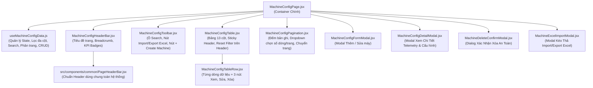

# KẾ HOẠCH TRIỂN KHAI GIAO DIỆN CẤU HÌNH MÁY MÓC (`/config/machine`)

> **Tài liệu tham chiếu:** Plan thiết kế kiến trúc và giao diện trang Quản lý Cấu hình Máy móc (Machine Configuration Management).  
> **Áp dụng cho route:** `/config/machine` (thuộc nhóm menu **CONFIG / CẤU HÌNH HỆ THỐNG**).  
> **Component đích:** `src/features/config/machine/MachineConfigPage.jsx`.  
> **Đặc tả kiến trúc:** Module hóa tối đa (Component-Driven Architecture) — Tách bảng dữ liệu (`MachineConfigTable.jsx`), thanh điều khiển & tìm kiếm (`MachineConfigToolbar.jsx`), phân trang & chọn số lượng bản ghi (`MachineConfigPagination.jsx`), modal thêm/sửa (`MachineConfigFormModal.jsx`), modal xem chi tiết (`MachineConfigDetailModal.jsx`), modal xác nhận xóa (`MachineDeleteConfirmModal.jsx`), modal import/export Excel (`MachineExcelImportModal.jsx`), và custom hook quản lý dữ liệu (`useMachineConfigData.js`).  
> **Ngày khởi tạo:** 29/10/2026.  
> **Vị trí tài liệu:** `md/MACHINE_CONFIG_PLAN.md` (đồng bộ tại `src/md/MACHINE_CONFIG_PLAN.md`).

---

## 1. TỔNG QUAN VÀ MỤC TIÊU DỰ ÁN

Giao diện **Cấu hình Máy móc (`/config/machine`)** là phân hệ quản trị danh mục thiết bị sản xuất toàn nhà máy của Foxconn / NVIDIA. Màn hình cho phép các kỹ sư cấu hình, giám sát tham số mạng (IP, Hostname), liên kết trạm máy với chuyền sản xuất (`Line`), công đoạn (`Step`), nhóm linh kiện (`Keys`), và thực hiện các thao tác quản trị CRUD (Thêm, Sửa, Xóa, Xem chi tiết, Lọc đa tiêu chí, Import/Export Excel).

### Mục tiêu thiết kế cốt lõi:
1. **Trực quan hóa bảng dữ liệu lớn:** Bảng thông tin chuẩn hóa đầy đủ 13 cột thông tin kỹ thuật, hỗ trợ cuộn ngang/dọc mượt mà, sticky header, phân tách rõ ràng giữa các trường dữ liệu.
2. **Bộ công cụ thao tác nhanh ở đầu trang:**
   - **Ô tìm kiếm tức thì (Instant Search Box):** Lọc theo tên máy, IP, hostname, line, khách hàng...
   - **Nút Import / Export Excel:** Tải file mẫu, nhập dữ liệu hàng loạt từ Excel hoặc xuất danh sách ra file `.xlsx`.
   - **Nút Tạo máy mới (`+ Create Machine`):** Mở form thêm máy mới trực quan với validation đầy đủ.
3. **Phân trang linh hoạt (Pagination & Page Size):**
   - Hỗ trợ chuyển trang (Next/Prev/First/Last/Số trang).
   - Dropdown chọn số lượng bản ghi hiển thị trên mỗi trang (`10`, `20`, `50`, `100`).
   - Hiển thị chính xác số lượng bản ghi: `"Hiển thị 1 - 10 trong tổng số 128 bản ghi"`.
4. **Cột Thao Tác & Reset Filter thông minh:**
   - Header cột có **Nút Reset Filter** (đặt lại mọi bộ lọc của bảng về mặc định).
   - Mỗi hàng có **3 nút chức năng**:
     - 👁️ **Xem chi tiết (View Details):** Mở modal xem toàn bộ thông số máy, telemetry và thông tin kết nối.
     - ✏️ **Sửa (Edit):** Chỉnh sửa nhanh thông tin máy.
     - 🗑️ **Xóa (Delete):** Xóa máy kèm dialog xác nhận bảo vệ an toàn.
   - Tích hợp bộ lọc nhanh ngay tại các cột (Column Filters).
5. **Tương thích hoàn hảo 2 Brand Theme:**
   - **Foxconn:** Nền sáng thanh lịch `bg-slate-50`, bảng trắng `bg-white border-slate-200`, điểm nhấn xanh navy `#002766`.
   - **NVIDIA:** Nền tối công nghiệp `bg-zinc-950`, bảng tối `bg-zinc-900 border-zinc-800`, chữ trắng tinh khiết `text-white`, điểm nhấn xanh neon `#76B900`.

---

## 2. BỐ CỤC KHÔNG GIAN VÀ SƠ ĐỒ GIAO DIỆN

### 2.1. Wireframe Tổng Quan Bố Cục Trang:

```text
┌────────────────────────────────────────────────────────────────────────────────────────────────────────┐
│ Header Bar: CONFIG / MACHINE CONFIG                                                                    │
│ Tiêu đề: MACHINE CONFIGURATION | Mô tả chức năng quản lý tham số & thiết bị trạm máy                   │
├────────────────────────────────────────────────────────────────────────────────────────────────────────┤
│ Toolbar Điều Khiển Phía Trên:                                                                          │
│ ┌───────────────────────────────────────────────┐ ┌──────────────────────────┐ ┌─────────────────────┐ │
│ │ 🔍 Tìm kiếm (Tên máy, IP, Host, Line...)... [✕]│ │ 📥 Import/Export Excel ⏷│ │ + Thêm Máy Mới (F2) │ │
│ └───────────────────────────────────────────────┘ └──────────────────────────┘ └─────────────────────┘ │
├────────────────────────────────────────────────────────────────────────────────────────────────────────┤
│ Bảng Dữ Liệu Máy Móc (Machine Configuration Master Table) - Sticky Header:                             │
│ ┌──────┬───────┬─────┬───────┬──────┬──────┬────┬────┬───────┬──────┬──────────┬──────────┬───────────┐ │
│ │Custom│Factory│Floor│Product│Prod. │Line  │Step│Keys│Group  │Mach. │IP Address│Host Name │[⟲ Reset]  │ │
│ │-er   │       │     │Name   │Type  │Name  │    │    │Name   │Name  │          │          │(Lọc/Thao  │ │
│ │ [⏷]  │  [⏷]  │ [⏷] │  [⏷]  │ [⏷]  │ [⏷]  │[⏷] │[⏷] │  [⏷]  │ [⏷]  │   [⏷]    │   [⏷]    │ tác) [⏷]  │ │
│ ├──────┼───────┼─────┼───────┼──────┼──────┼────┼────┼───────┼──────┼──────────┼──────────┼───────────┤ │
│ │NVIDIA│F01-BN │ 1F  │B200   │GPU   │Line01│ST01│K-01│SMT-Grp│MNT-01│192.168...│smt01.fii │👁️ ✏️ 🗑️  │ │
│ │NVIDIA│F01-BN │ 1F  │B200   │GPU   │Line01│ST02│K-02│AOI-Grp│AOI-01│192.168...│aoi01.fii │👁️ ✏️ 🗑️  │ │
│ │NVIDIA│F01-BN │ 2F  │GB200  │Tray  │Line02│ST03│K-03│SCR-Grp│SCR-01│192.168...│scr01.fii │👁️ ✏️ 🗑️  │ │
│ └──────┴───────┴─────┴───────┴──────┴──────┴────┴────┴───────┴──────┴──────────┴──────────┴───────────┘ │
├────────────────────────────────────────────────────────────────────────────────────────────────────────┤
│ Phân Trang & Đếm Bản Ghi (Footer Pagination):                                                          │
│ Hiển thị 1 - 10 trong tổng số 128 bản ghi  |  Số dòng/trang: [10 ⏷]  |  [⏮] [◀] [ 1 ] [ 2 ] [ 3 ] [▶] [⏭]│
└────────────────────────────────────────────────────────────────────────────────────────────────────────┘
```

---

## 3. ĐẶC TẢ BẢNG DỮ LIỆU: 100% TIÊU ĐỀ CỘT LÀ NÚT BẤM & TÍCH HỢP BỘ LỌC (TABLE SCHEMA)

> **QUY CHUẨN ĐẶC BIỆT:** Toàn bộ 13 tiêu đề cột trên Header của bảng đều được thiết kế dưới dạng **CÁC NÚT BẤM TƯƠNG TÁC (`<button>`)**. Người dùng nhấp vào nút tiêu đề cột nào sẽ kích hoạt mở ngay **Dropdown / Popover Bộ Lọc Nhanh** tương ứng của cột đó.

| STT | Nút tiêu đề cột (`<button>`) | Trường (Field) | Kiểu | Định dạng & Hiển thị | Cơ chế lọc khi bấm nút tiêu đề |
| :-- | :--- | :--- | :--- | :--- | :--- |
| **1** | **[ Nút Customer ⏷ ]** | `customer` | String | Huy hiệu badge: `NVIDIA`, `Foxconn`, `Apple`, `Cisco`. | Bấm nút mở Popover: Checkbox chọn nhiều khách hàng + Sort A-Z. |
| **2** | **[ Nút Factory ⏷ ]** | `factory` | String | Tên nhà máy: `Nhà máy F01 - Bắc Ninh`, `F03`, `F05`... | Bấm nút mở Popover: Checkbox chọn nhà máy + Sort A-Z. |
| **3** | **[ Nút Floor ⏷ ]** | `floor` | String | Tầng xưởng: `1F`, `2F`, `3F`. | Bấm nút mở Popover: Chọn nhanh các tầng 1F, 2F, 3F. |
| **4** | **[ Nút Product Name ⏷ ]**| `productName` | String | Tên sản phẩm: `NVIDIA HGX B200`, `GB200 NVL72`... | Bấm nút mở Popover: Ô text search tên sản phẩm + Checkbox list. |
| **5** | **[ Nút Product Type ⏷ ]**| `productType` | String | Phân loại: `GPU Accelerator`, `Server Tray`... | Bấm nút mở Popover: Checkbox chọn loại sản phẩm. |
| **6** | **[ Nút Line Name ⏷ ]** | `lineName` | String | Tên chuyền: `Line 01 - High-Speed SMT`... | Bấm nút mở Popover: Checkbox danh sách Line 01, Line 02... |
| **7** | **[ Nút Step ⏷ ]** | `step` | String | Công đoạn: `ST01 - Pick & Place`, `ST02 - AOI`... | Bấm nút mở Popover: Checkbox các mã Step ST01, ST02, ST03... |
| **8** | **[ Nút Keys ⏷ ]** | `keys` | String | Khóa trạm / Keypart: `KEY-SMT-01` (`font-mono`). | Bấm nút mở Popover: Search mã Key + Checkbox lọc keypart. |
| **9** | **[ Nút Group Name ⏷ ]** | `groupName` | String | Nhóm máy: `SMT Surface Mount Group A`... | Bấm nút mở Popover: Checkbox chọn nhóm máy trạm. |
| **10** | **[ Nút Machine Name ⏷ ]**| `machineName` | String | Tên máy: `High-Speed SMT Mounter #01` (font đậm). | Bấm nút mở Popover: Ô search tên máy + Sort A-Z. |
| **11** | **[ Nút IP Address ⏷ ]** | `stationIp` | String | Địa chỉ IP: `192.168.10.101` (`font-mono font-bold`). | Bấm nút mở Popover: Lọc dải IP mạng (VD: `192.168.10.*`) + Sort. |
| **12** | **[ Nút Host Name ⏷ ]** | `hostName` | String | Tên host trạm: `smt-mnt-01.fii.foxconn.com` (`font-mono`). | Bấm nút mở Popover: Search hostname + Sort A-Z. |
| **13** | **[ Nút ⟲ RESET FILTER ]**<br>kèm **[ Lọc Thao Tác ⏷ ]** | `actions` | Action Buttons | **Hàng dữ liệu gồm 3 nút:**<br>1. 👁️ **Xem chi tiết**<br>2. ✏️ **Sửa**<br>3. 🗑️ **Xóa** | **1. Nút chính `⟲ Reset Filter`:** Bấm vào reset toàn bộ bộ lọc mọi cột.<br>**2. Nút menu lọc thao tác:** Lọc danh sách máy theo 3 mục: Máy có chi tiết, Máy được sửa, Máy được xóa. |

---

## 4. CHI TIẾT CÁC TÍNH NĂNG CỐT LÕI

### 4.1. Thanh Công Cụ Điều Khiển Phía Trên (Top Toolbar)
1. **Ô Tìm Kiếm Nhanh (Search Box):**
   - Đặt ở góc trái toolbar, chiều rộng linh hoạt `w-full sm:w-80 lg:w-96`.
   - Placeholder: `"Tìm theo tên máy, IP, hostname, chuyền, sản phẩm..."`.
   - Tích hợp icon kính lúp 🔍 ở đầu và nút `✕` xóa nhanh từ khóa.
   - Cơ chế: Debounce 250ms, tìm kiếm tức thời trên toàn bộ các trường `machineName`, `stationIp`, `hostName`, `productName`, `lineName`, `customer`.

2. **Nút Import / Export Excel:**
   - Button dropdown hoặc cụm 2 nút:
     - 📥 **Import Excel:** Mở modal kéo thả file Excel (`.xlsx`, `.xls`), kiểm tra cú pháp cột, xem trước dữ liệu (preview 5 dòng đầu) và import hàng loạt vào hệ thống. Cung cấp nút tải file template chuẩn mẫu (`machine_config_template.xlsx`).
     - 📤 **Export Excel:** Xuất toàn bộ hoặc danh sách theo bộ lọc hiện tại ra file Excel với định dạng chuẩn, có header tiếng Việt/Anh và timestamp ngày giờ xuất file (`Machine_Config_Export_YYYYMMDD_HHmmss.xlsx`).

3. **Nút Tạo Máy Mới (`+ Create Machine`):**
   - Đặt ở góc phải với màu thương hiệu nổi bật (**Foxconn Navy Blue `#002766`** hoặc **NVIDIA Neon Green `#76B900`**).
   - Phím tắt gợi ý: `F2` hoặc `Ctrl + N`.
   - Bấm vào mở hộp thoại modal tạo mới `MachineConfigFormModal.jsx`.

---

### 4.2. Cơ Chế Tiêu Đề Cột Là Nút Bấm & Bộ Lọc Nhanh (Interactive Filter Button Headers)

#### 1. Thiết Kế Nút Tiêu Đề Cột (Column Header Buttons):
- Mỗi ô `<th>` trên header không chỉ là chữ tĩnh mà là một **Button tương tác hoàn chỉnh** (`<button type="button">`):
  - Bố cục bên trong nút: `[Tên Tiêu Đề Cột] [Icon Phễu Lọc ⏷] [Icon Mũi Tên Sort ⇅]`.
  - Hiệu ứng Hover: Nền nút sáng lên nhẹ nhàng (`hover:bg-slate-200` ở Foxconn, `hover:bg-zinc-800` ở NVIDIA), bo góc `rounded-lg px-2.5 py-1.5`.
  - **Trạng thái đang được lọc (Active Filter State):**
    - Khi cột đó đang áp dụng bộ lọc, nút tiêu đề sẽ tự động đổi sang màu chủ đạo nổi bật:
      - **Foxconn:** Nền xanh nhạt `bg-blue-100 text-[#002766] border border-blue-400 font-black shadow-xs`.
      - **NVIDIA:** Nền tối viền xanh neon `bg-zinc-800 text-[#76B900] border border-[#76B900]/70 font-black shadow-[0_0_10px_rgba(118,185,0,0.25)]`.
    - Kèm huy hiệu badge nhỏ hiển thị số lượng tiêu chí đang chọn (ví dụ: `Customer [2]`).

#### 2. Cửa Sổ Popover Lọc Khi Bấm Nút Tiêu Đề Cột (`MachineColumnFilterDropdown.jsx`):
Khi người dùng bấm vào nút tiêu đề bất kỳ, một bảng Popover nhỏ gọn sẽ trượt xuống ngay bên dưới tiêu đề cột đó:
1. **Ô tìm kiếm nội bộ (Search within column):** Nhập ký tự để lọc nhanh danh sách các giá trị đang xuất hiện trong cột.
2. **Danh sách Checkbox các giá trị duy nhất (Unique Values Multi-select):**
   - Tự động quét toàn bộ dữ liệu bảng để trích xuất các giá trị độc nhất.
   - Hỗ trợ nút **"Chọn tất cả"** (Select All) và **"Bỏ chọn"** (Clear All).
   - Kế bên mỗi giá trị có đếm số lượng dòng tương ứng (ví dụ: `☑ NVIDIA (18)`, `☑ Foxconn (8)`).
3. **Bộ nút Sắp xếp nhanh (Quick Sort):**
   - Nút `↑ Sắp xếp A → Z (Tăng dần)`.
   - Nút `↓ Sắp xếp Z → A (Giảm dần)`.
4. **Nút Thao tác Chân Popover:**
   - Nút **"Áp dụng" (Apply Filter)**: Áp dụng ngay bộ lọc vào bảng.
   - Nút **"Xóa lọc cột này" (Clear Filter)**: Đặt lại riêng cột này về tất cả.

#### 3. Cột Thao Tác (Actions) & Nút "⟲ Reset Filter" Đặc Biệt:
- **Nút "⟲ Reset Filter" trên Header:**
  - Nằm ở vị trí trung tâm của header cột thứ 13.
  - Thiết kế: Nút bấm nổi bật `rounded-xl px-3 py-1.5 text-xs font-black transition-all flex items-center gap-1.5 cursor-pointer`:
    - Khi có bộ lọc: Sáng đèn cảnh báo vàng/xanh kèm số lượng bộ lọc đang kích hoạt `⟲ Reset Filter (4)`.
    - Bấm vào nút: **Xóa toàn bộ các bộ lọc trên tất cả 13 cột và ô search**, đưa toàn bộ dữ liệu bảng về mặc định.
- **Tính năng Lọc Thao Tác (Filter by Action Availability):**
  - Cột thao tác cũng tích hợp nút menu lọc cho phép lọc nhanh các dòng theo 3 mục:
    1. **Mục "Xem thông tin chi tiết":** Lọc các máy có đầy đủ cấu hình telemetry và trạng thái online.
    2. **Mục "Sửa":** Lọc các máy đang được phép phân quyền chỉnh sửa cấu hình.
    3. **Mục "Xóa":** Lọc các máy đang ở chế độ chờ/ngừng hoạt động có thể dọn dẹp hoặc xóa an toàn.
- **3 Nút Hành Động Trên Mỗi Dòng:**
  - 👁️ **Xem chi tiết:** Mở modal `MachineConfigDetailModal.jsx` xem thông số sâu, chu kỳ bảo trì, IP, telemetry.
  - ✏️ **Sửa:** Mở modal `MachineConfigFormModal.jsx` cập nhật trực tiếp 12 thông số máy.
  - 🗑️ **Xóa:** Mở modal `MachineDeleteConfirmModal.jsx` xác nhận xóa an toàn.

---

### 4.3. Phân Trang (Pagination) & Chọn Số Lượng Bản Ghi (Page Size)
1. **Hiển Thị Thông Số Bản Ghi Đang Xem:**
   - Định dạng: `Hiển thị {from} - {to} trên tổng số {total} bản ghi`.
   - Ví dụ: `"Hiển thị 1 - 10 trên tổng số 128 bản ghi"`.
   - Khi không có dữ liệu: `"Không có bản ghi nào"`.

2. **Dropdown Chọn Số Lượng Bản Ghi (Page Size Selector):**
   - Thiết kế: Dropdown nhỏ gọn bo tròn `rounded-xl` đặt cạnh thông số bản ghi.
   - Các mức lựa chọn chuẩn:
     - `10 bản ghi / trang` (Mặc định)
     - `20 bản ghi / trang`
     - `50 bản ghi / trang`
     - `100 bản ghi / trang`
   - Khi thay đổi số lượng, tự động reset về trang 1 và tính lại tổng số trang.

3. **Điều Khiển Chuyển Trang (Pagination Controls):**
   - Nút Về đầu trang `⏮` (disabled ở trang 1).
   - Nút Trang trước `◀` (disabled ở trang 1).
   - Danh sách số trang thông minh dạng rút gọn: `1`, `2`, `3`, `...`, `13` (trang hiện tại được tô đậm màu thương hiệu).
   - Nút Trang sau `▶` (disabled ở trang cuối).
   - Nút Về cuối trang `⏭` (disabled ở trang cuối).

---

## 5. CÁC HỘP THOẠI MODAL ĐI KÈM

### 5.1. Modal Tạo Mới & Chỉnh Sửa Máy (`MachineConfigFormModal.jsx`)
- Tiêu đề động: `"THÊM MỚI CẤU HÌNH MÁY MÓC"` / `"CHỈNH SỬA THÔNG TIN MÁY: [TÊN MÁY]"`.
- Biểu mẫu chia 3 nhóm trường rõ ràng (Grid 2-3 cột):
  1. **Nhóm Vị Trí Xưởng & Khách Hàng:**
     - Khách hàng (Customer) - Select: `NVIDIA`, `Foxconn`, `Apple`, `Cisco`.
     - Nhà máy (Factory) - Select: `F01 - Bắc Ninh`, `F03 - Bắc Giang`, `F05 - Hải Phòng`.
     - Tầng xưởng (Floor) - Select: `1F`, `2F`, `3F`.
  2. **Nhóm Dây Chuyền & Quy Trình:**
     - Sản phẩm (Product Name) & Phân loại (Product Type).
     - Tên chuyền (Line Name) - Select danh sách lines.
     - Bước công đoạn (Step) & Mã định danh (Keys).
     - Nhóm máy (Group Name).
  3. **Nhóm Thiết Bị & Kết Nối Mạng:**
     - Tên máy (Machine Name) - Bắt buộc.
     - Địa chỉ IP (IP Address) - Bắt buộc (regex IPv4 hợp lệ).
     - Host Name - Bắt buộc.
     - Thông số vận hành: Target UPH, Target Cycle Time (giây).
- Nút bấm: `"Hủy Bỏ"` và `"Lưu Cấu Hình"` (Validate dữ liệu thời gian thực).

### 5.2. Modal Xem Chi Tiết Máy (`MachineConfigDetailModal.jsx`)
- Hiển thị toàn diện dữ liệu trạm máy dạng thẻ chi tiết (Info Cards):
  - Thông tin định danh: ID, Tên máy, Hostname, Địa chỉ MAC, IP Address.
  - Vị trí vật lý: Khách hàng, Nhà máy, Tầng, Tên chuyền, Trạm số mấy trong line (`Sequence Order`).
  - Dữ liệu sản xuất: Part Number sản phẩm, Target UPH, Target Cycle Time.
  - Lịch sử vận hành: Thời điểm tạo, người tạo, lần sửa đổi cuối cùng, trạng thái kích hoạt (`isActive`).
- Nút bấm: `"Đóng"` và nút `"Chuyển sang Chỉnh Sửa"`.

### 5.3. Modal Xác Nhận Xóa Máy (`MachineDeleteConfirmModal.jsx`)
- Cảnh báo an toàn: Hiển thị icon tam giác cảnh báo màu đỏ rực.
- Nội dung: *"Bạn có chắc chắn muốn xóa cấu hình máy **[Tên Máy]** (IP: **[IP]**) khỏi chuyền **[Tên Chuyền]** không? Thao tác này không thể hoàn tác."*
- Nút bấm: `"Hủy Bỏ"` và `"Xác Nhận Xóa Vĩnh Viễn"` (Màu đỏ `bg-rose-600`).

### 5.4. Modal Import / Export Excel (`MachineExcelImportModal.jsx`)
- Khung kéo thả file Excel (`Drag & Drop zone`) hỗ trợ file `.xlsx`, `.xls` dung lượng tối đa 10MB.
- Nút `"Tải file mẫu Excel (.xlsx)"` có định dạng chuẩn 12 cột.
- Bảng Preview kiểm tra lỗi trước khi import (highlight dòng lỗi nếu thiếu IP hoặc trùng Hostname).
- Nút `"Tiến Hành Import {N} Bản Ghi"`.

---

## 6. SƠ ĐỒ KIẾN TRÚC COMPONENT MODULE HÓA



---

## 7. CẤU TRÚC THƯ MỤC SOURCE CODE DỰ KIẾN

```text
src/components/common/
└── PageHeaderBar.jsx                    # [Header dùng chung] Breadcrumb, H1, Status Badge, Controls, Fullscreen

src/features/config/machine/
├── MachineConfigPage.jsx                 # [Container Chính] Kết nối layout, state và modals
├── components/
│   ├── header/
│   │   └── MachineConfigHeaderBar.jsx   # Header bar tích hợp PageHeaderBar chung + KPI Summary Badges
│   ├── toolbar/
│   │   └── MachineConfigToolbar.jsx     # Ô Search, Nút Import/Export Excel, Nút Create Machine
│   ├── table/
│   │   ├── MachineConfigTable.jsx       # Bảng 13 cột dữ liệu, sticky header, nút Reset Filter
│   │   ├── MachineConfigTableRow.jsx    # Hàng dữ liệu với định dạng chữ/badge và 3 nút thao tác
│   │   └── MachineColumnFilterDropdown.jsx # Menu dropdown lọc nhanh giá trị duy nhất từng cột
│   ├── pagination/
│   │   └── MachineConfigPagination.jsx  # Đếm bản ghi, dropdown chọn 10/20/50/100, nút chuyển trang
│   └── modals/
│       ├── MachineConfigFormModal.jsx   # Modal Thêm mới / Chỉnh sửa cấu hình máy
│       ├── MachineConfigDetailModal.jsx # Modal Xem chi tiết toàn diện thông số máy
│       ├── MachineDeleteConfirmModal.jsx# Dialog cảnh báo xác nhận xóa máy an toàn
│       └── MachineExcelImportModal.jsx  # Modal kéo thả import file Excel và tải template mẫu
├── data/
│   └── machineConfigMockData.js         # Dữ liệu mẫu 25-40 máy chuẩn đầy đủ 12 trường tương thích backend
├── constants/
│   └── machineConfigConstants.js        # Hằng số: Danh sách Customers, Factories, Floors, Product Types...
└── hooks/
    └── useMachineConfigData.js          # Custom hook: Lọc, search, phân trang, CRUD state
```

---

## 8. MÔ HÌNH DỮ LIỆU MOCK (DATA CONTRACT TƯƠNG THÍCH BACKEND)

Khớp chuẩn 100% với Entity Java Spring Boot `Machine.java`:

```javascript
// Cấu trúc một đối tượng Cấu hình Máy (MachineConfigItem)
{
  id: 1,
  customer: 'NVIDIA',                    // Khách hàng
  factory: 'Nhà máy F01 - Bắc Ninh',     // Nhà máy
  floor: '1F',                           // Tầng xưởng
  productName: 'NVIDIA HGX B200',        // Tên sản phẩm
  productType: 'AI GPU Accelerator Board', // Loại sản phẩm
  lineId: 1,
  lineName: 'Line 01 - High-Speed SMT',  // Tên chuyền
  step: 'ST01 - Pick & Place',           // Công đoạn / Bước
  keys: 'KEY-SMT-0101',                  // Khóa trạm / Keyparts
  groupName: 'SMT Surface Mount Group A', // Tên nhóm máy
  machineName: 'High-Speed SMT Mounter #01', // Tên máy
  stationIp: '192.168.10.101',           // Địa chỉ IP
  hostName: 'smt-mnt-01.fii.foxconn.com', // Host Name
  
  // Các thông số kỹ thuật bổ trợ
  stationCode: 'MC-SMT-0101',
  sequenceOrder: 1,
  targetUph: 120,
  targetCycleTime: 30.00,
  description: 'Trạm gắn chip SMT công tốc độ cao dual-beam',
  isActive: true,
  createdAt: '2026-10-15T08:30:00Z',
  updatedAt: '2026-10-28T14:22:15Z'
}
```

---

## 9. BẢNG MÃ MÀU THEO BRAND (FOXCONN & NVIDIA)

| Phần tử Giao diện | Foxconn Brand (`foxconn`) | NVIDIA Brand (`nvidia`) |
| :--- | :--- | :--- |
| **Nền trang** | `bg-slate-50` / `bg-white` | `bg-zinc-950` / `bg-black` |
| **Nền bảng** | `bg-white border-slate-200 shadow-sm` | `bg-zinc-900/90 border-zinc-800 shadow-xl text-white` |
| **Header bảng** | `bg-slate-100 text-slate-700 border-b` | `bg-zinc-950 text-zinc-300 border-zinc-800` |
| **Dòng hover** | `hover:bg-blue-50/50` | `hover:bg-zinc-800/60` |
| **Nút Tạo Máy Mới** | `bg-[#002766] hover:bg-blue-900 text-white` | `bg-[#76B900] hover:bg-[#86D400] text-black font-black` |
| **Nút Reset Filter** | `bg-slate-100 hover:bg-amber-100 text-amber-700 border-amber-300` | `bg-zinc-800 hover:bg-amber-950/50 text-amber-400 border-amber-500/40` |
| **Badge Customer (NVIDIA)** | `bg-emerald-50 text-emerald-700 border-emerald-300` | `bg-[#76B900]/20 text-[#76B900] border-[#76B900]/40 font-bold` |
| **Nút Thao Tác (Xem chi tiết)** | `text-blue-600 hover:bg-blue-100` | `text-[#76B900] hover:bg-zinc-800` |
| **Nút Thao Tác (Sửa)** | `text-amber-600 hover:bg-amber-100` | `text-amber-400 hover:bg-zinc-800` |
| **Nút Thao Tác (Xóa)** | `text-rose-600 hover:bg-rose-100` | `text-rose-400 hover:bg-zinc-800` |
| **Phân trang active** | `bg-[#002766] text-white` | `bg-[#76B900] text-black font-black` |

---

## 10. LỘ TRÌNH TRIỂN KHAI THEO TỪNG BƯỚC (STEP-BY-STEP CHECKLIST)

- [x] **Giai đoạn 1: Chuẩn bị Dữ liệu & Constants**
  - [x] Khởi tạo `machineConfigConstants.js` (danh sách nhà máy, tầng, khách hàng, nhóm máy, loại sản phẩm).
  - [x] Khởi tạo `machineConfigMockData.js` với 30+ máy mẫu bao quát đầy đủ 12 trường thông tin.
  - [x] Viết custom hook `useMachineConfigData.js` (state search, column filters, pagination, page size, CRUD handlers).

- [x] **Giai đoạn 2: Xây dựng Giao diện Bảng & Phân Trang**
  - [x] Xây dựng `MachineConfigHeaderBar.jsx` (tiêu đề, breadcrumb, badge tổng số máy).
  - [x] Xây dựng `MachineConfigToolbar.jsx` (ô search debounce, nút import/export Excel, nút thêm mới máy).
  - [x] Xây dựng `MachineConfigTable.jsx` và `MachineConfigTableRow.jsx` với 13 cột chuẩn xác, nút Reset Filter trên header cột.
  - [x] Xây dựng `MachineConfigPagination.jsx` (dropdown chọn 10/20/50/100, điều khiển trang trước/sau, hiển thị tổng số).

- [x] **Giai đoạn 3: Xây dựng các Hộp thoại Modal Thao Tác**
  - [x] Xây dựng `MachineConfigDetailModal.jsx` (xem chi tiết máy).
  - [x] Xây dựng `MachineConfigFormModal.jsx` (form thêm mới và chỉnh sửa máy có validation).
  - [x] Xây dựng `MachineDeleteConfirmModal.jsx` (hộp thoại xác nhận xóa máy an toàn).
  - [x] Xây dựng `MachineExcelImportModal.jsx` (kéo thả file Excel, tải template mẫu, import dữ liệu).

- [x] **Giai đoạn 4: Lắp ráp, Kiểm thử và Tối ưu hóa**
  - [x] Hoàn thiện kết nối tại `MachineConfigPage.jsx`.
  - [x] Kiểm thử hiển thị trên cả 2 theme **Foxconn** và **NVIDIA**.
  - [x] Kiểm thử responsive trên các độ phân giải màn hình (Full HD, 2K, 4K, Tablet).
  - [x] Chạy build production kiểm tra tính toàn vẹn hệ thống (`npm run build`).
