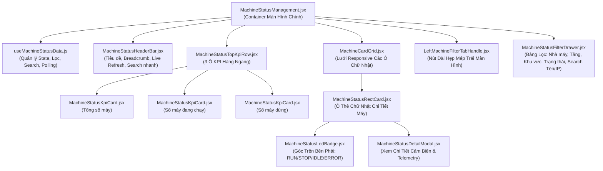

# KẾ HOẠCH TRIỂN KHAI GIAO DIỆN QUẢN LÝ TRẠNG THÁI MÁY MÓC (`/machine-status`)

> **Tài liệu tham chiếu:** Plan thiết kế kiến trúc và giao diện cho màn hình giám sát trạng thái máy móc toàn nhà máy (Factory Machine Status Monitoring Dashboard).  
> **Áp dụng cho route:** `/machine-status` (thuộc nhóm menu **QUẢN LÝ TỰ ĐỘNG HÓA / AUTOMATION MANAGEMENT**).  
> **Component đích:** `src/features/machine_status_management/MachineStatusManagement.jsx`.  
> **Đặc tả kiến trúc:** Thiết kế theo mô hình **Module Hóa Tối Đa (Component-Driven Architecture)** — Tách từng thẻ máy thành file JSX độc lập (`MachineStatusRectCard.jsx`), module hóa khối Top KPI (`MachineStatusTopKpiRow.jsx`), Drawer bộ lọc mép trái (`MachineStatusFilterDrawer.jsx`), LED trạng thái (`MachineStatusLedBadge.jsx`), custom hook quản lý dữ liệu (`useMachineStatusData.js`).  
> **Ngày khởi tạo:** 26/10/2026.  
> **Vị trí tài liệu:** `md/MACHINE_STATUS_PLAN.md` (đồng bộ tại `src/md/MACHINE_STATUS_PLAN.md`).

---

## 1. TỔNG QUAN VÀ MỤC TIÊU DỰ ÁN

Giao diện **Quản lý Trạng thái Máy móc (`/machine-status`)** là trung tâm giám sát thời gian thực (Real-time Machine Monitoring Center) cung cấp cái nhìn tổng quát và chi tiết về toàn bộ thiết bị máy móc trong nhà máy Foxconn / NVIDIA. Màn hình được thiết kế nhằm đáp ứng chuẩn Enterprise công nghiệp: **trực quan hóa rõ ràng, tra cứu nhanh chóng, lọc đa tiêu chí linh hoạt và tương thích hoàn hảo cả 2 giao diện thương hiệu Foxconn & NVIDIA**:

### Bố cục không gian 3 phân đoạn cốt lõi:

```text
┌─────────────────────────────────────────────────────────────────────────────────────────────┐
│ Header Bar: Tiêu đề "MACHINE STATUS", Breadcrumb, Bộ chọn Live Refresh (10s/30s/OFF), Đổi View│
├─────────────────────────────────────────────────────────────────────────────────────────────┤
│ PHẦN TOP: 3 Ô KPI HÀNG NGANG (Tổng số máy | Số máy đang chạy | Số máy dừng)                 │
│ ┌───────────────────────┐ ┌───────────────────────┐ ┌─────────────────────────────────────┐ │
│ │  TỔNG SỐ MÁY: 128     │ │  ĐANG CHẠY: 112 (87%) │ │  DỪNG MÁY: 16 (STOP: 9 | IDLE: 7)   │ │
│ └───────────────────────┘ └───────────────────────┘ └─────────────────────────────────────┘ │
├─────┬───────────────────────────────────────────────────────────────────────────────────────┤
│ [NÚT│ PHÍA CHÍNH: LƯỚI CÁC Ô HÌNH CHỮ NHẬT SẮP XẾP THEO HÀNG                                │
│ DÀI │ ┌───────────────────────────┐ ┌───────────────────────────┐ ┌───────────────────────┐ │
│ HẸP │ │ Tên máy        [TRẠNG THÁI]│ │ Tên máy        [TRẠNG THÁI]│ │ Tên máy    [TRẠNG THÁI] │ │
│ BỘ  │ │ IP: 192.168.10.101        │ │ IP: 192.168.10.102        │ │ IP: 192.168.10.103    │ │
│ LỌC │ │ Chương trình: PRG-H100.HEX│ │ Chương trình: PRG-B200.HEX│ │ Chương trình: SMT-03  │ │
│     │ │ Khu vực: Khu SMT #01      │ │ Khu vực: Khu SMT #02      │ │ Khu vực: Testing AOI  │ │
│ TRÁI│ │ Vị trí: Line A - Stn #01  │ │ Vị trí: Line A - Stn #02  │ │ Vị trí: Line B - Stn 1│ │
│     │ └───────────────────────────┘ └───────────────────────────┘ └───────────────────────┘ │
│     │ ... (Các ô hình chữ nhật dàn trải đều đặn dạng Responsive Grid 4-5 cột)               │
└─────┴───────────────────────────────────────────────────────────────────────────────────────┘
```

1. **Phần Top (Hàng ngang 1 - Top KPI Metrics Row):**
   - Bố trí 3 ô thẻ số liệu hàng ngang làm nổi bật số lượng tổng thể:
     - **Tổng số máy (Total Machines):** Tổng số lượng thiết bị trong phạm vi nhà máy/bộ lọc (ví dụ: `128` máy).
     - **Số máy đang chạy (Running Machines):** Số máy có trạng thái `RUN` đang hoạt động sản xuất liên tục (ví dụ: `112` máy, đạt `87.5%`).
     - **Số máy dừng (Stopped Machines):** Số máy đang không hoạt động (ví dụ: `16` máy, bao gồm dừng máy `STOP`, chờ hàng `IDLE`, hoặc cảnh báo lỗi `ERROR`).

2. **Phía Chính (Main Content Area - Lưới Thẻ Máy Hình Chữ Nhật):**
   - Các máy được hiển thị dưới dạng **ô hình chữ nhật** sắp xếp theo hàng/lưới responsive (`grid grid-cols-1 md:grid-cols-2 lg:grid-cols-3 xl:grid-cols-4 2xl:grid-cols-5 gap-4`).
   - Mỗi ô chữ nhật bao gồm 6 trường dữ liệu chuẩn xác theo yêu cầu:
     1. **Tên máy (Machine Name):** In đậm, nổi bật ở đầu thẻ.
     2. **Địa chỉ IP (IP Address):** Định dạng font monospace công nghệ kèm nút copy nhanh.
     3. **Chương trình (Program / Recipe):** Tên mã chương trình đang nạp chạy trên máy (ví dụ: `PRG-GB200-NVL72.HEX`).
     4. **Khu vực (Area / Section):** Phân xưởng sản xuất (ví dụ: `Khu SMT #01`, `Khu Lắp Ráp Tray`, `Testing & AOI`).
     5. **Vị trí (Location / Station):** Vị trí cụ thể của máy trong xưởng (ví dụ: `Line A - Slot #03`).
     6. **Phần trạng thái của máy nằm ở góc trên bên phải (Top-Right Status Badge):**
        - Nằm cố định ở góc trên bên phải của ô chữ nhật (`absolute top-3 right-3` hoặc header flex justify-between).
        - Đèn LED xung ánh sáng nổi bật và nhãn trạng thái:
          - `RUN` (Xanh lá / Emerald / Neon Green)
          - `IDLE` (Vàng hổ phách Amber)
          - `STOP` (Xám kim loại Slate)
          - `ERROR` (Đỏ Ruby cảnh báo nhấp nháy)

3. **Rìa Bên Trái (Nút Dài Hẹp & Bảng Lọc Đa Tiêu Chí Trượt Ra):**
   - **Nút dài hẹp mép trái (`LeftMachineFilterTabHandle.jsx`):**
     - Đặt cố định sát mép bên trái màn hình (`fixed left-0 top-1/2 -translate-y-1/2 z-30`).
     - Dạng tab dọc hẹp (`w-8`, `h-28`), bo góc ngoài bên phải (`rounded-r-2xl`), chữ xoay dọc `BỘ LỌC` kèm icon phễu lọc và huy hiệu số lượng tiêu chí đang chọn (`[3]`).
     - Hiệu ứng trượt nhẹ ra ngoài 4px khi hover, phát sáng theo theme (**Foxconn Blue `#002766`** hoặc **NVIDIA Neon Green `#76B900`**).
   - **Bảng lọc dạng Drawer trượt từ mép trái (`MachineStatusFilterDrawer.jsx`):**
     - Mở ra khi click nút mép trái, trượt mượt mà ra giữa màn hình với nền làm mờ `backdrop-blur-md`.
     - Chứa đầy đủ 5 tiêu chí lọc theo yêu cầu:
       1. **Nhà máy (Factory):** Dropdown chọn nhà máy (`Tất cả nhà máy`, `Nhà máy F01 - Bắc Ninh`, `Nhà máy F03 - Bắc Giang`, `Nhà máy F05 - Hải Phòng`).
       2. **Tầng (Floor):** Lựa chọn tầng xưởng sản xuất (`Tất cả các tầng`, `Tầng 1 (F1)`, `Tầng 2 (F2)`, `Tầng 3 (F3)`).
       3. **Khu vực (Area):** Lựa chọn khu vực (`Tất cả khu vực`, `Khu SMT`, `Khu Lắp Ráp Chassis`, `Khu Kiểm Tra AOI/ICT`, `Khu Đóng Gói`).
       4. **Trạng thái (Status):** Lọc theo trạng thái vận hành (`Tất cả`, `Đang chạy (RUN)`, `Tạm dừng (STOP)`, `Chờ hàng (IDLE)`, `Cảnh báo lỗi (ERROR)`).
       5. **Tìm kiếm theo Tên máy hoặc Địa chỉ IP (Nhập text):** Ô nhập liệu text (`<input type="text" ... />`) lọc tức thì theo thời gian thực (instant search), hỗ trợ nút xóa nhanh (`✕`).
     - Nút chân drawer: **"Áp Dụng Bộ Lọc"** và **"Đặt Lại Mặc Định"**.

4. **Tối Ưu Hiển Thị Giao Diện Foxconn & NVIDIA:**
   - **Foxconn:** Nền sáng `bg-slate-50`, thẻ máy trắng `bg-white border-slate-200 shadow-sm`, chữ đen xanh đậm `text-slate-900`, điểm nhấn xanh Foxconn `#002766`.
   - **NVIDIA:** Nền tối công nghiệp `bg-zinc-950`, thẻ máy tối `bg-zinc-900/95 border-zinc-800 text-white`, **chữ màu trắng tinh khiết (`text-white`) rõ nét 100%**, điểm nhấn xanh neon `#76B900`.

---

## 2. KIẾN TRÚC LUỒNG DỮ LIỆU & SƠ ĐỒ COMPONENT



---

## 3. THIẾT KẾ CHI TIẾT TỪNG PHÂN ĐOẠN GIAO DIỆN

### 3.1. Rìa Bên Trái: Nút Dài Hẹp & Bảng Lọc Đa Tiêu Chí (Module `filter/`)

#### 3.1.1. Component `LeftMachineFilterTabHandle.jsx` (Nút dài hẹp mép trái):
- **Vị trí cố định:** `fixed left-0 top-1/2 -translate-y-1/2 z-30`. Luôn nổi trên mọi lớp hiển thị khi cuộn trang.
- **Kích thước & Kiểu dáng:**
  - Chiều rộng hẹp khoảng `32px` (`w-8`), chiều cao khoảng `120px` (`h-28`).
  - Bo góc ngoài bên phải `rounded-r-2xl`, phẳng hoàn toàn ở mép trái áp sát màn hình.
  - Chữ xoay dọc: `BỘ LỌC` (`writing-mode: vertical-lr`).
  - Icon phễu lọc phát sáng nhịp thở nhẹ.
  - Huy hiệu badge đếm số lượng bộ lọc đang kích hoạt (ví dụ: `[3]`).
- **Phản hồi tương tác (Hover / Active):**
  - Hover: Trượt nhẹ ra ngoài 4px (`hover:translate-x-1`), phát quang theo màu chủ đạo:
    - **Foxconn:** Nền xanh navy `#002766`, viền xanh đậm, phát quang xanh `shadow-blue-900/30`.
    - **NVIDIA:** Nền tối `bg-zinc-900`, viền xanh neon `#76B900`, chữ `#76B900`, phát quang `shadow-[0_0_15px_rgba(118,185,0,0.3)]`.

#### 3.1.2. Component `MachineStatusFilterDrawer.jsx` (Bảng lọc trượt ra từ mép trái):
- **Cơ chế:** Khi click nút mép trái, trượt ra từ lề trái (`translate-x-0`), khi đóng trượt ẩn về bên trái (`-translate-x-full`). Có lớp backdrop tối mờ `bg-black/50 backdrop-blur-xs z-40`.
- **Độ rộng:** Chiều rộng chuẩn `w-84 sm:w-96`, chiều cao toàn màn hình `h-full fixed top-0 left-0 z-50 flex flex-col`.
- **Nội dung bên trong:**
  1. **Header Drawer:** Tiêu đề "BỘ LỌC TRẠNG THÁI MÁY", nút đóng nhanh `✕`.
  2. **Tiêu chí 1 - Nhà máy (Factory):**
     - Dropdown chọn: `Tất cả nhà máy`, `F01 - Bắc Ninh`, `F02 - Bắc Ninh`, `F03 - Bắc Giang`, `F05 - Hải Phòng`.
  3. **Tiêu chí 2 - Tầng (Floor):**
     - Button group / Dropdown: `Tất cả tầng`, `Tầng 1 (F1)`, `Tầng 2 (F2)`, `Tầng 3 (F3)`.
  4. **Tiêu chí 3 - Khu vực (Area / Section):**
     - Dropdown chọn: `Tất cả khu vực`, `Khu Vực SMT`, `Khu Vực Lắp Ráp Tray`, `Khu Kiểm Tra AOI/ICT`, `Khu Vực Đóng Gói Tự Động`.
  5. **Tiêu chí 4 - Trạng thái máy (Status):**
     - Nhóm pill chọn nhanh có màu sắc nhận diện:
       - `Tất cả` (All)
       - `Đang chạy (RUN)` (Xanh ngọc / Neon Green)
       - `Dừng máy (STOP)` (Xám kim loại)
       - `Chờ hàng (IDLE)` (Vàng hổ phách)
       - `Lỗi máy (ERROR)` (Đỏ Ruby)
  6. **Tiêu chí 5 - Tìm kiếm theo Tên máy hoặc Địa chỉ IP (Nhập text):**
     - Ô nhập liệu text (`<input type="text" placeholder="Nhập tên máy (vd: SMT #01) hoặc IP (vd: 192.168.10)..." />`).
     - Hỗ trợ icon kính lúp tìm kiếm ở đầu và nút `✕` xóa nhanh khi đã nhập ký tự.
     - Lọc tức thì (real-time filtering) kết hợp debounce mượt mà.
  7. **Footer Drawer:**
     - Nút **"Đặt Lại Mặc Định"** (Reset filters về trạng thái ban đầu).
     - Nút **"Áp Dụng Lọc"** với màu chủ đạo nổi bật.

#### 3.1.3. Component `MachineStatusHeaderBar.jsx` (Thanh Header Đồng Bộ Với Autoline Management):
- **Bố cục tổng quan:**
  - Thiết kế mở rộng thanh thoát, đường viền dưới phân tách `border-b border-slate-200 dark:border-zinc-800` (không đóng hộp kín dạng card) tạo trải nghiệm đồng nhất với trang Autoline Management.
  - Hỗ trợ căn chỉnh 2 phía (`flex flex-col lg:flex-row lg:items-center lg:justify-between gap-4 pb-4`).
- **Phía bên trái (Tiêu đề & Định danh):**
  - **Breadcrumb:** `QUẢN LÝ TỰ ĐỘNG HÓA / MACHINE STATUS` font `text-xs font-semibold`.
  - **Tiêu đề chính:** `GIÁM SÁT TRẠNG THÁI MÁY MÓC` cỡ chữ `text-2xl font-black tracking-tight`.
  - **Huy hiệu xung nhịp:** `LIVE MONITOR` bo tròn `rounded-full`, hiệu ứng đèn LED xanh ngọc nhấp nháy `animate-ping`.
  - **Đoạn mô tả phụ:** `text-xs text-slate-500 dark:text-zinc-400` tóm tắt công năng giám sát trạm máy theo thời gian thực.
- **Phía bên phải (Hệ thống điều khiển & Công cụ nhanh):**
  - **Nút "Bộ Lọc":** Mở drawer lọc đa tiêu chí, tích hợp badge số lượng bộ lọc đang kích hoạt `activeCount`.
  - **Khung thời gian cập nhật:** Hiển thị thời điểm dữ liệu mới nhất `Cập nhật: HH:mm:ss`.
  - **Bộ nút Auto Refresh kép:** Phím gạt `Auto ⟳ / Auto Tắt` kèm dropdown chọn chu kỳ tự động (`10s`, `30s`, `60s`).
  - **Nút "Làm Mới":** Bấm kích hoạt reload dữ liệu thủ công với icon SVG xoay vòng `animate-spin`.
  - **Nút Toàn Màn Hình (`Fullscreen`):** Bật/tắt chế độ Fullscreen phục vụ hiển thị màn hình lớn tại phòng điều hành (Command Center).

---

### 3.2. Phần Top: 3 Ô Thống Kê Chỉ Số Hàng Ngang (Module `top_kpi/`)

#### 3.2.1. Component `MachineStatusTopKpiRow.jsx`:
- Bố trí 3 ô thẻ dàn trải đều đặn theo hàng ngang bằng CSS Grid: `grid grid-cols-1 md:grid-cols-3 gap-3.5`.
- Chiều cao tinh gọn (`p-3.5`), khoảng cách rộng rãi, đồng bộ phong cách với trang Autoline.

#### 3.2.2. Chi tiết 3 Ô Chỉ Số:
1. **Ô 1: TỔNG SỐ MÁY (Total Machines):**
   - Tiêu đề: `TỔNG SỐ MÁY (TOTAL MACHINES)`
   - Giá trị chính: Số nguyên nổi bật cỡ chữ `text-2xl font-black font-mono` (ví dụ: `128`).
   - Đơn vị: `thiết bị` / `máy`.
   - Thông số phụ: `100% tài sản vận hành trong danh mục`.
   - Icon: Biểu tượng Server / Rack / Machine System.
   - Accent bar trên đầu: Màu xanh Foxconn `#002766` hoặc xanh neon NVIDIA `#76B900`.

2. **Ô 2: SỐ MÁY ĐANG CHẠY (Running Machines):**
   - Tiêu đề: `ĐANG HOẠT ĐỘNG (RUNNING)`
   - Giá trị chính: Số lượng máy có trạng thái `RUN` (ví dụ: `112`).
   - Tỷ lệ %: Badge phần trăm nổi bật (ví dụ: `87.5% tổng line`).
   - Điểm nhấn: Đèn LED xanh ngọc nhấp nháy, viền phát sáng nhẹ.
   - Accent bar trên đầu: Màu xanh ngọc `emerald-500` hoặc `#76B900`.

3. **Ô 3: SỐ MÁY DỪNG (Stopped Machines):**
   - Tiêu đề: `DỪNG HOẠT ĐỘNG (STOPPED / IDLE / ERROR)`
   - Giá trị chính: Tổng số máy đang không chạy (ví dụ: `16`).
   - Phân tích trạng thái chi tiết bên dưới:
     - `STOP: 8` (Bảo trì / Dừng chủ động)
     - `IDLE: 5` (Chờ nạp vật liệu / Chờ khay)
     - `ERROR: 3` (Báo động sự cố / Lỗi)
   - Accent bar trên đầu: Màu vàng hổ phách `amber-500` hoặc đỏ `rose-500`.

---

### 3.3. Phía Chính: Lưới Các Ô Hình Chữ Nhật (Module `machine_grid/`)

#### 3.3.1. Component `MachineCardGrid.jsx`:
- Lưới hiển thị danh sách toàn bộ các máy theo kết quả bộ lọc và tìm kiếm.
- Responsive layout:
  - Màn hình mobile: 1 cột (`grid-cols-1`).
  - Màn hình tablet: 2 cột (`md:grid-cols-2`).
  - Màn hình desktop chuẩn: 3 - 4 cột (`lg:grid-cols-3 xl:grid-cols-4`).
  - Màn hình lớn (Command Center): 5 cột (`2xl:grid-cols-5`).
- Hỗ trợ thanh toolbar phụ ở trên lưới:
  - Đếm kết quả: "Hiển thị **48 / 128** máy".
  - Sắp xếp nhanh: Theo Tên máy (A-Z), Theo Địa chỉ IP, Theo Trạng thái ưu tiên (ERROR trước -> IDLE -> RUN).
  - Trạng thái rỗng (Empty state): Hiển thị thông báo đẹp mắt kèm nút "Xóa Bộ Lọc" nếu không tìm thấy máy nào phù hợp.

#### 3.3.2. Component `MachineStatusRectCard.jsx` (Ô Hình Chữ Nhật Dọc Thẻ Máy - Bản Tiêu Chuẩn & Thu Gọn):
- **Hình dáng & Bố cục Hài Hòa & Viền Động Theo Trạng Thái (Status-Based Dynamic Framing):**
  - Ô **hình chữ nhật dọc** (tỷ lệ đứng dạng portrait), bo góc mềm mại `rounded-2xl`, viền mảnh `border`, đổ bóng tinh tế.
  - Chiều rộng tinh gọn ~210px, chiều cao ~290px tạo dáng hình chữ nhật dọc công nghiệp chuẩn mực (Cabinet/Rack Module).
  - **Khung viền cảnh báo màu trực quan theo trạng thái máy (Status-Driven Outer Borders & Tint):**
    - **Thẻ báo Vàng (`IDLE` / `WAITING`):** Viền khung vàng hổ phách nổi bật (`border-amber-400 bg-amber-50/35` ở Foxconn; `border-amber-500/80 bg-amber-950/20 shadow-[0_0_15px_rgba(245,158,11,0.2)]` ở NVIDIA) giúp kỹ sư nhận diện ngay máy đang chờ việc/ngưng nạp liệu.
    - **Thẻ báo Đỏ (`ERROR` / `ALARM`):** Viền khung đỏ rực cảnh báo sự cố (`border-rose-400 bg-rose-50/35` ở Foxconn; `border-rose-500/80 bg-rose-950/20 shadow-[0_0_15px_rgba(244,63,94,0.25)]` ở NVIDIA) thu hút sự chú ý tức thời.
    - **Thẻ Đang Chạy (`RUN`):** Viền tiêu chuẩn thanh lịch (`border-slate-200/90` ở Foxconn; `border-zinc-800` ở NVIDIA), hiệu ứng hover sáng màu thương hiệu (`hover:border-blue-400` hoặc `hover:border-[#76B900]/70`).
    - **Thẻ Tắt (`STOP`):** Viền trung tính xám kim loại (`border-slate-300/80` ở Foxconn; `border-zinc-800/80` ở NVIDIA).
  - Hiệu ứng hover nổi bật: Nâng nhẹ (`hover:-translate-y-0.5`).
  - Cursor pointer: Click vào ô chữ nhật để mở Modal chi tiết cảm biến trạm.

- **Bố cục Thẻ Bản Tiêu Chuẩn - Liền Mạch & Hài Hòa (Không đóng khung riêng cho IP & Chương trình):**
  - **Không dùng khung/hộp viền riêng hay phông nền dị biệt cho IP và Chương trình** để tránh làm vụn thẻ hoặc lệch tone so với tổng thể.
  - Toàn bộ 4 thông số (IP, Chương trình, Khu vực, Vị trí) được xếp theo dạng hàng thông số dọc thoáng mắt, phông nền đồng bộ tự nhiên với thẻ:
  ```text
  ┌───────────────────────────────────┐ <- Khung viền ngoài đổi màu theo trạng thái (Vàng / Đỏ / Chuẩn)
  │ [#M01]                [● RUNNING] │ <- Trạng thái góc trên bên phải (LED Badge)
  ├───────────────────────────────────┤
  │ High-Speed SMT Mounter #01        │ <- Tên máy (font đậm, tương phản cao)
  │ Panasonic NPM-D3 Dual-Beam        │ <- Model máy
  ├───────────────────────────────────┤
  │ 🌐 192.168.10.101          [Copy] │ <- Địa chỉ IP (Liền mạch, nút copy gọn gàng)
  │ </> PRG-GB200-NVL72.HEX           │ <- Chương trình / Recipe (Liền mạch, font-mono)
  │ 🏢 Khu Vực SMT #01                │ <- Khu vực
  │ 📍 Line 01 - Trạm ST-02           │ <- Vị trí
  └───────────────────────────────────┘
  ```

  1. **Tên máy (Machine Name):**
     - Nằm ở góc trên bên trái header thẻ, hiển thị kèm mã trạm (ví dụ: `#02 SMT-01`).
     - Tương phản chuẩn: `text-slate-900` ở Foxconn, `text-white font-black` ở NVIDIA (tuyệt đối không bị chìm).
  2. **Trạng thái máy nằm ở góc trên bên phải (Top-Right Status Badge):**
     - Sử dụng component `MachineStatusLedBadge.jsx`.
     - Nằm cố định ở góc trên bên phải của ô thẻ chữ nhật.
     - Thiết kế huy hiệu bo tròn `rounded-full px-2.5 py-0.5 text-[11px] font-black font-mono flex items-center gap-1.5`.
     - Đèn LED xung ánh sáng nhấp nháy phát sáng:
       - `RUN`: Đèn LED xanh ngọc (`bg-emerald-500 animate-ping`), chữ `RUN` / `RUNNING`.
       - `IDLE`: Đèn LED vàng hổ phách (`bg-amber-400`), chữ `IDLE` / `WAITING`.
       - `STOP`: Đèn xám kim loại (`bg-slate-400`), chữ `STOP` / `STOPPED`.
       - `ERROR`: Đèn đỏ ruby (`bg-rose-500 animate-pulse`), viền đỏ phát sáng, chữ `ERROR` / `ALARM`.
  3. **Địa chỉ IP (IP Address) - Liền mạch, Không đóng khung riêng:**
     - Font monospace công nghệ (`font-mono text-xs font-bold`).
     - Icon quả cầu mạng `🌐 text-blue-500`. Tương phản sắc nét: `text-slate-800` ở Foxconn, `text-white` ở NVIDIA.
     - Nút copy nhanh IP nhỏ gọn bên phải, hiển thị icon checkmark khi sao chép thành công.
  4. **Chương trình (Program / Recipe / Job) - Liền mạch, Không đóng khung riêng:**
     - Hiển thị tên file chương trình gia công đang nạp trên máy (ví dụ: `PRG-GB200-NVL72.HEX`).
     - Icon `</> text-purple-500 font-bold`, font mono thanh thoát.
     - Tương phản chuẩn: `text-slate-800` ở Foxconn, `text-zinc-100` ở NVIDIA.
  5. **Khu vực (Area / Section):**
     - Phân xưởng / Khu vực sản xuất đặt máy (ví dụ: `Khu SMT #01`, `Khu Lắp Ráp Tray`).
     - Tương phản chuẩn: `text-slate-700` ở Foxconn, `text-zinc-200` ở NVIDIA.
  6. **Vị trí (Location / Station / Slot):**
     - Tọa độ / Vị trí cụ thể của máy trong dây chuyền (ví dụ: `Line 01 - Trạm ST-02`).
     - Tương phản chuẩn: `text-slate-600` ở Foxconn, `text-zinc-300` ở NVIDIA.
  7. **Đảm bảo độ tương phản màu sắc giữa 2 chế độ Foxconn vs NVIDIA:**
     - **Foxconn (Light Mode):** Chữ sẫm màu rõ ràng (`text-slate-900`, `text-slate-800`, `text-slate-700`), nền sáng sạch sẽ, viền amber/rose dịu mắt nhưng rõ cảnh báo.
     - **NVIDIA (Dark Mode):** Toàn bộ nhãn giá trị sử dụng `text-white` và `text-zinc-100/200` tinh khiết, nhãn phụ `text-zinc-400`, viền phát quang neon theo trạng thái máy. Không có hiện tượng chữ tối trên nền tối.
  8. **Cơ chế tự động xuống dòng khi chữ quá dài (Auto Multi-line Word Wrap):**
     - Loại bỏ việc cắt xén dấu ba chấm (`truncate`) gây mất thông tin trên các ô thẻ hẹp.
     - **Tên máy & Model:** Sử dụng `break-words leading-snug` tự động xuống 2-3 dòng trơn tru.
     - **Địa chỉ IP & Tên Chương trình:** Sử dụng `break-all leading-snug` đảm bảo các chuỗi liền ký tự dài (như tên file `PRG-GB200-NVL72-REV4.HEX`) bẻ dòng tự nhiên, không tràn khung.
     - **Khu vực & Vị trí trạm:** Sử dụng `break-words leading-snug` và căn đầu dòng `items-start` cùng icon, giữ thẳng hàng đẹp mắt.

#### 3.3.3. Component `MachineStatusDetailModal.jsx` (Modal xem telemetry chi tiết):
- Mở ra khi click vào bất kỳ ô thẻ chữ nhật nào.
- Hiển thị đầy đủ thông số sâu:
  - Địa chỉ MAC, Cổng kết nối SECS/GEM, OPC-UA, TCP/IP Port.
  - Lịch sử vận hành trong 24 giờ qua (Run time, Idle time, Alarm time).
  - Nhiệt độ buồng máy, áp suất khí nén (bar), điện áp nguồn (V).
  - Tên kỹ sư vận hành máy trong ca (Operator).
  - Nút thao tác điều khiển: `Ping Máy`, `Xem Nhật Ký Lỗi`, `Mở Giao Diện Autoline`.
- **Đặc tả mục AOI Data (Kiểm tra quang học tự động - Optical Inspection):**
  - **Bố cục chia làm 2 phần trực quan (Split Layout - Không dùng cửa sổ nổi):**
    - **Phần bên trái (~60% chiều ngang):** Bảng danh sách chi tiết các điểm quang học tự động kiểm tra gồm 6 trường (#, Type, Step, Camera, POV, Result), tích hợp bộ lọc theo Step & Sequence và Xem tất cả. Dòng đang chọn được viền phát quang nổi bật.
    - **Phần bên phải (~40% chiều ngang):** Khung hiển thị trực tiếp ảnh chụp quang học độ nét cao (Embedded Optical Inspection Viewer).
  - **Cơ chế tương tác:** Khi ấn vào 1 dòng bất kỳ, hình ảnh quang học và thông số chẩn đoán lỗi tương ứng xuất hiện ngay lập tức ở khung bên phải, **không cần phải tạo cửa sổ nổi (popup modal) nữa**, giúp thao tác liền mạch và không bị che khuất giao diện.
  - **Hành động:** Nút "Tải ảnh này" và "Tải tất cả ảnh" tích hợp trực tiếp.

---

## 4. BẢNG MÃ MÀU VÀ ĐỒNG BỘ THIẾT KẾ THEO BRAND (FOXCONN & NVIDIA)

Màn hình được thiết kế tự động thích ứng với Brand được chọn trong `useTheme()`:

| Phần tử Giao diện | Foxconn Brand (`foxconn`) | NVIDIA Brand (`nvidia`) |
| :--- | :--- | :--- |
| **Màu nền toàn trang** | `bg-slate-50` / `bg-white` | `bg-zinc-950` / `bg-black` |
| **Thẻ Header & Toolbar** | `bg-white border-slate-200 shadow-xs` | `bg-zinc-900/90 border-zinc-800 text-white` |
| **Nút dài hẹp mép trái** | `bg-[#002766] text-white shadow-blue-900/30` | `bg-zinc-900 border-[#76B900] text-[#76B900] shadow-[#76B900]/20` |
| **Drawer Bộ lọc** | `bg-white border-slate-200 shadow-2xl text-slate-800` | `bg-zinc-900/95 border-zinc-800 backdrop-blur-xl shadow-2xl text-white` |
| **Ô Thẻ KPI Top** | `bg-white border-slate-200 shadow-xs text-slate-900` | `bg-zinc-900/90 border-zinc-800 text-white shadow-md` |
| **Khung thẻ Máy RUN** | `border-slate-200 bg-white hover:border-blue-400` | `border-zinc-800 bg-zinc-900/90 hover:border-[#76B900]/70 text-white` |
| **Khung thẻ Máy IDLE (Báo vàng)** | **`border-amber-400 bg-amber-50/45`** | **`border-amber-500/80 bg-amber-950/20 text-white shadow-amber-500/20`** |
| **Khung thẻ Máy ERROR (Báo đỏ)** | **`border-rose-400 bg-rose-50/50`** | **`border-rose-500/80 bg-rose-950/20 text-white shadow-rose-500/30`** |
| **Bảng Specs Panel (IP & PRG)** | **`bg-slate-50/80 border-slate-200/70 text-slate-800`** | **`bg-black/30 border-zinc-800/80 text-zinc-200` (Đồng bộ phông nền)** |
| **Màu chữ chính (Tên máy, IP)** | `text-slate-900` (Đậm nét trên nền sáng) | **`text-white` (Trắng sáng rõ nét 100% trên nền tối)** |
| **Màu chữ phụ (Khu vực, Vị trí)** | `text-slate-700` / `text-slate-600` | **`text-white` / `text-zinc-200` (Tương phản cao)** |
| **Trạng thái RUN (Góc phải)** | `bg-emerald-50 text-emerald-700 border-emerald-300` | `bg-emerald-950/60 text-emerald-400 border-emerald-500/50 shadow-[0_0_8px_rgba(16,185,129,0.3)]` |
| **Trạng thái IDLE (Góc phải)** | `bg-amber-50 text-amber-700 border-amber-300` | `bg-amber-950/60 text-amber-400 border-amber-500/50` |
| **Trạng thái STOP (Góc phải)** | `bg-slate-100 text-slate-700 border-slate-300` | `bg-zinc-800 text-white border-zinc-700` |
| **Trạng thái ERROR (Góc phải)**| `bg-rose-50 text-rose-700 border-rose-300` | `bg-rose-950/60 text-rose-400 border-rose-500/50 animate-pulse` |
| **Màu điểm nhấn (Accent)** | Xanh dương Foxconn (`#002766`, `#003893`) | Xanh neon NVIDIA (`#76B900`, `#86D400`) |

---

## 4.1. QUY CHUẨN ĐỒNG BỘ PHÔNG CHỮ & TYPOGRAPHY HỆ THỐNG (UNIFIED TYPOGRAPHY SPECIFICATION)

Để đảm bảo tính nhất quán tuyệt đối giữa 2 tính năng **Quản Lý Chuyền Tự Động (`/autoline-management`)** và **Giám Sát Trạng Thái Máy (`/machine-status-management`)**, hệ thống thiết lập bảng quy chuẩn Typography chuẩn mực công nghiệp cho từng chi tiết giao diện:

### 1. Phông chữ nền tảng (Base Font Families):
- **Phông chữ Sans-serif chuẩn (Toàn bộ giao diện):** `'Inter', -apple-system, BlinkMacSystemFont, 'Segoe UI', Roboto, Helvetica, Arial, sans-serif`.
  - Được cấu hình toàn cục trong `src/index.css` qua biến `@theme { --font-sans: 'Inter', ... }` và áp dụng cho `html, body, input, button, select`.
- **Phông chữ Đơn cách (Monospace - `font-mono`):** Dành riêng cho dữ liệu kỹ thuật, mã thiết bị, địa chỉ mạng, file chương trình, và các con số đo lường:
  - Mã trạm: `#{code}` / `#{index + 1}` (ví dụ: `#01`, `#M01`, `ST-02`).
  - Giá trị KPI lớn: `text-2xl font-black font-mono tracking-tight`.
  - Tỷ lệ phần trăm và sản lượng: Input, Output, NG, Yield %, UPH, Cycle Time.
  - Địa chỉ IP mạng: `font-mono font-bold text-xs`.
  - Tên file chương trình / Recipe: `font-mono font-semibold text-[11px]`.
  - Huy hiệu LED trạng thái: `font-mono font-black text-[10px]`.
  - Thời gian cập nhật: `font-mono font-bold text-xs`.

### 2. Bảng Phân Cấp Typography Đồng Bộ Từng Chi Tiết Giao Diện:

| Vị trí / Phần tử Giao diện | Cỡ chữ (Size) | Độ đậm (Weight) | Kiểu dòng & Giãn cách | Monospace | Màu Foxconn (Light) | Màu NVIDIA (Dark) |
| :--- | :--- | :--- | :--- | :--- | :--- | :--- |
| **Header: Đường dẫn Breadcrumb** | `text-xs` (12px) | `font-semibold` | `tracking-wider uppercase mb-1` | Không | `text-slate-400` / `#002766` | `text-zinc-400` / `#76B900` |
| **Header: Tiêu đề trang chính** | `text-2xl` (24px) | `font-black` | `tracking-tight leading-none` | Không | `text-slate-900` | `text-white` (trắng tinh) |
| **Header: Huy hiệu Live (Live Pulse)** | `text-[11px]` (11px) | `font-bold` | `px-2.5 py-1 rounded-full uppercase` | Không | `text-emerald-600 bg-emerald-500/10` | `text-emerald-400 bg-emerald-500/10` |
| **Header: Đoạn mô tả phụ** | `text-xs` (12px) | `font-normal` | `mt-1 leading-normal` | Không | `text-slate-500` | `text-zinc-400` |
| **Header: Nhóm nút công cụ & Nút lọc** | `text-xs` (12px) | `font-bold` | `px-3 py-1.5 rounded-xl` | Không | `text-slate-700` / `text-white` | `text-white` / `text-black` |
| **Header: Thời gian Cập nhật** | `text-xs` (12px) | `font-bold` | `font-mono` | Có | `text-slate-800` | `text-white` |
| **Top KPI: Tiêu đề thẻ chỉ số** | `text-[11px]` (11px) | `font-black` | `uppercase tracking-wider mb-1` | Không | `text-slate-500` | `text-white` |
| **Top KPI: Giá trị số lớn** | `text-2xl` (24px) | `font-black` | `tracking-tight font-mono` | Có | `text-slate-900` | `text-white` |
| **Top KPI: Đơn vị (Unit)** | `text-xs` (12px) | `font-bold` | `tracking-normal` | Không | `text-slate-500` | `text-white/80` |
| **Top KPI: Subtext / Details** | `text-[10px]` (10px) | `font-bold` | `tracking-tight` | Không | `text-slate-500` | `text-white/80` |
| **Thẻ máy: Mã trạm / Tag số** | `text-[10px]` (10px) | `font-black` | `font-mono px-2 py-0.5 rounded` | Có | `#002766` trên nền `bg-slate-100` | `#76B900` trên nền `bg-zinc-800` |
| **Thẻ máy: Huy hiệu trạng thái** | `text-[10px]` (10px) | `font-black` | `font-mono px-2.5 py-0.5 rounded-full` | Có | Sẫm màu theo trạng thái | Neon phát quang trên nền tối |
| **Thẻ máy: Tên thiết bị (Machine Name)** | `text-sm` (14px) | `font-black` | `tracking-tight leading-snug wrap-break-word` | Không | `text-slate-900` | `text-white` |
| **Thẻ máy: Model thiết bị** | `text-[10px]` (10px) | `font-medium` | `leading-tight wrap-break-word opacity-70` | Không | `text-slate-500` | `text-zinc-400` |
| **Thẻ máy: Địa chỉ IP** | `text-xs` (12px) | `font-bold` | `font-mono break-all leading-tight` | Có | `text-slate-800` | `text-white` |
| **Thẻ máy: Chương trình (Program/Recipe)** | `text-[11px]` (11px) | `font-semibold` | `font-mono break-all leading-snug` | Có | `text-slate-800` | `text-zinc-100` |
| **Thẻ máy: Khu vực & Vị trí** | `text-[11px]` (11px) | `font-medium` | `wrap-break-word leading-snug` | Không | `text-slate-700` / `text-slate-600` | `text-zinc-200` / `text-zinc-300` |
| **Thẻ máy: Khối In/Out & NG/Yield** | Nhãn: `text-[9px] font-black uppercase`; Số: `text-xs font-black font-mono` | Nhãn đậm, số mono | Có | `text-slate-900` | `text-white` |
| **Drawer Lọc: Tiêu đề Drawer** | `text-sm` (14px) | `font-black` | `uppercase tracking-wider` | Không | `text-slate-900` | `text-white` |
| **Drawer Lọc: Tiêu đề nhóm tiêu chí** | `text-xs` (12px) | `font-bold` | `uppercase tracking-wider` | Không | `text-slate-700` | `text-white` |
| **Drawer Lọc: Input / Select / Option** | `text-xs` (12px) | `font-semibold` | `leading-normal` | Không | `text-slate-800` | `text-white` |
| **Modal Chi Tiết: Tiêu đề máy** | `text-lg` (18px) | `font-black` | `tracking-tight wrap-break-word` | Không | `text-slate-900` | `text-white` |
| **Modal Chi Tiết: Model & Vị trí phụ** | `text-xs` (12px) | `font-medium` | `mt-0.5 wrap-break-word` | Không | `text-slate-500` | `text-zinc-400` |
| **Modal Chi Tiết: Nhãn thông số** | `text-[10px]` (10px) | `font-medium` | `uppercase tracking-wider` | Không | `text-slate-500` | `text-zinc-400` |
| **Modal Chi Tiết: Giá trị thông số** | `text-xs / text-sm` | `font-bold` | `wrap-break-word / break-all` | Tùy trường | `text-slate-800` | `text-white` |
| **Nút Mép Trái: Chữ BỘ LỌC dọc** | `text-[10px]` (10px) | `font-black` | `uppercase tracking-widest vertical` | Không | `text-white` | `#76B900` |
| **Nút Mép Trái: Badge đếm bộ lọc** | `text-[9px]` (9px) | `font-black` | `font-mono w-4 h-4 rounded-full` | Có | `text-slate-900 bg-amber-400` | `text-black bg-[#76B900]` |

### 3. Quy tắc Ngắt dòng & Xuống dòng tự động (Word Wrapping Policy):
- **Đối với văn bản chứa khoảng trắng (Tên máy, Model, Khu vực, Vị trí, Tên sản phẩm, Tên nhà máy):**
  - Sử dụng class `.wrap-break-word` kết hợp `leading-snug` (được định nghĩa chuẩn trong `src/index.css` với `overflow-wrap: break-word; word-break: break-word;`).
  - Khi nội dung dài quá khung, chữ tự động xuống dòng thứ 2 hoặc 3 một cách tự nhiên mà không bị cắt dấu ba chấm (`truncate`) làm mất dữ liệu.
- **Đối với chuỗi liền ký tự kỹ thuật không có dấu cách (Địa chỉ IP, Tên file Recipe `.HEX`, Mã UUID):**
  - Bắt buộc dùng `break-all` kết hợp `font-mono leading-tight` để trình duyệt tự ngắt dòng an toàn, ngăn chặn hoàn toàn hiện tượng tràn khung (horizontal overflow).

---

## 5. CẤU TRÚC THƯ MỤC SOURCE CODE MODULE HÓA CHI TIẾT

```text
src/features/machine_status_management/
├── MachineStatusManagement.jsx           # [Container Chính] Tích hợp layout tổng thể
├── components/
│   ├── header/
│   │   └── MachineStatusHeaderBar.jsx   # Header bar tích hợp PageHeaderBar chung: Tiêu đề, Breadcrumb, Live Refresh toggle, Nút mở bộ lọc
│   ├── top_kpi/
│   │   ├── MachineStatusTopKpiRow.jsx   # Hàng ngang 3 ô KPI (Tổng máy, Đang chạy, Dừng máy)
│   │   └── MachineStatusKpiCard.jsx     # Component thẻ KPI tái sử dụng
│   ├── machine_grid/
│   │   ├── MachineCardGrid.jsx          # Container lưới responsive danh sách các máy
│   │   ├── MachineStatusRectCard.jsx    # Ô thẻ chữ nhật hiển thị 6 thông số máy
│   │   ├── MachineStatusLedBadge.jsx    # Badge trạng thái góc trên bên phải (RUN/STOP/IDLE/ERROR)
│   │   └── MachineStatusDetailModal.jsx # Hộp thoại Modal xem telemetry cảm biến chi tiết máy
│   └── filter/
│       ├── LeftMachineFilterTabHandle.jsx # Nút dài hẹp bo góc gắn mép trái màn hình
│       └── MachineStatusFilterDrawer.jsx  # Drawer bảng lọc (Nhà máy, Tầng, Khu vực, Trạng thái, Search Text)
├── data/
│   └── machineStatusMockData.js         # Dữ liệu mô phỏng 40-60 máy với đầy đủ tên, IP, chương trình, khu vực, vị trí
├── constants/
│   └── machineStatusConstants.js        # Hằng số: Danh sách Nhà máy, Tầng, Khu vực, Trạng thái máy
└── hooks/
    └── useMachineStatusData.js          # Custom hook: quản lý state bộ lọc, search debounce, polling tự động làm mới
```

---

## 6. MÔ HÌNH DỮ LIỆU MOCK (DATA CONTRACT)

### 6.1. Đối tượng Thông số Máy (`MachineItem`):
```javascript
{
  id: 'M01',
  code: 'MC-SMT-0101',
  name: 'High-Speed SMT Mounter #01',
  model: 'Panasonic NPM-D3 Dual-Beam',
  ip: '192.168.10.101',
  program: 'PRG-GB200-NVL72-REV4.HEX',
  factoryId: 'factory_01',
  factoryName: 'Nhà máy F01 - Bắc Ninh',
  floorId: 'floor_02',
  floorName: 'Tầng 2 (F2)',
  areaId: 'area_smt',
  areaName: 'Khu Vực SMT #01',
  location: 'Line 01 - Trạm ST-02',
  status: 'RUN', // 'RUN' | 'STOP' | 'IDLE' | 'ERROR'
  uptimePct: 98.6,
  temp: '24.1°C',
  pressure: '6.2 bar',
  operator: 'Nguyen Van A (EMP-102)',
  lastPing: '2s ago',
  alarmMessage: null,
}
```

### 6.2. Bộ lọc Trạng thái Máy (`MachineFilterState`):
```javascript
{
  factoryId: 'all',      // 'all' | 'factory_01' | 'factory_02' | 'factory_03' | 'factory_05'
  floorId: 'all',        // 'all' | 'floor_01' | 'floor_02' | 'floor_03'
  areaId: 'all',         // 'all' | 'area_smt' | 'area_assembly' | 'area_aoi' | 'area_packing'
  status: 'all',         // 'all' | 'RUN' | 'STOP' | 'IDLE' | 'ERROR'
  searchQuery: '',       // Tìm kiếm text theo Tên máy hoặc Địa chỉ IP
}
```

---

## 7. LỘ TRÌNH TRIỂN KHAI THEO TỪNG BƯỚC (STEP-BY-STEP CHECKLIST)

### Giai đoạn 1: Chuẩn bị Cấu trúc Dữ liệu & Constants
- [x] Tạo file `src/features/machine_status_management/constants/machineStatusConstants.js`: Khai báo danh mục Nhà máy, Tầng, Khu vực, Trạng thái máy và mã màu LED.
- [x] Tạo file `src/features/machine_status_management/data/machineStatusMockData.js`: Tạo danh sách 24+ máy đa dạng trạng thái, địa chỉ IP, chương trình, khu vực, vị trí.
- [x] Tạo file `src/features/machine_status_management/hooks/useMachineStatusData.js`: Quản lý logic lọc đa tiêu chí, tìm kiếm text debounce theo Tên/IP, tính toán 3 chỉ số KPI (Tổng số, Đang chạy, Dừng máy) và polling làm mới tự động.

### Giai đoạn 2: Xây dựng Khối Top KPI
- [x] Xây dựng `MachineStatusKpiCard.jsx`: Thẻ hiển thị chỉ số tinh gọn, dải accent trên đầu, chữ trắng sáng chuẩn NVIDIA, tương phản cao trên Foxconn.
- [x] Xây dựng `MachineStatusTopKpiRow.jsx`: Hàng ngang 3 ô: Tổng số máy, Đang chạy, Dừng máy.

### Giai đoạn 3: Xây dựng Lưới Các Ô Hình Chữ Nhật (Phía Chính)
- [x] Xây dựng `MachineStatusLedBadge.jsx`: Huy hiệu trạng thái với đèn LED nhấp nháy phát quang (`RUN`, `STOP`, `IDLE`, `ERROR`).
- [x] Xây dựng `MachineStatusRectCard.jsx`: Ô thẻ chữ nhật hiển thị đủ 6 thông tin (Tên máy, IP, Chương trình, Khu vực, Vị trí, Trạng thái ở góc trên bên phải).
- [x] Xây dựng `MachineCardGrid.jsx`: Container lưới responsive 4-5 cột, thanh toolbar đếm kết quả, sắp xếp và empty state.
- [x] Xây dựng `MachineStatusDetailModal.jsx`: Modal xem thông số cảm biến chi tiết khi click thẻ máy.

### Giai đoạn 4: Xây dựng Bộ Lọc Mép Trái (Nút Dài Hẹp & Drawer)
- [x] Xây dựng `LeftMachineFilterTabHandle.jsx`: Nút dài hẹp dạng tab gắn sát mép trái màn hình, chữ xoay dọc `BỘ LỌC`, badge số lượng lọc đang kích hoạt.
- [x] Xây dựng `MachineStatusFilterDrawer.jsx`: Drawer trượt mượt mà từ mép trái với đầy đủ 5 tiêu chí lọc (Nhà máy, Tầng, Khu vực, Trạng thái, Ô tìm kiếm text theo Tên/IP).

### Giai đoạn 5: Tích hợp Toàn diện & Tối ưu Giao diện
- [x] Hoàn thiện `MachineStatusHeaderBar.jsx`: Thanh header tiêu đề trang, breadcrumb, Live Refresh toggle, nút mở bộ lọc mobile.
- [x] Lắp ráp toàn bộ các component vào `MachineStatusManagement.jsx`.
- [x] Kiểm thử hiển thị trên cả 2 theme **Foxconn** và **NVIDIA** (đảm bảo chữ trắng rõ nét 100%, không bị chìm).
- [x] Kiểm thử tìm kiếm text theo tên máy và địa chỉ IP, kiểm thử các tổ hợp lọc nhà máy/tầng/khu vực/trạng thái.

---

## 8. PHƯƠNG ÁN TỐI ƯU HÓA GIAO DIỆN: GIẢM TẢI CHỮ, CHỐNG RỐI MẮT & NÂNG CAO TRẢI NGHIỆM THỊ GIÁC (UI/UX DE-CLUTTERING PLAN)

### 8.1. Phân Tích Nguyên Nhân Gây Rối Mắt (Pain Points)
1. **Lặp lại tiền tố nhãn (Static Label Duplication):**
   - Mỗi ô thẻ chữ nhật lặp đi lặp lại các cụm từ: `"Địa chỉ IP:"`, `"Chương trình:"`, `"Khu vực:"`, `"Vị trí:"`, `"Nhiệt độ:"`, `"Uptime:"`.
   - Khi hiển thị 24 - 50 máy trên màn hình, người dùng phải đọc hàng trăm nhãn tĩnh trùng lặp gây ngợp mắt, giảm tốc độ định vị thông tin quan trọng.
2. **Thừa thông tin phụ ở chế độ tổng quát:**
   - Thẻ hiện cả: Mã thẻ (`#M01`), Model máy dài (`Panasonic NPM-D3 Dual-Beam`), Tên máy, Footer dài (`Nhiệt độ: 24.1°C • Uptime: 98.6% • Chi tiết →`).
3. **Phân mảnh không gian:**
   - Tách riêng dòng "Khu vực" và "Vị trí" khiến chiều cao thẻ bị kéo dài, khoảng cách giữa các ô hẹp lại làm bố cục trở nên bí bách.
4. **Top KPI chứa nhiều chữ chú thích dài dòng:**
   - Tiêu đề song ngữ kèm số thứ tự: `"1. Tổng Số Máy (Total Machines)"` cùng các dòng subtext giải thích rườm rà.
5. **Thiếu Chế độ Xem Linh Hoạt (View Mode Switcher):**
   - Kỹ sư giám sát cấp cao cần xem tổng quan 50-100 máy cùng lúc mà không cần cuộn trang nhiều lần, trong khi kỹ sư vận hành trạm lại cần xem chi tiết IP và chương trình.

---

### 8.2. Giải Pháp Tinh Gọn & Tối Ưu Hóa (Clean Industrial UI Solutions)

#### 1. Tinh Giản Thẻ Chữ Nhật (`MachineStatusRectCard.jsx`):
- **Bỏ hoàn toàn nhãn chữ lặp lại, thay bằng Icon trực quan chuẩn công nghiệp:**
  - Thay `"Địa chỉ IP: 192.168.10.101"` $\rightarrow$ Icon mạng `🌐` + font monospace `192.168.10.101` (định dạng IP mang tính tự minh họa cao, không cần nhãn).
  - Thay `"Chương trình: PRG-GB200..."` $\rightarrow$ Icon code `</>` + badge chip màu xám/tối gọn gàng `PRG-GB200...`.
- **Gộp dòng Khu vực & Vị trí thành 1 dòng duy nhất:**
  - Thay vì 2 dòng riêng biệt $\rightarrow$ Gộp thành: `📍 Khu SMT #01 • Line 01 - Trạm ST-02`. Vừa tiết kiệm 50% diện tích vừa giảm 2 nhãn chữ rườm rà.
- **Tinh giản Header & Footer thẻ:**
  - Header: Giữ mã thẻ nhỏ `#M01` + Tên máy in đậm to rõ nét. Chuyển tên Model dài vào tooltip khi rê chuột hoặc xem trong Modal chi tiết.
  - Footer: Bỏ câu chữ dài dòng, thay bằng 2 mini-chip tinh tế: `🌡️ 24.1°C` và `⚡ 98.6%`.
- **Đèn LED góc trên bên phải:**
  - Giữ nguyên hiệu ứng LED nhấp nháy phát quang (`RUN`, `STOP`, `IDLE`, `ERROR`) với huy hiệu ngắn gọn, dứt khoát.

#### 2. Bổ Sung Bộ Chuyển Chế Độ Xem (View Mode Switcher: Tiêu Chuẩn vs Thu Gọn):
- Tích hợp 2 nút chuyển đổi ngay trên thanh công cụ của lưới (`MachineCardGrid.jsx`):
  - 📋 **Chế độ Tiêu Chuẩn (Standard Grid):** Thẻ thông tin đầy đủ các trường chính (IP, Chương trình, Khu vực - Vị trí, Chip đo lường) nhưng đã loại bỏ triệt để các nhãn chữ thừa.
  - 🗲 **Chế độ Thu Gọn (Compact Matrix Grid):** Thẻ siêu phẳng chỉ cao ~72px, bao gồm Tên máy, IP, Khu vực và Đèn LED trạng thái góc phải. Cho phép quan sát 50-80 máy cùng lúc trên một màn hình mà cực kỳ thoáng đãng, không bị ngợp chữ.

#### 3. Tinh Giản Khối Top KPI (`MachineStatusTopKpiRow.jsx`):
- Bỏ số thứ tự `"1.", "2.", "3."` và bỏ tiếng Anh lặp trong ngoặc đơn.
- Tiêu đề ngắn gọn, mạnh mẽ: **TỔNG SỐ MÁY**, **ĐANG HOẠT ĐỘNG**, **DỪNG HOẠT ĐỘNG**.
- Bỏ các câu subtext dài dòng, tích hợp thanh tiến trình mini (Mini Progress Bar) thể hiện tỷ lệ % trực quan sinh động.

#### 4. Bảng So Sánh Trước & Sau Tối Ưu (Before vs After):

| Thành phần | Trước tối ưu (Nhiều chữ, bị rối) | Sau tối ưu (Tinh gọn, trực quan, thoáng mắt) |
| :--- | :--- | :--- |
| **Nhãn IP** | `🌐 Địa chỉ IP: 192.168.10.101 [Copy]` | `🌐 192.168.10.101 [Copy]` (Bỏ chữ "Địa chỉ IP:") |
| **Nhãn Chương trình**| `💻 Chương trình: PRG-GB200-NVL72.HEX` | `</> PRG-GB200-NVL72.HEX` (Bỏ chữ "Chương trình:") |
| **Khu vực & Vị trí** | Tách 2 dòng: `"Khu vực: ..."` + `"Vị trí: ..."` | Gộp 1 dòng: `📍 Khu SMT #01 • Line 01 - Trạm ST-02` |
| **Footer thẻ** | `Nhiệt độ: 24.1°C • Uptime: 98.6% • Chi tiết →` | `🌡️ 24.1°C` & `⚡ 98.6%` (2 chip mini đo lường) |
| **Tiêu đề Top KPI** | `1. Tổng Số Máy (Total Machines)` + subtext | **`TỔNG SỐ MÁY`** + Mini progress bar |
| **Chế độ xem** | Cố định 1 kích cỡ thẻ duy nhất | **Toggle Chế độ Tiêu chuẩn & Chế độ Thu gọn** |

---

### 8.3. Cơ Chế Tự Động Co Cuộn & Auto-Fit Khi Phóng To / Thu Nhỏ Màn Hình (Fluid Responsive Grid & Auto-Reflow)

Khi người dùng thao tác phóng to (Zoom In: 110%, 125%, 150%, 175%, 200%) hoặc thu nhỏ (Zoom Out: 90%, 80%, 67%, 50%), hoặc thay đổi kích thước cửa sổ trình duyệt:

1. **Thay thế Breakpoints Cố Định bằng CSS Grid Auto-Fill:**
   - Thay vì ép số cột cứng ngắc theo breakpoint Tailwind thông thường (`grid-cols-1 md:grid-cols-2 lg:grid-cols-4 2xl:grid-cols-5`), lưới thẻ máy móc sử dụng thuật toán bố cục linh hoạt tự tính toán theo độ rộng thực tế của màn hình:
     - **Chế độ Tiêu Chuẩn (Standard):** `gridTemplateColumns: repeat(auto-fill, minmax(min(100%, 280px), 1fr))`
     - **Chế độ Thu Gọn (Compact):** `gridTemplateColumns: repeat(auto-fill, minmax(min(100%, 210px), 1fr))`

2. **Cơ Chế Hoạt Động Khi Phóng To Màn Hình (Zoom In):**
   - Chiều ngang không gian pixel khả dụng thu hẹp lại $\rightarrow$ Thuật toán tự động giảm số lượng máy trên mỗi hàng (từ 5 máy $\rightarrow$ 4 máy $\rightarrow$ 3 máy $\rightarrow$ 2 máy $\rightarrow$ 1 máy).
   - Các máy dư ra sẽ tự động cuộn xuống các hàng tiếp theo (**Auto-Reflow**), bảo toàn độ rộng tối thiểu chuẩn mực của thẻ (`>= 280px`).
   - **Tuyệt đối không bị chèn ép chữ, không bị vỡ layout thẻ và không phát sinh thanh cuộn ngang gây khó chịu.**

3. **Cơ Chế Hoạt Động Khi Thu Nhỏ Màn Hình (Zoom Out / Màn Hình Lớn 2K/4K):**
   - Chiều ngang khả dụng tăng lên $\rightarrow$ Lưới tự động tăng số lượng máy trên mỗi hàng (từ 5 máy $\rightarrow$ 6 máy $\rightarrow$ 7 máy $\rightarrow$ 8+ máy).
   - Tận dụng tối đa 100% diện tích màn hình để người vận hành quan sát được nhiều trạm máy nhất có thể trong một tầm nhìn bao quát mà không để lại khoảng trống thừa thãi.

4. **Hiệu Ứng Chuyển Động & Cuộn Mượt (Smooth Layout Transition):**
   - Tích hợp `transition-all duration-300` giúp các thẻ máy trượt vị trí êm dịu khi số cột tự động thay đổi trong quá trình zoom.
   - Vùng lưới cuộn dọc mượt mà vừa vặn với kích thước viewport (`viewport-fit`), giữ cho toàn bộ trang luôn cân đối và không bị giật lag.

---

### 8.4. Tối Ưu Bố Cục Thẻ Máy Hài Hòa, Khung Viền Theo Màu Trạng Thái & Tương Phản Chuẩn Brand

1. **Khắc phục triệt để tình trạng lệch phông nền (Mismatched Backgrounds):**
   - Trước đây: Địa chỉ IP và Chương trình có nền màu riêng lẻ (hộp đen, hộp tím) không ăn khớp với tổng thể thẻ máy, tạo cảm giác rời rạc và thô cứng.
   - Sau tối ưu: Thay thế bằng **Unified Specs Panel** — một bảng thông số kỹ thuật duy nhất, đồng nhất tông màu nền và đường viền với thẻ. Các hàng IP, PRG, Khu vực, Vị trí được phân cách bằng các đường kẻ mảnh trang nhã, tạo nên một bố cục liền mạch, cân xứng và chuyên nghiệp chuẩn phòng điều hành.

2. **Khung viền thông minh theo trạng thái (Status-Based Dynamic Framing):**
   - **Thẻ báo Vàng (`IDLE` / Chờ hàng):**
     - Khung viền màu vàng hổ phách: `border-amber-400` (Foxconn) và `border-amber-500/80` (NVIDIA).
     - Nền thẻ phớt vàng nhẹ (`bg-amber-50/45` / `bg-amber-950/20`), đổ bóng phát quang vàng nhạt giúp người giám sát nhận diện tức thì trạm đang chờ phôi/vật tư.
   - **Thẻ báo Đỏ (`ERROR` / Báo sự cố):**
     - Khung viền màu đỏ ruby: `border-rose-400` (Foxconn) và `border-rose-500/80` (NVIDIA).
     - Nền thẻ phớt đỏ (`bg-rose-50/50` / `bg-rose-950/20`), kèm hiệu ứng phát quang cảnh báo đỏ `shadow-[0_0_15px_rgba(244,63,94,0.25)]` và banner cảnh báo nhấp nháy, giúp kỹ sư định vị máy lỗi ngay trong tích tắc.
   - **Thẻ đang chạy (`RUN`):**
     - Khung viền xám sáng nhẹ, hover phát quang xanh thương hiệu.

3. **Chuẩn hóa tương phản 100% giữa Foxconn và NVIDIA:**
   - **Giao diện NVIDIA:** Toàn bộ tên máy, địa chỉ IP, tên chương trình, khu vực và vị trí được chuyển sang **chữ màu trắng tinh (`text-white`)**, tuyệt đối không bị chìm trên nền tối, chữ sắc nét từ mọi góc nhìn.
   - **Giao diện Foxconn:** Chữ màu xanh đen đậm (`text-slate-900` / `text-slate-800`) trên nền sáng, mang phong cách doanh nghiệp nhã nhặn, độ tương phản cao đạt chuẩn WCAG.


