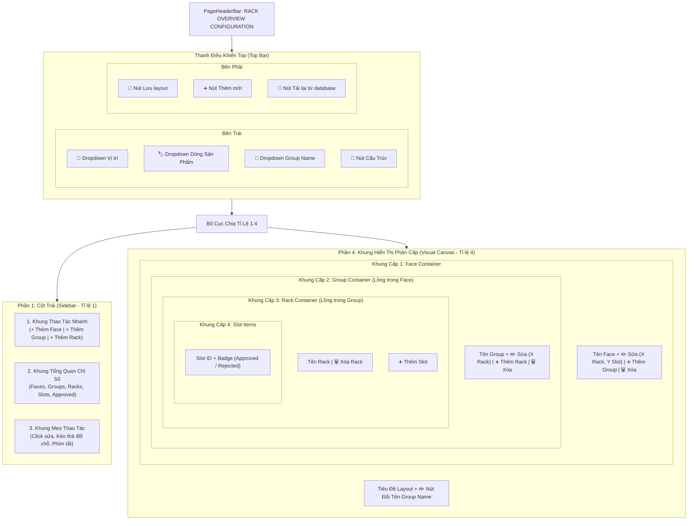

# KẾ HOẠCH TRIỂN KHAI GIAO DIỆN CẤU HÌNH TỔNG QUAN RACK (`/config/rack-overview`)

> **Tài liệu tham chiếu:** Plan đặc tả kiến trúc và thiết kế giao diện cho màn hình Cấu Hình Tổng Quan & Bố Cục Mặt Bằng Tủ Rack (Rack Overview Layout Configuration & Visual Hierarchy Canvas).  
> **Áp dụng cho route:** `/config/rack-overview` (thuộc nhóm menu **CONFIG / CẤU HÌNH HỆ THỐNG -> RACK -> RACK OVERVIEW CONFIG**).  
> **Component đích:** `src/features/config/rack/RackOverviewConfigPage.jsx`.  
> **Đặc tả kiến trúc:** Thiết kế theo mô hình **Module Hóa Tối Đa (Component-Driven Architecture)** kết hợp cấu trúc lồng phân cấp 4 tầng (**Face ➔ Group ➔ Rack ➔ Slot**). Giao diện phân chia theo tỷ lệ **1:4** (Cột bên trái 1 phần: Thanh công cụ nhanh, Thống kê KPI, Mẹo thao tác; Cột bên phải 4 phần: Trình soạn thảo trực quan Canvas phân cấp đa tầng, kéo thả linh hoạt và chỉnh sửa thông số tức thời).  
> **Ngày khởi tạo:** 07/11/2026.  
> **Vị trí tài liệu:** `src/md/RACK_OVERVIEW_CONFIG_PLAN.md` (đồng bộ tại `md/RACK_OVERVIEW_CONFIG_PLAN.md`).

---

## 1. TỔNG QUAN VÀ MỤC TIÊU DỰ ÁN

Trong các nhà máy thông minh Foxconn & NVIDIA (Smart Factory), các hệ thống máy chủ GPU AI (như HGX H100, H200, Blackwell GB200 NVL72) và tủ Rack mạng/PLC công nghiệp được phân bổ theo mặt bằng không gian 2D/3D phức tạp gồm nhiều mặt (Face), nhóm chuyền sản xuất (Group), tủ thiết bị vật lý (Rack) và các khe cắm linh kiện (Slot).

Màn hình **Rack Overview Config (`/config/rack-overview`)** là công cụ trực quan hóa (Visual Layout Builder & Configuration Studio) mạnh mẽ cho phép kỹ sư vận hành:
1. **Thiết lập và quản lý cấu trúc phân cấp linh hoạt**: Xây dựng mô hình cây lồng nhau chuẩn hóa: **Mặt tủ (Face) -> Phân nhóm (Group) -> Tủ Rack vật lý (Rack) -> Vị trí khe cắm (Slot)**.
2. **Kiểm soát trạng thái Slot tức thời**: Khai báo mã định danh Slot và phân định rõ trạng thái phê duyệt (`Approved` - Đã duyệt, màu xanh an toàn) hoặc từ chối (`Rejected` - Chưa duyệt / Từ chối, màu đỏ cảnh báo).
3. **Thanh điều khiển Top Bar đa năng**:
   - 3 bộ lọc Dropdown: **Vị trí (Location)**, **Dòng sản phẩm (Product Line)**, **Group Name**.
   - Nút **Cấu trúc (Structure)**: Bật modal hiển thị sơ đồ cây cấu trúc tổng thể.
   - Bộ 3 nút hành động chính: **Lưu layout (Save)**, **Thêm mới (Add New)**, **Tải lại từ database (Reload)**.
4. **Bố cục không gian 1:4 trực quan**:
   - **Cột 1 (Sidebar Thao Tác & Giám Sát - Tỷ lệ 1)**: Nút thao tác nhanh (Thêm Face, Thêm Group, Thêm Rack), Khung KPI tổng quan (Faces, Groups, Racks, Slots, Approved), Khung Mẹo thao tác (Kéo thả, phím tắt).
   - **Cột 4 (Trình Thiết Kế Bố Cục Phân Cấp - Tỷ lệ 4)**: Header với tiêu đề và nút đổi tên Group Name nhanh; bên dưới là hệ thống thẻ lồng trực quan cho phép thêm/sửa/xóa Face, Group, Rack và Slot trực tiếp.
5. **Hỗ trợ thao tác kéo thả và phím tắt chuyên nghiệp**:
   - Kéo Slot thả lên Slot khác để đổi chỗ tức thì.
   - Kéo đầu Rack thả lên Rack khác để đổi thứ tự cột.
   - Phím tắt: `Ctrl + S` Lưu, `Esc` Bỏ chọn, `Delete` Xóa.
6. **Tương thích hoàn hảo 2 hệ thống nhận diện thương hiệu**: Chế độ sáng Foxconn (Navy/Slate) và chế độ tối NVIDIA Cyberpunk (Zinc Dark / Neon Green `#76B900`).

---

## 2. BỐ CỤC KHÔNG GIAN VÀ SƠ ĐỒ GIAO DIỆN (WIREFRAME)

### 2.1. Sơ đồ Luồng Hoạt Động (Architecture Flow):



---

### 2.2. Wireframe Chi Tiết Bố Cục Màn Hình:

```text
┌────────────────────────────────────────────────────────────────────────────────────────────────────────────────────────┐
│ CONFIG / RACK / RACK OVERVIEW CONFIG                                                                  [⛶ Fullscreen]   │
│ RACK OVERVIEW CONFIGURATION                                                            [Badge: LAYOUT CONFIG]          │
│ Trực quan hóa bố cục sơ đồ mặt bằng tủ Rack, thiết lập cấu trúc phân cấp Face, Group, Rack và Slot                      │
├────────────────────────────────────────────────────────────────────────────────────────────────────────────────────────┤
│ [KHUNG TOP: BỘ LỌC BÊN TRÁI & NÚT THAO TÁC BÊN PHẢI]                                                                   │
│ ┌──────────────────────────────────────────────────────────────┐  ┌──────────────────────────────────────────────────┐ │
│ │ [📍 Vị trí: F01 - 2F - Cleanroom 01 ⏷]                        │  │ [💾 Lưu layout]  [➕ Thêm mới]  [🔄 Tải lại DB]   │ │
│ │ [🏷️ Dòng sản phẩm: NVIDIA H100 ⏷]                             │  └──────────────────────────────────────────────────┘ │
│ │ [👥 Group name: Group A (SMT) ⏷]   [🌳 Cấu trúc]             │                                                      │
│ └──────────────────────────────────────────────────────────────┘                                                      │
├────────────────────────────────────────────────────────────────────────────────────────────────────────────────────────┤
│ [BỐ CỤC CHIA 2 PHẦN THEO TỈ LỆ 1 : 4]                                                                                  │
│                                                                                                                        │
│ ┌── PHẦN 1: SIDEBAR (TỈ LỆ 1) ──────────┐  ┌── PHẦN 4: KHUNG THIẾT KẾ BỐ CỤC HIERARCHY CANVAS (TỈ LỆ 4) ────────────┐ │
│ │ ┌───────────────────────────────────┐ │  │ ┌──────────────────────────────────────────────────────────────────────┐ │ │
│ │ │ ⚡ THAO TÁC NHANH                 │ │  │ │ TIÊU ĐỀ: BỐ CỤC MẶT BẰNG RACK [Group A (SMT)]    [✏️ Đổi tên Group]     │ │ │
│ │ │ ┌───────────────────────────────┐ │ │  │ └──────────────────────────────────────────────────────────────────────┘ │ │
│ │ │ │ ➕ Thêm Face                  │ │ │  │                                                                          │ │
│ │ │ ├───────────────────────────────┤ │ │  │ ┌── KHUNG FACE 1: [Face Mặt Trước A] ─────────────────────────────────┐ │ │
│ │ │ │ ➕ Thêm Group                 │ │ │  │ │ Header: 🔲 Face Mặt Trước A  [✏️ Sửa] (2 rack, 8 slot)  [+ Group] [🗑️]│ │ │
│ │ │ ├───────────────────────────────┤ │ │  │ │                                                                      │ │ │
│ │ │ │ ➕ Thêm Rack                  │ │ │  │ │  ┌── KHUNG GROUP 1.1: [Group SMT Line 01] ─────────────────────────┐ │ │ │
│ │ │ └───────────────────────────────┘ │ │  │ │  │ Header: 👥 Group SMT Line 01 [✏️ Sửa] (2 rack)   [+ Rack]  [🗑️] │ │ │ │
│ │ └───────────────────────────────────┘ │  │ │  │                                                            │ │ │ │
│ │                                       │  │ │  │  ┌── RACK 1: RCK-A01 ──┐    ┌── RACK 2: RCK-A02 ──┐         │ │ │ │
│ │ ┌───────────────────────────────────┐ │  │ │  │  │ [RCK-A01]      [🗑️] │    │ [RCK-A02]      [🗑️] │         │ │ │ │
│ │ │ 📊 TỔNG QUAN HỆ THỐNG             │ │  │ │  │  │ [+ Thêm Slot]        │    │ [+ Thêm Slot]        │         │ │ │ │
│ │ │ • Tổng số Face:      2 Mặt        │ │  │ │  │  │ ┌──────────────────┐ │    │ ┌──────────────────┐ │         │ │ │ │
│ │ │ • Tổng số Group:     4 Nhóm       │ │  │ │  │  │ │Slot 01 [Approved]│ │    │ │Slot 01 [Approved]│ │         │ │ │ │
│ │ │ • Tổng số Rack:      8 Tủ         │ │  │ │  │  │ ├──────────────────┤ │    │ ├──────────────────┤ │         │ │ │ │
│ │ │ • Tổng số Slot:      32 Khe       │ │  │ │  │  │ │Slot 02 [Approved]│ │    │ │Slot 02 [Rejected]│ │         │ │ │ │
│ │ │ • Đã approved:       28 / 32 Slot │ │  │ │  │  │ └──────────────────┘ │    │ └──────────────────┘ │         │ │ │ │
│ │ └───────────────────────────────────┘ │  │ │  │  └─────────────────────┘    └─────────────────────┘         │ │ │ │
│ │                                       │  │ │  └─────────────────────────────────────────────────────────────┘ │ │ │
│ │ ┌───────────────────────────────────┐ │  │ └───────────────────────────────────────────────────────────────────────┘ │ │
│ │ │ 💡 MẸO THAO TÁC                   │ │  │                                                                          │ │
│ │ │ • Click vào Rack hoặc Slot để mở  │ │  │ ┌── KHUNG FACE 2: [Face Mặt Sau B] ────────────────────────────────────┐ │ │
│ │ │   bảng sửa thuộc tính.            │ │  │ │ Header: 🔲 Face Mặt Sau B    [✏️ Sửa] (1 rack, 4 slot)  [+ Group] [🗑️]│ │ │
│ │ │ • Kéo thả đổi chỗ: Kéo Slot thả   │ │  │ │ ...                                                                  │ │ │
│ │ │   lên Slot khác để đổi vị trí     │ │  │ └───────────────────────────────────────────────────────────────────────┘ │ │
│ │ │   tức thì.                        │ │  │                                                                          │ │
│ │ │ • Đổi thứ tự Rack: Kéo đầu Rack   │ │  │                                                                          │ │
│ │ │   thả lên Rack khác để đổi cột.   │ │  │                                                                          │ │
│ │ │ • Phím tắt:                       │ │  │                                                                          │ │
│ │ │   Ctrl + S Lưu                    │ │  │                                                                          │ │
│ │ │   Esc Bỏ chọn                     │ │  │                                                                          │ │
│ │ │   Delete Xóa                      │ │  │                                                                          │ │
│ │ └───────────────────────────────────┘ │  │                                                                          │ │
│ └───────────────────────────────────────┘  └──────────────────────────────────────────────────────────────────────────┘ │
└────────────────────────────────────────────────────────────────────────────────────────────────────────────────────────┘
```

---

## 3. ĐẶC TẢ CHI TIẾT CÁC PHÂN ĐOẠN GIAO DIỆN

### 3.1. Khung Top: Thanh Điều Khiển Bộ Lọc & Thao Tác (Top Control Bar)

Khung Top được thiết kế thành một khối thống nhất dàn trải trên đầu trang (`flex flex-col xl:flex-row items-stretch xl:items-center justify-between gap-4 p-5 rounded-2xl`):

#### A. Cụm Bên Trái (Bộ Lọc & Cấu Trúc):
1. **Dropdown Vị trí (Location Filter):**
   - Lựa chọn theo phân cấp: `Nhà máy - Tầng - Phòng / Xưởng`.
   - Danh sách mẫu:
     - `F01 - 2F - Cleanroom 01` (Mặc định)
     - `F01 - 1F - SMT Main Floor`
     - `F02 - 3F - Server Lab C`
     - `F03 - 2F - Assembly Line 01`
     - `F06 - 4F - QC Inspection Area`
2. **Dropdown Dòng sản phẩm (Product Line Filter):**
   - Danh sách dòng máy/bo mạch:
     - `NVIDIA H100` (Mặc định)
     - `NVIDIA H200`
     - `GB200 NVL72`
     - `Hopper Super`
     - `Grace CPU Superchip`
     - `Blackwell B200`
3. **Dropdown Group Name (Group Filter):**
   - Danh sách phân nhóm chức năng:
     - `Group A (SMT)` (Mặc định)
     - `Group B (Testing)`
     - `Group C (Burn-in)`
     - `Group ICT`
     - `Group Assembly`
4. **Nút "Cấu trúc" (`[🌳 Cấu trúc]`):**
   - Phong cách: Nền trung tính viền sáng nhẹ, icon cây thư mục / Blueprint.
   - Hành vi: Khi nhấn, mở modal **"Sơ Đồ Cấu Trúc Cây Phân Cấp" (`RackStructureModal.jsx`)** hiển thị toàn bộ Face > Group > Rack > Slot dưới dạng Tree View có thể thu gọn / mở rộng nhanh (Accordion Collapsible Tree).

#### B. Cụm Bên Phải (Nút Tác Vụ Chính):
1. **Nút "Lưu layout" (`[💾 Lưu layout]`):**
   - Nút hành động chính (Primary Action) màu nhận diện: Xanh Navy Foxconn (`bg-[#002766]`) hoặc Xanh Neon NVIDIA (`bg-[#76B900] text-black font-extrabold`).
   - Phím tắt tương ứng: `Ctrl + S`.
   - Hành vi: Gửi toàn bộ cấu trúc JSON hiện tại lưu vào CSDL hoặc State trung tâm, hiển thị Toast: *"Đã lưu bố cục layout thành công!"*.
2. **Nút "Thêm mới" (`[➕ Thêm mới]`):**
   - Nút thứ cấp: Mở menu chọn thêm nhanh: Thêm Face mới, Tạo layout mới từ Template, hoặc Import JSON bố cục.
3. **Nút "Tải lại từ database" (`[🔄 Tải lại từ database]`):**
   - Nút phụ: Gọi lại dữ liệu mới nhất từ backend/mock data, đặt lại các thay đổi chưa lưu, hiển thị Toast: *"Đã làm mới dữ liệu từ Database"*.

---

### 3.2. Cột 1 (Sidebar - Tỉ Lệ 1/5 - ~20-25% Chiều Rộng)

Bao gồm 3 khung thẻ dọc được sắp xếp khoa học:

#### Khung 1: Thao Tác Nhanh (Quick Actions Box)
Khung chứa 3 nút bấm tác vụ nhanh xếp dọc:
- **`[➕ Thêm Face]`**: Mở form thêm mới Mặt tủ (Face Container) ở cấp ngoài cùng. Người dùng nhập tên Face (vd: `Face Mặt Trước A`, `Face Mặt Sau B`).
- **`[➕ Thêm Group]`**: Thêm nhanh một Nhóm (Group) vào Face đang được chọn hoặc Face đầu tiên.
- **`[➕ Thêm Rack]`**: Thêm nhanh một Tủ Rack vật lý vào Group đang active.

#### Khung 2: Khung Tổng Quan Chỉ Số (KPI Summary Box)
Thẻ thống kê số liệu theo thời gian thực (Real-time Metric Counters):
| Chỉ số hiển thị | Nhãn kỹ thuật | Ý nghĩa & Cách tính | Màu sắc nhận diện |
| :--- | :--- | :--- | :--- |
| **Tổng số Face** | `Total Faces` | Đếm số lượng khung Face hiện có trên Canvas | Xanh Lam (`blue-500`) |
| **Tổng số Group** | `Total Groups` | Tổng số lượng Group con trong tất cả Face | Tím (`purple-500`) |
| **Tổng số Rack** | `Total Racks` | Tổng số lượng tủ Rack vật lý | Vàng Cam (`amber-500`) |
| **Tổng số Slot** | `Total Slots` | Tổng số vị trí khe cắm định danh | Xanh Lục (`emerald-500`) |
| **Đã approved** | `Approved Slots` | Tỷ lệ slot đã duyệt trên tổng số slot (vd: `28 / 32` - `87.5%`) | Xanh Neon NVIDIA (`#76B900`) / Xanh Ngọc |

#### Khung 3: Mẹo Thao Tác (Operational Tips & Keyboard Shortcuts)
Hiển thị chính xác các hướng dẫn tiện ích cho kỹ sư:
```text
💡 MẸO THAO TÁC:
• Click vào Rack hoặc Slot để mở bảng sửa thuộc tính.
• Kéo thả đổi chỗ: Kéo Slot thả lên Slot khác để đổi vị trí tức thì.
• Đổi thứ tự Rack: Kéo đầu Rack thả lên Rack khác để đổi chỗ cột.
• Phím tắt:
  - Ctrl + S: Lưu
  - Esc: Bỏ chọn
  - Delete: Xóa
```

---

### 3.3. Cột 4 (Canvas - Tỉ Lệ 4/5 - ~75-80% Chiều Rộng)

Đây là phân vùng làm việc chính (Workspace Canvas) trực quan hóa cấu trúc phân cấp lồng nhau:

#### A. Header của Khung Canvas:
- **Tiêu đề layout:** Hiển thị tên Layout hiện tại theo nhóm sản phẩm và Group (vd: `BỐ CỤC MẶT BẰNG RACK - [Group A (SMT)]`).
- **Nút đổi tên Group Name:** Nằm ngay cạnh tiêu đề (`[✏️ Đổi tên Group]`). Khi nhấn vào, cho phép đổi tên nhanh chóng cho Group đang được chọn trong dropdown phía trên, đồng bộ cập nhật ngay trên toàn bộ sơ đồ.

#### B. Cấu Trúc Lồng Phân Cấp 4 Tầng (Hierarchical Nested Container Component):

##### 1. Khung Cấp 1: Face Container (`FaceCard / FaceFrame`)
- **Đại diện:** Mặt phẳng vật lý của dãy tủ (ví dụ: Mặt Trước - Front Face, Mặt Sau - Rear Face).
- **Phần trên cùng bên trái:**
  - Tên của Face (vd: `Face Mặt Trước A`).
  - Nút **Sửa** (`[✏️ Sửa]`): Cho phép đổi tên Face trực tiếp (Inline Edit hoặc Modal).
  - Phần text thống kê đi kèm: Hiển thị rõ `(bao gồm X rack và Y slot)` (tự động tính tổng các Rack và Slot bên trong Face này).
- **Phần trên cùng bên phải:**
  - Nút **`[➕ Thêm Group]`**: Khi nhấn, tự động tạo mới một khung Group lồng bên trong Face này.
  - Nút **`[🗑️ Xóa]`**: Xóa toàn bộ Face kèm cảnh báo an toàn.
- **Khu vực thân (Body):** Vùng chứa danh sách các Group con lồng bên trong.

##### 2. Khung Cấp 2: Group Container (`GroupFrame` - Lồng trong Face)
- **Đại diện:** Phân khu hoặc chuyền sản xuất con trong một mặt tủ.
- **Trên đỉnh bên trái:**
  - Tên của Group (vd: `Group SMT Line 01`).
  - Nút **Sửa** (`[✏️ Sửa]`): Cho phép đổi tên khung Group.
  - Phần text thống kê: `(bao gồm Z rack)`.
- **Trên đỉnh bên phải:**
  - Nút **`[➕ Thêm Rack]`**: Khi bấm vào, tự động lồng thêm một tủ Rack mới vào bên trong khung Group này.
  - Nút **`[🗑️ Xóa]`**: Xóa Group con.
- **Khu vực thân (Body):** Xếp các Rack theo dạng lưới ngang (Flex/Grid) để kỹ sư nhìn thấy cấu trúc các tủ liền kề nhau.

##### 3. Khung Cấp 3: Rack Container (`RackFrame` - Lồng trong Group)
- **Đại diện:** Tủ Rack vật lý độc lập (vd: `RCK-A01`, `RCK-A02`).
- **Trên cùng bên trái:**
  - Icon tủ Rack 🗄️ và Tên của Rack (vd: `Rack RCK-A01`).
- **Trên cùng bên phải:**
  - Nút **`[🗑️ Xóa Rack]`**: Nút xóa tủ Rack.
- **Dòng điều khiển bên dưới tiêu đề Rack:**
  - Nút **`[➕ Thêm Slot]`**: Nút bấm nổi bật để thêm mới khe cắm vào tủ này.
- **Khu vực thân (Body):** Danh sách các Slot xếp theo thứ tự từ trên xuống dưới (hoặc từ dưới lên trên như tủ Rack U thực tế).
- **Hỗ trợ Drag Handle:** Cho phép kéo đầu Rack để đổi chỗ cột với các Rack khác trong cùng Group.

##### 4. Khung Cấp 4: Slot Item & Form Nhập Liệu (`SlotItem` - Lồng trong Rack)
- **Đặc tả khi nhấn nút `[➕ Thêm Slot]`:**
  - Mở form nhập liệu nhanh (Inline Form hoặc Popup Mini) với 2 thông tin bắt buộc:
    1. **Số định danh cho Slot (`slot_identifier` / `slot_number` / `slot_name`):** Nhập số hoặc mã định danh (vd: `01`, `SLOT-GPU-01`).
    2. **Trạng thái Slot (`status`):** Chọn 1 trong 2 trạng thái:
       - **`Approved` (Đã duyệt):** Badge xanh lá (`bg-emerald-500/15 text-emerald-600 dark:text-emerald-400 border-emerald-500/30`), biểu thị slot đạt chuẩn kiểm định sẵn sàng vận hành.
       - **`Rejected` (Từ chối / Chưa duyệt):** Badge đỏ/hổ phách (`bg-rose-500/15 text-rose-600 dark:text-rose-400 border-rose-500/30`), biểu thị slot cần bảo trì hoặc chưa được phê duyệt đưa vào dây chuyền.
- **Thao tác tương tác trên Slot:**
  - **Click vào Slot:** Mở popup / drawer chỉnh sửa nhanh số định danh, IP gán vào slot, và đổi trạng thái Approved/Rejected.
  - **Kéo thả đổi chỗ (Drag & Drop):** Kéo Slot thả lên Slot khác để hoán đổi vị trí thứ tự tức thì.
  - **Nút xóa Slot nhanh:** Icon ✕ nhỏ ở góc phải mỗi Slot Item.

---

## 4. MÔ HÌNH DỮ LIỆU & SCHEMA (DATA STRUCTURE)

### 4.1. TypeScript Interface Cho Cấu Trúc Cây Lồng Nhau (Hierarchical Tree):

```typescript
// Cấp 4: Slot Item
export interface SlotItem {
  id: string;                     // ID duy nhất (vd: 'slot-101')
  slot_number: number | string;   // Số định danh slot (vd: '01', 1)
  slot_name: string;             // Tên hiển thị (vd: 'SLOT-GPU-01')
  status: 'approved' | 'rejected'; // Trạng thái phê duyệt
  ip_address?: string;           // Địa chỉ IP thiết bị (nếu có)
  device_type?: string;          // Loại thiết bị: GPU, Switch, PLC...
}

// Cấp 3: Rack Container
export interface RackContainer {
  id: string;                     // ID duy nhất (vd: 'rack-01')
  rack_name: string;              // Tên tủ Rack (vd: 'RCK-A01')
  order: number;                  // Thứ tự hiển thị cột trong Group
  slots: SlotItem[];              // Danh sách các slot lồng bên trong
}

// Cấp 2: Group Container
export interface GroupContainer {
  id: string;                     // ID duy nhất (vd: 'grp-01')
  group_name: string;             // Tên nhóm (vd: 'Group SMT Line 01')
  racks: RackContainer[];         // Danh sách các Rack lồng bên trong
}

// Cấp 1: Face Container
export interface FaceContainer {
  id: string;                     // ID duy nhất (vd: 'face-01')
  face_name: string;              // Tên mặt tủ (vd: 'Face Mặt Trước A')
  groups: GroupContainer[];       // Danh sách các Group lồng bên trong
}

// Cấu trúc tổng thể của Layout
export interface RackOverviewLayout {
  id: string;
  location: string;               // Vị trí (Nhà máy - Tầng - Phòng)
  product_line: string;           // Dòng sản phẩm
  selected_group_name: string;    // Tên group được chọn ở dropdown
  faces: FaceContainer[];         // Danh sách các Face trên Canvas
  updated_at: string;
}
```

### 4.2. Dữ Liệu Khởi Tạo Mẫu (Sample Initial State):

```javascript
export const initialOverviewLayout = {
  id: 'LAYOUT-H100-SMT-01',
  location: 'F01 - 2F - Cleanroom 01',
  product_line: 'NVIDIA H100',
  selected_group_name: 'Group A (SMT)',
  faces: [
    {
      id: 'face-1',
      face_name: 'Face Mặt Trước A',
      groups: [
        {
          id: 'grp-1',
          group_name: 'Group SMT Line 01',
          racks: [
            {
              id: 'rack-1',
              rack_name: 'RCK-A01',
              order: 1,
              slots: [
                { id: 's-1', slot_number: '01', slot_name: 'SLOT-GPU-01', status: 'approved', ip_address: '192.168.1.101' },
                { id: 's-2', slot_number: '02', slot_name: 'SLOT-GPU-02', status: 'approved', ip_address: '192.168.1.102' },
                { id: 's-3', slot_number: '03', slot_name: 'SLOT-SW-01', status: 'rejected', ip_address: '192.168.1.103' }
              ]
            },
            {
              id: 'rack-2',
              rack_name: 'RCK-A02',
              order: 2,
              slots: [
                { id: 's-4', slot_number: '01', slot_name: 'SLOT-PWR-01', status: 'approved', ip_address: '192.168.1.104' },
                { id: 's-5', slot_number: '02', slot_name: 'SLOT-CTRL-01', status: 'approved', ip_address: '192.168.1.105' }
              ]
            }
          ]
        }
      ]
    },
    {
      id: 'face-2',
      face_name: 'Face Mặt Sau B',
      groups: [
        {
          id: 'grp-2',
          group_name: 'Group ICT Testing',
          racks: [
            {
              id: 'rack-3',
              rack_name: 'RCK-B01',
              order: 1,
              slots: [
                { id: 's-6', slot_number: '01', slot_name: 'SLOT-TST-01', status: 'approved', ip_address: '172.16.20.11' },
                { id: 's-7', slot_number: '02', slot_name: 'SLOT-TST-02', status: 'approved', ip_address: '172.16.20.12' }
              ]
            }
          ]
        }
      ]
    }
  ]
};
```

---

## 5. KIẾN TRÚC MÃ NGUỒN VÀ TỔ CHỨC THƯ MỤC

Tuân thủ cấu trúc chuẩn hóa đặt trong `src/features/config/rack/`:

```text
src/features/config/rack/
├── overview/                                  # Phân hệ Rack Overview Config
│   ├── components/
│   │   ├── RackOverviewTopBar.jsx             # Top bar: 3 Dropdown lọc, Nút Cấu trúc, Lưu layout, Thêm mới, Tải lại DB
│   │   ├── sidebar/
│   │   │   ├── OverviewQuickActions.jsx       # Khung thao tác nhanh: Thêm Face, Thêm Group, Thêm Rack
│   │   │   ├── OverviewKpiStats.jsx           # Khung tổng quan: Faces, Groups, Racks, Slots, Approved
│   │   │   └── OverviewOperationTips.jsx      # Khung mẹo thao tác: Click sửa, Kéo thả, Phím tắt
│   │   ├── canvas/
│   │   │   ├── RackHierarchyCanvas.jsx        # Canvas chính 4 tầng (Component trung tâm thực hiện/customize việc này)
│   │   │   ├── FaceContainerCard.jsx          # Khung Face: Tên, Sửa, Đếm Rack/Slot, Thêm Group, Xóa
│   │   │   ├── GroupContainerCard.jsx         # Khung Group: Tên, Sửa, Đếm Rack, Thêm Rack, Xóa
│   │   │   ├── RackContainerCard.jsx          # Khung Rack: Tên, Xóa, Nút Thêm Slot, Drag Handle
│   │   │   └── SlotItemRow.jsx                # Item Slot: Số định danh, Badge Approved/Rejected, Drag & Drop
│   │   └── modals/
│   │       ├── StructureTreeModal.jsx         # Modal xem cấu trúc cây tổng thể (Nút Cấu trúc)
│   │       ├── RenameGroupModal.jsx           # Modal đổi tên nhanh Group Name
│   │       ├── AddSlotModal.jsx               # Modal / Popover thêm Slot (Nhập số định danh, chọn approved/rejected)
│   │       └── ConfirmDeleteModal.jsx         # Modal xác nhận xóa an toàn
│   ├── constants/
│   │   └── rackOverviewConstants.js           # Danh mục dropdown options, default layout, phím tắt
│   ├── hooks/
│   │   └── useRackOverviewData.js             # Custom Hook: Quản lý State phân cấp, Drag & Drop, Phím tắt, CRUD
│   └── mock/
│       └── rackOverviewMockData.js            # Dữ liệu giả lập mặt bằng đa Face / Group / Rack / Slot
├── RackConfigPage.jsx                         # Màn hình cấu hình chi tiết (đã triển khai)
└── RackOverviewConfigPage.jsx                 # Màn hình cấu hình tổng quan kết nối toàn bộ phân hệ
```

---

## 6. ĐẶC TẢ CHI TIẾT CÁC TƯƠNG TÁC NGHIỆP VỤ (INTERACTIONS & BUSINESS FLOWS)

### 6.1. Luồng Thao Tác Cây Phân Cấp (Hierarchical Operations):
1. **Thêm Face mới:**
   - Kỹ sư bấm `[➕ Thêm Face]` tại Sidebar hoặc Canvas.
   - Nhập tên Face (vd: `Face Mặt Trái C`).
   - Khung Face mới xuất hiện ở cấp ngoài cùng với `0 rack, 0 slot` và nút `[➕ Thêm Group]`.
2. **Thêm Group lồng vào Face:**
   - Kỹ sư bấm `[➕ Thêm Group]` ở góc phải khung Face.
   - Một khung Group tự động xuất hiện lồng bên trong Face đó với tên mặc định `Group New (0 rack)`.
   - Text thống kê của Face tự động cập nhật.
3. **Thêm Rack lồng vào Group:**
   - Kỹ sư bấm `[➕ Thêm Rack]` ở góc phải khung Group.
   - Tủ Rack mới (vd: `RCK-A03`) được khởi tạo lồng vào khung Group, sẵn sàng cho việc cắm Slot.
   - Thống kê số rack của Group và Face tăng thêm 1.
4. **Thêm Slot vào Rack:**
   - Kỹ sư bấm `[➕ Thêm Slot]` nằm dưới tiêu đề của Rack.
   - Hộp thoại nhỏ / Modal xuất hiện:
     - Nhập số định danh Slot: `01`, `02`...
     - Chọn trạng thái: `approved` (xanh lá) hoặc `rejected` (đỏ cam).
   - Slot xuất hiện ngay trong Rack với huy hiệu trạng thái tương ứng.
   - Chỉ số KPI `Tổng số Slot` và `Đã approved` ở Sidebar tự động cập nhật ngay lập tức.

### 6.2. Kéo Thả Đổi Chỗ (Drag & Drop Mechanism):
- **Đổi thứ tự Rack:** Người dùng kéo thanh tiêu đề của Rack và thả sang vị trí Rack khác trong cùng Group để hoán đổi vị trí cột hiển thị.
- **Đổi vị trí Slot:** Người dùng kéo một thẻ Slot và thả đè lên Slot mục tiêu trong cùng Rack hoặc khác Rack để đổi vị trí khe cắm.

### 6.3. Xử Lý Phím Tắt Toàn Cục (Keyboard Shortcuts):
- `Ctrl + S`: Chặn hành vi lưu trang web mặc định của trình duyệt, kích hoạt hàm `handleSaveLayout()`, lưu trạng thái và hiện Toast thông báo.
- `Escape (Esc)`: Đóng bất kỳ modal đang mở, hủy chọn slot/rack đang active.
- `Delete`: Nếu có một Slot hoặc Rack đang được chọn (highlighted), hiển thị popup xác nhận xóa nhanh bản ghi đó.

---

## 7. ĐẶC TẢ GIAO DIỆN THEO 2 THƯƠNG HIỆU (DUAL THEME SPECS)

| Vị trí / Thành phần | Theme Foxconn (Light Mode) | Theme NVIDIA (Dark Mode) |
| :--- | :--- | :--- |
| **Nền tổng thể Canvas** | `bg-slate-50 text-slate-800` | `bg-zinc-950 text-zinc-100` |
| **Khung Top Bar & Sidebar Cards**| `bg-white border-slate-200 shadow-xs` | `bg-zinc-900/70 border-zinc-800 shadow-xl` |
| **Khung Cấp 1 (Face Container)** | `bg-slate-50/80 border-slate-300 shadow-sm` | `bg-zinc-900/50 border-zinc-800/90 shadow-xl` |
| **Khung Cấp 2 (Group Container)**| `bg-white border-blue-200/80 shadow-xs` | `bg-zinc-950/80 border-zinc-700/80` |
| **Khung Cấp 3 (Rack Container)** | `bg-slate-100/90 border-slate-300 text-slate-800` | `bg-zinc-900 border-zinc-700/90 text-zinc-200` |
| **Slot Item (Approved)** | `bg-emerald-50 text-emerald-700 border-emerald-300` | `bg-emerald-950/40 text-emerald-400 border-emerald-700/60` |
| **Slot Item (Rejected)** | `bg-rose-50 text-rose-700 border-rose-300` | `bg-rose-950/40 text-rose-400 border-rose-800/60` |
| **Nút Lưu layout (Primary)** | `bg-[#002766] hover:bg-[#003893] text-white shadow-md` | `bg-[#76B900] hover:bg-[#86d400] text-black font-extrabold shadow-[0_0_15px_rgba(118,185,0,0.3)]` |
| **Nút Cấu Trúc / Đổi Tên Group** | `bg-slate-100 hover:bg-slate-200 text-slate-700 border-slate-300` | `bg-zinc-800 hover:bg-zinc-700 text-zinc-200 border-zinc-700` |
| **Nút Thêm Slot** | `bg-blue-50 text-blue-700 hover:bg-blue-100 border-blue-200` | `bg-[#76B900]/15 text-[#76B900] hover:bg-[#76B900]/25 border-[#76B900]/30` |

---

## 8. KẾ HOẠCH TRIỂN KHAI VÀ THỰC THI (ACTION ITEMS)

- [x] **Bước 1**: Khởi tạo tài liệu đặc tả `src/md/RACK_OVERVIEW_CONFIG_PLAN.md` và đồng bộ sang `md/RACK_OVERVIEW_CONFIG_PLAN.md`.
- [x] **Bước 2**: Khởi tạo cấu trúc dữ liệu mẫu `rackOverviewMockData.js` và hằng số `rackOverviewConstants.js`.
- [x] **Bước 3**: Xây dựng Custom Hook `useRackOverviewData.js` quản lý cấu trúc cây phân cấp Face > Group > Rack > Slot, xử lý phím tắt và kéo thả.
- [x] **Bước 4**: Xây dựng Khung Top Bar `RackOverviewTopBar.jsx` (3 Dropdown bộ lọc, nút Cấu trúc, Lưu layout, Thêm mới, Tải lại DB).
- [x] **Bước 5**: Xây dựng các Component Sidebar Cột 1 (Tỷ lệ 1):
  - `OverviewQuickActions.jsx` (Thêm Face, Thêm Group, Thêm Rack).
  - `OverviewKpiStats.jsx` (Faces, Groups, Racks, Slots, Approved).
  - `OverviewOperationTips.jsx` (Mẹo thao tác & Phím tắt).
- [x] **Bước 6**: Xây dựng Canvas Phân Cấp Cột 4 (Tỷ lệ 4):
  - Header tiêu đề layout + Nút đổi tên Group Name.
  - `FaceContainerCard.jsx` (Khung Face cấp 1).
  - `GroupContainerCard.jsx` (Khung Group cấp 2).
  - `RackContainerCard.jsx` (Khung Rack cấp 3).
  - `SlotItemRow.jsx` (Khung Slot cấp 4: số định danh, badge Approved/Rejected).
- [x] **Bước 7**: Xây dựng các Modal phụ trợ:
  - `StructureTreeModal.jsx` (Sơ đồ cây cấu trúc tổng thể).
  - `AddSlotModal.jsx` (Nhập định danh và chọn trạng thái approved/rejected).
  - `RenameGroupModal.jsx` (Đổi tên Group nhanh).
- [x] **Bước 8**: Tích hợp hoàn thiện vào `src/features/config/rack/RackOverviewConfigPage.jsx`, kiểm thử đa theme Foxconn & NVIDIA và chạy `npm run build` xác thực tính toàn vẹn (Đã pass 100%).

