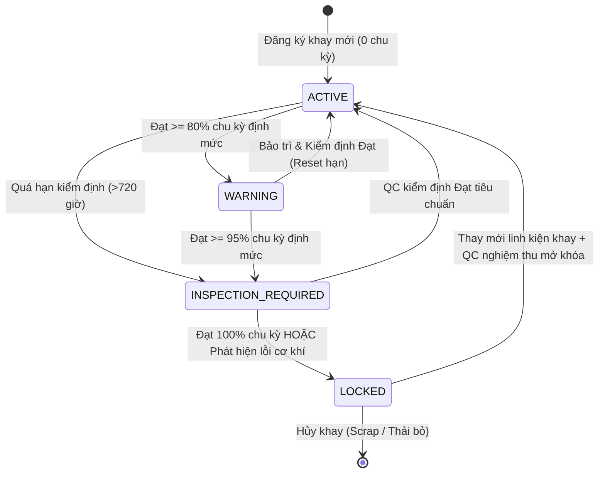

# KẾ HOẠCH TRIỂN KHAI GIAO DIỆN CẤU HÌNH KHAY CHỨA (`/config/carrier`)

> **Tài liệu tham chiếu:** Plan thiết kế kiến trúc và giao diện trang Quản lý Cấu hình & Giám sát Khay chứa (Carrier & Tray Lifecycle Management).  
> **Áp dụng cho route:** `/config/carrier` (thuộc nhóm menu **CONFIG / CẤU HÌNH HỆ THỐNG**).  
> **Component đích:** `src/features/config/carrier/CarrierConfigPage.jsx`.  
> **Đặc tả kiến trúc:** Module hóa tối đa (Component-Driven Architecture) — Phân tách thành 2 tab độc lập: Tab 1 "Giám sát thời gian thực" (`CarrierRealtimeTab.jsx`) và Tab 2 "Cấu hình vòng đời" (`CarrierLifecycleTab.jsx`), đi kèm các module: Thẻ thống kê KPI (`CarrierKpiCards.jsx`), Thanh công cụ lọc & tìm kiếm (`CarrierFilterToolbar.jsx`), Bảng giám sát thời gian thực (`CarrierRealtimeTable.jsx`), Phân trang (`CarrierPagination.jsx`), Modal kiểm định & bảo trì khay (`CarrierInspectionModal.jsx`), Modal khóa/mở khóa khay (`CarrierLockModal.jsx`), và Custom Hook quản lý dữ liệu (`useCarrierData.js`).  
> **Ngày khởi tạo:** 02/11/2026.  
> **Ngày cập nhật gần nhất:** 02/11/2026 (Khởi tạo tài liệu theo đặc tả hệ thống AutoLine Foxconn / NVIDIA).  
> **Vị trí tài liệu:** `src/md/CARRIER_CONFIG_PLAN.md` (đồng bộ tại `md/CARRIER_CONFIG_PLAN.md`).

---

## 1. TỔNG QUAN VÀ MỤC TIÊU DỰ ÁN

Hệ thống dây chuyền tự động hóa công nghệ cao (AutoLine) của Foxconn / NVIDIA vận hành liên tục hàng nghìn khay chứa chuyên dụng (Carriers, Pallets, Jigs, PCB Trays). Mỗi khay chịu hao mòn cơ học qua từng chu kỳ luân chuyển và tiếp xúc với máy ép (Pressfit), máy bắn vít (Screw), máy gắn linh kiện (SMT) và máy hàn tự động.

Màn hình **Carrier Configuration (`/config/carrier`)** có nhiệm vụ:

1. **Giám sát thời gian thực (Real-time Telemetry & Tracking):** Theo dõi tức thời tuổi thọ, % hao mòn, số chu kỳ vận hành, thời gian từ lần kiểm định cuối, vị trí chuyền/sản phẩm và trạng thái khóa/mở của toàn bộ khay trong nhà máy.
2. **Cấu hình vòng đời & An toàn tự động (Lifecycle Rules & Auto-locking):** Thiết lập định mức chu kỳ tối đa, ngưỡng cảnh báo sớm (Warning threshold), ngưỡng bắt buộc kiểm định (Inspection threshold) và chính sách cưỡng chế khóa khay (LOCKED) khi hết hạn để ngăn chặn lỗi cong vênh làm hỏng linh kiện GPU/Server cao cấp.
3. **Phản hồi tức thì & Đồng bộ:** Nút Refresh trên đầu trang cho phép kỹ sư vận hành làm mới tức thì dữ liệu telemetry của toàn bộ khay trên các chuyền AutoLine.

---

## 2. BỐ CỤC KHÔNG GIAN VÀ SƠ ĐỒ GIAO DIỆN (WIREFRAME)

### 2.1. Wireframe Tổng Thể Toàn Trang:

```text
┌────────────────────────────────────────────────────────────────────────────────────────────────────────────────────────┐
│ Header Bar: CONFIG / CARRIER CONFIG                                                                 [⟲ Refresh Data]   │
│ Tiêu đề: CARRIER CONFIGURATION                                                         [Badge: MASTER CARRIER]         │
│ Mô tả: Giám sát vòng đời, hao mòn cơ học, hạn kiểm định và cấu hình định mức cho hệ thống khay chứa AutoLine           │
├────────────────────────────────────────────────────────────────────────────────────────────────────────────────────────┤
│ TAB NAVIGATION:                                                                                                        │
│ ┌────────────────────────────────────────────────────────┬───────────────────────────────────────────────────────────┐ │
│ │  📡 1. GIÁM SÁT THỜI GIAN THỰC (Real-time Monitoring)  │  ⚙️ 2. CẤU HÌNH VÒNG ĐỜI (Lifecycle Configuration)         │ │
│ └────────────────────────────────────────────────────────┴───────────────────────────────────────────────────────────┘ │
├────────────────────────────────────────────────────────────────────────────────────────────────────────────────────────┤
│ NỘI DUNG TAB HIỆN TẠI (VD: TAB 1 - GIÁM SÁT THỜI GIAN THỰC ĐANG ACTIVE)                                                │
│                                                                                                                        │
│ [DÒNG 1: 5 THẺ CHỈ SỐ KPI THỐNG KÊ (KPI STATS CARDS)]                                                                  │
│ ┌──────────────────┐ ┌──────────────────┐ ┌──────────────────┐ ┌──────────────────┐ ┌──────────────────┐               │
│ │ 📦 TỔNG SỐ KHAY  │ │ 🟢 BÌNH THƯỜNG   │ │ 🟡 SẮP ĐẾN HẠN   │ │ 🟠 CẦN KIỂM ĐỊNH │ │ 🔴 ĐANG BỊ KHÓA  │               │
│ │   1,248 Khay     │ │   1,080 Khay     │ │    98 Khay       │ │    42 Khay       │ │    28 Khay       │               │
│ │   (100% tài sản) │ │   (86.5% tỷ lệ)  │ │    (7.9% cảnh báo│ │    (3.4% quá hạn)│ │    (2.2% cách ly)│               │
│ └──────────────────┘ └──────────────────┘ └──────────────────┘ └──────────────────┘ └──────────────────┘               │
│                                                                                                                        │
│ [DÒNG 2: THANH CÔNG CỤ TÌM KIẾM & BỘ LỌC (FILTER TOOLBAR)]                                                             │
│ ┌────────────────────┐ ┌────────────────────┐ ┌────────────────────┐ ┌──────────────────────┐ ┌──────────────────────┐ │
│ │ 🔍 Tìm mã khay...  │ │ ⚡ Tìm chuyền...   │ │ 🏷️ Tìm sản phẩm... │ │ [Trạng thái: Tất cả⏷]│ │ [Hiển thị: 20/trang ⏷]│ │
│ └────────────────────┘ └────────────────────┘ └────────────────────┘ └──────────────────────┘ └──────────────────────┘ │
│                                                                                                                        │
│ [DÒNG 3: BẢNG DỮ LIỆU GIÁM SÁT THỜI GIAN THỰC (CARRIER MONITORING MASTER TABLE)]                                       │
│ ┌──────┬──────────┬──────────────┬──────────┬─────────────────┬──────┬──────────────┬──────────────────┬────────┬───────┐│
│ │Mức độ│ Mã khay  │Chuyền/Sản phẩm│Loại khay │ Tiến độ chu kỳ  │% s.dụng│Giờ từ lần KT │ Lần K.định gần   │Trạng   │Thao   ││
│ │      │          │              │          │ (Hiện tại/T.đổi)│      │  cuối (h)    │     nhất         │thái    │tác    ││
│ ├──────┼──────────┼──────────────┼──────────┼─────────────────┼──────┼──────────────┼──────────────────┼────────┼───────┤│
│ │ [🔴] │ CRR-A089 │ Line01 - SMT │ GPU Tray │ [██████████] 100%│ 100% │ 720h (30d)   │ 2026-09-01 (QC05)│ LOCKED │👁️ 🔓 ⚙️││
│ │ [🟠] │ CRR-B012 │ Line02 - ASM │ Pallet-B │ [████████░░] 96% │ 96.2%│ 312h (13d)   │ 2026-10-18 (QC08)│ INSPEC.│👁️ 🛠️ 🔒││
│ │ [🟡] │ CRR-A045 │ Line01 - SMT │ GPU Tray │ [████████░░] 88% │ 88.0%│ 180h (7.5d)  │ 2026-10-24 (QC02)│ WARNING│👁️ 🛠️ 🔒││
│ │ [🟢] │ CRR-C103 │ Line03 - TST │ Jig-Fix  │ [███░░░░░░░] 35% │ 35.0%│ 24h (1d)     │ 2026-10-31 (QC11)│ ACTIVE │👁️ 🛠️ 🔒││
│ └──────┴──────────┴──────────────┴──────────┴─────────────────┴──────┴──────────────┴──────────────────┴────────┴───────┘│
│                                                                                                                        │
│ [DÒNG 4: PHÂN TRANG & THỐNG KÊ BẢN GHI (PAGINATION FOOTER)]                                                            │
│ Hiển thị 1 - 20 trong tổng số 1,248 khay           Trang: [⏮ First] [◀ Prev]  [ 1 ] [ 2 ] [ 3 ] ... [ 63 ]  [Next ▶] [Last ⏭] │
└────────────────────────────────────────────────────────────────────────────────────────────────────────────────────────┘
```

---

## 3. ĐẶC TẢ CHI TIẾT CÁC THÀNH PHẦN GIAO DIỆN

### 3.1. Phần Đầu Trang (Page Header & Tab Bar):

- **Breadcrumbs:** `CONFIG` > `CARRIER CONFIG`
- **Tiêu đề lớn:** `CARRIER CONFIGURATION`
- **Badge nhận diện:** `MASTER CARRIER` (Hiệu ứng ánh sáng Brand: Xanh neon `#76B900` ở theme NVIDIA, Xanh navy `#002766` ở theme Foxconn).
- **Mô tả chức năng:** Tóm tắt năng lực giám sát hao mòn và quản lý vòng đời khay chứa công nghệ cao.
- **Nút Refresh trên đầu trang (`⟲ Refresh`):**
  - Vị trí: Góc trên bên phải thanh Header.
  - Hành động: Kích hoạt tải lại dữ liệu tức thời từ hệ thống cảm biến/RFID/Database AutoLine.
  - Hiệu ứng thị giác: Icon mũi tên xoay `animate-spin` trong lúc fetch dữ liệu, kèm toast thông báo: _"Dữ liệu trạng thái khay đã được cập nhật mới nhất"_.
- **2 Tab điều hướng chính:**
  1. **Tab 1: 📡 Giám sát thời gian thực (`realtime`)** [Mặc định mở]
  2. **Tab 2: ⚙️ Cấu hình vòng đời (`lifecycle`)**

---

### 3.2. Tab 1: Giám Sát Thời Gian Thực (Real-time Monitoring)

#### Dòng 1: 5 Thẻ Chỉ Số KPI (Statistics Cards)

Xếp thành 5 cột ngang linh hoạt (`grid grid-cols-1 sm:grid-cols-2 lg:grid-cols-5 gap-4`):

| STT | Tên Thẻ KPI       | Dữ liệu hiển thị mẫu                        | Màu sắc nhận diện (NVIDIA / Foxconn)                     | Ý nghĩa nghiệp vụ                                                                            |
| :-: | :---------------- | :------------------------------------------ | :------------------------------------------------------- | :------------------------------------------------------------------------------------------- |
|  1  | **Tổng số khay**  | **1,248** khay<br>`100% tài sản lưu hành`   | **Brand Accent** (Xanh Neon `#76B900` / Navy `#002766`)  | Tổng số lượng khay chứa/pallet đang đăng ký trong hệ thống toàn xưởng.                       |
|  2  | **Bình thường**   | **1,080** khay<br>`86.5% hoạt động an toàn` | **Xanh lá Emerald** (`#10B981` / `bg-emerald-500/15`)    | Các khay có chu kỳ dưới 80%, còn hạn kiểm định, đang luân chuyển tốt trên chuyền.            |
|  3  | **Sắp đến hạn**   | **98** khay<br>`7.9% cần theo dõi`          | **Vàng hổ phách Amber** (`#F59E0B` / `bg-amber-500/15`)  | Các khay đạt ngưỡng cảnh báo (80% - 94% chu kỳ), chuẩn bị bảo trì định kỳ.                   |
|  4  | **Cần kiểm định** | **42** khay<br>`3.4% yêu cầu QA/QC`         | **Cam đậm Rose-Orange** (`#F97316` / `bg-orange-500/15`) | Các khay chạm 95% - 99% chu kỳ hoặc quá 30 ngày chưa thẩm định dung sai kỹ thuật.            |
|  5  | **Đang bị khóa**  | **28** khay<br>`2.2% cách ly khỏi line`     | **Đỏ rực Ruby-Red** (`#EF4444` / `bg-rose-500/15`)       | Các khay chạm 100% chu kỳ hoặc phát hiện cong vênh/hỏng hóc, bị khóa cưỡng bức bởi AutoLine. |

---

#### Dòng 2: Thanh Công Cụ Lọc & Tìm Kiếm (Filter Toolbar)

Bao gồm 5 bộ lọc được bố trí tinh gọn, hỗ trợ tìm kiếm kết hợp (AND filter):

```text
┌────────────────────────────────────────────────────────────────────────────────────────────────────────────────────────┐
│ [🔍 Ô 1: Tìm Mã Khay ] [⚡ Ô 2: Tìm Chuyền  ] [🏷️ Ô 3: Tìm Sản Phẩm] [Trạng Thái: ALL ⏷] [Số dòng: 20 ⏷] [⟲ Đặt lại]  │
└────────────────────────────────────────────────────────────────────────────────────────────────────────────────────────┘
```

1. **Trường text tìm kiếm theo Mã khay (`carrierCode`):**
   - Placeholder: `"Tìm theo mã khay (VD: CRR-A089, TRAY-01)..."`
   - Có nút xóa nhanh `[✕]` khi đã nhập text.
2. **Ô text tìm kiếm theo Tên chuyền (`lineName`):**
   - Placeholder: `"Tìm theo tên chuyền (VD: Line01, Line02)..."`
   - Tự động gợi ý danh sách chuyền đang hoạt động.
3. **Ô text tìm kiếm theo Tên sản phẩm (`productName`):**
   - Placeholder: `"Tìm theo sản phẩm (VD: GB200, B200, H100)..."`
4. **Dropdown menu Lọc theo Trạng thái (`status`):**
   - Tùy chọn 1: `Tất cả trạng thái (ALL)`
   - Tùy chọn 2: `🟢 ACTIVE (Bình thường)`
   - Tùy chọn 3: `🟡 WARNING (Sắp đến hạn)`
   - Tùy chọn 4: `🟠 INSPECTION_REQUIRED (Cần kiểm định)`
   - Tùy chọn 5: `🔴 LOCKED (Đang bị khóa)`
5. **Nút Lọc theo Số lượng trang / Phân trang (`pageSize`):**
   - Dropdown chọn số bản ghi trên mỗi trang: `10 dòng/trang`, `20 dòng/trang` (mặc định), `50 dòng/trang`, `100 dòng/trang`.
6. **Nút Reset bộ lọc (`⟲ Đặt lại`):** Khôi phục tất cả trường tìm kiếm về rỗng và trạng thái về `ALL`.

---

#### Dòng 3: Bảng Dữ Liệu Giám Sát Thời Gian Thực (Carrier Master Table)

Bảng dữ liệu chuẩn 9 cột thông tin theo yêu cầu nghiệp vụ, kèm 1 cột Thao tác quản trị:

| STT | Tên Cột                                                      | Định Dạng Dữ Liệu & Hiển Thị                                                                                                                                                                                   | Logic Nghiệp Vụ & Màu Sắc                                                                                                |
| :-: | :----------------------------------------------------------- | :------------------------------------------------------------------------------------------------------------------------------------------------------------------------------------------------------------- | :----------------------------------------------------------------------------------------------------------------------- |
|  1  | **Mức độ** _(Severity)_                                      | Icon chấm tròn trạng thái kèm Pulsing Dot:<br>• 🟢 An toàn<br>• 🟡 Cảnh báo<br>• 🟠 Nguy cơ<br>• 🔴 Khóa                                                                                                       | Phản ánh mức độ khẩn cấp cần can thiệp kỹ thuật dựa trên % sử dụng và trạng thái khóa.                                   |
|  2  | **Mã khay** _(Carrier Code)_                                 | Tag mã khay in đậm:<br>`CRR-A089`<br>Mã RFID phụ: `RFID: 0E4A-98C1`                                                                                                                                            | Mã định danh duy nhất của khay gắn thẻ RFID/Barcode 2D. Click vào để xem chi tiết.                                       |
|  3  | **Chuyền / Sản phẩm** _(Line / Product)_                     | 2 dòng liên kết:<br>**Line01 - SMT 01** _(Chuyền)_<br>`GB200 NVL72` _(Sản phẩm)_                                                                                                                               | Vị trí chuyền sản xuất và dòng sản phẩm hiện tại mà khay đang phục vụ.                                                   |
|  4  | **Loại khay** _(Carrier Type)_                               | Badge phân loại:<br>`GPU Tray`, `CPU Pallet`, `IC Jig`, `SMT Board Tray`                                                                                                                                       | Định loại khay quy định tải trọng, kích thước và định mức chu kỳ tối đa.                                                 |
|  5  | **Tiến độ chu kỳ** _(Cycle Progress)_                        | Thanh tiến trình (Progress Bar) trực quan:<br>`1,850 / 2,000 chu kỳ`<br>Thanh màu biến thiên theo %: Xanh → Vàng → Cam → Đỏ                                                                                    | Số chu kỳ đã qua trạm so với định mức vòng đời tối đa cho phép của khay.                                                 |
|  6  | **% sử dụng** _(% Life Used)_                                | Chỉ số phần trăm nổi bật:<br>`92.5%` (Phông số monospace to rõ)                                                                                                                                                | Tỷ lệ hao mòn tính toán: `(Chu kỳ thực tế / Chu kỳ định mức) * 100%`.                                                    |
|  7  | **Giờ từ lần kiểm tra cuối** _(Hours Since Last Inspection)_ | Thời gian trôi qua tích lũy:<br>`128 giờ trước` (hoặc `5.3 ngày`)<br>Cảnh báo đỏ nếu vượt quá 720h (30 ngày)                                                                                                   | Số giờ trôi qua kể từ lần gần nhất kỹ thuật viên QA/QC đo đạc dung sai cơ khí của khay.                                  |
|  8  | **Lần kiểm định gần nhất** _(Last Inspection Date & QC)_     | Ngày tháng & Nhân sự thực hiện:<br>`2026-10-18 14:30`<br>Bởi: `V109281 - Nguyễn Văn An (QC)`                                                                                                                   | Ghi nhận dấu vết kiểm định hợp lệ gần nhất phục vụ truy xuất nguồn gốc (Audit Trail).                                    |
|  9  | **Trạng thái** _(Status Badge)_                              | Badge màu sắc tiêu chuẩn:<br>• `ACTIVE` (Nền xanh lá)<br>• `WARNING` (Nền vàng)<br>• `INSPECTION_REQUIRED` (Nền cam)<br>• `LOCKED` (Nền đỏ)                                                                    | Trạng thái điều khiển logic chuyển mạch của trạm AutoLine: Khay `LOCKED` sẽ bị trạm đọc RFID từ chối và đẩy ra nhánh NG. |
| 10  | **Thao tác** _(Actions)_                                     | Nhóm 3 nút thao tác:<br>• 👁️ **Chi tiết:** Xem lịch sử chu kỳ & nhật ký trạm.<br>• 🛠️ **Kiểm định:** Mở popup nhập kết quả đo dung sai & reset chu kỳ.<br>• 🔒/🔓 **Khóa/Mở khóa:** Chuyển trạng thái an toàn. | Thao tác can thiệp trực tiếp của Kỹ sư vận hành AutoLine và Kiểm định viên QC.                                           |

---

### 3.3. Tab 2: Cấu Hình Vòng Đời (Lifecycle Configuration)

Dành cho Quản đốc phân xưởng và Trưởng nhóm Kỹ thuật (PE/ME) thiết lập quy tắc vận hành an toàn:

1. **Bảng Định Mức Vòng Đời Theo Loại Khay (Carrier Type Limits):**
   - Thiết lập số chu kỳ tối đa (`Max Cycles`) cho từng loại khay:
     - `GPU Component Tray`: Định mức 2,000 chu kỳ.
     - `High-Density IC Pallet`: Định mức 1,500 chu kỳ.
     - `Screw Fastening Jig`: Định mức 3,000 chu kỳ.
     - `Pressfit Positioning Fixture`: Định mức 1,000 chu kỳ.
2. **Quy Tắc Cảnh Báo Sớm (Warning Rules):**
   - Ngưỡng cảnh báo vàng (`WARNING`): Mặc định khi đạt `80%` định mức.
   - Ngưỡng bắt buộc kiểm định (`INSPECTION_REQUIRED`): Mặc định khi đạt `95%` định mức hoặc sau mỗi `720 giờ` (30 ngày).
3. **Cơ Chế Cưỡng Chế Khóa Tự Động (Auto-Lock Policies):**
   - `[☑] Khóa tự động khi đạt 100% chu kỳ`: Ngăn không cho khay tiếp tục vào chuyền nạp linh kiện.
   - `[☑] Khóa tự động khi quá hạn kiểm định định kỳ`: Ngăn lỗi dung sai phát sinh do lão hóa vật liệu.
   - `[☑] Tích hợp tín hiệu PLC/RFID trạm AutoLine`: Khi phát hiện khay `LOCKED`, PLC kích hoạt xylanh đẩy khay ra làn bảo dưỡng (Maintenance Buffer Track).
4. **Quy Trình Mở Khóa Khay (Unlocking Protocol):**
   - Chỉ được mở khóa sau khi Kỹ thuật viên QC thực hiện đo kiểm 3 chiều (X, Y, Z, độ phẳng/coplanarity), nhập mã số phiếu kiểm định và nhấn xác nhận.

---

## 4. QUY TRÌNH NGHIỆP VỤ & MA TRẬN TRẠNG THÁI (LIFECYCLE ENGINE)



### Tiêu Chuẩn Phân Loại Trạng Thái:

| Trạng thái              | Điều kiện kích hoạt                                    | Tác động lên AutoLine                                     | Hành động khắc phục                         |
| :---------------------- | :----------------------------------------------------- | :-------------------------------------------------------- | :------------------------------------------ |
| **ACTIVE**              | Chu kỳ < 80% & Thời gian kiểm định < 720h              | Chuyền hoạt động bình thường, AGV tự do bốc dỡ            | Tiếp tục theo dõi chu kỳ                    |
| **WARNING**             | Chu kỳ từ 80% - 94.9%                                  | Cảnh báo đèn vàng trên dashboard, không dừng máy          | Lên lịch chuẩn bị khay dự phòng             |
| **INSPECTION_REQUIRED** | Chu kỳ từ 95% - 99.9% HOẶC thời gian kiểm định >= 720h | Đèn cam nhấp nháy, trạm cảnh báo trước khi nạp            | QC thực hiện kiểm định dung sai tại trạm QC |
| **LOCKED**              | Chu kỳ >= 100% HOẶC có lệnh khóa thủ công              | Trạm chặn khay ngay tại đầu vào, PLC đẩy ra nhánh bảo trì | Đo kiểm tổng thể, sửa chữa hoặc loại bỏ     |

---

## 5. CẤU TRÚC THƯ MỤC NGUỒN VÀ KIẾN TRÚC COMPONENT

### 5.1. Cây Thư Mục Module Hóa (`src/features/config/carrier/`):

```text
src/features/config/carrier/
├── CarrierConfigPage.jsx              # Trang chính (Điều phối Tabs, Header, Refresh & State chung)
├── hooks/
│   └── useCarrierData.js              # Hook quản lý fetch dữ liệu, filter, pagination, status count, refresh
├── mock/
│   └── carrierMockData.js             # Dữ liệu giả lập 25+ khay chứa chuẩn nhà máy Foxconn/NVIDIA
└── components/
    ├── header/
    │   └── CarrierPageHeader.jsx      # Tiêu đề trang, breadcrumbs, badge và nút Refresh xoay mượt mà
    ├── tabs/
    │   ├── CarrierTabsNav.jsx         # Thanh chuyển đổi 2 Tab (Giám sát thời gian thực & Cấu hình vòng đời)
    │   ├── realtime/
    │   │   ├── CarrierRealtimeTab.jsx     # Container nội dung Tab 1
    │   │   ├── CarrierKpiCards.jsx        # 5 Thẻ thống kê KPI (Tổng, Normal, Warning, Inspection, Locked)
    │   │   ├── CarrierFilterToolbar.jsx   # Thanh công cụ lọc: 3 text search, 1 dropdown status, 1 page-size
    │   │   ├── CarrierRealtimeTable.jsx   # Bảng dữ liệu chính 9 cột + 1 cột thao tác
    │   │   └── CarrierPagination.jsx      # Thanh phân trang và số lượng dòng hiển thị
    │   └── lifecycle/
    │       ├── CarrierLifecycleTab.jsx    # Container nội dung Tab 2
    │       ├── CarrierTypeLimitTable.jsx  # Bảng cấu hình định mức chu kỳ theo loại khay
    │       └── CarrierAutoLockPolicy.jsx  # Form cấu hình ngưỡng cảnh báo & chính sách khóa tự động
    └── modals/
        ├── CarrierDetailModal.jsx         # Modal xem chi tiết thông số khay & lịch sử chu kỳ
        ├── CarrierInspectionModal.jsx     # Modal nhập kết quả đo kiểm định & reset chu kỳ
        └── CarrierLockActionModal.jsx     # Modal xác nhận Khóa hoặc Mở khóa khay
```

---

## 6. HỢP ĐỒNG DỮ LIỆU MẪU (MOCK DATA CONTRACT)

### 6.1. Cấu Trúc Khay Chứa (`CarrierItem`):

```javascript
// src/features/config/carrier/mock/carrierMockData.js
export const MOCK_CARRIERS = [
  {
    id: "CRR-001",
    carrierCode: "CRR-A089",
    rfidTag: "E280-1160-2000-7489",
    lineName: "Line01",
    stationName: "SMT-Mount-01",
    productName: "GB200 NVL72",
    carrierType: "GPU Component Tray",
    carrierTypeCategory: "GPU_TRAY",
    currentCycles: 2000,
    maxCycles: 2000,
    usagePercentage: 100.0,
    hoursSinceLastInspection: 720,
    lastInspectionDate: "2026-09-01 09:15",
    lastInspector: "V109281 - Nguyễn Văn An",
    status: "LOCKED", // 'ACTIVE' | 'WARNING' | 'INSPECTION_REQUIRED' | 'LOCKED'
    severity: "critical", // 'normal' | 'warning' | 'urgent' | 'critical'
    lockReason:
      "Đã đạt 100% định mức chu kỳ cơ học tối đa. Yêu cầu đo lại độ phẳng bề mặt.",
    dimensions: "350 x 250 x 40 mm",
    material: "Anodized Aluminum ESD Safe",
  },
  {
    id: "CRR-002",
    carrierCode: "CRR-B012",
    rfidTag: "E280-1160-2000-7512",
    lineName: "Line02",
    stationName: "Screw-Auto-02",
    productName: "B200 HGX",
    carrierType: "Assembly Pallet B",
    carrierTypeCategory: "PALLET",
    currentCycles: 1924,
    maxCycles: 2000,
    usagePercentage: 96.2,
    hoursSinceLastInspection: 312,
    lastInspectionDate: "2026-10-18 14:30",
    lastInspector: "V108455 - Trần Quốc Huy",
    status: "INSPECTION_REQUIRED",
    severity: "urgent",
    lockReason: null,
    dimensions: "420 x 300 x 55 mm",
    material: "PEEK Composite ESD Safe",
  },
  {
    id: "CRR-003",
    carrierCode: "CRR-A045",
    rfidTag: "E280-1160-2000-7445",
    lineName: "Line01",
    stationName: "Pressfit-01",
    productName: "GB200 NVL72",
    carrierType: "GPU Component Tray",
    carrierTypeCategory: "GPU_TRAY",
    currentCycles: 1760,
    maxCycles: 2000,
    usagePercentage: 88.0,
    hoursSinceLastInspection: 180,
    lastInspectionDate: "2026-10-24 10:00",
    lastInspector: "V107293 - Lê Minh Quân",
    status: "WARNING",
    severity: "warning",
    lockReason: null,
    dimensions: "350 x 250 x 40 mm",
    material: "Anodized Aluminum ESD Safe",
  },
  {
    id: "CRR-004",
    carrierCode: "CRR-C103",
    rfidTag: "E280-1160-2000-8103",
    lineName: "Line03",
    stationName: "AOI-Optical-01",
    productName: "H100 SXM5",
    carrierType: "Precision Test Jig",
    carrierTypeCategory: "JIG",
    currentCycles: 350,
    maxCycles: 1000,
    usagePercentage: 35.0,
    hoursSinceLastInspection: 24,
    lastInspectionDate: "2026-10-31 16:45",
    lastInspector: "V109281 - Nguyễn Văn An",
    status: "ACTIVE",
    severity: "normal",
    lockReason: null,
    dimensions: "280 x 210 x 30 mm",
    material: "Bakelite Anti-Static",
  },
];
```

---

## 7. BẢNG MÀU THIẾT KẾ VÀ BRAND TOKENS (DESIGN SYSTEM)

Trang Carrier Config tuân thủ tuyệt đối quy tắc giao diện 2 Brand Theme của nền tảng:

| Thành phần UI                                 | Foxconn Light Theme (`foxconn`)                                        | NVIDIA Dark Theme (`nvidia`)                                                       |
| :-------------------------------------------- | :--------------------------------------------------------------------- | :--------------------------------------------------------------------------------- |
| **Nền trang (`Page Background`)**             | `bg-slate-50 text-slate-800`                                           | `bg-zinc-950 text-zinc-100`                                                        |
| **Card / Bảng dữ liệu**                       | `bg-white border-slate-200 shadow-sm`                                  | `bg-zinc-900 border-zinc-800 shadow-lg`                                            |
| **Điểm nhấn thương hiệu (`Brand Accent`)**    | Xanh Navy `#002766` (`bg-[#002766] text-white`)                        | Xanh Neon `#76B900` (`bg-[#76B900] text-black font-black`)                         |
| **Nút Refresh**                               | `bg-white hover:bg-slate-100 text-slate-700 border-slate-200`          | `bg-zinc-800 hover:bg-zinc-700 text-zinc-200 border-zinc-700 hover:text-[#76B900]` |
| **Badge ACTIVE (Bình thường)**                | `bg-emerald-50 text-emerald-700 border-emerald-200`                    | `bg-emerald-500/15 text-emerald-400 border-emerald-500/30`                         |
| **Badge WARNING (Sắp đến hạn)**               | `bg-amber-50 text-amber-700 border-amber-200`                          | `bg-amber-500/15 text-amber-400 border-amber-500/30`                               |
| **Badge INSPECTION_REQUIRED (Cần kiểm định)** | `bg-orange-50 text-orange-700 border-orange-200`                       | `bg-orange-500/15 text-orange-400 border-orange-500/30`                            |
| **Badge LOCKED (Đang bị khóa)**               | `bg-rose-50 text-rose-700 border-rose-200`                             | `bg-rose-500/20 text-rose-400 border-rose-500/40`                                  |
| **Thanh tiến trình chu kỳ (`Progress Bar`)**  | Gradient: `from-blue-600 to-indigo-600` (hoặc Amber/Rose nếu cảnh báo) | Gradient: `from-[#76B900] to-emerald-400` (hoặc Amber/Rose nếu cảnh báo)           |

---

## 8. LỘ TRÌNH TRIỂN KHAI VÀ CHECKLIST THỰC HIỆN

- [x] **Bước 1: Khởi tạo & đặc tả tài liệu kế hoạch:**
  - Viết tài liệu `src/md/CARRIER_CONFIG_PLAN.md` và đồng bộ sang `md/CARRIER_CONFIG_PLAN.md`.
- [x] **Bước 2: Xây dựng Mock Data & Hook:**
  - Tạo `src/features/config/carrier/mock/carrierMockData.js` với 20+ bản ghi đầy đủ trạng thái.
  - Tạo `src/features/config/carrier/hooks/useCarrierData.js` xử lý lọc 3 trường text, lọc status, phân trang và refresh.
- [x] **Bước 3: Phát triển Header & Thanh 2 Tabs:**
  - Tích hợp `PageHeaderBar` có nút `Refresh` kích hoạt hiệu ứng xoay làm mới dữ liệu và cập nhật timestamp.
  - Tạo `CarrierTabsNav.jsx` chuyển đổi giữa Tab Giám sát thời gian thực và Tab Cấu hình vòng đời.
- [x] **Bước 4: Phát triển Tab 1 - Giám sát thời gian thực:**
  - Tạo `CarrierKpiCards.jsx` (5 thẻ KPI: Tổng số khay, Bình thường, Sắp đến hạn, Cần kiểm định, Đang bị khóa).
  - Tạo `CarrierFilterToolbar.jsx` (3 ô text tìm kiếm mã khay, chuyền, sản phẩm; 1 dropdown status; 1 pagination selector; 1 nút Reset).
  - Tạo `CarrierRealtimeTable.jsx` hiển thị đầy đủ 9 cột thông tin: Mức độ, Mã khay, Chuyền/Sản phẩm, Loại khay, Tiến độ chu kỳ, % sử dụng, Giờ từ lần KT cuối, Lần kiểm định gần nhất, Trạng thái + Cột thao tác.
  - Tạo `CarrierPagination.jsx` điều khiển trang và số lượng hiển thị.
- [x] **Bước 5: Phát triển Tab 2 - Cấu hình vòng đời:**
  - Tạo `CarrierLifecycleTab.jsx` với bảng định mức loại khay và quy tắc khóa tự động.
- [x] **Bước 6: Tích hợp Modal thao tác:**
  - Modal xem chi tiết khay, Modal nghiệm thu kiểm định & reset chu kỳ, và Modal xác nhận Khóa / Mở khóa khay.
- [x] **Bước 7: Kiểm thử chất lượng (Quality Assurance):**
  - Chạy `npm run build` thành công xuất sắc (0 lỗi biên dịch, 804 modules built in 337ms), tương thích cả 2 Brand Themes (Foxconn / NVIDIA).
