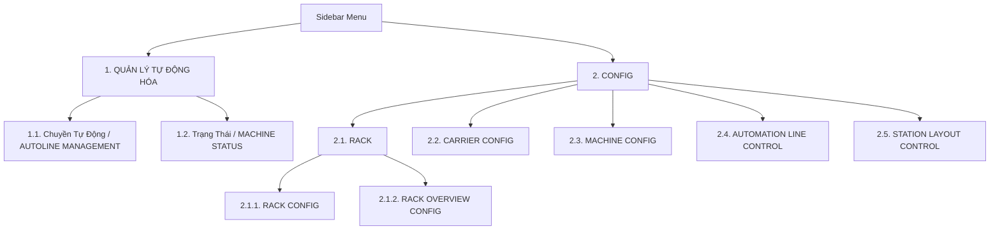

# KẾ HOẠCH TRIỂN KHAI MENU THANH ĐIỀU HƯỚNG DỌC (SIDEBAR)

> **Tài liệu tham chiếu:** Plan cấu trúc toàn diện menu dọc cho hệ thống Foxconn / NVIDIA Enterprise Frontend.  
> **Cập nhật:** Bổ sung mục **Chuyền tự động** và **Trạng thái** trong nhóm Quản lý Tự Động Hóa & cấu trúc thư mục mới `src/features/`.  
> **Ngày cập nhật:** 24/10/2026  
> **Vị trí file:** `src/md/CONFIG_MENU_PLAN.md` (đồng bộ tại `md/CONFIG_MENU_PLAN.md`)

---

## 1. MỤC TIÊU VÀ YÊU CẦU

Hệ thống thanh điều hướng dọc (`Sidebar.jsx`) quản lý 2 nhóm chính:
1. **QUẢN LÝ TỰ ĐỘNG HÓA** (`AUTOMATION MANAGEMENT`): Quản lý chuyền sản xuất tự động và trạng thái realtime của máy móc.
2. **CONFIG** (`SYSTEM CONFIGURATION`): Cấu hình thiết bị, tủ Rack, Carrier, máy móc, điều khiển line và bố cục layout.



---

## 2. CHI TIẾT DANH MỤC MENU & ROUTING

### 2.1. Nhóm 1: QUẢN LÝ TỰ ĐỘNG HÓA (AUTOMATION MANAGEMENT)

| STT | Tên hiển thị (Tiếng Việt) | English / Chinese | Route Path | Vị trí Component | Mô tả chức năng |
| :-- | :--- | :--- | :--- | :--- | :--- |
| **1.1** | **Chuyền Tự Động** | `AUTOLINE MANAGEMENT`<br>`自动化产线管理` | `/autoline-management` | `src/features/management/automation_line_management/AutomationLineManagement.jsx` | Quản lý danh sách các dây chuyền tự động hóa, thông số ca sản xuất, chỉ số OEE và vận hành. |
| **1.2** | **Trạng Thái** | `MACHINE STATUS`<br>`机台状态` | `/machine-status` | `src/features/management/machine_status_management/MachineStatusManagement.jsx` | Giám sát trạng thái hoạt động trực tiếp của các máy (Online, Offline, Warning, Error), tín hiệu sensor và telemetry. |

---

### 2.2. Nhóm 2: CONFIG (HỆ THỐNG CẤU HÌNH)

| STT | Tên hiển thị | Phân cấp | Route Path | Vị trí Component | Mô tả chức năng |
| :-- | :--- | :--- | :--- | :--- | :--- |
| **2.1** | **RACK** | *Accordion Parent* | `/config/rack/*` | *(Sub-menu)* | Quản lý hệ thống tủ Rack |
| 2.1.1 | └─ **RACK CONFIG** | Child | `/config/rack` | `src/features/rack/RackConfigPage.jsx` | Cấu hình chi tiết tủ rack vật lý, kích thước slot, vị trí tầng. |
| 2.1.2 | └─ **RACK OVERVIEW CONFIG** | Child | `/config/rack-overview` | `src/features/rack/RackOverviewConfigPage.jsx` | Sơ đồ mặt phẳng 2D/3D bố trí rack, heatmap nhiệt độ và dung lượng. |
| **2.2** | **CARRIER CONFIG** | Single Item | `/config/carrier` | `src/features/config/carrier/CarrierConfigPage.jsx` | Cấu hình khay chứa, pallet, khay trung chuyển AGV và mã RFID. |
| **2.3** | **MACHINE CONFIG** | Single Item | `/config/machine` | `src/features/config/machine/MachineConfigPage.jsx` | Thiết lập tham số máy, địa chỉ IP kết nối (SECS/GEM, OPC-UA, MQTT). |
| **2.4** | **AUTOMATION LINE CONTROL** | Single Item | `/config/automation-line` | `src/features/config/automation_line_control/AutomationLineControlPage.jsx` | Bảng điều khiển dây chuyền tự động: RUN, PAUSE, E-STOP, nhịp Takt Time. |
| **2.5** | **STATION LAYOUT CONTROL** | Single Item | `/config/station-layout` | `src/features/config/station-layout/StationLayoutControlPage.jsx` | Bố cục sơ đồ trạm thao tác (Station Blueprint Editor). |

---

## 3. CẤU TRÚC THƯ MỤC SOURCE CODE (`src/features/`)

Hệ thống được tổ chức chuẩn module hóa trực quan theo từng tính năng:
```text
src/features/
├── auth/                               # Đăng nhập & Xác thực
├── management/                         # Nhóm Quản lý Tự động hóa
│   ├── automation_line_management/     # Quản lý Chuyền Tự Động
│   │   └── AutomationLineManagement.jsx
│   └── machine_status_management/      # Giám sát Trạng Thái Máy
│       └── MachineStatusManagement.jsx
├── config/                             # Nhóm Cấu hình Hệ thống
│   ├── carrier/                        # Cấu hình Carrier
│   │   └── CarrierConfigPage.jsx
│   ├── machine/                        # Cấu hình Máy
│   │   └── MachineConfigPage.jsx
│   ├── automation_line_control/        # Điều khiển Line Tự Động
│   │   └── AutomationLineControlPage.jsx
│   └── station-layout/                 # Thiết kế bố cục Trạm
│       └── StationLayoutControlPage.jsx
├── rack/                               # Quản lý Cấu hình Rack
│   ├── RackConfigPage.jsx
│   └── RackOverviewConfigPage.jsx
└── misc/                               # Trang 404, Loading phụ trợ
```

---

## 4. KẾ HOẠCH TRIỂN KHAI VÀ THỰC THI (ACTION ITEMS)

- [x] **Bước 1**: Cập nhật file kế hoạch `src/md/CONFIG_MENU_PLAN.md` và `md/CONFIG_MENU_PLAN.md`.
- [x] **Bước 2**: Hoàn thiện component `AutomationLineManagement.jsx` (Giao diện chuẩn Enterprise, dashboard thống kê chuyền, danh sách line sản xuất, hỗ trợ 2 theme Foxconn & NVIDIA).
- [ ] **Bước 3**: Hoàn thiện component `MachineStatusManagement.jsx` (Giao diện telemetry máy móc, trạng thái kết nối realtime, bộ lọc theo khu vực).
- [ ] **Bước 4**: Cập nhật cấu hình Menu `src/utils/Menu.jsx` với 2 mục: **Chuyền Tự Động** và **Trạng Thái** trong nhóm `automation`.
- [ ] **Bước 5**: Cập nhật định tuyến `src/routes/routesConfig.jsx`:
  - Khai báo route `/autoline-management` (và redirect mặc định `/` về đây).
  - Khai báo route `/machine-status`.
  - Kết nối chính xác tới các file mới trong `src/features/`.
- [ ] **Bước 6**: Kiểm thử và build production kiểm tra tính toàn vẹn hệ thống (`npm run build`).
