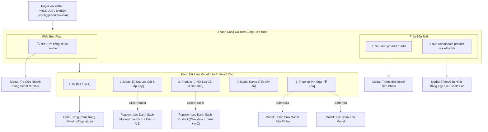

# KẾ HOẠCH TRIỂN KHAI GIAO DIỆN CẤU HÌNH PRODUCT / NVIDIA (`/config/product/nvidia`)

> **Tài liệu tham chiếu:** Plan đặc tả kiến trúc, thiết kế giao diện và luồng nghiệp vụ cho module Quản Lý & Cấu Hình Model Sản Phẩm NVIDIA (Product / NVIDIA Model Configuration & Master Catalog Studio).  
> **Áp dụng cho route:** `/config/product/nvidia` (và `/config/product`) (thuộc nhóm menu **CONFIG / CẤU HÌNH HỆ THỐNG -> PRODUCT -> NVIDIA**).  
> **Component đích:** `src/features/products/nvidia/ProductNvidiaPage.jsx` (và `src/features/config/products/nvidia/index.js`).  
> **Thư mục chức năng:** `src/features/products/nvidia/`.  
> **Bố cục giao diện:**
>
> - **Thanh công cụ trên cùng (Top Bar):**
>   - Phía bên trái trên cùng gồm 2 nút: **`Add product model`** (Thêm model mới) và **`Add/update product model by file`** (Thêm/cập nhật model sản phẩm bằng tệp file Excel/CSV).
>   - Phía bên phải trên cùng gồm: **Ô text nhập/quét Serial Number trực tiếp** kết hợp ngay cạnh nút **`Tìm bằng serial number`** cho phép nhập hoặc dùng đầu đọc mã vạch quét trực tiếp để tự động định danh và lọc model tương ứng trên bảng.
> - **Bảng dữ liệu trung tâm (Master Data Table):** Gồm 5 trường dữ liệu:
>   1. `id`: Mã số định danh / STT bản ghi.
>   2. `model`: Mã model sản phẩm (**Có tính năng lọc tương tác trên tiêu đề cột**).
>   3. `product`: Tên dòng sản phẩm (**Có tính năng lọc tương tác trên tiêu đề cột**).
>   4. `model name`: Tên mô tả đầy đủ của model.
>   5. `thao tác`: Cột hành động chứa 2 nút **Sửa** (Edit) và **Xóa** (Delete).
> - **Phân trang (Pagination):** Chuyển trang linh hoạt, tùy chọn số bản ghi trên trang (10, 20, 50, 100) và hiển thị tổng số bản ghi.  
>   **Ngày khởi tạo:** 11/11/2026.  
>   **Vị trí tài liệu:** `src/md/PRODUCT_CONFIG_PLAN.md` (đồng bộ tại `md/PRODUCT_CONFIG_PLAN.md`).

---

## 1. TỔNG QUAN VÀ MỤC TIÊU DỰ ÁN

Trong các nhà máy thông minh tự động hóa sản xuất máy chủ trí tuệ nhân tạo (Foxconn Industrial Internet - FII hợp tác sản xuất cho NVIDIA), các dòng máy chủ tính toán hiệu năng cao (như siêu chip Blackwell GB200 NVL72, B200 HGX, Hopper H100/H200, Grace CPU, Switch mạng Spectrum-X) đòi hỏi danh mục dữ liệu sản phẩm gốc (**Product Master Data**) phải tuyệt đối chính xác và có thể truy xuất tức thì.

Màn hình **Config Product - Product/Nvidia (`/config/product/nvidia`)** là trung tâm cấu hình giúp kỹ sư sản xuất, quản lý chất lượng (QA/QC) và chuyên viên kỹ thuật:

1. **Quản lý danh mục Model sản phẩm**: Khai báo, chỉnh sửa và chuẩn hóa các mã Model, dòng Product và Model Name tương ứng của dự án NVIDIA.
2. **Thao tác thêm mới linh hoạt (Top Left)**:
   - **`Add product model`**: Nút mở form tạo mới trực tiếp trên giao diện với validation trường dữ liệu chặt chẽ.
   - **`Add/update product model by file`**: Nút mở modal cho phép tải lên tệp Excel (`.xlsx`, `.xls`) hoặc CSV để thêm mới hoặc cập nhật đồng loạt hàng trăm model, tiết kiệm thời gian vận hành.
3. **Tra cứu nhanh bằng Serial Number (Top Right)**:
   - Nút **`Tìm bằng serial number`**: Hỗ trợ kỹ sư khi cầm bo mạch hoặc máy trên tay chỉ cần quét mã vạch Serial Number (SN) là hệ thống tự động bóc tách và định danh ra ngay Model, Product và Model Name liên quan.
4. **Bảng dữ liệu tương tác cao kèm Lọc cột Excel-style**:
   - Hai cột dữ liệu trọng yếu là **`model`** và **`product`** được tích hợp nút bấm mở Popover bộ lọc (tìm kiếm nhanh, checkbox chọn nhiều giá trị kèm số lượng đếm, sắp xếp A-Z / Z-A).
   - Cột **Thao tác** tích hợp 2 nút **Sửa** và **Xóa** kèm cơ chế xác nhận an toàn trước khi xóa dữ liệu.
5. **Hệ thống phân trang chuyên nghiệp**: Cho phép phân trang mượt mà, chuyển trang tức thời và tùy chọn số dòng hiển thị.
6. **Tương thích toàn diện nhận diện thương hiệu kép (Dual-Theme)**: Foxconn (Giao diện sáng Navy / Slate) và NVIDIA Cyberpunk (Giao diện tối Zinc Dark / Neon Green `#76B900`).

---

## 2. BỐ CỤC KHÔNG GIAN VÀ SƠ ĐỒ GIAO DIỆN (WIREFRAME)

### 2.1. Sơ đồ Luồng Hoạt Động (Architecture Flowchart):



---

### 2.2. Wireframe Chi Tiết Giao Diện (ASCII Wireframe):

```text
┌────────────────────────────────────────────────────────────────────────────────────────────────────────────────────────┐
│ CONFIG / PRODUCT / NVIDIA                                                                             [⛶ Fullscreen]   │
│ PRODUCT CONFIGURATION                                                                    [Badge: NVIDIA MASTER DATA]   │
│ Quản lý thiết lập danh mục model, dòng sản phẩm, tra cứu theo serial number và import dữ liệu hàng loạt                │
├────────────────────────────────────────────────────────────────────────────────────────────────────────────────────────┤
│ [THANH CÔNG CỤ TRÊN CÙNG: 2 NÚT BÊN TRÁI & Ô TEXT NHẬP SN + NÚT TÌM BẰNG SERIAL NUMBER BÊN PHẢI]                       │
│ ┌────────────────────────────────────────────────────────┐  ┌────────────────────────────────────────────────────────┐ │
│ │ [➕ Add product model]   [📁 Add/update model by file]  │  │ [🔍 Quét/nhập Serial Number...] [Tìm bằng serial number]│ │
│ └────────────────────────────────────────────────────────┘  └────────────────────────────────────────────────────────┘ │
│                                                                                                                        │
│ [BẢNG DỮ LIỆU MODEL SẢN PHẨM: 5 CỘT THÔNG TIN]                                                                         │
│ ┌──────┬────────────────────────┬────────────────────────┬───────────────────────────────────────────┬───────────────┐ │
│ │  ID  │ MODEL [🔻 ⇅]           │ PRODUCT [🔻 ⇅]         │ MODEL NAME                                │ THAO TÁC      │ │
│ ├──────┼────────────────────────┼────────────────────────┼───────────────────────────────────────────┼───────────────┤ │
│ │ 001  │ GB200-NVL72            │ Blackwell GB200        │ NVIDIA GB200 NVL72 Liquid-Cooled AI Rack  │ [✏️]   [🗑️]   │ │
│ ├──────┼────────────────────────┼────────────────────────┼───────────────────────────────────────────┼───────────────┤ │
│ │ 002  │ B200-HGX-192GB         │ B200 GPU Server        │ NVIDIA HGX B200 8-GPU AI Baseboard Tray   │ [✏️]   [🗑️]   │ │
│ ├──────┼────────────────────────┼────────────────────────┼───────────────────────────────────────────┼───────────────┤ │
│ │ 003  │ B100-HGX-192GB         │ B100 GPU Server        │ NVIDIA HGX B100 8-GPU Air-Cooled Tray     │ [✏️]   [🗑️]   │ │
│ ├──────┼────────────────────────┼────────────────────────┼───────────────────────────────────────────┼───────────────┤ │
│ │ 004  │ H100-SXM5-80GB         │ HGX H100               │ NVIDIA HGX H100 8-GPU Board (SXM5)        │ [✏️]   [🗑️]   │ │
│ ├──────┼────────────────────────┼────────────────────────┼───────────────────────────────────────────┼───────────────┤ │
│ │ 005  │ H200-SXM5-141GB        │ HGX H200               │ NVIDIA HGX H200 8-GPU Board (141GB HBM3e) │ [✏️]   [🗑️]   │ │
│ ├──────┼────────────────────────┼────────────────────────┼───────────────────────────────────────────┼───────────────┤ │
│ │ 006  │ GRACE-CPU-SUPERCHIP    │ Grace CPU              │ NVIDIA Grace Dual-CPU Superchip Module    │ [✏️]   [🗑️]   │ │
│ ├──────┼────────────────────────┼────────────────────────┼───────────────────────────────────────────┼───────────────┤ │
│ │ 007  │ QM9700-NDR-SWITCH      │ Quantum-2 InfiniBand   │ NVIDIA Quantum-2 QM9700 64-Port NDR Switch│ [✏️]   [🗑️]   │ │
│ ├──────┼────────────────────────┼────────────────────────┼───────────────────────────────────────────┼───────────────┤ │
│ │ 008  │ SN5600-SPECTRUM-4      │ Spectrum-X Ethernet    │ NVIDIA Spectrum-4 64-Port 800GbE Switch   │ [✏️]   [🗑️]   │ │
│ └──────┴────────────────────────┴────────────────────────┴───────────────────────────────────────────┴───────────────┘ │
│                                                                                                                        │
│ [CHÂN TRANG PHÂN TRANG (PAGINATION)]                                                                                   │
│ ┌────────────────────────────────────────────────────────────────────────────────────────────────────────────────────┐ │
│ │ Hiển thị 1 - 8 của 24 bản ghi        Số dòng mỗi trang: [10 ▼]             [◀ Trang trước]  [1] 2 3  [Trang sau ▶]│ │
│ └────────────────────────────────────────────────────────────────────────────────────────────────────────────────────┘ │
└────────────────────────────────────────────────────────────────────────────────────────────────────────────────────────┘
```

---

## 3. ĐẶC TẢ CHI TIẾT CÁC THÀNH PHẦN GIAO DIỆN

### 3.1. Thanh Công Cụ Trên Cùng (Top Toolbar - `ProductToolbar`):

Thanh công cụ được bố trí phía trên bảng dữ liệu, chia làm 2 bên:

|         Vị trí         | Tên nút / Điều khiển                   | Loại điều khiển         | Màu sắc & Kiểu dáng                                                                 | Hành vi tương tác                                                                                                          |
| :--------------------: | :------------------------------------- | :---------------------- | :---------------------------------------------------------------------------------- | :------------------------------------------------------------------------------------------------------------------------- |
| **Bên trái trên cùng** | **`Add product model`**                | Primary Action Button   | - Foxconn: Nền `#002766` chữ trắng.<br>- NVIDIA: Nền `#76B900` chữ đen font in đậm. | Mở modal **`AddEditProductModal`** ở chế độ thêm mới (`mode = 'create'`) với các trường: `model`, `product`, `model name`. |
| **Bên trái trên cùng** | **`Add/update product model by file`** | Secondary Action Button | - Nền Slate/Zinc viền mỏng, icon file tài liệu `📁/📄`.                             | Mở modal **`ImportProductFileModal`** cho phép kéo thả/chọn file Excel/CSV, xem trước dữ liệu và tải file mẫu (Template).  |
| **Bên phải trên cùng** | **`Ô text nhập Serial Number`** + **`Tìm bằng serial number`** | Inline Search Input + Trigger Button | - Input nền sáng/tối font mono, nút bấm màu nhận diện kèm icon barcode/kính lúp `🔍`. | Cho phép nhập trực tiếp hoặc dùng súng quét mã vạch SN, nhấn Enter hoặc bấm nút để tìm và tự động lọc bản ghi Model tương ứng trên bảng ngay lập tức (kèm nút xóa `X` để reset lọc). |

---

### 3.2. Bảng Dữ Liệu Model Sản Phẩm (`ProductTable`):

Bảng dữ liệu trung tâm gồm 5 cột chuẩn mực:

|  STT  | Tên cột        | Thuộc tính dữ liệu |     Chiều rộng     | Tính năng tương tác                                                                                                                                                          |
| :---: | :------------- | :----------------- | :----------------: | :--------------------------------------------------------------------------------------------------------------------------------------------------------------------------- |
| **1** | **ID**         | `id`               |       `80px`       | Số thứ tự định danh (Ví dụ: `001`, `002`...). Căn giữa.                                                                                                                      |
| **2** | **MODEL**      | `model`            |      `220px`       | **Có thể lọc được (Filterable Header)**.<br>Tiêu đề là nút tương tác mở Popover: tìm kiếm giá trị model, danh sách checkbox chọn nhiều, đếm số bản ghi, sắp xếp A-Z / Z-A.   |
| **3** | **PRODUCT**    | `product`          |      `220px`       | **Có thể lọc được (Filterable Header)**.<br>Tiêu đề là nút tương tác mở Popover: tìm kiếm giá trị product, danh sách checkbox chọn nhiều, đếm số bản ghi, sắp xếp A-Z / Z-A. |
| **4** | **MODEL NAME** | `modelName`        | `Flex` (Rộng nhất) | Tên mô tả chi tiết của model (Ví dụ: `NVIDIA GB200 NVL72 Liquid-Cooled AI Rack`).                                                                                            |
| **5** | **THAO TÁC**   | `actions`          |      `150px`       | Cột căn giữa chứa 2 nút hành động:<br>- **Sửa** (`✏️`): Mở modal chỉnh sửa dữ liệu.<br>- **Xóa** (`🗑️`): Mở hộp thoại xác nhận xóa bản ghi.                                  |

---

### 3.3. Đặc Tả Popover Lọc Cho Cột `model` Và `product` (`ProductColumnFilterDropdown`):

Hai cột `model` và `product` được tích hợp thành phần lọc chuyên nghiệp theo chuẩn dự án:

1. **Nút tiêu đề cột tương tác**:
   - Tên cột (`MODEL` / `PRODUCT`).
   - Icon phễu lọc (`Funnel icon`) đổi màu khi đang có điều kiện lọc được áp dụng.
   - Badge hiển thị số lượng điều kiện đang lọc (Ví dụ: `(2)` nếu đang chọn 2 model).
   - Icon mũi tên sắp xếp (`▲` tăng dần, `▼` giảm dần, `⇅` mặc định).
2. **Khung Popover xổ xuống khi click**:
   - **Cơ chế hiển thị React Portal (`createPortal` ra `document.body`)**: Tọa độ `fixed` tính toán tự động theo vị trí nút bấm và mép màn hình (viewport boundary), lớp phủ `z-[9999]`. Đảm bảo popover không bao giờ bị cắt cụt hay che khuất bởi `overflow-x-auto`, `overflow-hidden` hay chiều cao của bảng khi bảng chỉ còn 1 dòng dữ liệu.
   - **Ô tìm kiếm giá trị nội bộ (Quick Search Box)**: Tìm nhanh các giá trị trong danh sách lọc.
   - **Nút tiện ích**: **Chọn tất cả** (Select All) / **Bỏ chọn tất cả** (Clear All).
   - **Danh sách Checkbox**: Hiển thị từng giá trị kèm số lượng bản ghi tương ứng `(count)`.
   - **Cặp nút sắp xếp**: **A → Z (Tăng dần)** và **Z → A (Giảm dần)**.
   - **Chân popover**: Nút **Áp dụng (Apply)** và nút **Xóa lọc (Clear Filter)**.
   - Tự động đóng khi nhấn phím `Escape`, nhấp chuột ra ngoài (Click Outside) hoặc cuộn trang.

---

### 3.4. Đặc Tả Các Modal Tương Tác:

#### A. Modal Thêm Mới / Chỉnh Sửa Model (`AddEditProductModal`):

- Tiêu đề: `THÊM MỚI MODEL SẢN PHẨM` hoặc `CHỈNH SỬA MODEL SẢN PHẨM`.
- Gồm 4 trường text nhập liệu:
  1. **Customer** (`customer` - Bắt buộc): Input text khách hàng, ví dụ: `NVIDIA, FOXCONN, MICROSOFT...`
  2. **Model Serial** (`modelSerial` - Bắt buộc): Input text mã Model Serial, font chữ monospace in đậm, ví dụ: `GB200-NVL72`.
  3. **Product Name** (`productName` - Bắt buộc): Input text tên dòng sản phẩm, ví dụ: `Blackwell GB200, B200 GPU Server...`
  4. **Model Name** (`modelName` - Bắt buộc): Input text mô tả tên đầy đủ của Model, ví dụ: `NVIDIA GB200 NVL72 Liquid-Cooled AI Server Rack System...`
- Nút bấm: **Tạo mới Model / Lưu cập nhật** và **Hủy bỏ**.

#### B. Modal Thêm/Cập Nhật Bằng Tệp File (`ImportProductFileModal`):

- Tiêu đề: `THÊM / CẬP NHẬT MODEL SẢN PHẨM BẰNG TỆP FILE (EXCEL / CSV)`.
- Vùng kéo thả tệp (Drag-and-drop file upload zone): Chấp nhận các tệp `.xlsx`, `.xls`, `.csv`.
- Nút **Tải tệp mẫu (Download Template File)**: Cung cấp file mẫu Excel chuẩn gồm các cột `model`, `product`, `modelName`.
- Bảng xem trước dữ liệu (Preview Table): Hiển thị 5 dòng đầu tiên của file vừa tải lên trước khi xác nhận lưu vào hệ thống.
- Nút bấm: **Xác nhận Import** và **Đóng**.

#### C. Modal Tra Cứu Bằng Serial Number (`SearchSerialNumberModal`):

- Tiêu đề: `TRA CỨU MODEL BẰNG SERIAL NUMBER`.
- Ô input lớn có icon quét mã: Placeholder: `Quét hoặc nhập số Serial Number (ví dụ: SN-GB200-20261111-0089)...`
- Bắt sự kiện phím `Enter` hoặc súng quét mã vạch tự động tìm kiếm.
- Thẻ kết quả tra cứu (Result Card):
  - Khi tìm thấy: Hiển thị ngay thông tin `Model`, `Product`, `Model Name` tương ứng.
  - Có nút **Lọc trong bảng**: Tự động áp dụng bộ lọc trong bảng để chỉ hiển thị model vừa tra cứu.
- Nút bấm: **Tra cứu** và **Đóng**.

#### D. Modal Xác Nhận Xóa Model (`DeleteProductConfirmModal`):

- Cảnh báo an toàn trước khi xóa model khỏi cơ sở dữ liệu.
- Hiển thị rõ mã Model và tên Product sắp bị xóa.
- Nút bấm: **Xóa vĩnh viễn** (Màu đỏ) và **Hủy bỏ**.

---

## 4. THIẾT KẾ DỮ LIỆU & QUẢN LÝ TRẠNG THÁI (DATA SCHEMA & STATE)

### 4.1. Data Schema cho Model Sản Phẩm (`ProductModelItem`):

```typescript
interface ProductModelItem {
  id: number; // ID định danh: 1, 2, 3...
  model: string; // Mã model: 'GB200-NVL72', 'B200-HGX-192GB'
  product: string; // Dòng sản phẩm: 'Blackwell GB200', 'B200 GPU Server'
  modelName: string; // Tên mô tả đầy đủ: 'NVIDIA GB200 NVL72 Liquid-Cooled AI Rack'
  serialPrefix?: string; // Tiền tố serial mẫu: 'SN-GB200'
  status?: "ACTIVE" | "INACTIVE"; // Trạng thái hoạt động
  updatedAt: string; // Thời gian cập nhật gần nhất
}
```

### 4.2. State trong Custom Hook (`useProductConfigData`):

```javascript
// Danh sách gốc & dữ liệu đã lọc
const [productsList, setProductsList] = useState(INITIAL_PRODUCT_MODELS);

// Bộ lọc theo cột
const [columnFilters, setColumnFilters] = useState({
  model: [], // Mảng các model được chọn
  product: [], // Mảng các product được chọn
});

// Cấu hình sắp xếp
const [sortConfig, setSortConfig] = useState({
  field: null, // 'model' | 'product' | null
  direction: "asc", // 'asc' | 'desc'
});

// Phân trang
const [currentPage, setCurrentPage] = useState(1);
const [pageSize, setPageSize] = useState(10);
```

---

## 5. DANH MỤC COMPONENT VÀ CẤU TRÚC THƯ MỤC

Toàn bộ mã nguồn tính năng được tổ chức theo cấu trúc module hóa chuẩn mực tại `src/features/products/nvidia/`:

```text
src/features/products/nvidia/
├── components/
│   ├── ProductToolbar.jsx                 # [Top Bar] 2 nút bên trái (Add, Import File) + 1 nút bên phải (Tìm bằng SN)
│   ├── ProductTable.jsx                   # [Bảng] 5 cột (ID, Model, Product, Model Name, Actions)
│   ├── ProductColumnFilterPopover.jsx     # [Popover] Bộ lọc và sắp xếp cho cột Model & Product
│   ├── ProductPagination.jsx              # [Phân trang] Tái sử dụng Pagination dùng chung (src/components/common/Pagination.jsx)
│   └── modals/
│       ├── AddEditProductModal.jsx        # [Modal] Thêm mới & Chỉnh sửa model sản phẩm
│       ├── ImportProductFileModal.jsx     # [Modal] Thêm/cập nhật model bằng tệp file Excel/CSV
│       ├── SearchSerialNumberModal.jsx    # [Modal] Tra cứu model nhanh bằng Serial Number
│       └── DeleteProductConfirmModal.jsx  # [Modal] Xác nhận xóa model an toàn
├── hooks/
│   └── useProductNvidiaData.js            # [Custom Hook] Quản lý state dữ liệu, lọc 2 cột, sort, CRUD, toast
├── mock/
│   └── productNvidiaMockData.js           # [Mock Data] Danh mục các model NVIDIA AI Server thực tế
├── index.js                               # [Barrel Export]
└── ProductNvidiaPage.jsx                  # [Trang Chính] Tích hợp PageHeaderBar, Toolbar, Table và Modals
```

---

## 6. QUY CHUẨN THIẾT KẾ ĐA THƯƠNG HIỆU (DUAL-THEME SPECIFICATION)

| Thành phần giao diện             | Giao diện Foxconn (Light / Navy Slate)                            | Giao diện NVIDIA (Dark / Cyberpunk Neon)                                                          |
| :------------------------------- | :---------------------------------------------------------------- | :------------------------------------------------------------------------------------------------ |
| **Nền trang chính**              | `bg-slate-50 text-slate-800`                                      | `bg-zinc-950 text-zinc-100`                                                                       |
| **Thẻ Toolbar & Bảng dữ liệu**   | `bg-white border-slate-200/90 shadow-xs`                          | `bg-zinc-900/60 border-zinc-800/80 shadow-xl backdrop-blur-md`                                    |
| **Nút "Add product model"**      | `bg-[#002766] hover:bg-[#003893] text-white`                      | `bg-[#76B900] hover:bg-[#86d400] text-black font-extrabold shadow-[0_0_15px_rgba(118,185,0,0.3)]` |
| **Nút "Add/update by file"**     | `bg-slate-100 hover:bg-slate-200 text-slate-700 border-slate-200` | `bg-zinc-800 hover:bg-zinc-700 text-zinc-200 border-zinc-700`                                     |
| **Nút "Tìm bằng serial number"** | `bg-blue-50 text-[#002766] border-blue-200 hover:bg-blue-100`     | `bg-[#76B900]/15 text-[#76B900] border-[#76B900]/40 hover:bg-[#76B900]/25`                        |
| **Tiêu đề cột có lọc (Active)**  | `text-blue-900 font-black bg-blue-50/70`                          | `text-[#76B900] font-black bg-[#76B900]/10`                                                       |
| **Nút Sửa (`✏️`)**               | `text-blue-600 hover:bg-blue-50`                                  | `text-blue-400 hover:bg-blue-950/40`                                                              |
| **Nút Xóa (`🗑️`)**               | `text-red-600 hover:bg-red-50`                                    | `text-red-400 hover:bg-red-950/40`                                                                |

---

## 7. CẤU HÌNH MENU VÀ ROUTING

1. **Menu Navigation (`src/utils/Menu.jsx`)**:
   - Đã thêm nhóm menu `PRODUCT` với mục con `NVIDIA` dưới danh mục `CONFIG`:
   ```javascript
   {
     id: 'product',
     name: { vi: 'PRODUCT', en: 'PRODUCT', zh: '产品' },
     icon: (/* svg icon */),
     children: [
       {
         name: { vi: 'NVIDIA', en: 'NVIDIA', zh: '英伟达' },
         path: '/config/product/nvidia',
       },
     ],
   }
   ```
2. **Route Configuration (`src/routes/routesConfig.jsx`)**:
   - Khai báo lazy load `ProductConfigPage`.
   - Đăng ký các route:
     - `/config/product/nvidia` -> `<ProductConfigPage />`
     - `/config/product` -> `<ProductConfigPage />`
     - `/config/product-nvidia` -> `<ProductConfigPage />`

---

## 8. KẾ HOẠCH TRIỂN KHAI THEO CÁC BƯỚC (NEXT STEPS)

Khi người dùng duyệt và gửi lệnh **`thực thi nhé`**:

1. **Bước 1**: Khởi tạo file mock data `src/features/config/product/mock/productConfigMockData.js`.
2. **Bước 2**: Khởi tạo custom hook `src/features/config/product/hooks/useProductConfigData.js`.
3. **Bước 3**: Triển khai các sub-components:
   - `ProductToolbar.jsx` (2 nút bên trái: Add model, Add/update by file; 1 nút bên phải: Tìm bằng SN).
   - `ProductTable.jsx` (Bảng 5 cột: ID, Model, Product, Model Name, Actions).
   - `ProductColumnFilterDropdown.jsx` (Popover lọc cho Model và Product).
   - `ProductPagination.jsx` (Phân trang dữ liệu).
   - `AddEditProductModal.jsx`, `ImportProductFileModal.jsx`, `SearchSerialNumberModal.jsx`, `DeleteProductConfirmModal.jsx`.
4. **Bước 4**: Hoàn thiện trang chính `src/features/config/product/ProductConfigPage.jsx`.
5. **Bước 5**: Đồng bộ routes trong `src/routes/routesConfig.jsx`.
6. **Bước 6**: Chạy `npm run build` để xác thực toàn bộ hệ thống.
