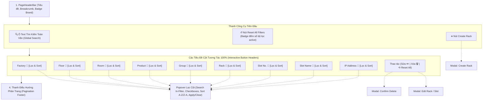

# KẾ HOẠCH TRIỂN KHAI GIAO DIỆN CẤU HÌNH RACK (`/config/rack`)

> **Tài liệu tham chiếu:** Plan đặc tả kiến trúc và thiết kế giao diện cho màn hình Cấu Hình Tủ Rack (Rack Configuration Dashboard & Management).  
> **Áp dụng cho route:** `/config/rack` (thuộc nhóm menu **CONFIG / CẤU HÌNH HỆ THỐNG -> RACK -> RACK CONFIG**).  
> **Component đích:** `src/features/config/rack/RackConfigPage.jsx`.  
> **Đặc tả kiến trúc:** Thiết kế theo mô hình **Module Hóa Tối Đa (Component-Driven Architecture)** — Phân tách độc lập Thanh công cụ tìm kiếm & tác vụ (`RackFilterToolbar.jsx`), Bảng dữ liệu cấu hình Rack với bộ lọc tương tác trên từng tiêu đề cột (`RackTable.jsx` kết hợp `RackColumnFilterDropdown.jsx`), Phân trang (`RackPagination.jsx`), Modal tạo mới và chỉnh sửa (`RackFormModal.jsx`), Modal xác nhận xóa (`RackDeleteModal.jsx`), và Custom Hook quản lý dữ liệu (`useRackConfigData.js`).  
> **Ngày khởi tạo:** 06/11/2026.  
> **Ngày cập nhật:** 07/11/2026 (Nâng cấp tiêu đề các cột trên bảng hỗ trợ bộ lọc và sắp xếp Excel-style).  
> **Vị trí tài liệu:** `src/md/RACK_CONFIG_PLAN.md` (đồng bộ tại `md/RACK_CONFIG_PLAN.md`).

---

## 1. TỔNG QUAN VÀ MỤC TIÊU DỰ ÁN

Trong hệ thống nhà máy thông minh công nghệ cao (Foxconn & NVIDIA Smart Factory), các tủ Rack mạng và Rack máy chủ tự động đóng vai trò là hạ tầng xương sống kết nối hàng trăm trạm máy AutoLine, thiết bị biên Edge Computing, bộ điều khiển PLC, Switch công nghiệp và khay chứa GPU/Server.

Màn hình **Rack Configuration (`/config/rack`)** là nơi kỹ sư mạng và kỹ sư tích hợp hệ thống cấu hình, định danh và giám sát sơ đồ vị trí vật lý đến từng slot cắm và địa chỉ IP của thiết bị.

### Mục Tiêu Cốt Lõi:
1. **Quản lý phân tầng vật lý chuẩn xác**: Định vị rõ vị trí từ cấp Nhà máy (`factory`) -> Tầng (`floor`) -> Phòng xưởng (`room`) -> Dòng sản phẩm (`product`) -> Nhóm chuyền (`group`) -> Tủ Rack (`rack`) -> Vị trí khe (`slot_number`, `slot_name`).
2. **Quản lý kết nối mạng (`ip_address`)**: Gán và kiểm soát địa chỉ IP tương ứng của từng slot để đảm bảo liên lạc thông suốt trong hệ thống mạng nội bộ xưởng sản xuất.
3. **Tìm kiếm tức thời & Bộ lọc tiêu đề cột tương tác (Excel-style Column Filter)**:
   - Cung cấp ô tìm kiếm từ khóa toàn văn (Search Text) hỗ trợ tra cứu nhanh toàn bộ bảng.
   - **Tất cả các tiêu đề cột đều có thể tương tác**: Click vào bất kỳ tiêu đề cột nào để mở Popover lọc giá trị duy nhất (kèm checkbox, ô tìm kiếm nội bộ, sắp xếp A-Z / Z-A).
   - Nút **Reset filter** trên thanh công cụ và trên Header cột Thao tác (kèm badge đếm số lượng bộ lọc đang active) giúp xóa trắng mọi điều kiện lọc chỉ với 1 click.
4. **Tạo mới tủ Rack / Slot linh hoạt (`Create rack`)**: Cho phép thêm mới nhanh tủ Rack kèm khai báo thông số định vị và cấu hình mạng qua Modal giao diện trực quan.
5. **Thao tác nhanh trên từng bản ghi (Row Actions)**: Mỗi hàng dữ liệu được tích hợp sẵn 2 nút thao tác tiện dụng:
   - **Nút Sửa (`Edit`)**: Cập nhật thông số slot, nhóm, IP hoặc phòng ban.
   - **Nút Xóa (`Delete`)**: Xóa bản ghi cấu hình kèm hộp thoại cảnh báo an toàn tránh thao tác nhầm.
6. **Hỗ trợ phân trang hoàn chỉnh (Data Pagination)**: Phân chia dữ liệu gọn gàng theo trang (10, 20, 50, 100 dòng/trang), đảm bảo hiệu năng tải trang và trải nghiệm người dùng mượt mà.
7. **Tương thích hoàn hảo 2 hệ thống màu thương hiệu**: Chế độ sáng Foxconn (Navy/Slate) và chế độ tối NVIDIA Cyberpunk (Zinc Dark / Neon Green `#76B900`).

---

## 2. BỐ CỤC KHÔNG GIAN VÀ SƠ ĐỒ GIAO DIỆN (WIREFRAME)

### 2.1. Sơ đồ Luồng Hoạt Động (Architecture Flow):



---

### 2.2. Wireframe Chi Tiết Bố Cục Trang:

```text
┌────────────────────────────────────────────────────────────────────────────────────────────────────────────────────────┐
│ CONFIG / RACK / RACK CONFIG                                                                          [⛶ Fullscreen]   │
│ RACK CONFIGURATION                                                                    [Badge: MASTER RACK]             │
│ Quản lý thiết lập vị trí nhà máy, tầng, phòng, sản phẩm, nhóm, tủ rack, khe cắm slot và địa chỉ IP mạng               │
├────────────────────────────────────────────────────────────────────────────────────────────────────────────────────────┤
│ [THANH CÔNG CỤ TRÊN ĐẦU: TÌM KIẾM, RESET FILTER & CREATE RACK]                                                         │
│                                                                                                                        │
│ ┌──────────────────────────────────────────────────┐   ┌──────────────────────┐   ┌────────────────────────────────┐   │
│ │ 🔍 Tìm kiếm theo rack, slot, ip, factory...      │   │  [↺ Reset Filter (2)]│   │  [➕ Create Rack]              │   │
│ └──────────────────────────────────────────────────┘   └──────────────────────┘   └────────────────────────────────┘   │
├────────────────────────────────────────────────────────────────────────────────────────────────────────────────────────┤
│ [BẢNG DỮ LIỆU CẤU HÌNH RACK - INTERACTIVE HEADER FILTERING TABLE]                                                      │
│                                                                                                                        │
│ ┌──────────────┬────────────┬────────────┬─────────────┬────────────┬────────────┬────────────┬─────────────┬──────────┬──────┐│
│ │[Factory ⏷ 2] │[Floor ⏷]   │[Room ⏷]    │[Product ⏷ 1]│[Group ⏷]   │[Rack ⏷]    │[Slot No. ⏷]│[Slot Name ⏷]│[IP Addr⏷]│⟲Reset││
│ ├──────────────┼────────────┼────────────┼─────────────┼────────────┼────────────┼────────────┼─────────────┼──────────┼──────┤│
│ │ F01 - BG     │ 2F         │Cleanroom 01│ NVIDIA H100 │ Group A    │ RCK-A01    │ 01         │ SLOT-GPU-01 │192.168...│✏️  🗑️││
│ │ F01 - BG     │ 2F         │Cleanroom 01│ NVIDIA H100 │ Group A    │ RCK-A01    │ 02         │ SLOT-GPU-02 │192.168...│✏️  🗑️││
│ │ F01 - BG     │ 2F         │Cleanroom 01│ NVIDIA H200 │ Group B    │ RCK-A02    │ 01         │ SLOT-SW-01  │192.168...│✏️  🗑️││
│ │ F02 - QVO    │ 1F         │SMT Shop 02 │ GB200 NVL72 │ Group SMT  │ RCK-B03    │ 12         │ SLOT-PLC-04 │10.12.3...│✏️  🗑️││
│ │ F02 - QVO    │ 3F         │Server Lab C│ Hopper Super│ Group ICT  │ RCK-C08    │ 24         │ SLOT-TST-02 │172.16....│✏️  🗑️││
│ └──────────────┴────────────┴────────────┴─────────────┴────────────┴────────────┴────────────┴─────────────┴──────────┴──────┘│
│       │                                                                                                                │
│       └──► [POPOVER BỘ LỌC CỘT: FACTORY (CLICK VÀO TIÊU ĐỀ ĐỂ MỞ)]                                                     │
│            ┌────────────────────────────────────────────────────────────┐                                              │
│            │ 🔍 [Tìm kiếm giá trị trong cột...]                         │                                              │
│            │ [x] Chọn tất cả                        [ Bỏ chọn tất cả ]  │                                              │
│            │ ┌────────────────────────────────────────────────────────┐ │                                              │
│            │ │ [x] F01 - Bắc Giang                                (8) │ │                                              │
│            │ │ [x] F02 - Quế Võ                                   (4) │ │                                              │
│            │ │ [ ] F03 - Bình Dương                               (3) │ │                                              │
│            │ │ [ ] F06 - Vĩnh Phúc                                (1) │ │                                              │
│            │ └────────────────────────────────────────────────────────┘ │                                              │
│            │ [ 🔤 Sắp xếp A ➔ Z ]            [ 🔤 Sắp xếp Z ➔ A ]       │                                              │
│            │ [ ✕ Bỏ lọc cột ]                [ ✓ Áp dụng (2 giá trị) ]  │                                              │
│            └────────────────────────────────────────────────────────────┘                                              │
│                                                                                                                        │
│ [THANH PHÂN TRANG - PAGINATION FOOTER]                                                                                 │
│ Hiển thị 1 - 10 trên tổng số 128 bản ghi          Số dòng/trang: [10 ⏷]   Trang: [⏮] [◀]  [ 1 ] [ 2 ] [ 3 ] [▶] [⏭]    │
└────────────────────────────────────────────────────────────────────────────────────────────────────────────────────────┘
```

---

## 3. ĐẶC TẢ CHI TIẾT CÁC THÀNH PHẦN GIAO DIỆN

### 3.1. Phần Đầu Trang (Page Header Bar)

- **Breadcrumbs:** `CONFIG` > `RACK` > `RACK CONFIG` (kết nối trực tiếp với Menu điều hướng Sidebar).
- **Tiêu đề lớn:** `RACK CONFIGURATION` (chữ in hoa đậm, cỡ chữ `text-xl` đến `text-2xl`).
- **Badge định danh:** `MASTER RACK` với hiệu ứng màu nhận diện theo Theme:
  - Theme Foxconn: Viền xanh Navy, nền lam nhạt `bg-blue-50 text-blue-800 border-blue-200`.
  - Theme NVIDIA: Viền xanh neon `#76B900`, nền tối `bg-[#76B900]/10 text-[#76B900] border-[#76B900]/30 shadow-[0_0_12px_rgba(118,185,0,0.2)]`.
- **Mô tả tính năng:** _"Quản lý thiết lập vị trí nhà máy, tầng, phòng, sản phẩm, nhóm, tủ rack, khe cắm slot và địa chỉ IP mạng."_

---

### 3.2. Thanh Công Cụ Trên Đầu (Top Filter & Action Bar)

Khu vực công cụ được bố trí thành một thanh ngang linh hoạt (`flex flex-col sm:flex-row items-center justify-between gap-3 p-4 rounded-2xl`):

| Phần tử                                  | Kiểu điều khiển            | Đặc tả hiển thị & Trạng thái                                                                                                                                                                                                                                                                       | Tương tác người dùng                                                                                                           |
| :--------------------------------------- | :------------------------- | :------------------------------------------------------------------------------------------------------------------------------------------------------------------------------------------------------------------------------------------------------------------------------------------------- | :----------------------------------------------------------------------------------------------------------------------------- |
| **Ô text tìm kiếm**<br>_(Search Input)_  | `<input type="text" />`    | • Icon kính lúp ở đầu ô (`M21 21l-6-6m2-5a7 7 0 11-14 0 7 7 0 0114 0z`)<br>• Placeholder: `Tìm kiếm theo rack, slot, ip, factory...`<br>• Nút xóa nhanh chữ `✕` khi ô có ký tự.<br>• Hỗ trợ debounce 300ms tối ưu hiệu năng.                                                                       | Người dùng gõ từ khóa, danh sách bảng sẽ tức thời lọc theo thời gian thực (realtime) dựa trên tất cả các trường dữ liệu.       |
| **Nút Reset Filter**<br>_(Reset Button)_ | `<button type="button" />` | • Icon mũi tên xoay tròn `↺`<br>• Nhãn chữ: `Reset Filter`<br>• Huy hiệu hiển thị tổng số cột đang được lọc (`activeFilterCount`).<br>• Hiệu ứng ánh sáng cảnh báo khi đang có ít nhất 1 bộ lọc cột active.                                                                                     | Khi nhấn nút, toàn bộ giá trị trong ô tìm kiếm và tất cả bộ lọc trên từng tiêu đề cột lập tức bị xóa sạch, quay về trang 1.     |
| **Nút Create Rack**<br>_(Action Button)_ | `<button type="button" />` | • Icon dấu cộng tròn `➕`<br>• Nhãn chữ: `Create Rack` (hoặc `Thêm Mới Rack`)<br>• Màu chủ đạo:<br> - Foxconn: Xanh navy `bg-[#002766] hover:bg-[#003893] text-white shadow-md`<br> - NVIDIA: Xanh neon `bg-[#76B900] hover:bg-[#86d400] text-black font-extrabold shadow-lg shadow-[#76B900]/25`. | Khi nhấn nút, mở popup Modal `RackCreateModal` để người dùng điền biểu mẫu thêm mới thông tin rack và slot.                    |

---

### 3.3. Bảng Dữ Liệu Cấu Hình Rack Với Bộ Lọc Tiêu Đề Cột (Interactive Header Filtering Table)

Bảng dữ liệu hiển thị toàn bộ 9 trường dữ liệu theo yêu cầu cùng cột Thao tác quản trị. **Đặc biệt, 100% tiêu đề các cột dữ liệu đều là nút tương tác thông minh cho phép thực hiện lọc và sắp xếp trực tiếp (Excel-style Column Header Filter):**

|  STT   | Tên Cột (Header) | Tên Trường | Kiểu Điều Khiển Tiêu Đề | Đặc Tả Bộ Lọc & Sắp Xếp Trên Tiêu Đề Cột |
| :----: | :--- | :--- | :--- | :--- |
| **1**  | **Factory** | `factory` | Nút Popover Lọc Cột | • Checkbox lọc theo danh sách nhà máy: `F01 - Bắc Giang`, `F02 - Quế Võ`, `F03 - Bình Dương`, `F06 - Vĩnh Phúc`.<br>• Sắp xếp tên nhà máy A ➔ Z hoặc Z ➔ A. |
| **2**  | **Floor** | `floor` | Nút Popover Lọc Cột | • Checkbox lọc theo tầng lầu: `1F`, `2F`, `3F`, `4F`, `B1`.<br>• Sắp xếp theo số tầng. |
| **3**  | **Room** | `room` | Nút Popover Lọc Cột | • Tìm kiếm & Checkbox phòng ban: `Cleanroom 01`, `SMT Workshop 02`, `Server Lab C`...<br>• Sắp xếp theo tên phòng. |
| **4**  | **Product** | `product` | Nút Popover Lọc Cột | • Checkbox lọc theo dòng sản phẩm: `NVIDIA H100`, `NVIDIA H200`, `GB200 NVL72`, `Hopper Super`...<br>• Sắp xếp theo tên sản phẩm. |
| **5**  | **Group** | `group` | Nút Popover Lọc Cột | • Checkbox lọc theo nhóm chuyền: `Group A (SMT)`, `Group B (Testing)`, `Group ICT`, `Group AGV`...<br>• Sắp xếp tên nhóm. |
| **6**  | **Rack** | `rack` | Nút Popover Lọc Cột | • Tìm kiếm nhanh mã tủ Rack: `RCK-A01`, `RCK-A02`, `RCK-B03`, `RCK-C08`...<br>• Checkbox từng mã tủ kèm số lượng slot.<br>• Sắp xếp theo mã tủ. |
| **7**  | **Slot No.** | `slot_number` | Nút Popover Lọc Cột | • Checkbox lọc theo số thứ tự slot (`01`, `02`, `12`, `24`...).<br>• Sắp xếp tăng dần / giảm dần theo số. |
| **8**  | **Slot Name** | `slot_name` | Nút Popover Lọc Cột | • Tìm kiếm theo tên kỹ thuật của slot: `SLOT-GPU-01`, `SLOT-SW-01`, `SLOT-PLC-04`...<br>• Sắp xếp theo tên slot. |
| **9**  | **IP Address** | `ip_address` | Nút Popover Lọc Cột | • Tìm kiếm nhanh theo dải IP / Subnet.<br>• Lọc checkbox theo IP tĩnh thiết bị.<br>• Sắp xếp theo địa chỉ mạng. |
| **10** | **Thao tác**<br>_(Actions)_ | `actions` | Nút Reset & Nút Thao Tác | • **Trên Header cột:** Nút **`⟲ Reset`** nhanh kèm badge đếm tổng số bộ lọc cột đang kích hoạt.<br>• **Trên từng dòng:** Cặp 2 nút **Sửa (`Edit`)** và **Xóa (`Delete`)**. |

---

### 3.4. Đặc Tả Chi Tiết Popover Lọc Tiêu Đề Cột (`RackColumnFilterDropdown`)

Khi người dùng nhấn vào bất kỳ tiêu đề cột nào trên bảng, một Popover chuyên dụng (`RackColumnFilterDropdown`) sẽ xuất hiện ngay phía dưới tiêu đề đó với đầy đủ các tính năng:

1. **Thanh tìm kiếm nội bộ (Search In-Filter):** Cho phép gõ lọc nhanh các giá trị có trong cột (rất hữu ích khi có hàng chục mã tủ Rack, IP hoặc tên Slot khác nhau).
2. **Chọn tất cả / Bỏ chọn tất cả (Select All / Clear All):**
   - Checkbox "Chọn tất cả": Chọn nhanh toàn bộ các giá trị đang hiển thị.
   - Nút "Bỏ chọn tất cả": Bỏ chọn nhanh toàn bộ để chọn lại từ đầu.
3. **Danh sách giá trị duy nhất (Unique Values Checklist):**
   - Tự động trích xuất các giá trị không trùng lặp từ bộ dữ liệu.
   - Mỗi mục hiển thị kèm số lượng bản ghi thực tế xuất hiện trong bảng, ví dụ: `[x] NVIDIA H100 (6)`, `[ ] GB200 NVL72 (3)`.
4. **Cụm nút sắp xếp nhanh (Quick Sort Buttons):**
   - Nút `[🔤 Sắp xếp A ➔ Z]` (Tăng dần).
   - Nút `[🔤 Sắp xếp Z ➔ A]` (Giảm dần).
5. **Cụm nút thực thi (Action Buttons):**
   - Nút **"Bỏ lọc cột này" (Clear Column Filter):** Xóa bộ lọc của riêng cột hiện tại và đóng Popover.
   - Nút **"Áp dụng" (Apply Filter):** Kích hoạt lọc danh sách theo các giá trị đã chọn, hiển thị badge số lượng giá trị đang chọn trên tiêu đề cột (ví dụ: `Factory [2]`).
6. **Hỗ trợ đóng Popover thông minh:** Tự động đóng khi nhấn phím `Escape` hoặc khi click chuột ra bên ngoài vùng Popover (`Click Outside`).

---

### 3.5. Đặc Tả Chi Tiết 2 Nút Thao Tác (Sửa & Xóa)

#### A. Nút Sửa (Edit Action):
- **Giao diện nút:** Icon Edit kèm chữ `Sửa`.
- **Hành vi tương tác:**
  1. Khi click, mở modal chỉnh sửa **`RackFormModal`** (mode edit).
  2. Toàn bộ thông tin của dòng hiện tại (`factory`, `floor`, `room`, `product`, `group`, `rack`, `slot_number`, `slot_name`, `ip_address`) được bind sẵn vào các trường nhập liệu.
  3. Người dùng cập nhật thông tin và bấm **"Lưu thay đổi" (Save Changes)**.
  4. Hệ thống kiểm tra hợp lệ dữ liệu -> Cập nhật danh sách -> Hiển thị Toast thành công.

#### B. Nút Xóa (Delete Action):
- **Giao diện nút:** Icon Trash kèm chữ `Xóa` màu đỏ.
- **Hành vi tương tác:**
  1. Khi click, mở hộp thoại xác nhận **`RackDeleteModal`** (Confirm Dialog).
  2. Cảnh báo hiển thị rõ ràng: *"Bạn có chắc chắn muốn xóa cấu hình Slot **[slot_name]** thuộc tủ **[rack]** tại nhà máy **[factory]** không? Hành động này không thể hoàn tác."*
  3. Cung cấp 2 lựa chọn: **Hủy bỏ (Cancel)** và **Xác nhận xóa (Confirm Delete)**.

---

### 3.6. Phần Chân Trang Phân Trang (Pagination Footer)

Thanh phân trang nằm cố định phía dưới bảng (`flex flex-col sm:flex-row items-center justify-between gap-4 py-4 px-6`):
- **Thống kê tổng quan:** Hiển thị `Hiển thị [Từ] - [Đến] trên tổng số [Tổng số] bản ghi`.
- **Tùy chọn số lượng bản ghi trên một trang (Page Size Selector):**
  - Dropdown: `10 dòng/trang`, `20 dòng/trang`, `50 dòng/trang`, `100 dòng/trang`.
- **Cụm nút điều hướng trang (Pagination Controls):**
  - Nút Về trang đầu `[⏮ First]`, Trang trước `[◀ Prev]`, Danh sách số trang `[1]`, `[2]`, `...`, Trang kế `[Next ▶]`, Trang cuối `[Last ⏭]`.

---

## 4. MÔ HÌNH DỮ LIỆU & SCHEMA (DATA STRUCTURE)

### 4.1. TypeScript Interface / Kiểu Dữ Liệu:

```typescript
export interface RackConfigItem {
  id: string | number;           // Khóa chính duy nhất của bản ghi
  factory: string;               // Nhà máy (vd: 'F01 - Bắc Giang')
  floor: string;                 // Tầng (vd: '2F')
  room: string;                  // Phòng/xưởng (vd: 'Cleanroom 01')
  product: string;               // Sản phẩm (vd: 'NVIDIA H100')
  group: string;                 // Nhóm chuyền (vd: 'Group A (SMT)')
  rack: string;                  // Mã tủ Rack (vd: 'RCK-A01')
  slot_number: number;           // Vị trí Slot (vd: 1, 2, 12, 24)
  slot_name: string;             // Tên Slot (vd: 'SLOT-GPU-01')
  ip_address: string;            // Địa chỉ IPv4 (vd: '192.168.1.101')
  status?: 'ACTIVE' | 'OFFLINE' | 'MAINTENANCE'; // Trạng thái hoạt động
  created_at?: string;           // Thời điểm tạo
  updated_at?: string;           // Thời điểm cập nhật cuối
}
```

---

## 5. KIẾN TRÚC MÃ NGUỒN VÀ TỔ CHỨC THƯ MỤC

Tuân thủ nghiêm ngặt mô hình module hóa và chuẩn cấu trúc của dự án Enterprise:

```text
src/features/config/rack/
├── components/
│   ├── RackFilterToolbar.jsx          # Thanh công cụ: Search input, Nút Reset Filter, Nút Create Rack
│   ├── RackTable.jsx                  # Bảng hiển thị 9 trường dữ liệu với Interactive Header Filter
│   ├── RackColumnFilterDropdown.jsx   # Popover lọc giá trị trên tiêu đề cột (Excel-style)
│   ├── RackPagination.jsx             # Phân trang hoàn chỉnh (Page size, Prev/Next/Numbers)
│   └── modals/
│       ├── RackFormModal.jsx          # Modal thêm mới và chỉnh sửa cấu hình tủ Rack & Slot
│       └── RackDeleteModal.jsx        # Hộp thoại modal xác nhận xóa an toàn
├── constants/
│   └── rackConfigConstants.js         # Danh mục dropdown options, default values, table columns
├── hooks/
│   └── useRackConfigData.js           # Custom Hook: State quản lý danh sách, filter cột, search, CRUD, pagination
├── mock/
│   └── rackConfigMockData.js          # Dữ liệu giả lập 15 - 30 bản ghi chuẩn Foxconn / NVIDIA
└── RackConfigPage.jsx                 # Trang chính kết hợp các module con
```

---

## 6. ĐẶC TẢ CHI TIẾT CÁC COMPONENT CON

### 6.1. Component `RackFilterToolbar.jsx`
- **Props nhận vào:**
  - `searchTerm: string`: Từ khóa tìm kiếm hiện tại.
  - `onSearchChange: (value: string) => void`: Hàm xử lý khi người dùng gõ tìm kiếm.
  - `onResetFilter: () => void`: Hàm xử lý khi bấm nút **Reset filter**.
  - `onCreateRack: () => void`: Hàm kích hoạt mở Modal **Create rack**.
  - `totalResults: number`: Tổng số kết quả tìm thấy sau khi lọc.
  - `activeFilterCount: number`: Tổng số bộ lọc cột đang kích hoạt.
- **Hành vi:**
  - Cung cấp ô text input kích thước lớn, dễ bấm.
  - Có icon xóa nhanh (clear button) khi ô text có nội dung.
  - Hai nút `[↺ Reset Filter]` (có badge đếm số bộ lọc active) và `[➕ Create Rack]` phân biệt rõ cấp độ ưu tiên.

### 6.2. Component `RackTable.jsx` (Interactive Header Filtering)
- **Props nhận vào:**
  - `data: Array<RackConfigItem>`: Danh sách các bản ghi hiển thị trên trang hiện tại.
  - `startIndex: number`: Vị trí bản ghi bắt đầu.
  - `columnFilters: Record<string, string[]>`: Trạng thái các giá trị đang lọc của từng cột.
  - `sortConfig: { field: string, direction: 'asc' | 'desc' }`: Trạng thái sắp xếp hiện tại.
  - `onApplyColumnFilter: (columnId: string, values: string[]) => void`: Hàm áp dụng lọc cho 1 cột.
  - `onClearColumnFilter: (columnId: string) => void`: Hàm xóa lọc của 1 cột.
  - `onResetAllFilters: () => void`: Hàm đặt lại toàn bộ bộ lọc cột và ô tìm kiếm.
  - `onSort: (columnId: string, direction?: 'asc' | 'desc') => void`: Hàm sắp xếp theo cột.
  - `getUniqueValuesForColumn: (columnId: string) => Array<{ value: string, count: number }>`: Hàm trích xuất giá trị duy nhất và số lượng bản ghi.
  - `onEdit: (item: RackConfigItem) => void`: Callback khi bấm nút **Sửa**.
  - `onDelete: (item: RackConfigItem) => void`: Callback khi bấm nút **Xóa**.
- **Đặc tả hiển thị:**
  - 100% tiêu đề cột dữ liệu là nút bấm tương tác (`Interactive Header Button`) mở Popover lọc.
  - Hiển thị badge số lượng lọc và icon chiều sắp xếp (▲/▼/⇅) trên từng tiêu đề.
  - Nút `⟲ Reset` trên Header cột Thao tác kèm badge đếm tổng số cột đang được lọc.
  - Trạng thái trống (Empty State) hiển thị khi không có kết quả khớp bộ lọc kèm nút CTA *"Đặt lại toàn bộ bộ lọc"*.

### 6.3. Component `RackColumnFilterDropdown.jsx` (Excel-style Header Filter Popover)
- **Props nhận vào:**
  - `column: { id: string, label: string }`: Thông tin cột đang mở popover.
  - `uniqueValues: Array<{ value: string, count: number }>`: Danh sách giá trị duy nhất trong cột kèm số lượng.
  - `selectedValues: string[]`: Danh sách các giá trị đang được chọn lọc.
  - `sortConfig: { field: string, direction: 'asc' | 'desc' }`: Trạng thái sắp xếp.
  - `onApplyFilter: (columnId: string, values: string[]) => void`: Callback khi nhấn "Áp dụng".
  - `onClearFilter: (columnId: string) => void`: Callback khi nhấn "Bỏ lọc cột".
  - `onSort: (columnId: string, direction: 'asc' | 'desc') => void`: Callback sắp xếp nhanh A-Z / Z-A.
  - `onClose: () => void`: Callback đóng popover (hỗ trợ Click Outside & phím Escape).
- **Giao diện & Chức năng:**
  - Ô tìm kiếm nội bộ giá trị trong cột (`Search In-Filter`).
  - Nút "Chọn tất cả" và "Bỏ chọn tất cả".
  - Checklist các giá trị duy nhất với checkbox và số đếm `(count)`.
  - Hai nút sắp xếp: `[🔤 A ➔ Z]` và `[🔤 Z ➔ A]`.
  - Nút "Bỏ lọc cột" và nút "Áp dụng (X)".

### 6.4. Component `RackPagination.jsx`
- **Props nhận vào:**
  - `currentPage: number`: Trang hiện tại (1-based index).
  - `pageSize: number`: Số bản ghi mỗi trang (10, 20, 50, 100).
  - `totalRecords: number`: Tổng số lượng bản ghi thỏa mãn bộ lọc.
  - `onPageChange: (newPage: number) => void`: Callback chuyển trang.
  - `onPageSizeChange: (newSize: number) => void`: Callback đổi số dòng/trang.

### 6.5. Component `RackFormModal.jsx` (Tích hợp Tạo mới & Chỉnh sửa)
- Các trường biểu mẫu: `factory`, `floor`, `room`, `product`, `group`, `rack`, `slot_number`, `slot_name`, `ip_address`.
- Hỗ trợ validate IP regex, slot number > 0.

---

## 7. ĐẶC TẢ GIAO DIỆN THEO 2 THƯƠNG HIỆU (DUAL THEME SPECS)

| Thuộc tính Giao diện | Theme Foxconn (Light Mode) | Theme NVIDIA (Dark Mode) |
| :--- | :--- | :--- |
| **Nền tổng thể trang** | `bg-slate-50 text-slate-800` | `bg-zinc-950 text-zinc-100` |
| **Khung Toolbar & Table Card** | `bg-white border-slate-200 shadow-sm` | `bg-zinc-900/60 border-zinc-800 shadow-xl` |
| **Header Bảng (Table Head)** | `bg-slate-100/95 text-slate-700 border-b border-slate-200` | `bg-zinc-950/95 text-zinc-300 border-b border-zinc-800` |
| **Tiêu đề cột đang Active Filter** | `bg-blue-100 text-[#002766] border-blue-400 font-black` | `bg-zinc-800 text-[#76B900] border-[#76B900]/70 font-black` |
| **Popover Lọc Cột** | `bg-white border-slate-200 text-slate-800 shadow-2xl` | `bg-zinc-900 border-zinc-700 text-white shadow-2xl` |
| **Dòng dữ liệu (Table Row)** | `hover:bg-slate-50 border-b border-slate-100` | `hover:bg-zinc-800/40 border-b border-zinc-800/50` |
| **Nút Create Rack (Primary)** | `bg-[#002766] hover:bg-[#003893] text-white` | `bg-[#76B900] hover:bg-[#86d400] text-black font-extrabold shadow-[0_0_15px_rgba(118,185,0,0.3)]` |
| **Nút Reset Filter** | `bg-slate-100 hover:bg-slate-200 text-slate-700 border-slate-300` | `bg-zinc-800 hover:bg-zinc-700 text-zinc-200 border-zinc-700` |

---

## 8. KẾ HOẠCH TRIỂN KHAI VÀ THỰC THI (ACTION ITEMS)

- [x] **Bước 1**: Cập nhật tài liệu đặc tả `src/md/RACK_CONFIG_PLAN.md` và đồng bộ sang `md/RACK_CONFIG_PLAN.md`.
- [x] **Bước 2**: Xây dựng component Popover lọc cột `RackColumnFilterDropdown.jsx` chuẩn Excel-style.
- [x] **Bước 3**: Nâng cấp Custom Hook `useRackConfigData.js` hỗ trợ `columnFilters`, `getUniqueValuesForColumn`, `sortConfig`, `handleSort`, `activeFilterCount`.
- [x] **Bước 4**: Nâng cấp Component `RackTable.jsx` tích hợp các nút bấm tiêu đề cột tương tác, mở popover lọc và hiển thị trạng thái sắp xếp.
- [x] **Bước 5**: Kiểm thử tính tương thích trên cả 2 theme Foxconn & NVIDIA và chạy `npm run build` xác thực tính toàn vẹn (Pass 100%).
