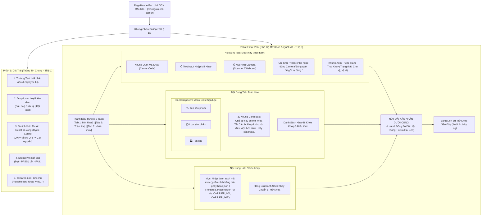

# KẾ HOẠCH TRIỂN KHAI GIAO DIỆN MỞ KHÓA CARRIER (UNLOCK CARRIER - `/config/unlock-carrier`)

> **Tài liệu tham chiếu:** Plan đặc tả kiến trúc và thiết kế giao diện cho màn hình Mở Khóa Khay Mang Hàng & Nghiệm Thu Kiểm Định Vòng Đời (Carrier Unlock & Life-cycle Inspection Studio).  
> **Áp dụng cho route:** `/config/unlock-carrier` (và `/unlock-carrier`) (thuộc nhóm menu **CONFIG / CẤU HÌNH HỆ THỐNG -> CARRIER -> UNLOCK CARRIER**).  
> **Component đích:** `src/features/config/carrier/components/unlock_carrier/UnlockCarrierPage.jsx`.  
> **Thư mục chức năng:** `src/features/config/carrier/`  
> **Bố cục giao diện:** Chia cột theo tỉ lệ **1:3** (Phần 1: Khung Thông Tin Chung; Phần 3: Hệ thống 3 Tabs Quét Khay, Camera/Súng quét Barcode và Nút Xác nhận lưu tổng hợp).  
> **Ngày khởi tạo:** 09/11/2026.  
> **Vị trí tài liệu:** `src/md/UNLOCK_CARRIER_PLAN.md` (đồng bộ tại `md/UNLOCK_CARRIER_PLAN.md`).

---

## 1. TỔNG QUAN VÀ BỐI CẢNH DỰ ÁN

Trong dây chuyền sản xuất tự động hóa Smart Factory (Foxconn & NVIDIA AI Server Systems), các khay chứa bo mạch và module GPU AI (như HGX H100, H200, GB200 NVL72) di chuyển liên tục qua các trạm (SMT, Screw Auto, Pressfit, Testing). 

Mỗi khay mang hàng (Carrier / Tray / Pallet) được quản lý theo dõi số vòng tuần hoàn sử dụng (Cycle Count) và độ phẳng bề mặt (Coplanarity Deviation). Khi khay đạt giới hạn chu kỳ quy định (ví dụ 2,000 chu kỳ), bị sai lệch cơ khí hoặc gặp sự cố cảm biến, hệ thống AutoLine PLC sẽ tự động kích hoạt trạng thái **`LOCKED` (Cưỡng bức khóa khay)** để ngăn ngừa rủi ro hư hỏng linh kiện giá trị cao.

Màn hình **Unlock Carrier (`/config/unlock-carrier`)** là module chuyên trách giúp kỹ sư kiểm định chất lượng (QC Inspector) và kỹ thuật viên bảo trì (Maintenance Technician):
1. **Kiểm tra và nghiệm thu tình trạng khay**: Khai báo mã nhân viên, lựa chọn loại kiểm định và kết quả Đạt / Lỗi.
2. **Quản lý chu kỳ vòng đời (Cycle Count Management)**: Cung cấp nút switch dạng viên thuốc cho phép thiết lập lại (Reset) số vòng chu kỳ về 0 sau khi bảo trì hoặc duy trì chu kỳ hiện tại.
3. **Thao tác quét linh hoạt theo tỷ lệ 1:3**:
   - **Bên 1 (Tỉ lệ 1 - Thông tin chung)**: Cố định các thông số nghiệm thu của lượt kiểm định.
   - **Bên 3 (Tỉ lệ 3 - Thao tác quét khay)**: 3 Tab chức năng riêng biệt:
     - **Một khay (Single Carrier)**: Nhập mã khay, kích hoạt Camera/Súng quét tự động gửi dữ liệu khi bấm Enter.
     - **Toàn line (Whole Line)**: Hỗ trợ mở khóa toàn bộ các khay đang bị khóa trên một chuyền sản xuất.
     - **Nhiều khay (Batch Carriers)**: Nhập hoặc quét danh sách nhiều khay liên tiếp.
4. **Nút xác nhận dài trải rộng**: Đồng bộ hóa dữ liệu từ cả hai bên (Thông tin chung + Dữ liệu khay) để lưu trữ vào lịch sử nhật ký (Audit Log) và truyền lệnh mở khóa đến PLC/MES.
5. **Đồng bộ nhận diện thương hiệu kép (Dual-Theme)**: Hỗ trợ giao diện sáng Foxconn (Navy/Slate) và giao diện tối NVIDIA Cyberpunk (Zinc Dark / Neon Green `#76B900`).

---

## 2. BỐ CỤC KHÔNG GIAN VÀ SƠ ĐỒ GIAO DIỆN (WIREFRAME)

### 2.1. Sơ đồ Luồng Hoạt Động (Architecture Flowchart):



---

### 2.2. Wireframe Chi Tiết Giao Diện (ASCII Wireframe):

```text
┌────────────────────────────────────────────────────────────────────────────────────────────────────────────────────────┐
│ CONFIG / CARRIER / UNLOCK CARRIER                                                                     [⛶ Fullscreen]   │
│ UNLOCK CARRIER                                                                             [Badge: CARRIER AUDIT]      │
│ Mở khóa và kiểm định trạng thái khay mang hàng (Carrier), cập nhật chu kỳ vòng đời và lưu trữ nhật ký kiểm tra          │
├────────────────────────────────────────────────────────────────────────────────────────────────────────────────────────┤
│ [BỐ CỤC CHIA TỈ LỆ 1:3 - MASTER DETAIL WORKSPACE]                                                                      │
│ ┌──────────────────────────────────────────────┐ ┌──────────────────────────────────────────────────────────────────┐ │
│ │ [PHẦN 1: THÔNG TIN CHUNG (TỈ LỆ 1)]          │ │ [PHẦN 3: CHẾ ĐỘ MỞ KHÓA & QUÉT MÃ (TỈ LỆ 3)]                    │ │
│ │                                              │ │ ┌──────────────────────────────────────────────────────────────┐ │ │
│ │ 👤 Mã nhân viên:                             │ │ │  [★ MỘT KHAY]    │    [TOÀN LINE]    │    [NHIỀU KHAY]       │ │ │
│ │ ┌──────────────────────────────────────────┐ │ │ └──────────────────────────────────────────────────────────────┘ │ │
│ │ │ V1029384 - Nguyễn Văn A                  │ │ │                                                                  │ │
│ │ └──────────────────────────────────────────┘ │ │ 🎯 QUÉT MÃ KHAY (CARRIER CODE)                                    │ │
│ │                                              │ │ ┌───────────────────────────────────────────────┐ ┌────────────┐ │ │
│ │ 📋 Loại kiểm định:                           │ │ │ Nhập hoặc quét mã khay (ví dụ: CRR-A089)...   │ │  [ 📷 CAM ]│ │ │
│ │ ┌──────────────────────────────────────────┐ │ │ └───────────────────────────────────────────────┘ └────────────┘ │ │
│ │ │ [▼] Đầu ca (shift start)                 │ │ │ 💡 Nhấn enter hoặc dùng Camera/Súng quét để gửi tự động.          │ │
│ │ └──────────────────────────────────────────┘ │ │                                                                  │ │
│ │                                              │ │ ┌──────────────────────────────────────────────────────────────┐ │ │
│ │ 🔄 Reset số vòng (cycle count):              │ │ │ 📦 THÔNG TIN KHAY ĐÃ QUÉT (LIVE PREVIEW)                     │ │ │
│ │    (●──────) BẬT (Reset chu kỳ về 0)         │ │ │ • Mã khay: CRR-A089          • Line: Line01 (SMT-Mount-01)   │ │
│ │                                              │ │ │ • Trạng thái: [LOCKED]       • Số vòng: 2,000 / 2,000 (100%) │ │
│ │ 📊 Kết quả kiểm định:                        │ │ │ • Lý do khóa: Đã đạt 100% định mức chu kỳ cơ học tối đa      │ │
│ │ ┌──────────────────────────────────────────┐ │ │ └──────────────────────────────────────────────────────────────┘ │ │
│ │ │ [▼] Đạt (Pass)                           │ │ │                                                                  │ │
│ │ └──────────────────────────────────────────┘ │ │ ┌──────────────────────────────────────────────────────────────┐ │ │
│ │                                              │ │ │ 🕒 NHẬT KÝ MỞ KHÓA GẦN ĐÂY (5 LƯỢT GẦN NHẤT)                  │ │ │
│ │ 📝 Ghi chú:                                  │ │ │ Thời gian   │ Mã khay   │ NV      │ Loại       │ Reset │ K.Quả│ │ │
│ │ ┌──────────────────────────────────────────┐ │ │ │ 08:32:15    │ CRR-B012  │ V1029384│ Đầu ca     │ CÓ    │ ĐẠT  │ │ │
│ │ │ Nhập lý do...                            │ │ │ │ 08:15:40    │ CRR-C099  │ V109281 │ Đột xuất   │ KHÔNG │ ĐẠT  │ │ │
│ │ │                                          │ │ │ └──────────────────────────────────────────────────────────────┘ │ │
│ │ └──────────────────────────────────────────┘ │ │                                                                  │ │
│ │                                              │ │ ┌──────────────────────────────────────────────────────────────┐ │ │
│ │                                              │ │ │ [✔] XÁC NHẬN MỞ KHÓA & LƯU THÔNG TIN (CONFIRM & SAVE)        │ │ │
│ │                                              │ │ └──────────────────────────────────────────────────────────────┘ │ │
│ └──────────────────────────────────────────────┘ └──────────────────────────────────────────────────────────────────┘ │
└────────────────────────────────────────────────────────────────────────────────────────────────────────────────────────┘
```

---

## 3. ĐẶC TẢ CHI TIẾT CÁC THÀNH PHẦN GIAO DIỆN

### 3.1. Phần 1 (Cột Trái - Tỉ lệ 1): Thông Tin Chung (`UnlockGeneralInfoCard`)

Cột bên trái chiếm tỷ lệ 1 (khoảng 25% - 30% bề ngang trên màn hình máy tính để bàn `lg:col-span-1`), chứa form nhập liệu cố định cho lượt kiểm định:

| STT | Tên trường | Loại điều khiển (Control Type) | Tùy chọn / Định dạng | Ràng buộc & Ghi chú |
|:---:|:---|:---|:---|:---|
| **1** | **Mã nhân viên** | Text input (`<input type="text">`) | Chuỗi ký tự (Ví dụ: `V1029384`, `EMP-8809`) | Bắt buộc (Required). Tự động điền nếu đã có phiên đăng nhập của người dùng. |
| **2** | **Loại kiểm định** | Dropdown Menu (`<select>` hoặc custom) | Gồm 3 lựa chọn:<br>1. **Đầu ca (`shift_start`)**<br>2. **Định kỳ (`periodic`)**<br>3. **Đột xuất (`manual`)** | Bắt buộc. Mặc định là `Đầu ca (shift start)`. |
| **3** | **Reset số vòng (cycle count)** | Switch dạng viên thuốc (Pill Toggle Switch) | **Bật (ON)**: Reset chu kỳ về 0.<br>**Tắt (OFF)**: Giữ nguyên số chu kỳ hiện tại. | Khi Bật, có hiệu ứng chuyển màu rực rỡ và ghi chú phụ nhắc nhở kỹ thuật viên. |
| **4** | **Kết quả kiểm định** | Dropdown Menu (`<select>` hoặc custom) | Gồm 2 trạng thái:<br>1. **Đạt (`PASS`)** (Màu xanh lá `#10B981` / `#76B900`)<br>2. **Lỗi (`FAIL`)** (Màu đỏ `#EF4444`) | Bắt buộc. Quyết định trạng thái mở khóa thành công hay chuyển sang trạng thái chờ xử lý lại. |
| **5** | **Ghi chú** | Textarea lớn (`<textarea rows={4}>`) | Placeholder: `Nhập lý do...` | Cho phép nhập tối đa 500 ký tự. Cung cấp các nút gắn nhãn nhanh (Quick Tags) như: *Bảo dưỡng định kỳ*, *Vệ sinh khay*, *Cân chỉnh dung sai*, *Thay đệm cao su*. |

---

### 3.2. Phần 3 (Cột Phải - Tỉ lệ 3): Chế Độ Mở Khóa & Quét Mã Khay

Cột bên phải chiếm tỷ lệ 3 (khoảng 70% - 75% bề ngang `lg:col-span-3`), gồm các khối chức năng chính:

#### A. Thanh điều hướng 3 Tabs (`UnlockCarrierTabsNav`):
* **Tab 1: Một khay (Single Carrier)** *(Active mặc định)*: Chuyên dùng cho kỹ sư thao tác quét và mở khóa từng khay đơn lẻ tại bàn kiểm tra QC.
* **Tab 2: Toàn line (Whole Line)**: Chuyên dùng cho trưởng ca mở khóa hàng loạt toàn bộ khay trên một chuyền sản xuất khi bắt đầu ca làm việc hoặc sau khi bảo trì toàn tuyến.
* **Tab 3: Nhiều khay (Multiple Carriers)**: Chuyên dùng cho quét liên tiếp theo lô khay hoặc dán danh sách mã khay từ file danh sách kiểm tra.

#### B. Nội dung Tab 1: "Một khay" (`SingleCarrierScannerTab`):
1. **Tiêu đề khối**: `Quét mã khay (carrier code)` với icon Barcode/RFID nổi bật.
2. **Ô nhập mã khay**:
   - Trường input kích thước lớn, font chữ monospace in đậm, viền nổi bật.
   - Placeholder: `Nhập hoặc quét mã khay (ví dụ: CRR-A089, TRAY-01)...`
   - Nút xóa nhanh `(X)` khi có nội dung.
   - Bắt sự kiện phím `Enter`: Khi người dùng nhập xong và gõ Enter, hệ thống tự động tìm kiếm thông tin khay và đưa vào danh sách xác nhận ngay lập tức.
3. **Ô nút hình Camera (Camera Scanner Trigger)**:
   - Đặt ngay sát cạnh bên phải của ô input.
   - Icon Camera sắc nét với viền bo tròn thẩm mỹ.
   - Khi click vào nút Camera:
     - Mở modal quét mã `CameraScannerModal` với khung ngắm camera (Viewfinder scanner), tia laser đỏ quét ngang trực quan.
     - Cho phép nhận diện trực tiếp qua Webcam/Camera thiết bị hoặc mô phỏng quét barcode thông minh.
4. **Dòng ghi chú hướng dẫn**:
   - Dòng text đặt ngay bên dưới cụm input + camera:
   > 💡 **Ghi chú:** *Nhấn enter hoặc dùng Camera/Súng quét để gửi tự động.*
   - Kèm biểu tượng phím `↵ Enter` và biểu tượng súng quét Laser Barcode.
5. **Khung thông tin khay sau khi quét (Live Preview Card)**:
   - Khi mã khay hợp lệ được nhận diện, khung xem trước tự động hiển thị:
     - Tên khay (`carrierCode`), Loại khay (`carrierType`), Mã RFID.
     - Vị trí hiện tại (`lineName`, `stationName`, `productName`).
     - Trạng thái khóa (`LOCKED`), Lý do bị khóa (`lockReason`).
     - Số vòng chu kỳ hiện tại / định mức (`currentCycles` / `maxCycles`), Thanh tiến trình % hao mòn.
     - Sai lệch dung sai bề mặt (`coplanarityDeviation`).

#### C. Nội dung Tab 2: "Toàn line" (`WholeLineScannerTab`):
1. **Khung Cảnh Báo An Toàn Trên Cùng (Safety Warning Banner)**:
   - Đặt trên cùng của giao diện Tab Toàn line, thiết kế nổi bật với tông màu hổ phách/cam vàng hoặc viền đỏ cảnh báo (`bg-amber-500/10 border-amber-500/30 text-amber-500` hoặc dark mode `bg-amber-950/40 border-amber-700/80 text-amber-300`).
   - Có biểu tượng cảnh báo tam giác `⚠️` kích thước lớn.
   - **Nội dung cảnh báo chính xác**:
     > ⚠️ **CẢNH BÁO:** *Chế độ này sẽ mở khóa Tất Cả các khay khớp với điều kiện bên dưới. Hãy cẩn trọng.*
   - **Ý nghĩa vận hành**: Đảm bảo kỹ thuật viên nhận thức rõ phạm vi ảnh hưởng hàng loạt trước khi bấm xác nhận, ngăn chặn việc vô tình mở khóa các khay đang có lỗi cơ khí hoặc chưa hoàn tất kiểm định an toàn.

2. **Bộ 3 mục Dropdown Menu điều kiện lọc (3 Filter Dropdown Selectors)**:
   - Đặt ngay bên dưới khung cảnh báo, bố trí dạng lưới 3 cột trực quan (`grid-cols-1 md:grid-cols-3 gap-3`):
     * **1. Tên sản phẩm (Product Name)**: Dropdown menu chọn dòng sản phẩm (ví dụ: `Tất cả sản phẩm`, `GB200 NVL72`, `B200 HGX`, `H100 SXM5`...).
     * **2. Loại sản phẩm / Loại khay (Product Type / Carrier Type)**: Dropdown menu chọn loại cấu trúc khay (ví dụ: `Tất cả loại sản phẩm`, `GPU Component Tray`, `Assembly Pallet B`, `AI Server Base Tray`...).
     * **3. Tên line (Line Name)**: Dropdown menu chọn tên chuyền sản xuất (ví dụ: `Tất cả line`, `Line01`, `Line02`, `Line03`...).

3. **Danh Sách Khay Khớp Điều Kiện & Thống Kê**:
   - Tự động hiển thị tổng số khay đang bị khóa khớp đồng thời cả 3 tiêu chí lọc trên.
   - Nút **Chọn tất cả khay / Bỏ chọn tất cả** kèm chỉ số đếm `(đã chọn / tổng số)`.
   - Danh sách chi tiết các khay khớp điều kiện kèm thông số chu kỳ sử dụng, trạm làm việc, và lý do bị khóa để người vận hành kiểm tra đối chiếu trước khi thực hiện mở khóa.

#### D. Nội dung Tab 3: "Nhiều khay" (`BatchCarrierScannerTab`):
1. **Mục Nhập Danh Sách Mã Máy (Textarea Input)**:
   - **Tên mục hiển thị**: `Nhập danh sách mã máy ( phân cách bằng dấu phẩy hoặc json )`
   - **Loại điều khiển**: Trường văn bản lớn (`<textarea rows={4}>`), định dạng font chữ monospace in đậm, bo góc viền thẩm mỹ tương thích dual-theme.
   - **Placeholder chính xác**: `Ví dụ: CARRIER_001, CARRIER_002`
   - **Cơ chế bóc tách dữ liệu thông minh (Smart Parser)**:
     - *Phân cách bằng dấu phẩy*: Ví dụ `CARRIER_001, CARRIER_002, CRR-A089...`
     - *Phân cách bằng dấu xuống dòng*: Mỗi mã máy / mã khay nằm trên một dòng riêng.
     - *Định dạng JSON*:
       * Dạng mảng chuỗi (Array of strings): `["CARRIER_001", "CARRIER_002", "CRR-A089"]`
       * Dạng mảng đối tượng (Array of objects): `[{"carrierCode": "CARRIER_001"}, {"carrierCode": "CARRIER_002"}]`
   - Nút hành động: **+ Thêm vào hàng đợi (Add to Queue)** tự động phân tích cú pháp, trích xuất mã hợp lệ, chuẩn hóa chữ in hoa và loại bỏ khoảng trắng thừa.

2. **Hàng Đợi Danh Sách Khay Chuẩn Bị Mở Khóa (Scan Queue Table)**:
   - Hiển thị danh sách các mã khay hợp lệ đã bóc tách được (STT, Mã khay/Mã máy, Chuyền, Chu kỳ, Nút xóa từng mục).
   - Tự động loại bỏ các mã trùng lặp (Deduplication).
   - Hiển thị tổng số lượng khay sẵn sàng mở khóa trước khi bấm nút xác nhận.

#### E. Nút dài xác nhận dưới cùng (Full-Width Confirm Action Button):
* Đặt cố định ở chân trang hoặc đáy của khung bên 3, trải dài toàn bộ chiều rộng.
* **Tiêu đề nút**: `XÁC NHẬN MỞ KHÓA & LƯU THÔNG TIN (CONFIRM & SAVE)`
* **Quy trình xử lý khi nhấn nút**:
  1. Kiểm tra validation: Mã nhân viên không được rỗng, đã có ít nhất một mã khay được quét, loại kiểm định hợp lệ.
  2. Gom toàn bộ thông tin từ cả 2 bên:
     - **Bên 1**: Mã NV, Loại kiểm định, Reset số vòng (Có/Không), Kết quả (Đạt/Lỗi), Ghi chú.
     - **Bên 3**: Danh sách mã khay đã quét, chế độ mở khóa (Một khay/Toàn line/Nhiều khay).
  3. Cập nhật trạng thái khay trong hệ thống (Nếu Đạt -> chuyển từ `LOCKED` sang `ACTIVE`; Nếu bật Reset số vòng -> đặt `currentCycles = 0`).
  4. Ghi nhận bản ghi vào Bảng Lịch Sử Mở Khóa Gần Đây (`RecentUnlockHistoryTable`).
  5. Bật Floating Toast thông báo thành công màu xanh lá.
  6. Tự động reset ô quét mã khay và focus lại ô input sẵn sàng cho lượt quét kế tiếp.

---

## 4. THIẾT KẾ DỮ LIỆU & QUẢN LÝ TRẠNG THÁI (DATA SCHEMA & STATE)

### 4.1. Data Schema cho Form Thông Tin Chung:

```typescript
interface UnlockGeneralInfoForm {
  employeeId: string;                     // Mã nhân viên kiểm định (ví dụ: 'V1029384')
  inspectionType: 'shift_start' | 'periodic' | 'manual'; // Loại kiểm định
  resetCycleCount: boolean;               // True: Reset số vòng về 0; False: Giữ nguyên
  result: 'PASS' | 'FAIL';                // Đạt hoặc Lỗi
  note: string;                           // Lý do kiểm định / mở khóa
}
```

### 4.2. Data Schema cho Bản Ghi Lịch Sử Mở Khóa (Audit Record):

```typescript
interface UnlockAuditRecord {
  id: string;                             // Mã bản ghi: 'UNL-20261109-001'
  timestamp: string;                      // Thời gian thực hiện: '2026-11-09 08:35:12'
  employeeId: string;                     // Mã nhân viên
  carrierCode: string;                    // Mã khay được mở khóa
  lineName: string;                       // Tên chuyền sản xuất
  inspectionType: 'shift_start' | 'periodic' | 'manual';
  resetCycleCount: boolean;               // Có reset chu kỳ hay không
  previousCycles: number;                 // Số vòng trước khi reset
  result: 'PASS' | 'FAIL';                // Đạt hay Lỗi
  note: string;                           // Lý do ghi nhận
  statusAfter: 'ACTIVE' | 'LOCKED';       // Trạng thái sau mở khóa
}
```

---

## 5. DANH MỤC COMPONENT VÀ CẤU TRÚC THƯ MỤC

Toàn bộ mã nguồn tính năng được tổ chức mô đun hóa chuẩn mực trong thư mục `src/features/config/carrier/`:

```text
src/features/config/carrier/
├── components/
│   ├── unlock_carrier/
│   │   ├── UnlockCarrierPage.jsx              # [Trang Chính] Bố cục Master-Detail tỷ lệ 1:3
│   │   ├── UnlockGeneralInfoCard.jsx          # [Bên 1] Thẻ thông tin chung (5 trường nhập liệu)
│   │   ├── UnlockCarrierTabsNav.jsx           # [Bên 3] Thanh điều hướng 3 Tabs (Một khay / Toàn line / Nhiều khay)
│   │   ├── SingleCarrierScannerTab.jsx        # [Bên 3 - Tab 1] Quét mã khay + Nút Camera + Ghi chú + Preview khay
│   │   ├── WholeLineScannerTab.jsx            # [Bên 3 - Tab 2] Lựa chọn Line và mở khóa toàn chuyền
│   │   ├── BatchCarrierScannerTab.jsx         # [Bên 3 - Tab 3] Quét danh sách nhiều khay liên tiếp
│   │   ├── RecentUnlockHistoryTable.jsx       # [Bên 3] Bảng nhật ký mở khóa 5-10 lượt gần nhất
│   │   └── CameraScannerModal.jsx             # [Modal] Giả lập khung hình camera quét mã vạch trực quan
├── hooks/
│   └── useUnlockCarrier.js                    # [Custom Hook] Quản lý toàn bộ State, Form, Validation, Scanner & Submit
├── mock/
│   └── unlockCarrierMockData.js               # [Mock Data] Danh sách dữ liệu khay bị khóa & lịch sử mẫu
└── CarrierConfigPage.jsx                      # Trang quản lý cấu hình Carrier hiện tại (/config/carrier)
```

---

## 6. QUY CHUẨN THIẾT KẾ ĐA GIAO DIỆN (DUAL-THEME SPECIFICATION)

| Thành phần giao diện | Giao diện Foxconn (Light / Navy Slate) | Giao diện NVIDIA (Dark / Cyberpunk Neon) |
|:---|:---|:---|
| **Nền trang chính** | `bg-slate-50 text-slate-800` | `bg-zinc-950 text-zinc-100` |
| **Thẻ khối bên 1 & 3** | `bg-white border-slate-200 shadow-xs` | `bg-zinc-900/70 border-zinc-800 shadow-xl backdrop-blur-md` |
| **Tiêu đề & Nhãn (Labels)** | `text-slate-800 font-bold` | `text-zinc-100 font-bold` |
| **Text input & Textarea** | `bg-slate-50 border-slate-300 text-slate-800 focus:bg-white focus:border-[#002766]` | `bg-zinc-950/80 border-zinc-700 text-zinc-100 focus:border-[#76B900]` |
| **Switch Viên Thuốc (BẬT)** | `bg-[#002766]` kèm thumb trắng trượt | `bg-[#76B900] shadow-[0_0_12px_rgba(118,185,0,0.4)]` kèm thumb đen |
| **Switch Viên Thuốc (TẮT)** | `bg-slate-300` | `bg-zinc-700` |
| **Ô nút Camera** | `bg-blue-50 text-[#002766] border-blue-200 hover:bg-blue-100` | `bg-[#76B900]/15 text-[#76B900] border-[#76B900]/40 hover:bg-[#76B900]/25` |
| **Nút Xác nhận dài dưới cùng** | `bg-[#002766] hover:bg-[#003893] text-white shadow-lg active:scale-[0.99]` | `bg-[#76B900] hover:bg-[#86d400] text-black font-black shadow-[0_0_20px_rgba(118,185,0,0.35)] active:scale-[0.99]` |
| **Badge Trạng thái Đạt (PASS)** | `bg-emerald-100 text-emerald-800 border-emerald-300` | `bg-emerald-950/80 text-emerald-300 border-emerald-700` |
| **Badge Trạng thái Lỗi (FAIL)** | `bg-red-100 text-red-800 border-red-300` | `bg-red-950/80 text-red-300 border-red-700` |

---

## 7. CẤU HÌNH ROUTING VÀ MENU ĐIỀU HƯỚNG

Để đảm bảo người dùng truy cập được từ cả Menu thanh bên và URL trực tiếp:
1. `src/routes/routesConfig.jsx`:
   - Route chuẩn: `/config/unlock-carrier` -> `<UnlockCarrierPage />`
   - Route tương thích: `/unlock-carrier` -> Chuyển hướng hoặc render `<UnlockCarrierPage />`
2. `src/utils/Menu.jsx`:
   - Đã khai báo đường dẫn: `path: '/config/unlock-carrier'` thuộc cụm menu Carrier.

---

## 8. KẾ HOẠCH TRIỂN KHAI & KIỂM THỬ (NEXT STEPS)

Khi người dùng duyệt và yêu cầu thực thi (`thực thi nhé`):
1. **Bước 1**: Khởi tạo file mock data `src/features/config/carrier/mock/unlockCarrierMockData.js` với các mã khay thực tế đang bị khóa và lịch sử mở khóa mẫu.
2. **Bước 2**: Xây dựng custom hook `src/features/config/carrier/hooks/useUnlockCarrier.js` xử lý toàn bộ logic form, toggle switch, camera simulation, submit và toast.
3. **Bước 3**: Triển khai các sub-components:
   - `UnlockGeneralInfoCard.jsx` (Cột 1).
   - `UnlockCarrierTabsNav.jsx`, `SingleCarrierScannerTab.jsx`, `WholeLineScannerTab.jsx`, `BatchCarrierScannerTab.jsx` (Cột 3).
   - `CameraScannerModal.jsx` (Modal camera).
   - `RecentUnlockHistoryTable.jsx` (Lịch sử mở khóa).
4. **Bước 4**: Hoàn thiện trang chính `src/features/config/carrier/components/unlock_carrier/UnlockCarrierPage.jsx`.
5. **Bước 5**: Đồng bộ routes trong `src/routes/routesConfig.jsx`.
6. **Bước 6**: Chạy kiểm tra bản dựng `npm run build` đảm bảo không phát sinh lỗi.

